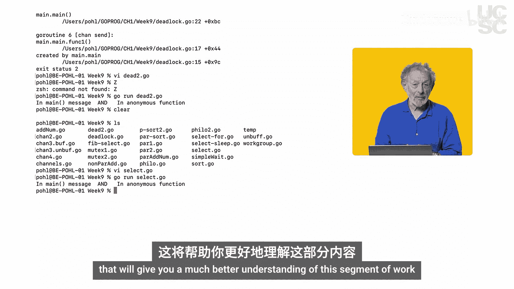

# 【加州大学】Go语言编程-｜-Go-Programming-Everyone-Part-2-p20-P20_select_04_01_04--BV1GTe7z3Eqi_p20-

So we've seen deadadlock。Very nasty problem。We don't want our programs to they luck。

 just like we don't want our programs to have infinite loops。

And a critical way to avoid deadlock is to use。Something called select select。Is。

A key word that's in go but not in C recall in some ways， go is a very modern version。

 C was 50 years ago and it did it。Have a few revisions。Chiefly in 1989。

 it was revised and given a new ansi document。 so most peoples。Who do see。Use largely C 1989。

 so even that's what 35 years ago。Now， of course， people have jumped off to newer languages like C++。

 so they have different ways to be modern， but the nice thing about C。Was it small。

The concepts were fairly clear， so that's still in heavy use。So the people who invented go。

 the team at Google。Were led by people who were largely the same people at Bell Labs。

Who had participated in developing eunuchs。And worked。In the early days with the sea language。

People like Thompson and Pike。And they didn't want a large number of keywords。

 but because they edit concurrency。And see， you don't have concurrency。 So see， you get concurrency。

By using special libraries like。Psic thread libraries。It gets added in in a library。

Go makes it a language feature， and in many ways that makes it simpler， it constrains it。

 but it makes it simpler。And。Besides using the keyword go。

 we already saw go is what launches a thread。Select is what else you decide what channels should have priority。

 Remember， we just experienced deadlock and the deadlock was。Two channels were， in effect。

 competing with each other， and they didn't know which to go first。 Now， we could， we fix the order。

 and then we got a result， but。And frequently。In the way we write a code， we won't notice that。

And select gives us a direct way。To avoid deadlock， by indicating。What channel should go first， Okay。

 let's see the syntax。We'll see that on the next slide of of the select statement。

 Select is very much like a case statement。 A case statement， of course。

 is some kind of generalization of what might be called an if statement。

Select will have a number of cases， it will use the keyword case。And then after the keyword case。

 you will have a send or receive expression。Now Senator Sp expression is just basically the use of a channel。

 so you'll see something that involves her channel。And then there'll be a colon。

And possibly a statement， the statement can be the empty statement。But in any case。

 the case will be the decision maker for what channel gets used。

Now you can have as many as you want cases， typically there might be as many cases as there are。

Channels or。How the channels get used。And on top of that， optionally。

 you can have a default statement， normally it's put last， and a default means， oh。

 if we didn't find any of the cases， if none of the cases were true。

Then we go to the false statement。The false statement most likely will be some。

Termination of the program because。You were expecting。Some channel selection， but you didn't find it。

 So that means things got confusing and you threw this in to。

Make sure that the program terminated with an appropriate me， so let's see an example。

Here's a select。There's a case。The case is the variable foo is getting a value from channel1， colon。

 nothing gets done， there's a case C2 gets a message that its message is from the variable boo。

And then there's a fault and the default is just saying。Print the line done。Now。

Several cases can be matched， so it's not necessarily the case。

If you recall in a switch statement and a switch statement works by looking at the first case。

Seeing if it's a match and then getting executed。In this case， all the cases have equal status。

If there's a match and more than one match。One is picked at random。So。You won't。

The logic of the program says， oh， if any of these cases get met。Use them。

 it doesn't matter which one you use because the program will go on it'll mean that's who goes next。

 that's the selection mechanism selection mechanism。Sits over a channel and says who goes next？

All right， so let's see a program。We have。Our previous program at deadedlocked。

 we have our two channels。And again， we have our anonymous function。Where we can print it。

 and then in Maine。So let's look at the next part。The second thread and the next slide。There。

We using a select， so the difference between this program and the program that Delocked was。We have。

A select。Inside the select。We're looking at a case。One of two cases。

 whichever is the case that's met。That gets executed。And then finally， we go and do our print。

And now we will not see Dlock， so。Let's just see if this will work。

 Let's see if it avoids Stlock as before， and let's now run this go。Okay。

 so here we are the terminal。And hopefully。The select。We' have fixed our program。

So we had that simple program， two channels。They both can have strings in them。

 we have our simple threaded function。Where we're putting a message called in anonymousous function。

So we distinguish who gets printed in Maine， we're going to say。In the main。Program。

And then here's the difference。So the sole difference between those two pieces of code was I inserted a select。

On the cases。And then。Need this line。And then we'll run this now and see whether it。Remember。

 the first time we ran this without a select， we had deadadlock， it blocked。And sure enough。We don't。

We don't have a deadlock situation。Select。Tells us， oh， take this as priority because I matched。That。

Expression， that case expression。On a channel expression。

 So there was a channel expression that was true。 It went and used that。

 and then it showed up and said in main message。And an anonymous function， it kept printed。So again。

 you can play with that。And you might even try to see if you can。

Redo the program so that both threads。Complete their print line。

You might have to throw in a weight group。But。Why don't you see if you can do that。

 that'll give you a much better understanding。Of this segment of work。

Okay。

