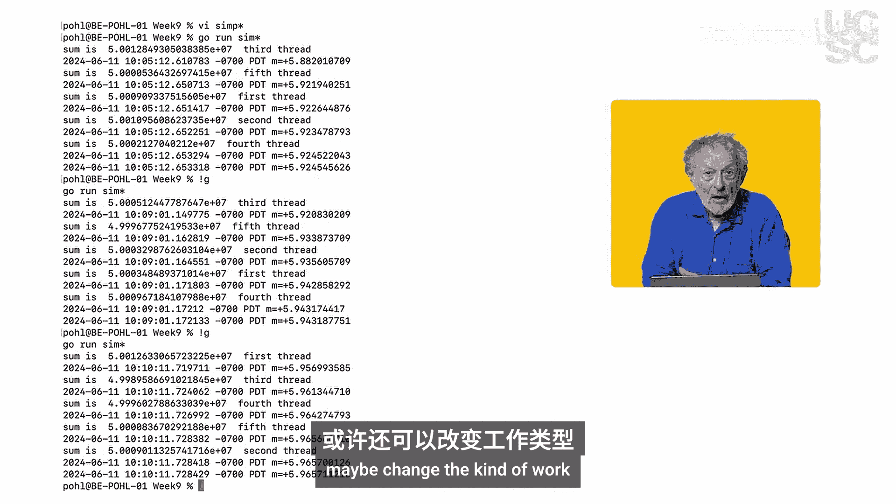

# 【加州大学】Go语言编程-｜-Go-Programming-Everyone-Part-2-p21-P21_等待组_04_01_05--BV1GTe7z3Eqi_p21-

So one of the important。Packages available。For doing concurrent programming and go it the sync package。

And the sync package has a crucial type that really helps。

When are you dealing with these difficult ideas of trying to run things concurrently without them？

Running is the problems like deadlock。So in the synchronization package。Or sync package。

The key element is called the S weight group。And that allows you to declare things that are very useful in。

Organizing the order in which。Threreading can be accomplished so that the threads don't interfere with each other。

 for example， there's also a muttex that's short for mutual exclusion， which can be used to。

Protect critical areas or critical resources from being。Used in an improper order。

And there's also things like locks and unlocks that work with the Mutexes。

Another thing is another call is done。When certain things are over。

 when the use of the mutex is done。Now， in this particular program。

 the first one that we will discuss， we will use a very standard theme where we use a weight group and we declare something to。

Be the weight group and the weight group is used。To keep track of how many threads。are。

Working concurrently， and the idea is if the work group is saying there are two， three。

 whatever number of threads involved。Well， we have to keep going， but。At some point。

 the threads complete their task。And you decrement the weight group。And the weight group can go to 0。

 And when the weight group goes to 0， we can complete the。

Synchronization process and finish off the execution of the program normally occurring towards the end of Maine。

Okay， so in this particular example， we will focus on a weight group， so let's see our next slide。

Inside the weight group we have。Particular operations。

 so we have an ad and we use an integer and the integer tells us if we are going to use more threads。

We have done， as I mentioned， which also will decrement。The thread counter。

 So think of the thread counter as more processes going on Currentlyly， we add。

More processes getting concluded。 we use done， and it decrements by one。 and then。

The weight counter itself， the weight operation just waits for the counter to hit zero so that the operations。

 you know， the operations are all concluded。Okay。Let's see this in working， so first off。

 let's get some serious work， so to speak。呃。Frequently， when we show these examples。

 you'll see if you use other。Literature or view some other。

Discussions of this that the examples are simplified by。

Showing you something where the function just bends its wheels。 In other words。

 it calls time and takes a certain number of seconds。 and that's supposed to simulate a work。

 But here we're going to show you what you might consider real work。

 So we're going to have a very large slice or in this case， an array because we give it an actual。

Fixed。Number of elements in this case， it's 10 million。

 so I have 10 million floating point pieces of update。 and you can imagine that。

In a big system where there's lots of data and you want to process it and you want to sometimes use。

Multiple cores， well， if you can。Chop up the job and do the work on different segments of the data。

 you're going to get an improvement。In your running time。

So you'll get some efficiency out of this kind of concurrency because you're actually going to see some parallelism。

Okay， now we're going to take that data， the data is going to be generated by the random number generator。

So when we call RA of float 64， we get numbers between zero and1 floating point numbers。

 so we want numbers between0 and 10， so we'll multiply them by floating point number 10。

 and that'll be our data， that's our simulated data。And then。

The job we're going to see is we're going to sum that data now you could do all sorts of things to the data。

Imagine you want to take。A standard deviation on the data and the data represents a series of experiments in in the world。

 and you need different statistics on it。 So that would also be possible。

 but here we're just going to。Return the sun and one use here is。

If you consider that the random number generator。Is working properly。

And what should be the average number？Well， the average number is going to be somewhere between zero and 10。

And if it's a normal random generating function， on average， we expect that to be five。Okay。

 if it's5， then what's that ultimate sum going to be， Well。

 it's going to be somewhere in the range of  five times 10 million。

 So that's what we expect as a result， All right。Now here we have。

The main where we're going to call that working function。 and first off。We declare a weight group。

 so the weight group is going to track。The threading。We're going to initiate some threading。

Where the work gets done with that。Call to some。And we're going to add。Five， so we're going to。

When we say workgroup。 add 5， we mean there should be five threads that we'll be using in this process。

Then we call an anonymous function。And in that anonymous function。We're going to call。呃。

Our adding function。And notice that the very first thing we do is we defer。Weight group do done。

So recall what done does， Dun decrements the weight group number。 So when the thread is completed。

The weight group variable in this case， WG will have an integer contained in it that's one less than before。

And we use the fur， if you recall what the fur does， is the fur just says。Execute this。

But you can execute this。At some later time。But it guarantees that you get it executed。

 So it's a good mechanism。For making sure， the code。

That you won't forget to do the decrement that Dun is supposed to do for you。Okay。

 so then we're going to。That go routine is launching a thread and I also am including a print of time dot now in there and the reason I'm including that is that I want you to see when I run the program later on。

How。This kind of program actually runs in real time here we see again， a threaded anonymous function。

In that go function again， we're using this idea of deferring。And that's a common idiom。

 so that is something to get used to， especially when you have resources， you have resources。Ingo。

 for example， channels and threads。You might have files and it's appropriate when you're done with them to tell the operating system I'm done。

And you can。Make sure to do that right at the top of a function when you say， okay。

 this function is going to end up。Using a resource， and then it'll be done。

 and then you can use the fur on whatever is involved like done or sometimes you use a closed function。

Okay， so here again。We're having a second thread just like before。And in that second thread。

 we're also printing its time。And we're also calling add sum。So print line is going to print sum is。

 and then we're going to be able to see what that sum is for the second of them。

 And then we repeat this。 So basically， the code has five of these。

 Each one of those anonymous functions， are internally calling add sum。

 which is really doing the work。But we set off five threads and each。

Single go function has a done in it。 so we'll have five of them。Why don't we look at the next slide。

 I think we'll see the rest of them， so you see a further two of them， and after those two。

 what do we see， we see wg。weight， so that's critical again。

 think of this as an idiom to do concurrency。We have individual threats doing jobs， in this case。

 the same job。And。Each thread has a done in it。At the beginning。

 we had an ad for the number of threads we're going to use。And then at the very end， in Maine。

 we call WG Wait， what's what you're going to wait for。Well， wait's going to wait for。

Everything being。Accomplished where the thread count gets down to 0。If you didn't have a wait there。

What would happen？What would happen is don't forget Maine itself is a threat。

 so really there are five threads doing work， and then there's overall Maine organizing things。

And the main thread。Is also concurrent if the weight wasn't there。

The main thread would go ahead and print that time do now。

And it would do it quickly because the other work is taking real work。

And that would be the end of the program， so you wouldn't actually see the work done。

 so the idiom is。Create in the work group， typically WG is a typical identifier。And。Do an ad。

 put in the number of threads， do your work concurrently， and then call Wg。

 Wait and that should end it。Okay。So。Let us see how the running times worked。

 That's why use time debt now。 Time debt now gets you the internal clock that tells you how long your。

Pieceace of code is running and we will run these programs。And see how long it takes。

And you can experiment on your own machine， you can actually see if there's an improvement。

In doing it this way over， for example， eliminating all the threading and just doing。

That's summing five different times in a big loop。And hopefully， on a modern machine。

Using the go algorithms， the internal operating system algorithms that Go uses for scheduling。

Your course。There may be a speed up。Okay， so let's turn to my computer now。

So here's our program on my Mac。It's a fairly new Mac， so it has， I believe。

 the M2 processor and that has。Multiple cores， so in fact， you can get some real parallelism。

Notice what I'm importing， I'm importing format， of course， map out Rand。

That package gets me the random number routine in this case。

 I'm going to use it to generate floating point numbers。Time because I'm going to be timing。呃。

How fast this runs on my machine， so you'll see that different on your machine。

And then sink and sink is where all that good stuff is to help you with concurrency。

Here's my function。Again， it returns to float 64 because all I'm doing is ammaning a very large number of numbers。

 in this case， 10 million numbers。Now， first off， the 10 million numbers are going to be data and they're going to be data。

That is 10 times what ordinarily ran float 64 returns。

 Rdo float64 returns the number between a floating point number between0 and1。

 so this will return floating point numbers between 0 and 10。And then we're going to do the sum。

 so we have this work overall。We're doing。あ。Tens of millions of operations。

 the machine is running tens of millions of operations to accomplish this function。Then in Maine。

Again， remember， this is the critical idiom。Concurrency is hard。So the way to master it。

 much like ordinary programming is， let's say when you got to a hard part。

 something that was new for you。 For example， the use of a for statementment with a slice。 Oh， O。

 you see how it's done in one case。And then there's so many other cases that。Basically。而。

Just variations on that critical idiom。So program mastery， you don't have to reinvent the wheel。

 if you have a good way of doing something， you can stick with it。

 just make sure you have some of these idioms downpat that you've used them。

 and I recommend you go off and try this on other things that you invent so you can invent a different function and add some。

You can use more threads than I will use here。WG， I've just chosen WG as identifier because。

Weight group， so WG， you could choose some other identifier like thread number。And then Wg。t add5。

That's a standard function in that weight group package。

And it's just telling the system that I expect to use。Five。

 the counter is now going to be set at five。 The threat counter is being set at five。

Then each of these。Anonymous go routines。First， they're doing it deferwg。gu。

Recall that's a decrement on WG。So that。Subtracts one from the internal value of WG。

Which has started off at five。And then we're calling add some internally in this。

And that's the first thread。And then we're timing it。

And then we're repeating and we're the only difference between these。呃。Five go functions。Is that。

I'm telling you which thread is doing the work， so when you see a sum printed out， you'll see， oh。

 this sum is such and such produced by this thread。And there should be five of them。

 because that's what we're。Starting。And then crucial to the idiom is at the end of the program。

 which is typically。One of the last statements。Of。The main。

Is you call Wg with weight and weight is waiting on Wg getting to but value。0。And again。

 the only thing I want to do after that is print the total time。That the code is taken。Okay。So。

Hopefully is the law work。Let's do a run。Now it's taking a few seconds。Remember。

 I'm asking it to do tens of millions of operations。When I was first。呃。Long time ago in school。

In the 60s， if you had set this on a huge IBM mainframe。This may have taken hours。

That's how much improvement there is。So even though there was a pause in doing the work。

 it's awfully fast。For the amount of operations you just saw。 Now， look。

 what's the first thing it gets printed out， Some is 5。001284， et cetera，10 to the seventh。Well。

 that's roughly。What we expected。Right， that's 50 million and a little more。

So we're adding all of those random numbers between zero and one。

 if they truly are random and uniformly distributed in that。Region。That's。

Gives us some confidence that our random number generator for floats is working appropriately。 Now。

 notice that was the third thread。 Don't forget which thread did I launch first， I launched。

 at least when you look in the code。The go thread that was launched first。Was the first thread。Well。

 what's happening is as a scheduler， the scheduler is going and saying， oh， you start on this。

 you start on that， you start on this。And since there's very little effort between them and they're all taking roughly the same time。

啊。You can expect。That in different cases， these will occur in different times。

 but that's what's critical about threading and concurrency。

We don't care that this is occurring at a different place。

We don't care that the third one went first。That's the nature of the fact that we decided to use。

A concurrent scheme in this computation。And then I print out some time。And。

The fifth thread completed next。Then the first thread， then the second thread and the fourth thread。

 and then they're all done and you get the final time and that's roughly 5。

9 seconds to do all this work。Now。嗯。Looking at the answers we see。They were roughly equivalent。

 This was 5，0，0，0，5，3，6。 That was 5，0，0，0，9。 That was 5，0，0，1。 That was 50，0，2。

 It's interesting that let me run that again。Now， will we expect the same result。No。

 why won't we expect the same result？Because we're using a random number generator。

That might start at a different point in the sequence。And。Also。

 the order in which the threads complete。Might be different， so let's see if this happens。Again。

 you notice the five seconds， right， one， two， three bang。Well， again。

 the third threat completed first。The fifth thread completed second。

The only difference in the order of threading between these two is in this case。

 we had the second thread completing before the first thread in the first case。

 the first thread completed before the second thread so you can see there's a little difference in the scheduler。

And then， on top of that。Notice one of these results was 4。999 and we would expect。

Just like something would be slightly over。呃。50 million。

 something would be slightly under 50 million， but that still gives us confidence because it's very close to 50 million that we got it right。

I'll just do it one more time。so this time the first thread completed ahead the third of all the others。

 so we had the first， the third， the fourth， the fifth and the second in that order so again you can see that when you have tasks that are。

It's essentially the same work。The scheduler distributing it to several processors。

Doesn't guarantee that always the。That they finish in the order that you've basically assigned the task there's just not enough difference。

Clock difference。And so instead， you get some kind of randomness there。

 But you don't get a randomness in the result。 You get a true result。 And again。

 there were two results here that are 4。9 and two results，3 results that were a little over 5。

 So we have confidence that。This is computing it and computing it correctly。All right。

 so all I suggest now is you go and play with this。

 change a very a variety of things like the number of threads， run it on your own machine。

 change the size of the problem so that you can see that it scales up properly。

 maybe change the kind of work。All right。

