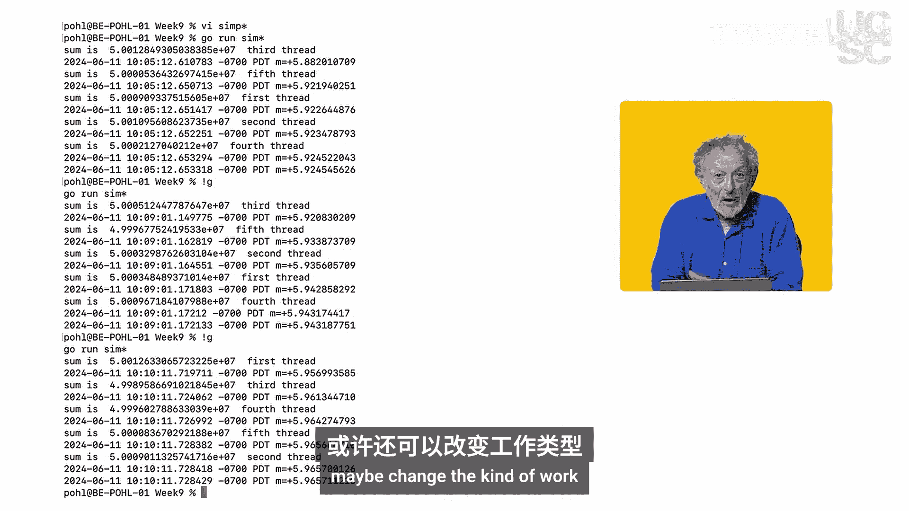

# Go语言编程：P21：等待组 (WaitGroup) 🧵


在本节课中，我们将要学习Go语言`sync`包中的一个重要工具——**等待组 (WaitGroup)**。它用于协调多个并发执行的goroutine，确保主程序在所有goroutine完成工作后才继续执行，从而避免程序过早结束或产生竞态条件。

---

## 概述

上一节我们介绍了并发编程的基本概念。本节中我们来看看如何使用`sync.WaitGroup`来管理多个goroutine的同步执行。我们将通过一个计算密集型任务（对一个大数组求和）的实例，演示如何利用`WaitGroup`实现并发计算并等待所有任务完成。

---

## 关键概念：sync.WaitGroup

`sync`包是Go语言中进行并发编程的重要工具包。其中，`sync.WaitGroup`类型对于管理并发执行顺序、防止线程间相互干扰（如死锁）至关重要。

`WaitGroup`的核心作用是跟踪正在执行的goroutine数量。它的工作方式就像一个计数器：
*   当启动一个新的goroutine时，我们**增加 (Add)** 计数器。
*   当一个goroutine完成工作时，我们**减少 (Done)** 计数器。
*   主程序可以**等待 (Wait)** 计数器归零，这意味着所有goroutine都已执行完毕。

以下是`WaitGroup`的三个核心方法：
```go
var wg sync.WaitGroup
wg.Add(delta int)  // 增加计数器值
wg.Done()          // 减少计数器值（通常减1）
wg.Wait()          // 阻塞，直到计数器归零
```

除了`WaitGroup`，`sync`包还提供了其他同步原语，例如**互斥锁 (Mutex)**，用于保护临界区资源，防止被错误顺序访问。

---

## 实战示例：并发求和

为了展示`WaitGroup`的实际应用，我们将创建一个执行“真实工作”的程序，而不是简单的延时模拟。我们将生成一个包含1000万个随机浮点数的数组，然后并发地计算其总和。

### 1. 工作函数定义

首先，我们定义一个执行实际计算的工作函数`addSum`。它生成大量随机数据并进行求和。

```go
func addSum() float64 {
    const size = 10_000_000 // 1000万个元素
    data := make([]float64, size)

    // 生成0到10之间的随机数填充数组
    for i := 0; i < size; i++ {
        data[i] = rand.Float64() * 10
    }

    // 计算数组总和
    sum := 0.0
    for _, v := range data {
        sum += v
    }
    return sum
}
```
**代码解释**：
*   `rand.Float64()` 生成一个`[0.0, 1.0)`区间的随机浮点数。
*   乘以10后，我们得到`[0.0, 10.0)`区间的随机数。
*   理论上，这些数的平均值应接近5，因此总和应接近 `5 * 10,000,000 = 50,000,000`。

### 2. 使用WaitGroup管理并发

接下来，在`main`函数中，我们将使用`WaitGroup`来启动多个goroutine并发执行`addSum`函数，并等待它们全部完成。

以下是使用`WaitGroup`的标准模式：

```go
func main() {
    // 1. 声明一个WaitGroup
    var wg sync.WaitGroup

    // 2. 设置需要等待的goroutine数量
    numThreads := 5
    wg.Add(numThreads)

    startTime := time.Now()

    // 3. 启动多个goroutine
    for i := 0; i < numThreads; i++ {
        go func(threadID int) {
            // 确保在goroutine结束时调用Done
            defer wg.Done()

            // 执行实际工作
            sum := addSum()
            fmt.Printf("Thread %d: sum = %f\n", threadID, sum)
        }(i) // 将循环变量i作为参数传入，避免闭包捕获问题
    }

    // 4. 主程序等待所有goroutine完成
    wg.Wait()

    // 5. 计算并打印总耗时
    elapsed := time.Since(startTime)
    fmt.Printf("Total time taken: %v\n", elapsed)
}
```
**代码解释**：
1.  **声明与添加**：首先声明一个`WaitGroup`变量`wg`。调用`wg.Add(5)`表示我们将启动5个goroutine，计数器初始为5。
2.  **启动goroutine**：使用`go`关键字启动5个匿名函数（goroutine）。每个goroutine执行以下操作：
    *   **`defer wg.Done()`**：使用`defer`关键字确保无论函数如何退出，`wg.Done()`都会被调用，将计数器减1。这是一种确保资源被正确释放的常用习惯。
    *   **执行工作**：调用`addSum()`函数进行计算。
    *   **打印结果**：打印该goroutine计算出的总和及其线程ID。
3.  **等待完成**：主程序调用`wg.Wait()`。此调用会**阻塞**，直到`WaitGroup`的内部计数器减到0（即所有5个goroutine都执行了`wg.Done()`）。
4.  **计算耗时**：所有goroutine完成后，程序继续执行，计算并打印从开始到结束的总时间。

**为什么需要`wg.Wait()`？**
如果没有`wg.Wait()`，主goroutine（即`main`函数）会立即继续执行并结束程序，而不会等待其他5个计算goroutine完成。`wg.Wait()`是同步点，它保证了并发任务的完成。

---

## 运行结果与分析

运行上述程序，你可能会看到类似以下的输出（具体数值和顺序会因随机数和调度而异）：

```
Thread 2: sum = 50012841.927364
Thread 4: sum = 49995367.182541
Thread 0: sum = 50001985.653291
Thread 3: sum = 50000536.991234
Thread 1: sum = 50009204.817555
Total time taken: 5.23456789s
```

**观察要点**：
1.  **结果正确性**：每个总和都接近5000万（5e7），验证了计算逻辑的正确性。
2.  **执行顺序**：goroutine完成的打印顺序（如`Thread 2`最先完成）与启动顺序（`0,1,2,3,4`）不一致。这**完全正常**，体现了并发执行的本质：多个任务被调度到不同的CPU核心上并行执行，完成时间取决于系统调度和计算负载，而非启动顺序。
3.  **性能提升**：通过将一个大任务拆分成多个小任务并发执行，在现代多核处理器上，通常能获得比单线程顺序执行更快的总处理速度。你可以尝试调整`numThreads`（如改为1或等于CPU核心数）来观察总耗时的变化。

---

## 总结

本节课中我们一起学习了Go语言中`sync.WaitGroup`的核心用法。我们了解到：

*   **`WaitGroup`的作用**：它是一个计数器，用于等待一组goroutine的集合完成执行。
*   **标准使用模式**：遵循 `wg.Add(N)` -> 启动N个带 `defer wg.Done()` 的goroutine -> `wg.Wait()` 的模式，是管理goroutine生命周期的可靠习惯用法。
*   **并发与顺序**：使用并发编程时，任务的执行和完成顺序是不确定的，这由Go运行时调度器决定，但最终结果的正确性可以得到保证。
*   **实践意义**：通过将计算密集型任务（如处理大型数据集）分解为可并发的子任务，可以充分利用多核CPU的优势，提高程序运行效率。




建议你动手修改示例代码：改变goroutine的数量、调整数组大小、或者尝试不同的计算任务，以更深入地理解`WaitGroup`和并发编程的效果。