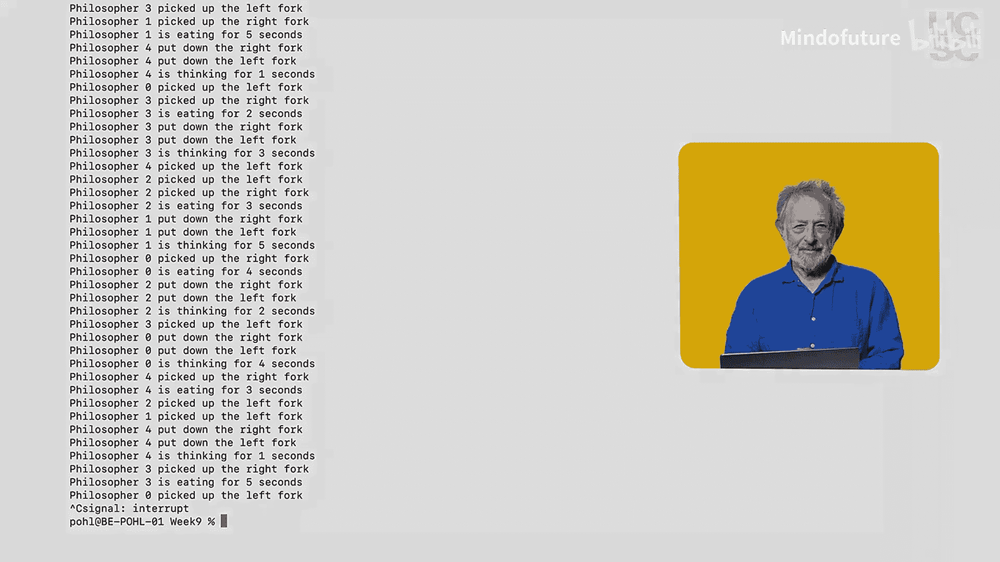

# 【加州大学】Go语言编程-｜-Go-Programming-Everyone-Part-2-p22-P22_互斥锁_04_01_06--BV1GTe7z3Eqi_p22-

So this topic is mutual exclusion。And this is a very important concern in getting a concurrent program to work correctly。

Concurrent programs frequently have what they're called critical sections。

 So let's say you have more than one thread running。And each of those threads need。

What turns out to be a critical resource。Then there has to be a means to tell the other threads layoff。

So we need an ability to let a thread exclusively use a resource。Now， in the package。

 we've already seen sync where we had weight groups。We have a type called Saint Mutex。

 Mutex stands for a mutualual Ex。Where we can use what are called lock and unlock operations。

 so we allow a thread to attach a lock to a critical resource or a critical section of the code。

 and then they're the only ones that can use that until they unlock it and then somebody else can use。

Quite important。 Okay， how are we going to study this。

 We're going to study this in a very famous problem。

 which is called the dining philosopher's problem。And in the dining philosopher's problem。

5 philosophers sit around。A round table。With their food in front of them。

And in between each philosopher is either a single chopstick or in the western version of fork。

 but in order to eat。From their bowl。The philosopher must use two chopsticks， or two forks。

So if you imagine， there'll be a picture in just a second。That the。

Philosopher has to reach for a chopstick on his left and a chopstick on his right。Now。

 if you imagine all the philosophers sitting there and they're all grabbing。

The chopstick to the right， Then everybody only has one chopstick。And with only one choppsstick。

They're all going to starve。 They won't be able to eat。 That's called starvation or deadlock。

So we want to avoid that the problem was invented by Dktra。And recall。

 I've mentioned Dykester before he's a touring award winner。

 and he solved the problem by creating an effect， a form of mutual exclusion using something called a ceopphore。

 which is a form of a lock。And later， Tony Hore， another computer scientist。Also， a touring awardwin。

He invented this language called CSP communicating sequential precede， which go is based thought。

 goes concurrency， not the language itself， but the concurrency part of the language is actually goes back to this。

Language。And scheme for doing concurrency that H invented。

And he also used mutual exclusion to solve the dining philosopher's problem。

 though very worth while going and seeing what they did now。Here's a image of the problem。

 there are the philosophers sitting around the table， when they're not eating。

 the philosophers are thinking。But they better be eating once in a while。

 or they're going to starve to death。Now I took this cartoon out of a book on Sea。

 that was my book in which my sea course is based on， and in that book。

 there is a solution to the dining philosophypher problem using the sea language。

 but in the sea language because concurrency is not built into the language it's built into the library。

 You've got to use things like po threads and locks and semaphos come from libraries rather than being directly in language in the language。

呃。It's a much clunkier problem， but you could see it there if you're also somebody who's taking the has taken or seen the sea course。

 Okay， so let's look at the code。In our go code， we have five philosophers。And we have five forks。

 I use the fork version rather than its chopstick version。And。Each philosopher has a number。

 so the numbers will be one to five。And then the philosophers。Will have a left fork and right fork。

Mutual exclusion。Both the left fork and the right fork can be locked。And unlocked。

So that a given philosopher can grab that resource and eat。 So let's see how that's done in the code。

 Let's go on。Now we have a function where we have a philosopher passed in。

 and we try to see whether they're going to eat。And。

We're going to be running these things as threads。So。The first thing they're doing is thinking。And。

While they think， they think for some random amount of time。

So we are just letting them sit there and think for a while。 And then when they try to eat。

 they go to pick up a fork。So when they go and pick up a fork， if they can grab a left fork。

They lock it。And then they have to go and pick up a right fork。 So once they get those resources。

 the other philosophers are excluded from grabbing those forks。And then they can go ahead and eat。

 let's see that on the next slide。So there's your eating and again。

 we're going to use the random number generator just to indicate， okay。

 they're going to eat for a number of seconds。So here's the philosopher three。

 he's managed to get out right in left fork。He's now going to eat for whatever3 seconds。

 And then he's going to unlock the resource。 He has to unlock the resource because otherwise。

 the other philosophers will starve。 But you see the different threads。

Each representing a philosopher， they can be thinking or they can try to eat if they can't grab the resource。

 they wait until they can， because ultimately， the philosopher that has a resource will unlock it。

And then the next philosopher who comes in at that particular time because they're thinking randomly will go and pick up their forks。

That will be running their critical section and doing their eating。Okay。So in the main。We initialize。

 remember， ran C time now dot Uniex nanono。 We're doing that because we want each。

Version of the routine to start on a different place。In the pseudoandum number sequence。

By now you've seen that quite a few times， but very important。Then we make some forks。

 and the forks involve a muttex。And we have five forks。And then。The forks。Are a。

Given an assignment to the Mutes， and then we make some philosophers。

The same number of philosophers fork。 So there's no， we could do this for more than 5， by the way。

 No problem。 All right， let's see the rest of May。And then， in May。After we've made the philosophers。

We then。Have left forks and right forks。And。The philosophers。

See if they can get a left fork and a right fork。So that they can。Eat。

And we're syncing with a weight group。So we're sinking all our threads。And then。

In that next for loop for ranging over the slice of philosophers， we do the thread。Philosopher P。

Dot eat。That。Aperssad work group。So each thread is now launched。And each thread attempts to eat。呃。

Run sometime。As determined by the random number generator and then。Grabs locks， unlocks。

 lets the next philosopher eat as well。 And when they're not eating their thinking。 And then finally。

 W G dot wait。Just waits until。All the program is synced up。 Okay， so hopefully。

 nobody is going to starve under this regime and nobody starves because we're not allowing all the philosophers to simultaneously grab one of the chopsticks or one of the forks。

So that somebody can always have two forks or two chopsticks available to eat。

 and we'll see now how this program actually works。So here's the program we talked about。

We're importing format， of course， remember that SSRIO， we're importing the rant part of math。

That's going to allow us to decide how long to think and how long。To eat。

We're going to use the sinkc package that's critical to a lot of concurrerencies。

 that's where we get things like。Wight groups and New Texas。

And then the time package because we're going to use。The initial time， the initial Uni time has a。

Place， a starting place for our random number generator。

 So that won't always start in the same place。We have five philosophers and five forks。

 this could of course be changed， it will work for an arbitrary number。A philosopher has。A mutex。

 a mutual exclusion flag for a left fork and a right fork。So that's what the philosopher struck is。

 it's the integer defining the philosopher， and then the two locks。

 it'll essentially be a way to lock the left fork and the right fork。

And here is the method that allows us to eat， so the philosopher is going to either be thinking or eating first off。

 we think。Think。😡，This is a thinking for RA number integer between one and five so we could be thinking up to。

 I think， five seconds。啊。And then。It's the thinking time is going to be。Simulated by sleeping。

 by the computer sleeping。And now we attempt the philosopher attempts to pick up a fork。

And if he picks up a fork successfully。Then it initiates a lock on that fork。

 the lock allows that philosopher。To get mutual exclusion。So that they can get two forks。

So here we see a philosopher has picked up a left fork。

 and then the philosopher has picked up the right fork。

And here's your random time for allowing that philosopher to eat。

We could have a different amount of time for eating。

 but we're keeping the same amount of time for eating。

 And that's not particularly important for eating or for thinking。 So here's the philosopher。

 Maybe the philosopher will eat up to5 seconds。All the philosophers have SAT down and agreed to this so that they can all ultimately。

 nobody could starve。 I mean， if one philosopher was a hog。

 they could just sit there and eat forever and maybe make the other philosophers starve。

 But they're going to give up。When they finish eatinging， they're going to unlock their resource。

So here's where they're putting down their forks。Put down the right fork。 Put down the left fork。

Theyve finished eating and that's the that's the。Eat function that's showing how mutual exclusion works。

And now we start the main program。We have a seed， we make forks。We make philosophers。And finally。

 we set in this force statement。We set a bunch of threads。

Namely as many threads as there are philosophers， so each philosopher is in effect a concurrent process and each of those processes need access。

To a critical resource， and they need that resource。To be used in an unshared way。

So they're going to do this through the locking and unlocking mechanism。

 which gets us a way to do mutual exclusion in the critical section。Okay， so that's it。

And now I'm going to run that code。So before I run it， I want you to think for a second。

Do we know whether philosopher 1 is going to eat first or is philosopher 2 going to eat first。

 How we， how do we think about that。Well， this is concurrent。

And all of these are being started concurrently。And there's so randomness factor in it。

 So we don't really know who's going to go first。 It's whoever gets in there and can grab the resources for the critical section。

So hopefully we'll see that in running the program， so we'll go ahead on the program。All right。

 there's a bunch of philosophers thinking philosopher well the philosophers were。是。

So this is continuing because this program doesn't stop。

We actually have the philosopher's thinkinging and eating randomly throughout。

And there's no fixed order as you're watching it。 I'm going to have to stop the program。

 So I'm going to do a control C from my keyboard， which will interrupt the program。So。

This is like a program running in an operating system that needs to use a critical resource。

And a critical resource has to be unshared， so it gets locked and unlocked as each thread gets its chance at using it。

 largely in a random way， and here you can see that。Philosopher Ze picked up the right fork。

 philosopher zero is eating for three seconds。Philoster three， put down the right fork， phos  three。

 put down the left fork。And now Phililosopher3 is thinking for three seconds。

And now we have philosopher 4 picking up the left fork。 loosster 2， picking up the right fork。

 loster 2， eating for three seconds。So that means that at a critical time。

 they have both forks available。And they locked the forks as they picked them up。

And then they unlock them when they shut them down and when they shut them down。

 they go back to thinking and they go back to thinking。

You can see here's philosopher0 thinking for four seconds。

Here's philosopher 4 thinking for five seconds。 So that's all done through the random number generator。

 We didn't have to do it that way， but we wanted to see how。The program。Let me rerun the program。

 You can see that again if I rerun the program。You will see that things show up in a somewhat different order。

You would have to retain the order they already had it in。In effect， by looking at this。

 you don't see any specific order。 You're not seeing 0，1，2，3，4。 You're seeing 0 sometimes。

 and then 4 sometimes， and then  three sometimes。And the other thing to notice is everybody's getting a chance at it because。

At random， no philosopher is going to starve in this solution to the dining philosopher problem。

 okay？So。The one thing I'd like you to think about， I'm going to control C。Is。

This version of the program doesn't have a stopping criteria。So I'd like you to revise the program。

So， that。If every philosopher has dined。At least let's say three times。Then。

We can consider the program terminated。 They've all had their three chances at eating。

 That's enough to finish the meal。 They can go on to other things。

So think about how you would put in some additional code that would terminate the program rather than letting the program run forever and having to terminate it。

🎼あ。Your on the keyboard。Okay。

