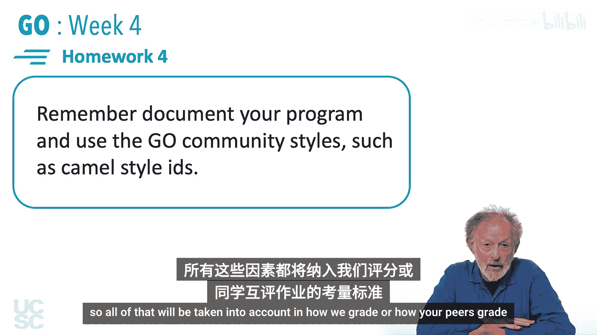

# 【加州大学】Go语言编程-｜-Go-Programming-Everyone-Part-2-p23-P23_第四周_同行评审作业_04_01_08--BV1GTe7z3Eqi_p23-

So this is the homework for week four， and week four was largely about parallelism and how to write code。

Where there were different threats。And the most interesting example we gave during the week was the very classic example。

 an example studied first by Dyketra and Tony Hore， which is called the Di philosopher's problem。

 so Ho in fact invented the CSP language， which is the basis for concurrency N go。

To handle a problem of this kind， and in the dining philosopher problem。

 recall you have each philosopher sitting at a table， in our case we had five philosophers。

And they all have a fork next to them， but they need two forks。To eat。

 so they have to grab a left fork and a right fork， or you can think chopsticks。

So you have to get two forks。But if all of them were to grab a fork。Then nobody would have two forks。

And the phospher end up starving。So we have to be able to do the the。

Concurrent processes in a way where a critical resource。

Is protected and that's called the critical section of the code。And。

We're going to extend the problem that we saw in this week。To have two extra steps。So in this case。

 we're also going to require that the philosopher has。The table has one unique ladle or scoop。

 and they ladle the food out of some big central bowl into their individual bowl。

 and then they eat their food with their。Two forks so the philosopher has to scoop food and since there's only one ladle。

 we can't have contention for that ladle， we have to assign that ladle to the philosopher and then the philosopher has to gain the two forks and then they can go on eating and then when they're finished eating after。

Some number of seconds they can go back to thinking now， if you recall the program we wrote in class。

Ha the philosophers doing this forever so they would。When they got their two forks。

 they could eat for a while and then they'd put down their forks and some other philosopher could grab the forks。

呃。And then they would just go on， that program had to be interrupted externally。

 so now we're going to add a second requirement to that program and we want the program to terminate after all the philosophers have had three servings of their food。

 so we're going to have to determine that， and then the program will terminate okay。So。

We're going to specify the number of philosophers， and this can be generalized， of course。

 the number of forks or chopsticks。That's going to be five and the number of ladles we're only going to have a singleton ladle。

 we'll have one ladle， and that's specified for this problem， okay。Remember。

 the critical resources are protected by locks。Remember。

 you get locks from the package sink and you want to get a hold of sink muttex。

 So this is how you can control both the ladle and your forks in making sure that。

You don't get what's called deadlock。And you're program。Okay。

Before our code continued until externally interrupted。

 now the philosopher will alternate between thinking and eating。In the past indefinitely。

 and now we will also add in this further condition that's necessary in your homework and in this case we're going to say after they've eaten three bowls of their food。

 that's enough， they're all done and we can end the program。Remember？

Document your program and use the go community style such as Caml style IDs and recall that you want to put where you want to put your curly braces and how you want to invent your code after things like for loops。

So all of that will be taken to account in how we grade or how your peers grade your homework。

