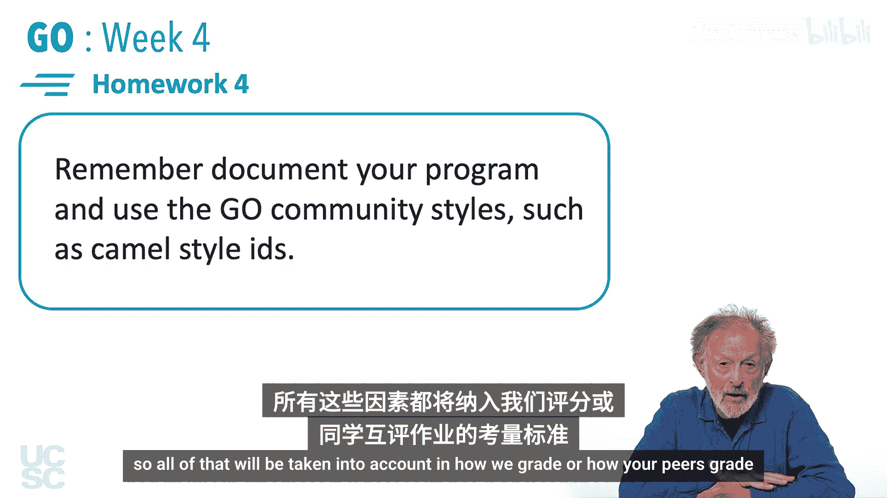

# Go语言编程：第四周：哲学家就餐问题扩展作业 🍽️


在本节课中，我们将学习如何扩展经典的“哲学家就餐问题”，以包含一个额外的共享资源（勺子）和一个程序终止条件。我们将运用Go语言的并发机制，如互斥锁（Mutex），来安全地管理这些资源。

## 概述

第四周的主要内容是关于并行性以及如何编写包含不同线程（在Go中是协程）的代码。我们讨论过的最有趣的例子是经典的“哲学家就餐问题”。这个问题最初由Dijkstra和Tony Hoare研究，Hoare发明的CSP语言正是Go语言并发模型的基础。

在哲学家就餐问题中，每位哲学家坐在一张桌子旁（在我们的例子中是五位哲学家），他们旁边都有一把叉子，但进餐需要两把叉子。如果所有哲学家同时拿起一把叉子，就会陷入僵局，无人能够进餐。因此，我们必须以保护临界资源的方式编写并发进程，这部分代码被称为临界区。

## 作业扩展要求

我们将扩展本周课堂上看到的问题，增加两个额外的步骤。

1.  **添加共享勺子**：餐桌中央有一个大碗，哲学家们需要用**唯一的一把勺子**将食物舀到自己的个人碗中。然后，他们再用两把叉子进食。由于只有一把勺子，我们必须确保勺子这个资源不会产生争用。
2.  **添加终止条件**：在课堂上的程序会无限运行，直到被外部中断。现在，我们要求程序在**所有哲学家都吃完三份食物后**自动终止。

因此，哲学家现在需要依次完成以下动作：拿到勺子 -> 舀取食物 -> 放下勺子 -> 拿到两把叉子 -> 进食 -> 放下叉子 -> 思考。这个过程将重复，直到满足终止条件。

以下是本作业的具体参数：
*   哲学家数量：5（可泛化）
*   叉子（筷子）数量：5
*   勺子数量：1（单例）

## 核心概念与实现要点

上一节我们介绍了作业的扩展要求，本节中我们来看看实现时需要掌握的核心概念。

临界资源（如勺子和叉子）需要通过锁来保护。在Go语言中，我们可以使用 `sync` 包中的 `Mutex`（互斥锁）来实现。

**代码示例：创建和使用互斥锁**
```go
import "sync"

var ladleLock sync.Mutex // 用于保护勺子的锁
var forkLocks []sync.Mutex // 一个锁的切片，用于保护每一把叉子

// 哲学家尝试获取勺子
func pickUpLadle() {
    ladleLock.Lock() // 获取锁，进入临界区
    defer ladleLock.Unlock() // 确保函数退出时释放锁
    // ... 执行舀取食物的操作 ...
}
```

关键目标是避免**死锁**。死锁发生在多个进程相互等待对方释放资源，导致所有进程都无法继续执行。在本次作业中，我们需要仔细设计获取锁的顺序（例如，总是先申请勺子，再按固定顺序申请叉子），以防止死锁发生。

## 编程规范与评审要求

在实现功能的同时，请遵循以下Go语言社区的编程规范，这将是同行评审的重点。

*   **代码文档**：为你的包、函数和方法添加清晰的注释。
*   **命名风格**：使用驼峰式命名法（Camel Case），例如 `pickUpLadle`。
*   **代码格式**：注意花括号 `{}` 的位置以及 `for` 循环等语句后的代码缩进。建议使用 `gofmt` 工具自动格式化代码。

## 总结




本节课中，我们一起学习了如何扩展哲学家就餐问题。我们引入了新的共享资源（勺子）和程序终止条件（每位哲学家进食三次）。通过使用 `sync.Mutex` 来保护临界区，我们可以安全地管理并发访问，并需要仔细设计以避免死锁。请记住在实现时遵循Go语言的代码规范。现在，你可以开始动手实现这个有趣的并发程序了。