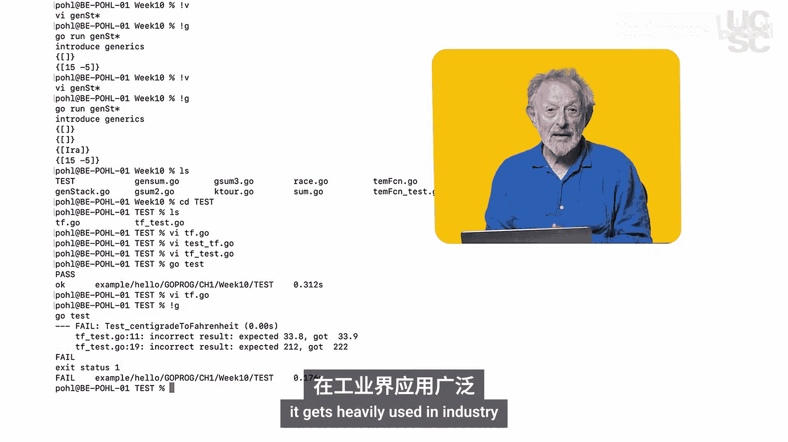

# 【加州大学】Go语言编程-｜-Go-Programming-Everyone-Part-2-p24-P24_测试_05_01_01--BV1GTe7z3Eqi_p24-

Testing code is always very important， as we know。There's no way to write code。

That's bug free immediately， nobody's ever figured that out。

So it's critical to have a testing strategy now。What I advise students to do is。

They should hand simulate the code with some small amount of information and go through it that way first。

Typically， people are too lazy for that。So we then go on to the ability to write。up。

Print lines at critical points in the code to see how the code's behaving and make sure we understand its behavior and it's executing the way we thought。

But that's fairly tedious。So go has provided special ways to test your code。

 it' not that the other stuff is obsolete， the other stuff is quite important and quite useful， but。

In software engineering， there are things called unit testing which have been found to be very useful。

And when we write go code and we want to make sure we can see that it's working properly。

 we also can write tests for them， and then we can use the special instruction go test to run the tests on the code that we've written。

So to try this out。We're going to go back to our very first go class。呃。

And in that first school class， we wrote the very famous program that did conversion from centigrade to Fahrenheit。

The reason we've used that code is that it's very famous in the original。

A book describing C as one of the early one of the early non trivial programs。

 So it's a very useful program everybody should be able to write code like that。

 but also we want to be able to test the code。Now when you're writing test code。

You're testing functions， you're not testing typically。Their use in a main。

 so what you typically want to do is write out the functions that you're going to be using and put them in a package。

So here we have a package convert， we're calling it convert because we're converting centigrade to Fahrenheit。

And we're taking a centigrade temperature， a sea temp as a 64 B float and producing a 64 B float that'll use as our formula 32 plus 1。

8 times。C10。And this is going to sit in a file which I。Labeled temperature toFahrenheittf。

go so that's going to be one file and that's the code we want to test and now let's write the unit test so let's see what they'll look like。

We use the same package name。Why， because when go test gets used， it looks for that package。

 It looks for the test code。To run on the original code。

And notice that we call the testing code test underbar name of the original code。 So test Tf。go。

 So you write your original code to be tested， then you write your test cases in something called test underbar name of where the original code is stored。

And here we must import。The stuff related to testing。And here's we're going to put in our unit test。

 Notice that we're testing to see if。33。8 is a result。When we use centigraderate。Temperature one。

So I have to know that if centigrade is temperature 1。We're going to have。

That's one degree centigrade above freezing， freezing in Fahrenheit is 32。

 each centigrade degree is 1。8， so I know that result is right。

So now I test it against running the code。The test conversion code， checking it。

And if it's not equal， I produce an error， t dota error， which is sitting in the testingling package。

So that sort of writes out。 I have to choose to write out something and I write out an incorrect result。

 I expected 33 point。8ight。And instead， I got whatever the result was。

 So that'll alert me to the fact that the code failed。

 And this was the characteristic of the failure， and that'll help me resolve。My error。Now。

 notice I put in two other tests。 I put in the tests for 32 degrees。

 We know the result should be up for0。 So centigrade 0 yield 32。 And if you recall。

 centigrade 100 is boiling in Fahrenheit。That would be 212， so that's boiling water， centigrade 100。

 freezing water， centigrade0， so I've thrown in three test cases and that'll be my unit test for the convert program。

So this is what I've accomplished。I have a test file that runs the test against the functions to see if we get correct answers。

 we import testing， use it。To check each result and then we'll see a particular error message。

If the test fails， what's that errormetric going to look like， Let's look at the next slide。

Running the go test will execute a Uni test and if correct， you'll see pass。So you'll see。

That the tests worked and it says pass and everything is okay now tests are passed。

Now let's try this and also show what happens when the tests fail。诶。So let's go ahead。

And try the code。Here's the function I wish to test。

Remember way back when you were writing a program that converted from centigrade to Fahrenheit。

Here's the conversion， and now a function that's in a file called Tf。go。Let me exit that。

And let's look at the unit tests。That's going to be Tf。Under barre test。Let go。So we import testing。

And here are unit tests。We checked to see what the answer would be if centigrade is1 should be 3033。

8 we check to see。0。Freezing 32 and we check to see for 100。And now let's run this。

And all we say is go test。It runs around， looks for the right thing and it says， pass， okay。

 the example stored here ran in a certain amount of time and everything was okay。 Now。

 let's redo this so that there's a fail。And let's see what might happen in a failil。

What if I mistakenly？Wrote here。1。9。 so let me just change that。

And we know that that's the wrong formula。So for some reason that got changed or was written incorrectly in the first part。

Gotes fail Ts case， incorrect result。38。8。Got 38。9212， Go 222。 We had a failure on those setss。So。

Notice we didn't fail for zero。So having the unit test zero。That would have still worked。

 that would have given us 32。So we get information and make sure you have an adequate number of test cases。

So that you can see if there's a critical failure anywhere。

But that's what's going to happen when we fail， very useful， a very， very good discipline。

You should learn to practice it。

Gets heavily used in industry， okay。

