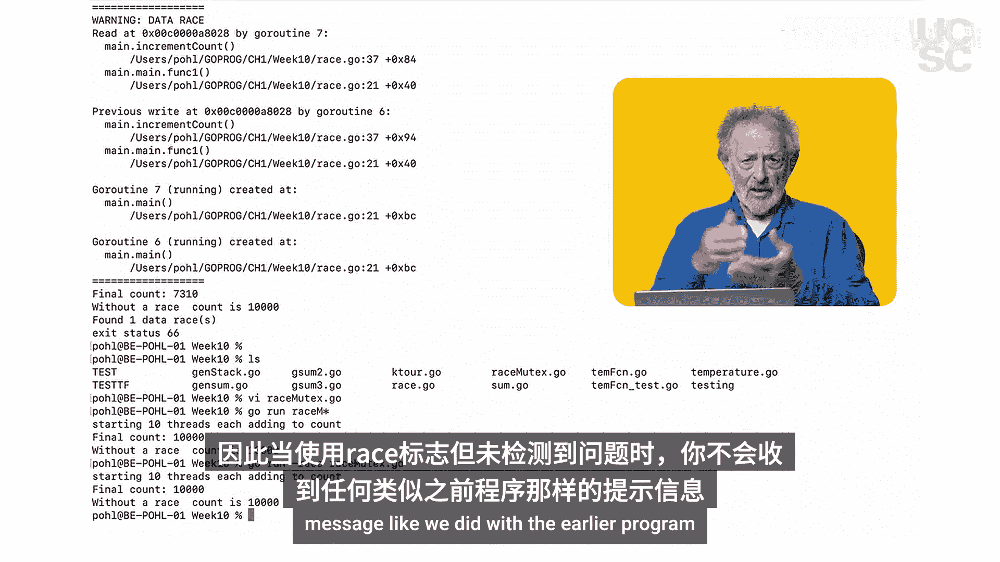

# 【加州大学】Go语言编程-｜-Go-Programming-Everyone-Part-2-p25-P25_竞态条件_05_01_02--BV1GTe7z3Eqi_p25-

So inconcurrent programs。One of the subtle。Errors that can happen is a race condition。Now。

 a race condition is when two or more threads。Attempt to access the same resource at the same time。

And we're going to see that in the following program。

 we're going to have multiple threads running and accessing。Accounting variable。

And what can happen here is that we can have as a result， an incorrect count。

So if a count currently is 10 and if there are two threads attempting to update that count。

 let's say both trying to get the result of be 11。Then。1 will come in and make it 11。

 and the next one will come in and make it 11， where it should have been 12。

Let's look at how that might happen in a program。 Here's a function that's going to increment a counter。

The counter we can see is a passed in with passing a pointer so we can change the counter variable。

 which is called count。 And we see that the count is going from 0 to 1000。

 So we're going to have a counter variable that counts up to 1000。

 and the function should add 1000 to whatever the count is。 And if there is no race condition。

And we have multiple counts， we're going to end up with a round number where for each thread there will be a thousand counts。

 if there are five threads it'll be 5，000， if there are 10 threads it'll be 10，000。Okay。

 so let's look at the next slide。And now we're calling that function。 So here in Maine。

We've established the count variable。And now， we're counting。We're starting to count with 10 threads。

 so the threads are launched using a weight group to make sure that the threads coordinate and then。

So for each thread we go weightgroup。 add1， and then we go an increment account and don't forget inside those threads so weight group is decremented after it's done and。

We're incrementing the counter each time and each thread is supposed to count 1000 times。

 and then we wait for all the go routines to finish。

 so all of that works because we've used weight groups again for coordination and then we're going to print out the final count。

Now let's see what the possibilities might be， we'll see them in the next slide。Now on my machine。

 when I get to Rendez， I'm going to show this in a second。One time I got 8，711 another time I got 5。

910。I got 6605。 I've always gotten something less than 10000。And again， why is that。

 Because the threads are interacting with that resource， the count variable。

 the count variable is not protected。So two are getting access to it。

 trying to simultaneously increment it， and very often you can see in the case of 5，910。400。

4090 times there was a race condition， so it was not properly incremented， okay？

we're also going to see how to use the go system to detect race conditions to help us。

 and that's going to involve using a flag， the minus race flag so we can with concurrent programs put in a race flag and then it will give us some additional information on where the race condition might be occurring so we could fix it。

Okay， now let's try this on my machine。So here we are on my Macintosh。And it's got， I believe。

 the M2 processor， I believe that has 10 cores。So we can use up to 10 cores on a concurrent program。

So we're going to demonstrate that race condition that I showed。

And here's the program as already described。There's a counter。It's a very simple program。

More complicated programs again， might be using some special resource。

 not necessarily a variable and。In both attempting to use that variable， the results can in effect。

 be affected by this race condition。So we're going to have synchronization via a weight group。

 we're going to have a traditional variable WG for the weight group。啊。Then in this program。

 I'm starting 10 threads。I could also demonstrate this with fewer threads as well。

The only time it won't have a race condition for sure is in one thread。Now。

We've done the incrementing in here， the simple function of。U。Has done some incrmenting。

 And here's where we wait for all the go routines to finish。 And here is。The particular count。

We do a the defer W G done decrements the W G ad， right？ We have up here。

Where we're launching the threads， every time we launch a thread we do an ad。

 that's how we use weight groups。Then we call in the particular function。

And when it exits the defer WG done decrements it so that when you get the WG weight。

 you're back to zero when all 1 threads。Exit。And now here we're going to show the final count。

So let me run this。I had put that in up。File called race。go。Okay。

 here relatively few race conditions。 It was 9192 rather than 10000。Let me try it again。

And you can see here， it's there're far more race condition，6557。

 So you can also see that there's a certain of randomness to the race condition， because。

Depending on， you know where you are and the threading and those things are going simultaneously on different core。

 you're not going to always get the same results so it is。A pretty unusual phenomenon。

 Let me try it one more time so you can see that。This time it was 7，348。

 so most of the time the addition happens。Without the race or you're seeing more than。

5000 in the count。 But you're never seeing 10000 because the race condition with 10 threads running is going to happen quite frequently。

Now I do want to point out that you can avoid the race condition oh let me。

Do what I said where I'm going to run this with the race flag。

So if you wanted to detect race conditions in concurrent programs and go。

 they provide you a special flag to help you out。And sure enough。

We're getting information about where the occurrence of the race condition is besides the answer。

 and the answer in this case was 7310。And the program indicates it found one data race with an exit status of 66。

 Okay， I'm going to fix that race condition just so we see that it can how one way we could fix it。

 I have。A program called Race Mutch。 So I'm going to go。 I'm going to show you that program。

So by its name， you can see that I'mmusing。Mutual exclusion。Material in。So again。

 all of this stuff shows up in the sync package。In this case， I add to the program the muttex。

And in the go increment count， I include a muttex。So I've added a variable to the increment count。

And otherwise， the program is the same。So it also runs 10 threads。

 but the Mutex is going to protect the critical resource of what we call the critical section。

 So here we see star Mutex dot lock。Then we do the count， and then we do an unlock。

 So when somebody goes to increment our critical resource， the counter。

 and this could be a bigger chunk of code when it goes to do whatever is involved in the critical section。

 It first does a lock。 So nobody else can enter and mess with the critical section and then we unlock。

So that's the only difference I've made in the program。And now let me run that。Go。run。Race muttex。

Wow。I started10 threads， final count is 10，000。Correct。And now let me just also。

Try seeing what I would do， what would happen if the race lag is used on this program。So again。

 this is supposed to help us discover race conditions。And here we say， without a race。

🎼Count is 10000， and there's no indicator from the flag。 Nothing has happened。

 It looks like an ordinary compile。 So when the race flag is used and nothing is detected。

 you don't get any kind of message like we did with the earlier program。

