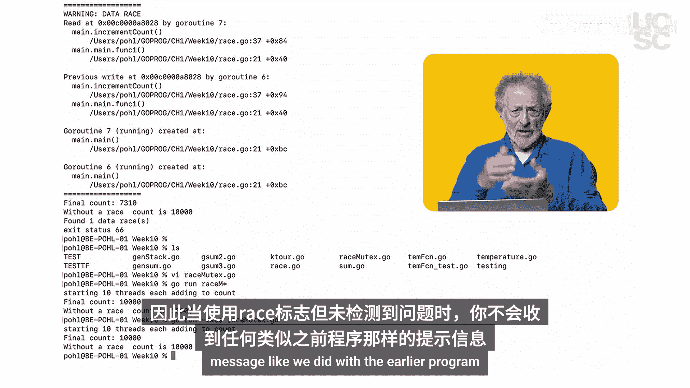

# Go语言编程：P25：竞态条件


## 概述

在本节课中，我们将要学习并发编程中一个常见但隐蔽的错误：竞态条件。我们将了解竞态条件是如何发生的，如何通过Go语言工具检测它，以及如何使用互斥锁来修复它。

## 什么是竞态条件？

在并发程序中，竞态条件是指两个或多个线程试图同时访问同一资源时可能发生的错误。

具体来说，当多个线程同时读写一个共享变量时，由于操作的执行顺序不确定，可能导致最终结果与预期不符。例如，假设一个计数器当前值为10，两个线程都试图将其增加1。理想情况下，最终结果应为12。但在竞态条件下，可能发生以下情况：两个线程都读取到初始值10，然后分别将其更新为11，导致最终结果错误地停留在11，而不是12。

## 演示程序：一个存在竞态条件的计数器

为了理解竞态条件，我们来看一个具体的Go程序。这个程序将启动多个goroutine（Go语言中的轻量级线程），每个goroutine都会对一个共享的计数器变量执行1000次递增操作。

以下是实现递增操作的函数：

```go
func incrementCounter(count *int) {
    for i := 0; i < 1000; i++ {
        *count++
    }
}
```

该函数接收一个指向整数`count`的指针，并通过循环将其递增1000次。如果程序没有竞态条件，并且我们启动了N个goroutine，那么最终计数器的值应为 `N * 1000`。

## 主程序：启动多个goroutine

接下来，我们看看主函数如何启动这些goroutine并等待它们完成。我们使用`sync.WaitGroup`来协调多个goroutine的执行。

```go
func main() {
    var count int
    var wg sync.WaitGroup

    // 启动10个goroutine
    for i := 0; i < 10; i++ {
        wg.Add(1)
        go func() {
            defer wg.Done()
            incrementCounter(&count)
        }()
    }

    // 等待所有goroutine完成
    wg.Wait()
    fmt.Println("Final count:", count)
}
```

在这个程序中，我们创建了10个goroutine。每个goroutine启动前，我们调用`wg.Add(1)`来增加等待组的计数器。在每个goroutine内部，我们使用`defer wg.Done()`来确保在函数退出时减少等待组的计数器。最后，`wg.Wait()`会阻塞主goroutine，直到所有10个goroutine都执行完毕，然后打印出最终的计数值。

## 竞态条件的后果

理论上，10个goroutine各递增1000次，最终`count`应为10000。但由于存在竞态条件，实际运行结果总是小于10000。

以下是程序多次运行可能得到的结果示例：
*   8711
*   5910
*   6605
*   7348

每次运行的结果都不同且小于10000，这是因为多个goroutine在没有同步保护的情况下同时读写`count`变量，导致部分递增操作“丢失”。

## 使用Go工具检测竞态条件

Go语言内置了强大的竞态检测器，可以帮助开发者发现程序中的竞态条件。我们可以在运行或构建程序时使用 `-race` 标志来启用它。

在命令行中运行存在竞态条件的程序：
```bash
go run -race race.go
```

启用竞态检测后运行程序，除了输出错误的计数值（例如7310），工具还会在控制台打印详细的警告信息，指出程序中存在数据竞争（data race）的具体位置，并会以状态码66退出。这为定位和修复问题提供了极大帮助。

## 修复竞态条件：使用互斥锁

要修复竞态条件，我们需要确保对共享资源（这里是`count`变量）的访问是互斥的，即同一时间只能有一个goroutine对其进行操作。在Go语言中，我们可以使用`sync.Mutex`（互斥锁）来实现这一点。

以下是修复后的`incrementCounter`函数和主程序：

```go
import "sync"

func incrementCounterWithMutex(count *int, mu *sync.Mutex) {
    for i := 0; i < 1000; i++ {
        mu.Lock()   // 进入临界区前加锁
        *count++
        mu.Unlock() // 离开临界区后解锁
    }
}

func main() {
    var count int
    var wg sync.WaitGroup
    var mu sync.Mutex // 声明一个互斥锁

    for i := 0; i < 10; i++ {
        wg.Add(1)
        go func() {
            defer wg.Done()
            incrementCounterWithMutex(&count, &mu)
        }()
    }

    wg.Wait()
    fmt.Println("Final count:", count) // 现在总是输出 10000
}
```

**核心修改如下：**
1.  我们声明了一个`sync.Mutex`类型的变量`mu`。
2.  在`incrementCounterWithMutex`函数中，在对`count`进行操作（临界区代码）之前，调用`mu.Lock()`获取锁。如果锁已被其他goroutine持有，当前goroutine会被阻塞，直到锁被释放。
3.  操作完成后，调用`mu.Unlock()`释放锁，允许其他等待的goroutine进入临界区。

通过互斥锁的保护，对`count`变量的所有递增操作都变成了串行执行，从而消除了竞态条件。现在无论运行多少次程序，最终结果都将是正确的10000。

如果我们对修复后的程序再次使用`-race`标志进行检测，竞态检测器将不会报告任何问题，程序会正常输出结果。

## 总结

本节课我们一起学习了并发编程中的竞态条件。
*   我们首先了解了竞态条件的定义：多个线程无序访问共享资源导致结果错误。
*   然后，我们通过一个计数器程序演示了竞态条件如何导致计算结果不准确且每次运行结果不一致。
*   接着，我们学习了如何使用Go语言的`-race`标志来检测程序中的竞态条件，这是一个非常实用的调试工具。
*   最后，我们介绍了使用`sync.Mutex`互斥锁来保护共享资源，修复竞态条件，确保并发程序的正确性。

理解并防范竞态条件是编写可靠并发程序的关键一步。




