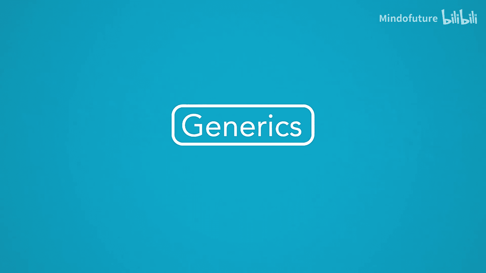
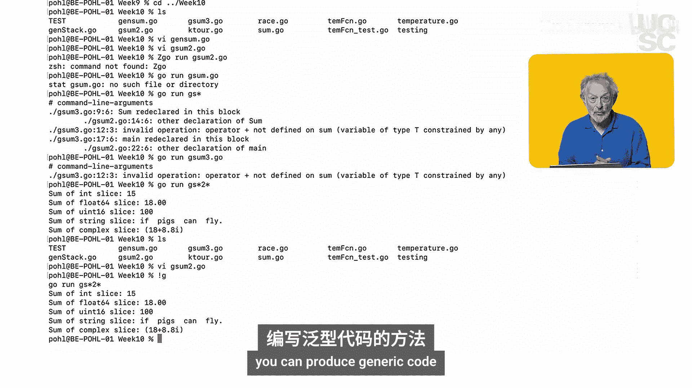

# 【加州大学】Go语言编程-｜-Go-Programming-Everyone-Part-2-p26-P26_生成求和函数_05_01_03--BV1GTe7z3Eqi_p26-

So we're going to go on to the topic of generics in Go。Now， generics in go are a very recent feature。

 so some of the go books that you might have purchased。

To learn the language might not yet have generics like there's a go booked that's very good by Knegan。

 but at least in the first edition， it did not have generics。

 So you need a compiler that supports this feature And one way to find that out is to use the command go。

B version， and that'll tell you what version of compiler you have and if you have version 1。18， 1。

18 or later。Your compiler should run generics， so generics came into the language in 2022。

 much like all modern languages， these have special committees and frequently the committees decide they want to add something that's important or correct something go。

Has as its philosophy that it's not going to invalidate earlier code， so。Everything will work。

As before。But generics are just added on。Now， generics have been found in other languages。

 especially C++， where they came into the language。呃。Fairly late。C++ was around since 1985。

 generics came in， I think in the late 1990s， they came in through something called a template。

And they became very important in developing generic code in the C+ plus standard library。

 which is a very powerful library。 And again， if you've taken my C plus plus courses。

 you've seen generics displayed。But。Go as with other things。Makes things simpler。

So it has generics and it has a simple form of generics。

But it still allows you to use this very powerful form of code reuse。

What do generics allow you to do， You can write a piece of code that works for a very specific type。

So we'll see that in the further example。And make sure that it works correctly for that type。

But then。It's probably the same code that can be used for a different type。So in an old language。

 like the C language， if I wrote。Something that's going to work on int。

And then I wrote something that's going to work on floatat。

 I'm going to have to define two different functions。The one for float and the one for int。

They will have to have different names。However。When it comes to generics。

 we're going to be able to write one function and specify that。The type is a generic type。

 which can be instantiated by any number of types。That fit the features of the coat。 Okay。

 let's see that。So。Here's code for summing a slice of data that's an integer。So we just set out to。

Assign S。And create S to be an integer where we'll keep the sum。 We， of course。

 started at zero and then we'll range over the data slice。And we'll do S。Is assigned S plus V。

 so each item in the slice， which is an integer， gets added to the S and then ultimately this function returns sets。

 and if in non generic terms， we needed this for float。

 we'd have to say something like function some float data blah， blah， blah。

 and then we'd have to say something like float 32， float 32。

 and then we'd say something like S colon equals 0。0。So we'd write effectively the same code。

But we'd have to change both the name of the function。And the specific type it was acting on。

Generics let us avoid that， so let's see the generic version。Now we're going to create an interface。

 so that's important remember we've already studied the use of interfaces。

 they're very important in the go language， they don't exist in the C language。

And we can create a type called number。So I'll create a type called number and the number。

Can be either an int， an inth8， an in 16 and up to an in 64， it could be a float。

Of the two types of float， 32 or 64 complete an unsigned in。And again。

 it can be unsign in up to a size， unsignant，64。And notice that I'm also going to allow number to be a complex number。

And we'll see why。And further on， this is interesting because the number isn't really a string。

But I'm going to allow a string to be in this interface， so think of it as a number plus string。

Anyway， all of those types will work for my generic code。

 And then I write my code just slightly differently。 So let's look at how I write my code。

 So I say funk sum。And then， instead of。呃。The immediate list of parameters， I say。

Open bracket T number， so T is going to be taken from the interface for number。And then。I say slice。

Which is defined over a type T。And。I returned。A value of type D。And then I have a fair sum of type T。

 Don't forget that a fair sum of T is always going to be initialized， and in general。

 it will be initialized to the appropriate zero value。 But if you think about string。

Itll be be initialized to the null screen to nail。So it's going to work for strengths and now we're going to say what we said before。

 over the range of the slices we do a sum and this time I use plus equal v the other，え。

A slide showed it as sum equal V plus sum。 I could do it that way。 And then I returned some。

 So I'm doing this repeated sum over the slice。 But now it's going to work regardless of what type。

I actually use and all of those types。Will work all of those types， so now let's try and call it。

 let's call Maine next。So there's main and we have an integer slice， so there's the integers one。

 two， three， four， five。And then I call integer sum to be the sum over the integer slice。 Now。

 notice I didn't say anything about what type。Enterters your slice was。The compiler。Knowing。

That the code for some was over the generic type T， and that T was of type number， Seeized that， oh。

 int is one of the things allowed。 So I'm going to make that In effect。

 the compiler is writing the special function you need there。

 It's saying this is really some over an int slice。 And then we can print out the answer。

 And then we can go on and do the same thing for a float slice and print out the answer。😊，And now。

 let's look at the rest of the code。And there we have a string slice。 Now， look for the string。

 That's sort of interesting。I have four strings in there and says string and then one string is if。

And then another string is a couple of blanks pigs。 If pigs can fly。 So I have four little strings。

 And what does plus do with strings。Well， plus is the concatenation operator。

So this sum will work on strings， but there it thinks of string as being concatenated。

And then we also show complex numbers finally。 And there we haven't used complex numbers。

 Most of us don't need complex numbers。 But in some scientific work， you need complex numbers。And。

Complex numbers are allowed in the go language。 That's an extension that Go did that early C did not have。

And you can see that the first number in that slice was real part 1。2， an imaginary part 8。8。

 And the rest just were real part 3。45。67。8。 I didn't bother the imaginary part as taken to be 0。😔。

So it could have been0 I in the other cases。But that would just have been extra work to show how this works。

Anyway， all of this should be okay。Complex should be okay， hopefully that's all going to work。So。

Here's how you develop generic code and how the labor saveor。

Take the ideal type for debugging the code， in our case it was going to be the sum over the integer space。

After we've debuged it and are sure that that's what we want。

See what other types satisfy the condition to make that work。 and that can be as general as possible。

 So we added number and all those things we included were number。

 but we did throw in string just to show a more unusual case。And indeed。

 you do have to test it anyway。 we will wait on， see how to do unit testing on our code。

Make sure the code works and then now let's go and actually run the code on my machine。

Here we are at the terminal with our generic code， and let's go over it again。呃。Again。

 we define this interface number in most typical examples。We don't include strength。

I probably should really have called that string plus。numberumb plus string。So that make it clearer。

 so and I just did this because。It's an interesting case that string also works for that code。

So here's my sum program， and here's the code reuse。

 rather than having to write a sum program for the however。

 many types there were over 10 types there and have them unique and have a polluted namespace with all some ins。

 some float， some unsigned， some unsigned 16， cetera， et cetera。I can write it generically。

And here's the thing to focus on。You don't have to say capital T， you could use something else。

 that's just an identifier but。Sttylistically， in the go community。

 we typically say capital T when we mean a generic type。

And here's the type and we'll be able to use other things than number for other generics。

Not everything is going to be using number。And。Here's where we declare the slice。

 and rather than declare it as type enter or type float 64， it's declared it as type T。

 and here's where the return value is。 So the syntax for function except for that bracket pair。

 looks somewhat similar， except we're using T for a type。

And that first part tells us what the interface is that he represents。 So that's why the extra。

Bracket at the beginning of the funk。 And here we go。 And we just say we declare ver some tea。

 So it's properly initialized。啊。If I had said there some if I had said some colon equals zero。

That may not have worked for string。 So then string would have failed。

So that's why I do this because。The good thing about Go is it always initializes everything。

 and it always initializes to whatever it considers its zero value。 And in string case。

 that's going to be the null string。And here's where we do our summing and we return some much as they showed in the slide。

And here's。The different。Values we're doing， I also show。U。U wins。

 So that's 10 plus 20 plus 30 plus 40。 That's going to the unsigned ins。 that's going to be 100。

 And here's a string slice。 that'll that should show up as if pinks。IfPigs can fly。

 that should be the sum of the string slice， and that's the complex number slice。

So let's try and run this。And there we go。 The sum of the in slice was 15。

 I believe that was one plus 2 plus 3 plus 4 plus 5。 And that's indeed 15。

 There's the unsigned in slice being 100。 There's the sum of the string slice being if pigs can fly。

 and there's sum of the complex number slice being 18 plus。8。8。Imaginary， so there。

 since only one number had a non zero imaginary part， that's why the 8。

8 I shows that we got that right and you can go back and you can see that it would work regardless。

So。Big code saving。Not much more difficulty than just writing ordinary code。

 Write your ordinary code and test it on。🎼An iconic type for whatever you're working on。

 and then see how it generalizes。 And that's how you can produce。

Generic code。Okay。

