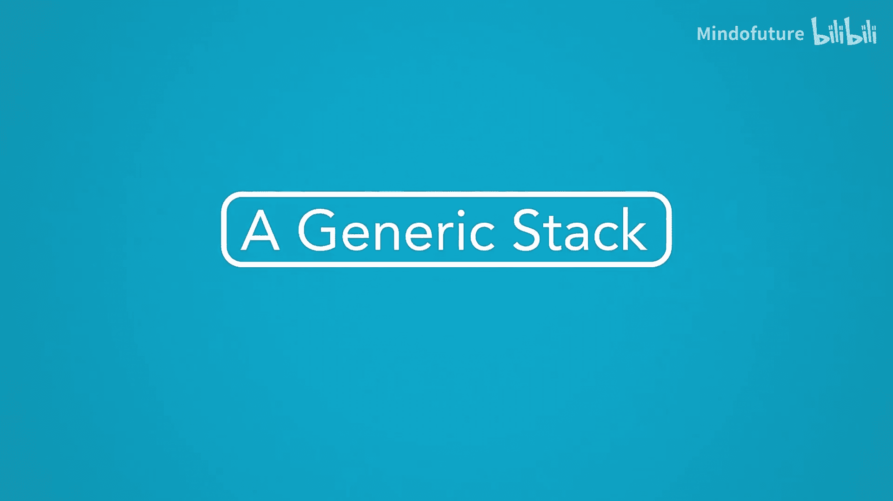
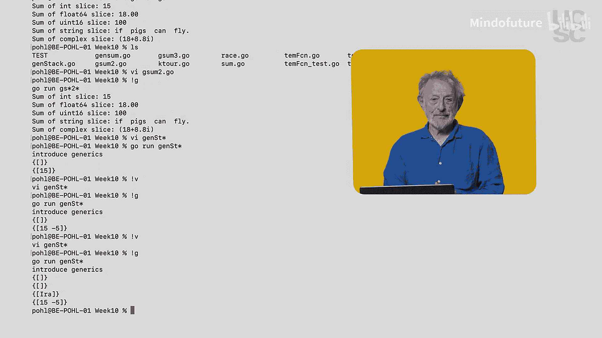

# 【加州大学】Go语言编程-｜-Go-Programming-Everyone-Part-2-p27-P27_生成栈_05_01_04--BV1GTe7z3Eqi_p27-

So let's see some more generic code and generic code is especially useful when working with container types。

 what I mean by container types。Container types are things like slices。

But we can also make things like linear link lists， W link lists， stacks， cus of all sorts。

And these and others are standard container types。 Why。

 because we want to put values in them and why do we have more than just slices。

 Because each one of these types as a different discipline how to get at things。

 and they have different benefits of drawbacks。 So universally probably the slice or array are the most convenient and most used container class。

 and we already saw how to write genetic code over a slice。But it's a heavily used idea。

 And if you've come from my C plus plus course， you've seen it in the standard library。

 The standard library contains a lot of containers。

And they're all instantiated generically so they can be used over any type。We also。

 in this particular code， use what。Is a universal type。 Remember。

 in number we specified in the previous generic code， we specified in individual set oftype。

 even those large number of them。But we didn't specify other types such as certain kinds ofstructs。

Which would be types。Or pointer types。So they were not available when we used plus。When we use some。

But here for universal type， when we're just considering putting things in and taking things out。

 we can use a type called any。 That's the universal type in go。 Okay， let's look at a co。

 So we're going to do a basic。Container type you already should know about this， called a stack。

A stack。 Remember， you've seen it in cafeterias。 It's just a set of plates。

 if you want that are stacked up。 And the regimen is you take things off the top。

That's called the pop。And you put things back on the top， that's called a push。

And you also can see whether the stack is empty。 That's another basic operation for the stack。

 And you can also peak at the top of the stack。 So the stack has some basic operations。

4 or five basic operations。 If you've used stacks in your previous work。

And it's container and we want to be able to store anything in it。

So we have an interface that's already available to us。

 it's just to type any that's defined for you in the go language， just like it is。

And it means you can use anything there， so T and E says。Struck。

The tight stack is a struck in which there's a slice of values。And the slice of values。

Has any type in it， okay。So in a way， if you notice， I said that was really a facade。

 basically the underlying representation of the stack is a slice。

But we're not using a slice because we want to restrict the operations available on a stack to things like push and pop in in a slice we have。

Any kind of random access we can look in the I element in the stack you can't。

 You can just look at the top or push pop from the top。How does a generic push work。

 how do we write such an operation well again？We have our。Function。And a function is a method。

And the method is going to work on a value T。And then we're going to be able to take a value。

And appended。2。The fact。So that's the basic stack operation where we put a value onto the front of the stack。

I'm going to leave as an exercise for you to write the other operations like checking whether the stack is empty。

 checking， whether you can pop the stack， checking the top of the stack。

 I'm just going to show this one operation。So let's go and see how that works。There we have a funk。

 we're going to introduce generics we have。And enters your stack。Where we're using a stack of ins。

As what we're using。And。We're going to push onto the integer stack， the value 15。

 and then we'll print the inches of stack。So any is instantiated as an inth。

And we'll see how this all can work。 Now let's turn and run the code。

So here we are at the terminal and we have the code we， which I just displayed in my talk。

Not very complicated。 Let's just go back and see we're using any。 We didn't have to declare it。

 We could declare the interface any， but that's already known to us。So that means an arbitrary。Stack。

Of anything is some series in this。As an underlying slice， a slice of tea。

Though it's going to be a facade and that means we're only going to use it。And the way we use stacks。

 which are push and pop， top。And see if it's empty。

And I'm going to let you write the other code I'm just writing push。

 So here's the function on a stack of type T。And we push a value of type T。

So that's going to be instantiated， but it's going to work for anything。So here we have。

Our introduction here we have an in stack。We're going to print its value。

 It should show up as nothing or empty at first。 And then we're going to stick in。

The value 15 printed again just to see what happens。 So let's run that code。Okay。No biggie。

 It's that introduced generics。 That was the first print statement。

 Then it's printing what effectively is the empty stack。 So there's nothing in there。

 We then pushed 15 onto the stack。 and that's the new stack value。 All done。

 Let me modify the program just to show you， it's going to work。In other ways。

What if I push on another number， now let's see what happens， so I have two pushes。Okay。

 now we have two items， 15 and minus5。And so on。 And if I had the full range of operations。

 I could do pushes and pops and make sure they all work。 And as I say， I've left that to you。

 One further thing I want to do with this code。Is test out any。So let's say I am going to have a。

Sttrainranget。And it'll be a stack。And I'll print the string stack。And I am going to push。AndSting。

Let's use my name。Let's do a format of string stack。And let's see what happens with this。

 hopefully this is all going to work， trying this in real time。There we go。

We saw that both the ink stack and the string stack initially were empty。

And now we pushed Ira on to the string stack。 and sure enough at Prince Ira。

 And we pushed 15 and 5-5 on the inst。 and they show up again。 And as I said， arbitrary。

 any things can be put there， Even things like your own made up。

Strucks as detailed as you want or something like a pointer type。

 it'll just be the print values will just be。Related to whatever type you're using。

So that's how you create。A generic container。Very easy， very powerful， very useful。🎼O。

