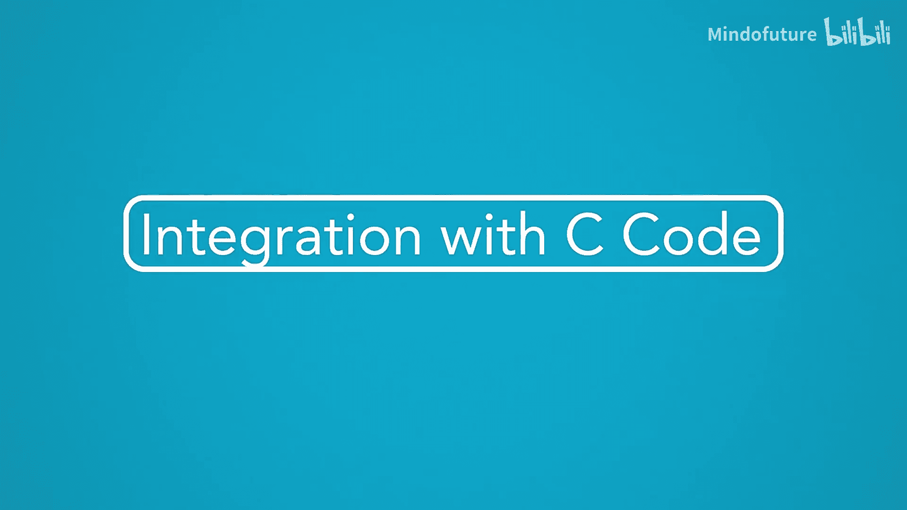
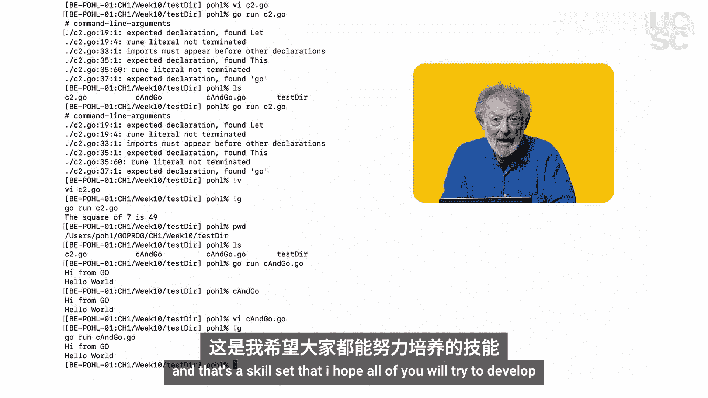

# 【加州大学】Go语言编程-｜-Go-Programming-Everyone-Part-2-p28-P28_与C代码集成_05_01_05--BV1GTe7z3Eqi_p28-

So now we're going to look at how to write go code and integrate it with C code。So keep in mind。

 go is a language that's relatively modern and in some ways as based on C。And may be seen as。

A recent improvement to the C language category， however， C。Is in many instances。

More efficient than go。So for example， one of the benefits of G is that it's garbage collected。

 it means that you have to do less with allocating memory， you don't get all sorts of memory errors。

 however， in certain，Areas of computing use， like real time use。

You can't allow for garbage collection。So when you need to。

 there is a simple scheme that lets you integrate。Using something called Seago to integrate both your C code。

 and you can write and see and then your and then compile it together with your go code。

 Don't forget， C is still in very wide use。 It has extensive libraries。

And it the lingua fca of many operating systems， including the original one that was invented for Ex。

 so this makes it an extremely valuable language because of its wide use。

 even though by modern standards， you might think of it as an antique。Okay。

 let's go on so to use both languages together， compile them together。

 you need something called Cgo also you will see in the following code that we will do an import of quote capital C。

And then。The code， the C code that will write， will be inside what otherwise would be。Our comments。

So the sea code gets placed inside the comments and see go。

Understands if that C code and not go code。 And then， for example， we'll use be build。

 and then we can build a executable that uses both see and go。Okay。So let's look at this code。

There we are。Just like with go， we have a package main。

 and then we're importing format because we're going to use。The I O from go。

 And then we're doing some loes。Inside the。Slash star。

 So the multi line comment surrounds the C code。 And I'm showing you something very simple in C code。

 If you've already come from knowing C code。 this will be the earliest kind of program you'd write。

 It's the hello world program。 and in the C language， Sha include is like an import。

 So Sha include gets you standard I O dot H， which is the I O package， and then all this。

Function does。Is calls。A print that prints a new line with the message aello world。 Now。

 you can also see， again， if you haven't taken C， I would recommend that you do。

 but you can see here slight differences from how a function works。In。And C as opposed to go and C。

 you don't use a special keyword funk， you use a type。That you're calling the function， in this case。

 since the function returns no value， that type is void。So， and then， unlike。The go style。

 you tend to always be putting in your semicoons at the end of line。

 so that's why you'll see printf hello world。Ending per semicolon。

 And then we see the import capital C， and then we see our normal。See code and inside that C code。

 Look at the last line， you see。A capital C dot hello。And that is telling the compiler that。

This is code associated with the C part of the compilation， so an effect。That function。

 void Hallo is being called by using capital C dot Hallo， okay。

So you have to make sure you place import。Capital C， immediately after。That star。

 you don't want to leave a line and I did when I was myself learning about this and then something goes wrong in the compilation。

 so don't leave any lines between that and then use Bill to get it executable and run the code。

 and you can， of course， run the code in a normal way as well without building the executable。 Okay。

 so let's go ahead and try this。Okay， here we are in my terminal and I have。

What you saw in the slides。Again， ordinary ordinary go code， package main import port format。

 but here's where it's novel。 So we start back last star。

I can include something like messages to the ordinary part of the C compiler。

 because C compiler is going to be invoked along with the go compiler。

 So here I'm invoking load flags。 actually not necessary for this particular program。

 but minus L M loads the math package。 And in some cases， I was experimenting with。

Code that in C required the math package。And here you're including the standardIo。 H。So again。

 this could be familiar with lots of you。 you might have come from a ready a see background。

 This is a syntax slightly different than the syntax of a funk and go。

So here we always have a return type first。 In this case， it's void。

 void means there's no return value。Yeah。And it's merely printing ao world。 And that's the end。

 And then we immediately do an import capital C。And here's the go code that mixes。

 so in this code we say function print high from go， and then we're going to see C dot hello。

 which is going to invoke the C part of the program， which willll do hello world now of course。

This is just an example。 We aren't really going to use something like this。

 that wouldn't be of any real value in our kind of code。 But as I said before。

 there's an enormous installed base of code。In the sea world。Including code that would be unsafe。

 undergo， and you might even have to use the unsafe package as well if you want to get to the kind of super efficiency code that might be needed for your application。

嗯。Okay， so let's go ahead and make sure this is all working， so I'll exit my editor。

And now I'm going to。Just run it。And sure enough， there it is says high from go Hello world completely as expected。

 So there's lots of other nuance here。But this is really basic and it shows how easy it is。

To combine C with go， and that's a skill set。That I hope all of you will try to develop， okay。

