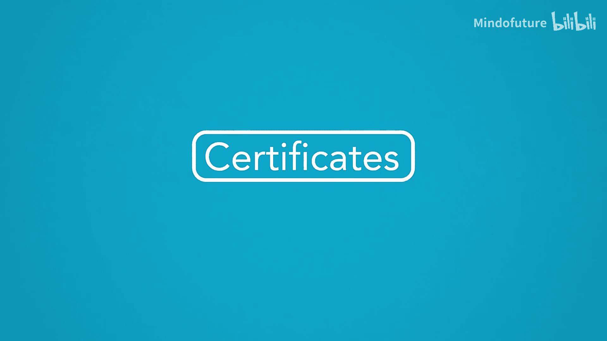
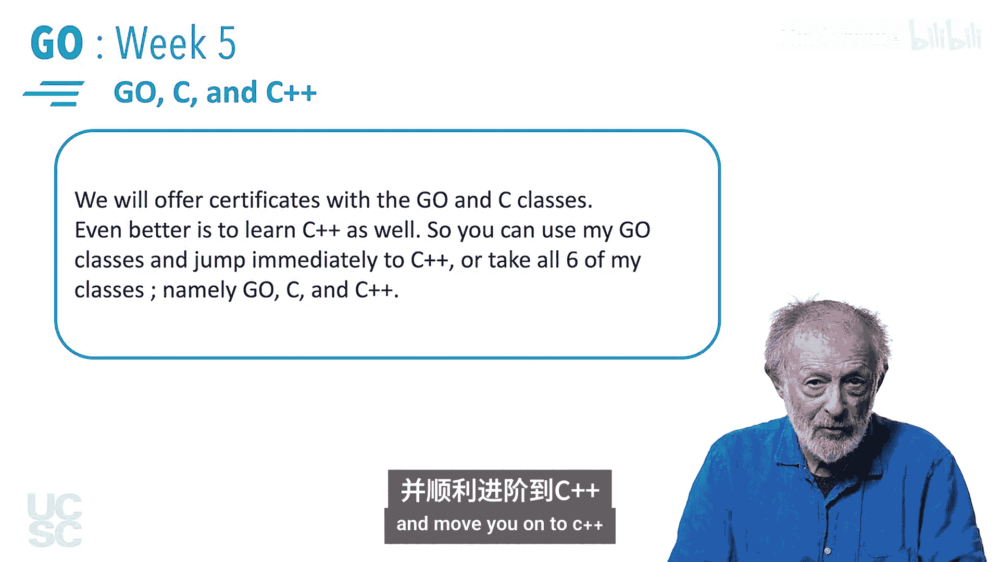

# 【加州大学】Go语言编程-｜-Go-Programming-Everyone-Part-2-p29-P29_证书_05_01_06--BV1GTe7z3Eqi_p29-

As I've already spoken about， Go is a direct descendant of C。

Many of the same people that worked on C and Uniunuchs。At Bell Labs， more recently， 2009。

Develop the goal language for Google。And in many ways， they cleaned up some of what word。

Problematic in C。 Now C was enormously successful。Very useful。

 especially when it came to writing operating systems， which is what it was designed for。

The category of language C is considered to be in is a system implementation language。

 It became so useful that it became， again， much like。呃。Java or Python or whatever。

 a more universal language。 But that wasn't its original intention。

So many of you come to this class knowing C， that's a big advantage。

 but also if you came to this as your first language。

 now you can easily and readily learn C after learning go because the two languages。

Are so similar in the same language category， and indeed， as we saw。

 they could be compiled together as well。 so it's very useful to have knowledge of both languages。

Okay， so both languages can be used together with SeaG， we just had a demonstration of that。

But it's also possible to use C plus plus Again， C plus plus was developed by Bjo Strwstrip at Bell Labs on early 1980s and then released into the general public around 1985 and started to pick up steam and became a very dominant industrial language because again。

 it had improved on。The earlier language C and also added on very critical features like object orientation。

 which was starting to become a popular development。

 So C plus plus can also be used together with go， but its techniques， unlike the Sego technique。

Are more complex， so wasn't a topic for this class。So if you had not learned C before this course。

You could use my introductory C classes on Coursera。

 and this will make you even more valuable as a go program。

C is very useful because there are extensive code libraries in C。

 so there might be stuff that you can pick up and see that you'd otherwise have to code from scratch and go。

 and in many instances the C code is faster。Especially when you use parts of the C code that are unsafe。

 or you may in fact use unsafe parts of the go code to allow you to avoid things like garbage collection。

 and this can be necessary， in some coding applications， especially real time applications。

So we're going to offer certificates with the go and C classes and even better throw in C++ because C++ again is a very dominant industrial language and has enormous tool set。

It has what is called the standard template library。

 so it's one of the pioneering examples of heavy use of generosity。

So you can use my go classes and jump immediately to C++ or even take all six of my classes and even if you've had some of the C knowledge。

 it would refresh you on your C knowledge and move you on to C++。

