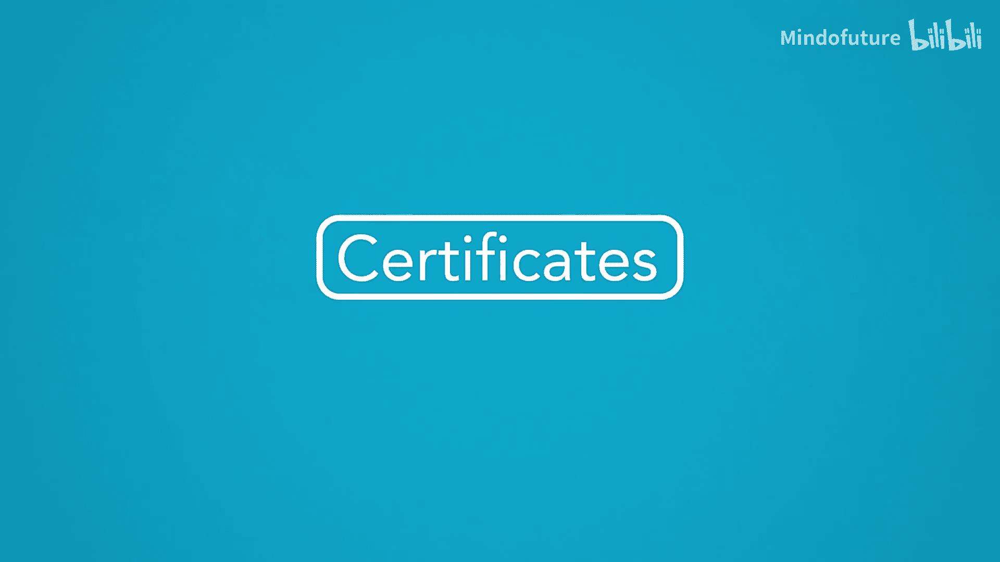
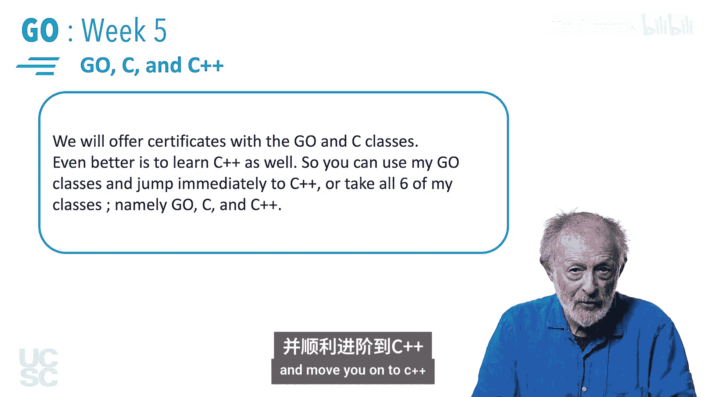

# Go语言编程：P29：Go与C/C++的关系

## 概述

在本节课中，我们将要学习Go语言与C/C++这两种经典编程语言之间的历史渊源和实际联系。我们将了解它们为何能协同工作，以及掌握这些语言如何提升你作为开发者的价值。

## Go与C的渊源

上一节我们介绍了Go语言的基本特性，本节中我们来看看它的“家族背景”。Go是C语言的直系后代。Go语言的许多开发者，正是当年在贝尔实验室参与C和Unix系统开发的原班人马。他们在2009年为谷歌设计了Go语言。

在许多方面，Go语言清理了C语言中存在的一些问题。C语言本身取得了巨大的成功，尤其在编写操作系统方面非常有用，这也是它最初的设计目标。C语言所属的类别被认为是“系统实现语言”。

## C语言的演变与通用性

C语言变得如此有用，以至于它像后来的Java或Python一样，演变成了一种更通用的语言，尽管这并非其最初的设计意图。

以下是C语言与Go语言关系的两个关键点：
*   许多学习本课程的学生已经了解C语言，这是一个巨大的优势。
*   如果你将Go作为第一门语言，在学完Go后也能轻松地学习C，因为这两种语言非常相似，属于同一语言类别。正如我们所见，它们甚至可以被一起编译。因此，同时掌握这两种语言的知识非常有用。

## Go与C/C++的互操作性

既然两种语言可以协同使用，我们来看看具体方式。通过CGo，Go和C可以一起使用，我们刚刚已经演示过这一点。

同样，Go也可以与C++一起使用。C++由Bjarne Stroustrup于20世纪80年代初在贝尔实验室开发，大约在1985年向公众发布，并逐渐流行起来，成为一门非常重要的工业语言。因为它改进了早期的C语言，并增加了面向对象等关键特性，而当时面向对象编程正开始流行。

然而，与CGo技术相比，Go与C++结合使用的技术更为复杂，因此不在本课程的讨论范围内。

## 学习C/C++的价值

如果你在本课程之前没有学过C，可以利用我在Coursera上的C语言入门课程进行学习，这将使你作为一名Go程序员更具价值。

C语言非常有用，因为它拥有庞大的代码库。这意味着你可以直接使用现成的C代码，否则你可能需要在Go中从头开始编写。在许多情况下，C代码的运行速度更快，尤其是当你使用C代码中那些“不安全”的部分时。事实上，你也可以使用Go代码中的“不安全”部分来避免垃圾回收等机制，这在某些编码应用（特别是实时应用）中是必要的。

## 课程与证书

我们将为Go和C课程提供证书，并且更棒的是，还会加入C++。因为C++同样是一门非常重要的工业语言，拥有庞大的工具集。它拥有所谓的“标准模板库”，是大量使用泛型的先驱典范之一。

因此，你可以学完我的Go课程后，直接跳转到C++学习，或者学习全部六门课程。即使你已经具备一些C语言知识，这些课程也能帮你巩固C语言知识，并引导你进入C++的世界。

## 总结

本节课中我们一起学习了Go语言与C/C++的历史联系和实际协作方式。我们了解到Go脱胎于C，两者语法相似，可通过CGo互操作。同时，掌握C/C++能让你利用丰富的现有库，并在特定场景下获得性能优势。结合这些语言的学习，将大大提升你的编程能力和职业竞争力。