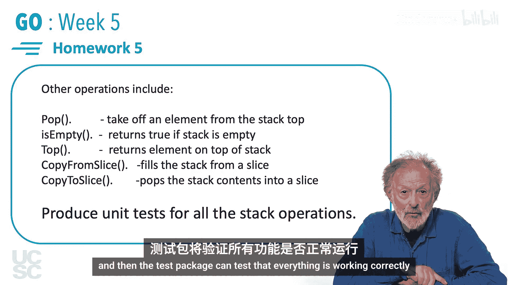

# 【加州大学】Go语言编程-｜-Go-Programming-Everyone-Part-2-p30-P30_第五周_同行评审作业_05_01_08--BV1GTe7z3Eqi_p30-

So on week five homework， we're going to extend the generic version of stack to include a large list of standard operations on this data type。

So a stack， remember， can be used to store almost anything。

And it has some very specific requirements。So a stack like a stack of dishes is something in which you can take the dish off the top or you can put a dish back on top。

 think of it as a pile of dishes or plates or trays。And that's the stack data type。

 It's called the last in first out data type。Now， as part of this problem。

 not only you'll extend the code to include a large list of standard operations， but you'll also。

Use unit testing， remember go has specific provisions for helping you debug your code or making sure that you have correctness。

 as's called unit testing and you will be asked to devise unit tests。For each operation。ok。So recall。

 if we're going to have a generic stack， that's T， T is going to be a type any。

 so any is the universal type， it means anything there。 remember， we did some。Generic。

 where we use something called number， well number was restricted because we needed the ad operation。

And not everything works with a， so we had to specify when we could expect the ad operation to work Now here。

 since all we're doing is storing the information， we can store anything。

 that's why we're using the universal generic type any。

So all that is is it's basically a slice of type T， but then the functionality。

 the methods that we write on it are what restricted to being a stack。Okay。

So here is the basic operation we've seen before on a stack。

We are going to push a value onto the top of the stack and we do that by taking the vows。

Form of the value and appending it to the slice。So。

That's a very simple operation and because G does all of this memory management for you。

 a pen just keeps adding onto internally what is a slice the additional storage for that value so here is the method for this the basic operation push。

 but now you'll need to write the analogous code for operation P， recall pop on a stack。

Takes a value off the stack， and then。The next value then appears at the top， okay。

Here are the other operations that we're asking you to code so you can get a full。A fully。Useful。

Stack collection type， we're going to have pop， take off an element from the stack top。

 we're going to have is empty。Because we can't pop a stack if the stack is empty。

 so it'll return true if the stack is empty。Then there's an operation called Top。

 sometimes you'll see that also called peak PEK。And top returns the element on top of the stack。

 but it doesn't pop the stack， so it just looks at the top of the stack and says， oh。

 that's the value I found there。And then we're going to have some useful operations that allow us to use stack with slice。

 I'm going to say copy from slice so that we can take all the values from the stack。

 copy them into a slice。And then maybe the slice is better for certain kinds of operations instead of the stack。

 and we're going to also do the opposite， we're going to say copy to slice where we pop the stack contents。

Onto a slice， so copy thumb slice and copy two slice will be two operations that deal with the moving information between slice and stack。

 and then for each of these operations， you're going to provide unit testing and then the test package can test that everything is working correctly。

