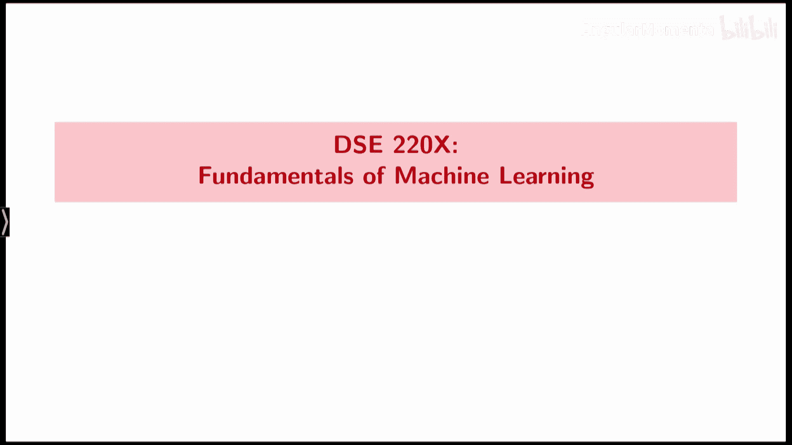
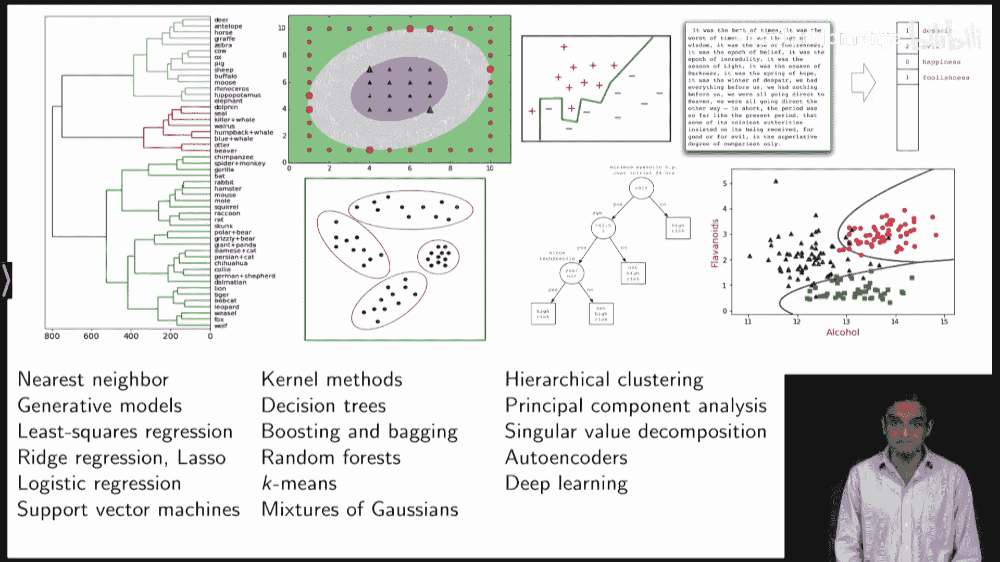
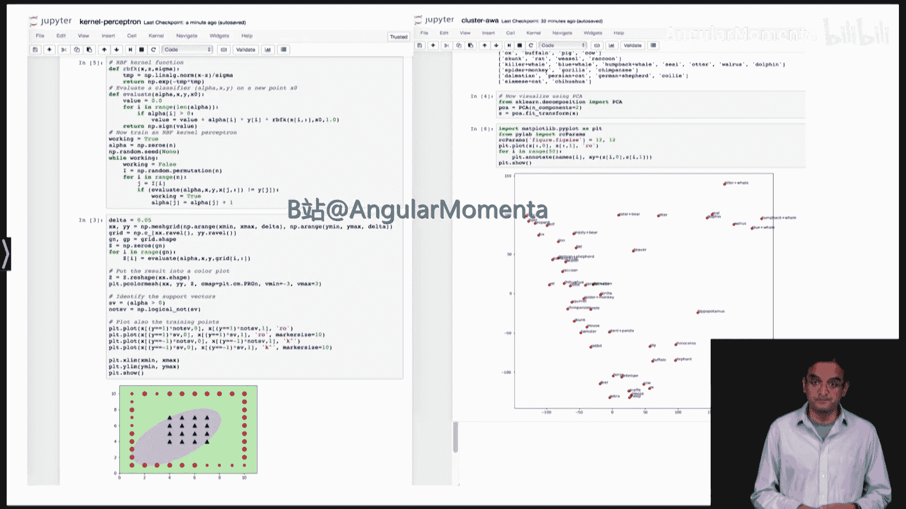

# 002：课程导论 🚀

在本节课中，我们将要学习《机器学习基础》这门课程的整体框架、你将掌握的核心技能，以及课程背后的设计理念。

欢迎来到《机器学习基础》课程。在本课程中，你将深入学习如何从数据中构建模型，并利用这些模型进行预测。

我们将涵盖最广泛使用的机器学习方法，包括逻辑回归、支持向量机、核方法、主成分分析、随机森林、神经网络等。我们会看到这些方法在图像理解、情感分析、语言处理、性格测试等诸多领域的应用。最重要的是，我们将深入探究这些方法的基本原理。

我们不会将它们视为需要盲目遵循的“食谱”，而是将其理解为一旦掌握，就可以进行各种修改和改进的有趣方法。

## 数学基础 🔢

为了达到这种理解层次，我们将深入机器学习的数学基础。我们主要需要三类数学知识：**概率论**、**线性代数**和**优化理论**。我们将非常仔细地讲解这三个领域，因为它们对于掌握机器学习至关重要。

## 你将获得的技能 🛠️

那么，学完这门课程后，你将获得哪些技能呢？以下是核心收获：

首先，你将熟练掌握最常用的机器学习方法。你将了解它们是什么、如何工作、为何有效、适用于何种数据、各自的优缺点以及底层原理。这将帮助你评估哪些方法最适合解决特定问题，并帮助你理解和解释所得到的结果。

其次，你将获得改造现有方法以适应特定应用的能力。有时直接使用现成的方法是可以的，但通常其性能可能达不到你的期望。为了达到更高水平，你需要进行定制化操作，例如在现有方法基础上进行修改，或者对数据进行变换。本课程将教你如何进行有效的改造。

最后，本课程将为你的机器学习基础打下足够扎实的根基，帮助你跟上这个飞速发展的领域。

## 课程实践与项目 💻

对于我们将学习的每一种方法，你都会获得一个或多个Jupyter笔记本。这些笔记本包含代码和可视化内容，展示了该方法在特定数据集上的应用。你可以使用它们进行实验，真正感受这些方法是如何工作的。

课程还将包含编程项目。这些项目将给你机会跳出固有思维，创造性地在现有方法基础上构建新方案以解决问题。在课程结束时，这些项目集合将构成一个作品集，即一系列独立的笔记本，你可以向他人展示，例如给你的朋友留下深刻印象。

## 关于讲师 👨‍🏫

以上是对课程的概述，接下来让我简单介绍一下自己。我是加州大学圣地亚哥分校的教授，在这里任教大约15年。我的研究方向是机器学习和算法，这是我最关注的两个领域。这门《机器学习基础》课程，正是基于我在这里所教授的一门课程精心设计的，我希望将它开放给更广泛的受众。希望你喜欢这门课。

---

本节课中，我们一起学习了《机器学习基础》课程的整体目标、所需的数学基础、你将获得的核心技能，以及课程包含的实践环节。我们明确了本课程旨在帮助你深入理解而非机械套用方法，并为你未来的学习和创新打下坚实基础。