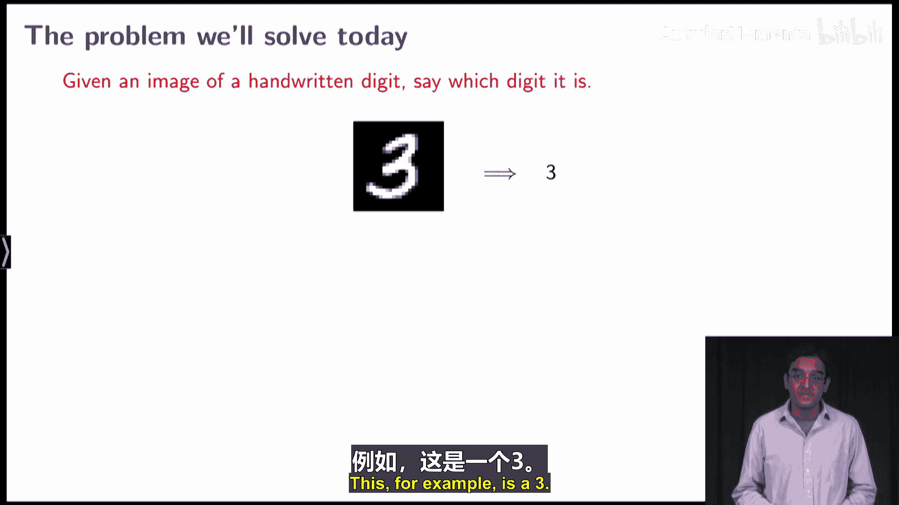
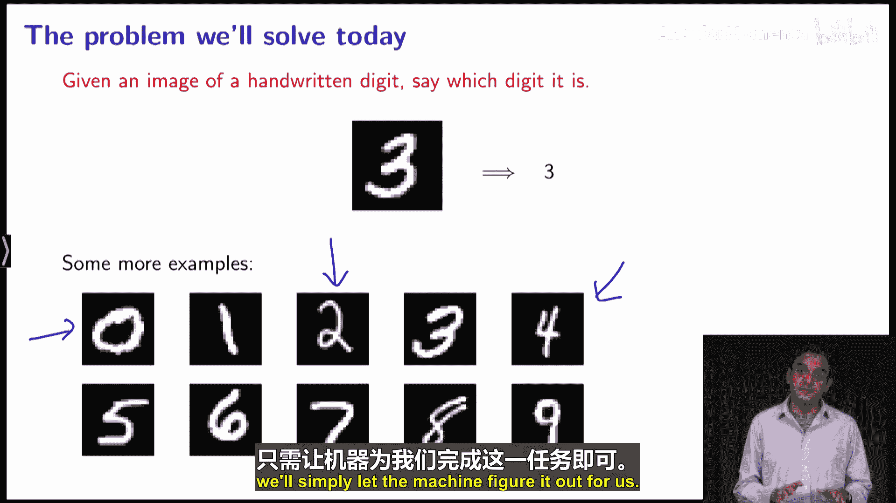
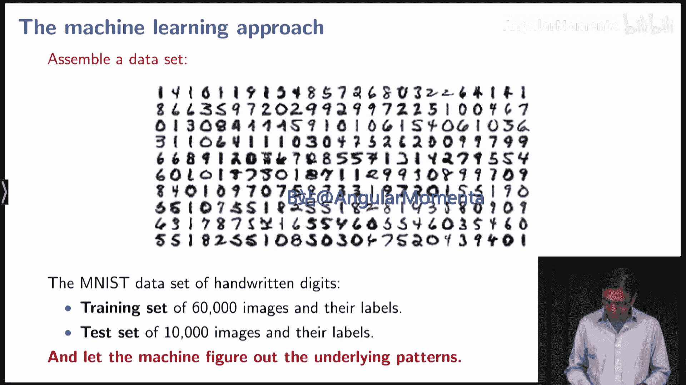
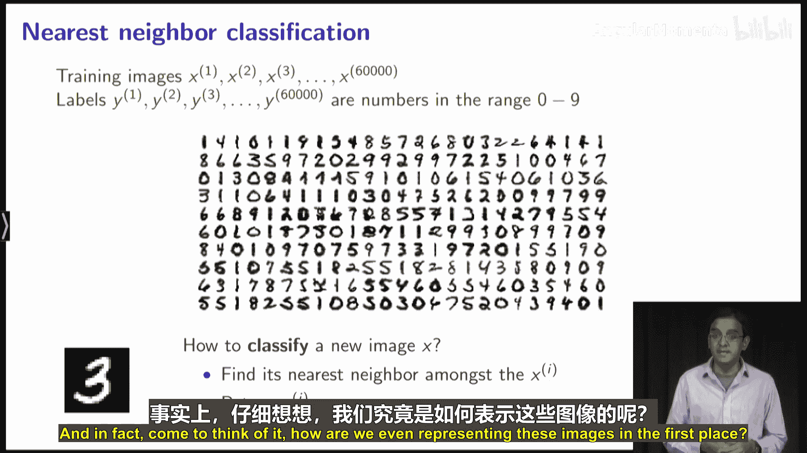
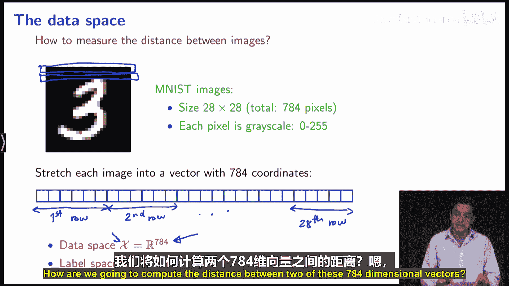
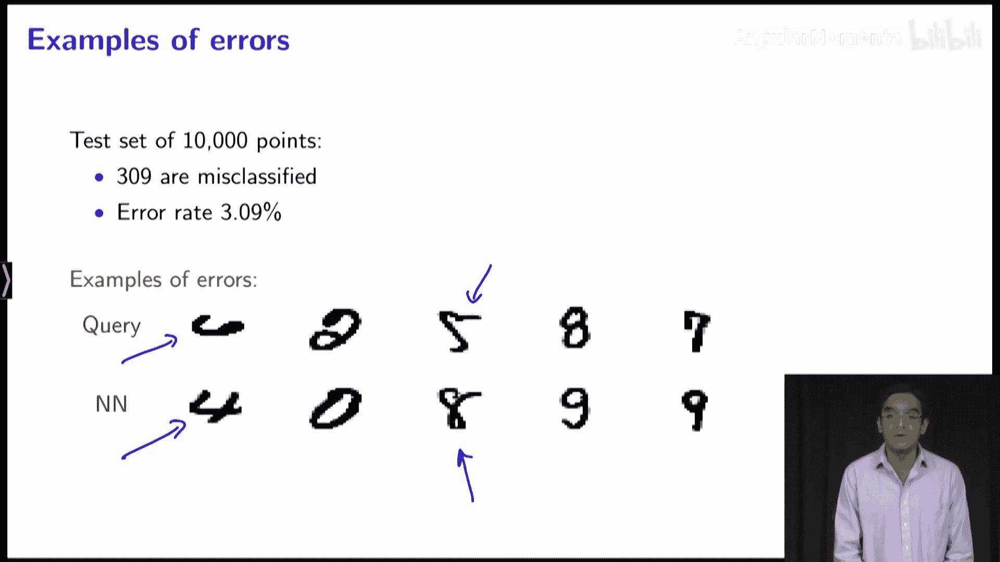

# 003：最近邻分类

在本节课中，我们将通过了解最古老且最持久的分类方法之一——最近邻分类，来初步感受机器学习。我们将以此方法为切入点，介绍分类问题的概念，并引入一些基本的机器学习术语，如训练集、测试集、训练误差和测试误差。我们将看到数据如何表示为欧几里得空间中的向量，以及如何计算这些向量之间的距离。所有这些都将为我们应用最近邻分类器奠定基础。

## 概述

我们将要解决的具体问题是：给定一张手写数字的图片或图像，我们需要判断它是哪个数字。例如，下图是一个数字“3”。

而这是一个“0”，那是一个“2”，那是一个“4”，那是一个“7”，等等。

## 传统方法的局限性

我们如何解决这个问题呢？一个想法是：数字“0”有一个环，“8”有两个环，“1”有一条直线，“4”有三条直线。我们可以编写一个小程序，让它接收一张图像，计算它有多少个环和多少条直线，以及这些环和直线的相对位置。也许我们可以利用这些信息，然后编写一套简单的规则来判断它是哪个数字。

然而，人们很久以前就尝试过这种方法，效果并不理想。第一个问题是手写体噪声非常大，因此识别环和直线的数量并不像看起来那么容易。此外，人们书写“7”、“2”等数字的方式存在巨大差异。因此，需要创建大量的规则来涵盖所有可能的情况。即使付出了所有这些努力，最终的系统效果仍然不佳。

## 机器学习方法

因此，今天我们来看一种截然不同的方法——机器学习方法。我们不再试图自己找出底层模式，而是让机器为我们找出这些模式。

机器要找出这些模式，需要大量数据。因此，首先我们需要收集一个带有正确标签的手写数字数据集。幸运的是，这样的数据集已经存在，它叫做MNIST数据集。它包含60,000张带标签的手写数字图像，我们可以使用这个训练集来学习一个分类器，即一个接收图像并输出其认为正确数字的函数。

MNIST还包含一个单独的测试集，有额外的10,000张图像。我们可以使用这个测试集来评估分类器的真实性能。

## 最近邻分类器

今天要讨论的分类方法可能是能想到的最简单的方法，它叫做最近邻分类。我们拥有包含60,000张图像的训练集。为了对一张新图像X进行分类，我们只需遍历这个训练集，找到与X最相似的图像，即X的最近邻，然后输出这个最近邻的标签。就是这样。

这非常简单。但为了实现它，我们确实需要一个距离的概念，即图像之间相似度的概念。事实上，我们首先需要考虑的是，我们如何表示这些图像？

## 图像表示与向量化

我们将用向量来表示每张图像。MNIST图像是28x28像素，总共有784个像素。每个像素本身是灰度值，其值在0到255之间，0表示纯黑，255表示纯白。

为了将这样的图像转换为向量，我们可以简单地将它拉伸成一个具有784个坐标的向量。具体做法是：首先复制第一行（前28个像素），然后是第二行（接下来的28个像素），依此类推，直到最后一行（第28行）。通过这种方式，每张图像都变成了一个784维的向量。

因此，我们的数据空间（记为X）是784维的欧几里得空间，写作R^784。我们的标签空间Y就是可能的数字集合{0, 1, 2, ..., 9}。

现在，我们有了表示数据的具体方法，可以讨论距离函数了。我们将如何计算两个784维向量之间的距离呢？

## 欧几里得距离

最常用的距离函数是欧几里得距离。让我们先回顾一下它在二维空间中的定义。下图是二维空间中的两个点X和Z。

它们之间的欧几里得距离就是连接它们的线段的长度。观察这两个点，它们在第一个坐标上相差2，在第二个坐标上相差3。因此，这条线段的长度是√(2² + 3²)，即√13。这就是X和Z之间的欧几里得距离。

在高维空间中，公式基本相同。要计算X和Z之间的距离，我们只需看X和Z在每个坐标上的差值，将这些差值平方后求和，然后取总和的平方根。这就是欧几里得距离。我们将用双竖线符号来表示它，这个符号除非特别说明，否则总是指欧几里得距离。

**公式**：`distance(x, z) = √( Σ (x_i - z_i)² )`

很好。现在我们可以应用最近邻分类了。我们拥有60,000张图像的训练集。为了对一张新图像X进行分类，我们将遍历这60,000张图像，找到在刚刚讨论的784维向量表示下，与X的欧几里得距离最近的那一张。我们找到那个最近邻，并返回它的标签。

## 分类器性能评估

那么这个分类器有多好，准确度如何？让我们看一些数字。我们有一个包含60,000个点的训练集，在这个训练集上的错误率是多少？对于每个训练点，它的最近邻就是它自己，所以它总能得到正确的标签。因此，训练误差是0。

正如你所看到的，训练误差通常不能很好地指示未来数据上的性能。这就是为什么我们有一个独立的测试集。测试集上的错误率，即测试误差，是衡量分类器质量的更好指标。

在这种情况下，我们可能期望什么样的错误率呢？在我们得到答案之前，先做一个小小的思想实验。一个随机分类器的错误率会是多少？这种分类器甚至不看数据，只是随机猜测一个0到9的数字。这种分类器的错误率会是多少？无论正确标签是什么，它猜中该标签的概率正好是1/10，所以它会有9/10的时间是错的。它的错误率将是90%。

那么最近邻分类器在测试集上的错误率是多少呢？结果是3.09%。这相当不错。总共有10,000个测试点，最近邻分类器弄错了309个。对于一个如此简单的分类器来说，这已经很好了。

现在，让我们看看最近邻分类器犯的一些错误。例如，对于这张图像，它的最近邻是下面这张图，所以它认为原图是“4”。

对于另一张图像，它的最近邻是下面这张图，所以它给出的标签是“8”。这些只是错误案例的随机示例。你可以看到，一旦你理解了分类器在做什么，这些错误其实相当容易理解。

## 总结

本节课中，我们一起学习了我们的第一个分类器——最近邻分类器。我们了解了如何将图像表示为高维向量，如何使用欧几里得距离来衡量相似度，以及如何利用带标签的训练集对新数据进行分类。我们还区分了训练误差和测试误差，并认识到测试误差是评估模型泛化能力的更可靠指标。虽然最近邻方法简单，但在手写数字识别任务上取得了不错的效果。下次课，我们将探讨如何改进这个分类器。