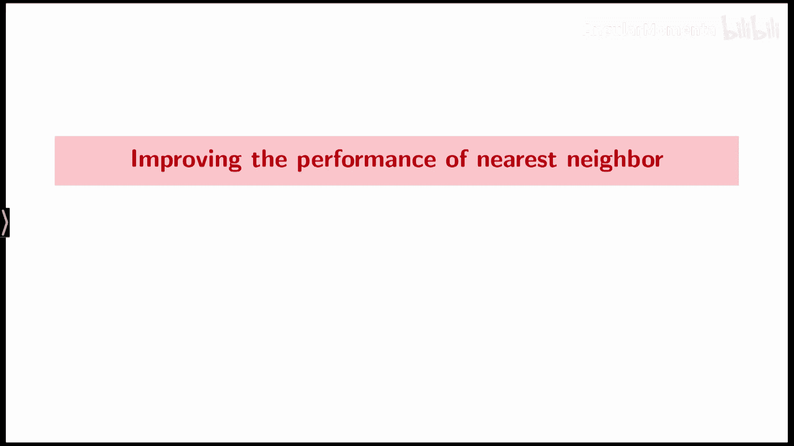
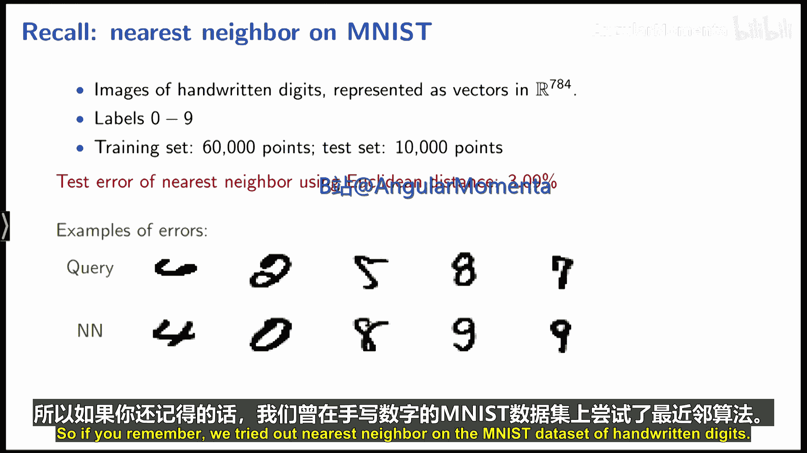
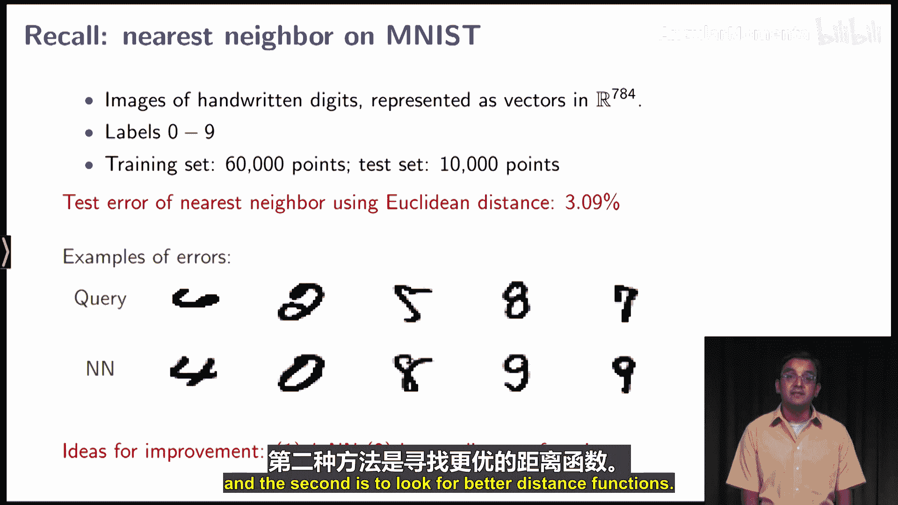
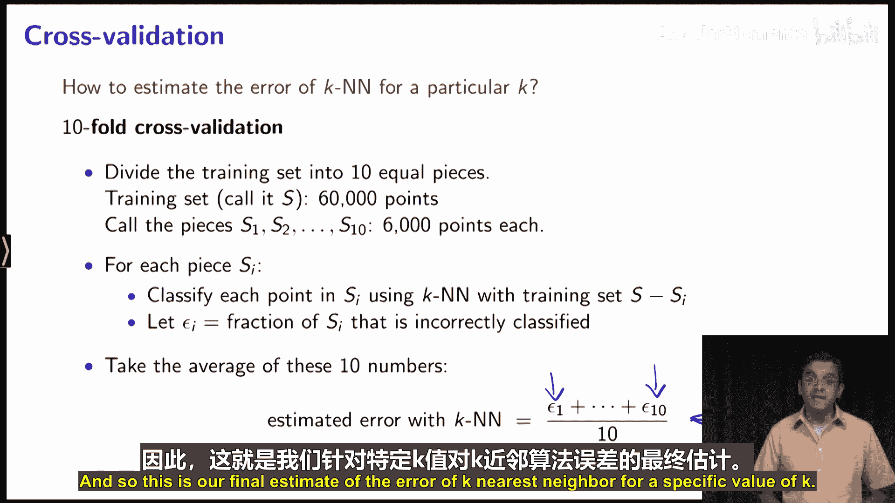
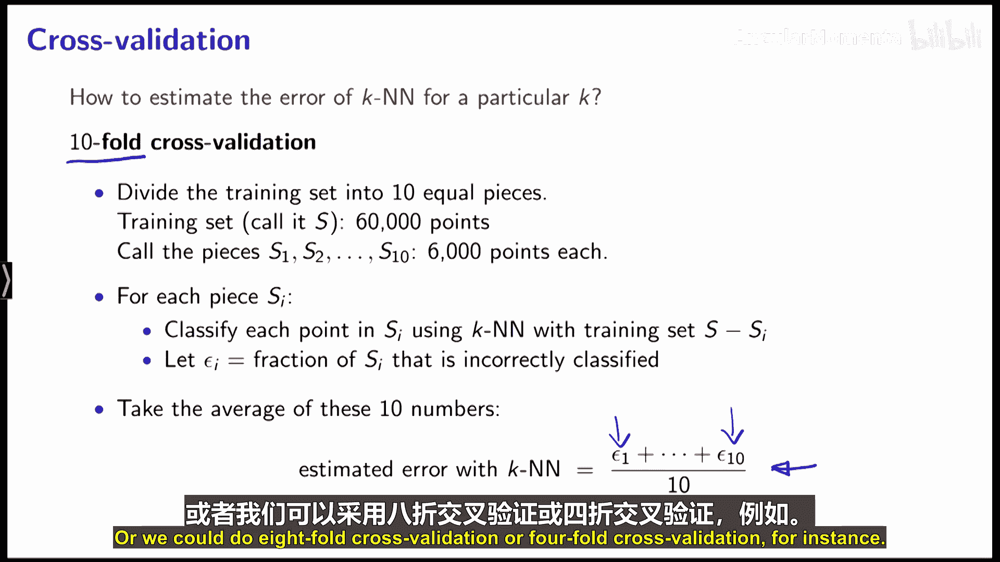
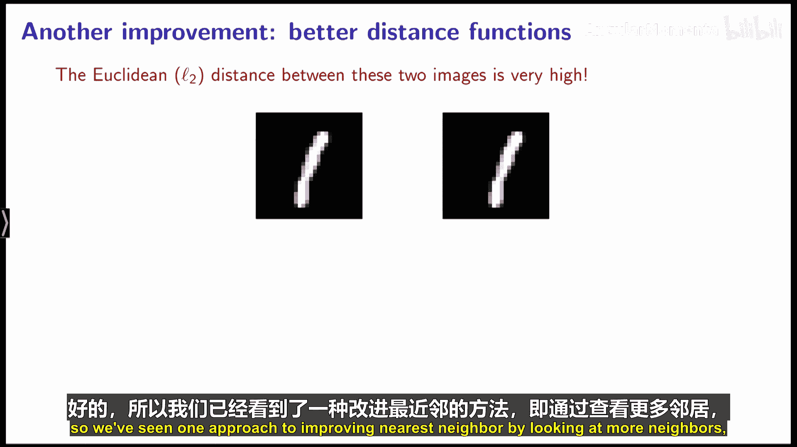
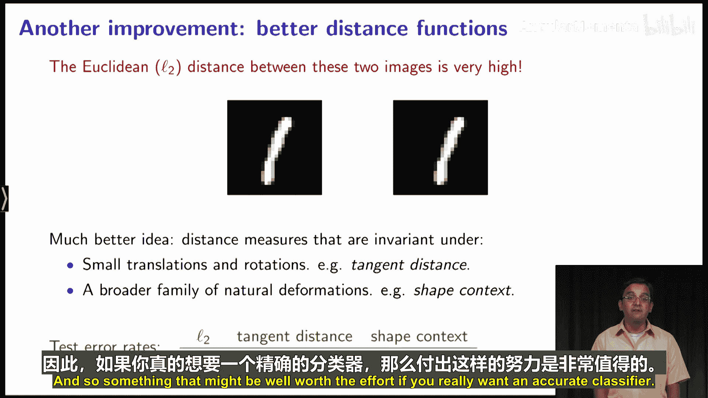
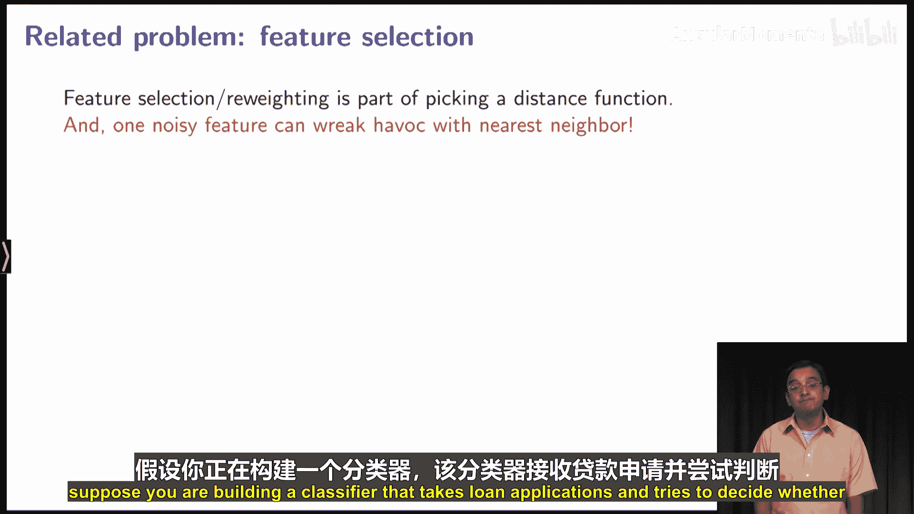
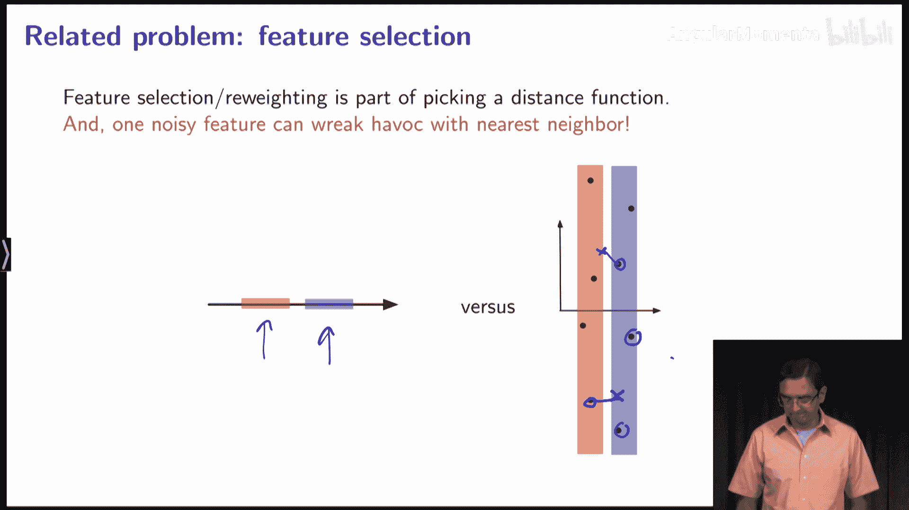
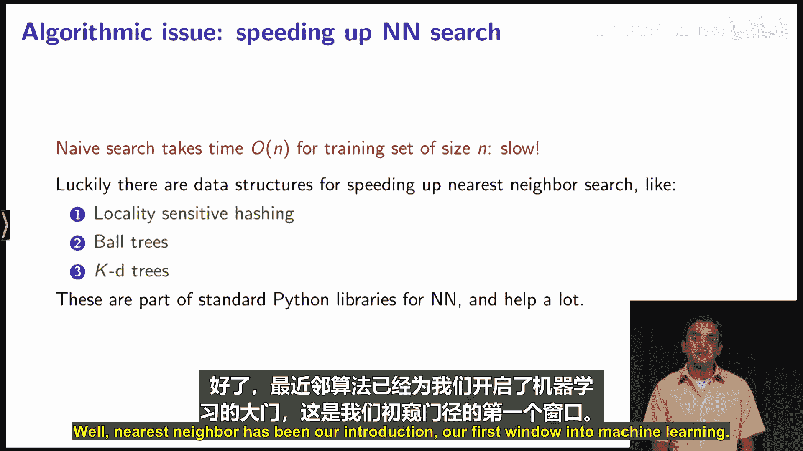

# 004：优化最近邻算法

## 概述
在本节课中，我们将学习如何改进基础的最近邻分类算法。我们将探讨两种主要方法：K最近邻算法和寻找更好的距离函数。同时，我们也会了解如何通过交叉验证选择最佳参数，以及如何处理特征选择和算法效率问题。

---

## 回顾基础最近邻分类
上一节我们介绍了最近邻分类的基础知识。我们尝试在MNIST手写数字数据集上应用最近邻算法，并发现它在独立测试集上取得了3.09%的错误率，这是一个相当不错的结果。算法也犯了一些错误。

## 提升性能的方法
为了进一步提升性能，我们来看两种标准方法。第一种是转向K最近邻算法，第二种是寻找更好的距离函数。

---

## K最近邻分类
K最近邻分类是一个简单的想法。在执行最近邻分类时，我们不再只寻找测试集中最接近的一个点，而是寻找最接近的三个点或五个点。每个点都有一个标签，我们返回这些点中的多数标签或最常见的标签。

以下是K最近邻在MNIST数据集上的表现：
*   当 **K=1** 时，这就是我们之前看到的基础最近邻分类器，错误率为3.09%。
*   当 **K=3** 时，我们为每个新图像找到训练集中最接近的三个图像，并返回它们的多数标签。错误率略微下降到2.94%。
*   当我们尝试更大的K值（如5、7、9等）时，错误率又开始上升。

需要重点说明的是，这些错误率是在独立的测试集上测量的。在训练集上测量错误率对于预测未来性能来说是一个非常差的指标。

在这个特定数据集上，调整K值有所帮助，但效果并不显著。在其他情况下，它有时会有很大帮助。

---

## 如何选择K值
在这个示例中，我们有一个独立的开发集，但在实际生活中通常没有。我们通常只有训练集。我们已经明确，训练集上的错误率并不能很好地反映实际错误率。

我们如何处理这个问题？这是一个相当棘手的问题，并且这个问题不仅限于最近邻算法。我们在机器学习中会反复遇到这种情况。我们研究的许多方法都有像K这样的参数需要正确设置。如果设置得当，方法就有效；如果设置不当，方法就无效。我们必须仅使用训练集来设置它们。

一个标准的方法是使用**交叉验证**。

让我展示一下如何为K最近邻算法进行交叉验证。假设我们想评估一个特定的K值选择，例如K=3。我们想仅使用训练集来估计3最近邻的错误率。

以下是**十倍交叉验证**的工作原理：
1.  我们取训练集（60，000个点），并将其分成10个相等的块，即每块6000个点。我们称这些块为S1， S2， ...， S10。
2.  对于每个子集Si，我们执行以下操作：
    *   将该子集视为测试集。
    *   将剩余的九个子集视为训练集。
    *   对于Si中的每个点（6000个点），我们使用剩余的54，000个点对其进行分类。
    *   这将为我们得到Si的错误率，我们称之为εi。
3.  当我们对每个部分都完成此操作后，我们就得到了这10个错误率ε1到ε10。其中每一个单独都是对K最近邻错误率的一个相当不错的估计。
4.  为了得到更好的估计，我们对这10个错误率取平均值。这个平均值就是我们对于特定K值的K最近邻错误的最终估计。

当然，我们可能想尝试多个K值。我们会尝试K=1， K=3， K=5等等。在每种情况下，对于每个K值，我们都会运行十倍交叉验证，得到一个错误估计，然后选择错误估计最低的K值。这就是我们为K最近邻算法寻找最佳K值的方法。

这里我描述的是**十倍交叉验证**，因为我们把数据集分成了10等份。但我们也可以做**五折交叉验证**（分成5份，每份12，000点），或者八折、四折交叉验证等。

---

## 寻找更好的距离函数
我们已经看到了一种改进最近邻算法的方法，即通过观察更多邻居（K个邻居）而不仅仅是一个。另一种在许多情况下非常有效的策略是寻找更好的距离函数。

当我们在MNIST上运行最近邻算法时，我们使用了欧几里得距离。但实际上，欧几里得距离对于图像来说通常不是一个好的选择。

例如，看这两张图像。它们实际上是相同的，只是其中一张稍微向右滚动了一点。这对我们来说差别不大，但这意味着它们的向量表示完全不同，因此它们之间的L2距离实际上很大。显然，欧几里得距离对于图像来说不是一个好的选择。

我们想要的是提出一个不同的距离函数，一个不会因为图像轻微平移或旋转而发生巨大变化的距离函数。研究人员已经对此进行了研究，并提出了一种称为**切线距离**的距离函数。

更好的距离函数应该对更大范围的形变保持不变，不仅仅是小的平移和旋转，可能还包括将一条线稍微弯曲等。这种距离函数的一个例子叫做**形状上下文**。

当你在最近邻算法中使用这些更好的距离函数时，MNIST上的性能会如何？我们可以看到，性能显著提高。例如，使用形状上下文时，错误率远低于1%。

总的来说，利用领域知识选择更好的数据表示、更好的距离函数和相似性函数，对于分类任务可能非常有益。如果你真的想要一个准确的分类器，这可能是非常值得投入精力的。

---

## 特征选择
选择距离函数的一个方面首先是选择正确的特征。在MNIST的例子中，我们使用的特征是图像中的784个独立像素，这些特征可以说都与分类相关。

但在许多其他情况下，数据中有很多特征与手头的分类任务完全无关。例如，假设你正在构建一个分类器来处理贷款申请，并试图判断申请人是否有违约风险。在这种情况下，贷款申请数据包含很多有用信息，如年龄、收入等，但也包含很多完全不相关的信息，如社会安全号码。如果你不删除这些特征，它们可能会严重干扰最近邻算法。距离计算可能完全由这些特征主导。

这里有一个图示说明。在左边，我们有一个一维数据集，有两个标签：红色和蓝色。具有较小x值的点是红色，具有较大x值的点是蓝色，它们很好地分开了，最近邻算法在这个一维数据上会表现得非常好。

在右边，我们决定添加一个沿x2轴的额外特征。这个特征完全无关，并且完全破坏了最近邻算法的性能。例如，假设这些点是训练点。这个测试点会如何分类？它的最近邻是这个点，所以它会被分类为红色，但这并不好。这个点会如何分类？它的最近邻是这个点，所以它会被分类为蓝色，同样很糟糕。

因此，在使用最近邻算法之前，**特征选择**非常重要。

---

## 算法效率
到目前为止，我们一直在讨论提高最近邻算法的统计性能，即提高其分类准确率。但另一个非常重要的事情是算法的效率方面。

如果训练集很大，最近邻搜索实际上可能相当慢。例如，当我们在MNIST上做最近邻时，为了分类一个新图像，我们必须查看60，000个训练图像。这并不令人愉快。你能想象如果训练集有100万张或1亿张图像吗？那将使最近邻算法完全不切实际。

更正式地说，如果有一个大小为N的训练集，一个朴素的最近邻搜索需要与N成正比的时间，这非常糟糕。好消息是，这个问题已经被研究了几十年，人们已经提出了各种数据结构来显著加速最近邻搜索。这些数据结构有诸如**局部敏感哈希**、**球树**、**k-d树**等名称，还有很多其他类型。主要的是要意识到它们的存在。例如，它们是Python标准库的一部分。在某些情况下，它们可以将搜索时间从大约N减少到大约log N，总的来说，它们非常有帮助。

---

## 总结
在本节课中，我们一起学习了如何优化最近邻算法。我们介绍了**K最近邻算法**，它通过考虑多个最近邻的多数投票来提升稳定性和可能的效果。我们学习了使用**交叉验证**（如十倍交叉验证）来仅基于训练数据选择最佳K值等超参数。我们还探讨了改进距离函数的重要性，例如针对图像任务的**切线距离**或**形状上下文**，并强调了**特征选择**对于消除无关或干扰特征的关键作用。最后，我们提到了处理大规模数据时算法效率的问题，以及使用如**局部敏感哈希**、**球树**等专用数据结构来加速搜索的必要性。

最近邻算法是我们进入机器学习的第一个窗口，我们用它讨论了训练误差与测试误差、特征选择和交叉验证等基本概念。很快我们将遇到各种其他分类方法，但最近邻是其中最古老、最简单且最灵活的方法之一。