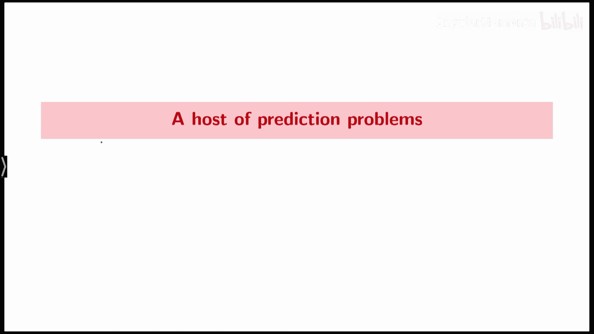
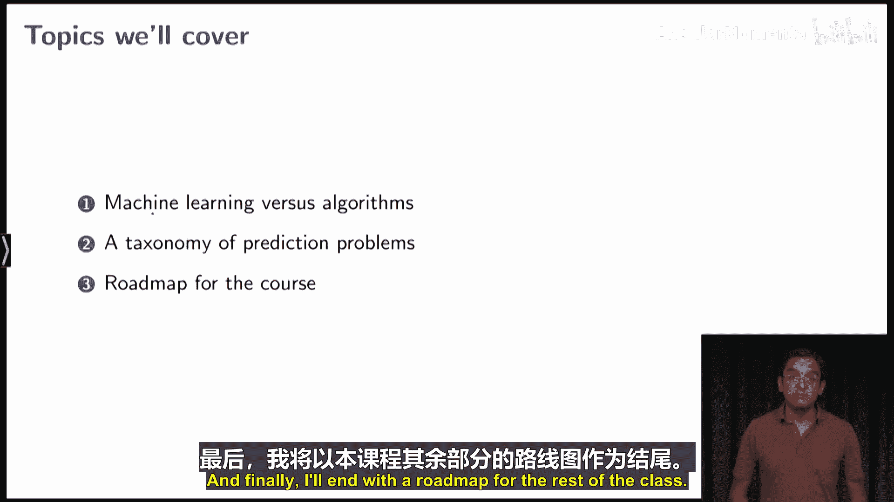
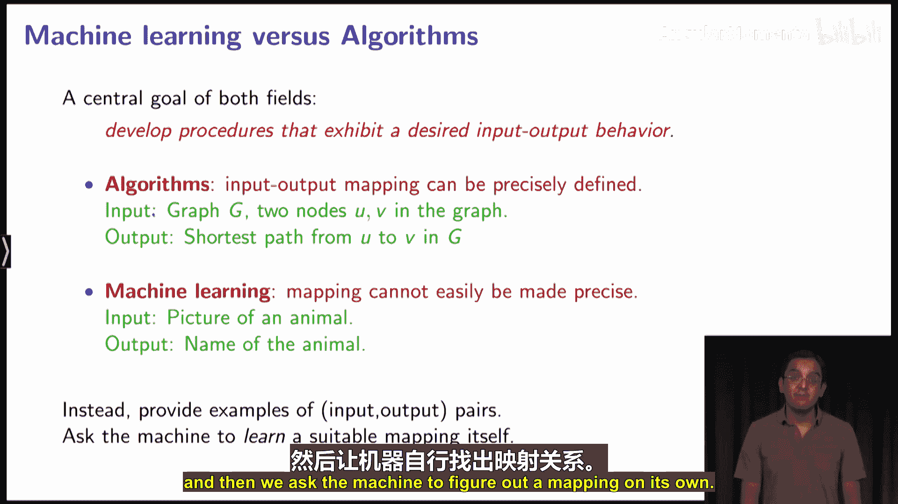
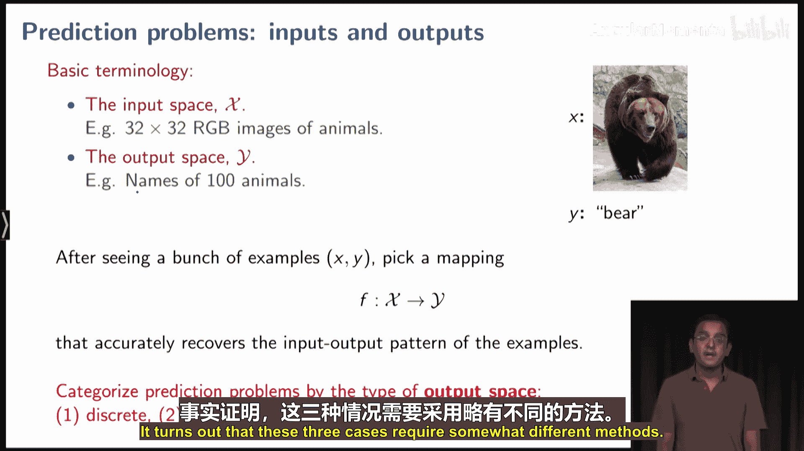
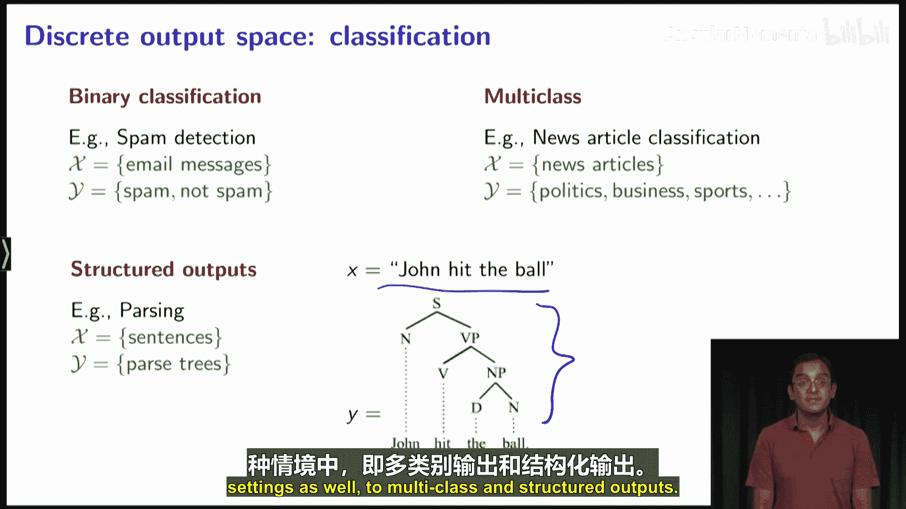
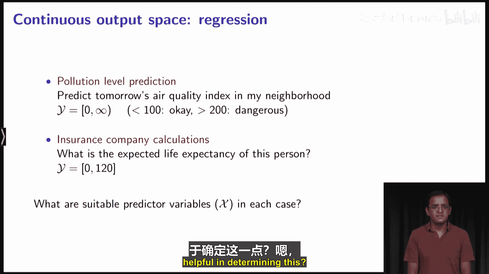
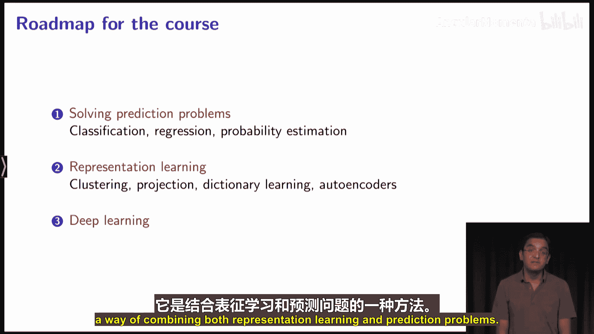

# 006：预测问题概述

在本节课中，我们将学习机器学习中的核心概念——预测问题。我们将从机器学习与算法的区别讲起，然后正式定义预测问题，并按照输出空间的类型对其进行分类。最后，我们将概览本课程后续的学习路线。

## 机器学习与算法

上一节我们提到了手写数字分类的例子，这是一个预测问题。在深入探讨之前，我们先来看看机器学习与算法的异同。

在当今的计算机世界中，机器学习和算法是两项核心技术。有趣的是，这两个领域有一个共同的核心目标：开发能够实现特定输入输出功能的程序或代码片段。

在算法领域，人们花费数十年时间寻找在图中计算两点间最短路径的好方法。输入是一个图以及图中的两个节点，期望的输出是这两个节点之间的最短路径。算法是一系列从输入导向期望输出的精确步骤。

在机器学习领域，我们也希望找到能从输入映射到期望输出的程序。但我们处理的问题性质不同，通常很难列出一套能直接得到输出的精确步骤。

例如，假设输入是一张动物的图片，期望的输出是动物的名称。很难想象能有哪些精确的步骤来完成这个任务。事实上，这个问题甚至没有精确的定义。因此，我们不是自己设计算法，而是收集大量输入输出对的示例，然后让机器自行找出一个映射关系。

## 预测问题的形式化定义

上一节我们介绍了机器学习与算法的区别，本节中我们来看看预测问题的正式定义。

这是一个预测问题。存在一个输入空间，我们通常称之为 **X**，例如所有动物图片的集合。同时存在一个输出空间，例如动物名称的集合。

我们心中有一个从输入到输出的期望映射，但这个映射通常无法被我们精确地描述。因此，我们收集一个由 **XY** 示例组成的训练集。学习机器接收这个训练集，并利用它来选择一个从 **X** 到 **Y** 的映射函数。这个函数接收一张动物图片，并返回它认为正确的动物名称。

通常，学习算法的工作方式是寻找一个在训练集上表现良好的函数或映射。

## 预测问题的分类

我们已经讨论了预测问题的定义，接下来看看如何对它们进行分类。预测问题种类繁多，一种常见的分类方式是依据输出空间的类型。我们通常区分以下三种情况：
*   当输出空间是离散的。
*   当输出空间是连续的。
*   当输出空间由概率值组成。

事实证明，这三种情况需要的方法有所不同。

### 分类问题：离散输出

以下是当输出为离散值时的情况，我们称之为**分类**。

*   **二分类**：最简单的设置是二分类，只有两种可能的输出，例如好/坏、正/负、是/否。在垃圾邮件检测中，输入 **X** 是电子邮件，期望的输出只是“垃圾邮件”或“非垃圾邮件”。
*   **多分类**：在分类问题中，通常存在多于两种可能的输出。例如，输入是一篇新闻文章，期望的输出是文章的主题，如政治、商业、科技、体育、娱乐等。
*   **结构化输出**：也存在期望输出是离散的，但具有更复杂组合结构的情况。例如在句法分析中，输入是一个句子（如“John hit the ball”），期望的输出是该句子的句法分析树。输出空间仍然是有限的、离散的，但比简单的类别标签更复杂，具有特定的结构。

我们将投入大量精力研究二分类，因为这是一个研究预测问题的简洁而简单的设置。我们将发现，我们开发的方法可以很容易地推广到其他两种设置，即多分类和结构化输出。

### 回归问题：连续输出

上一节我们讨论了离散输出的分类问题，本节中我们来看看当输出为连续值时的情况，这被称为**回归问题**。

以下是几个回归问题的例子：
*   **预测污染水平**：假设我们想预测明天的污染水平，因为这有助于我们决定是否让孩子明天外出。衡量污染水平的一个常见方法是空气质量指数。这是一个正数，如果小于100意味着空气质量尚可，大于100则不佳，超过200则意味着空气非常危险。输出空间由正数组成，是一个连续空间。即使我们只预测整数值，我们仍然将其视为连续空间，因为预测值100与101或102非常接近，而与200相差甚远。换句话说，这些值位于一个尺度上。
*   **保险公司计算**：保险公司在你申请保单时感兴趣的一件事是，他们预计你还能活多久。这决定了他们向你收取的费用。这里，我们想要预测的数字 **y** 是你的死亡年龄，假设范围在0到120岁之间。同样，我们总是可以将其四舍五入到最接近的整数，但我们仍然将其视为一个连续体，因为这些数字位于一个尺度上。

一个有趣的问题是，对于这类回归问题，什么是合适的预测变量？以预测寿命为例，这是一个被深入研究过的领域。人们使用的信息包括你的年龄、性别（女性往往寿命更长）、是否吸烟、是否有高血压及是否服药、是否有高胆固醇及是否服药等。

### 概率估计问题

上一节我们介绍了回归问题，本节中我们来看看最后一种输出空间类型：当 **Y** 代表概率值时的情况。

这里，输出空间就是字面意义上的0到1的范围。这看起来有点像回归，因为它是一个连续范围。但事实证明，这种特殊情况确实需要专门的方法，因此我们倾向于将其单独处理。

以下是概率估计问题的一个例子：
*   **信用卡欺诈检测**：输入 **X** 是信用卡交易的详细信息，例如购买金额、购买物品、商户名称、邮政编码等。我们希望预测的输出 **y** 是这笔交易是欺诈交易的概率。

一个有趣的问题是：为什么不将其视为二分类问题？为什么我们要预测概率，而不是直接说只有两种可能的标签（欺诈或合法）？这是一个很好的问题。

原因在于，这个预测的结果将被用作更大决策框架的一部分。它只是决策所需信息中的一项。例如，如果一笔交易具有很高的欺诈概率，那么当然应该拒绝该交易。但如果一笔交易具有很低的欺诈概率，是否应该接受？如果它只有很小但显著的欺诈概率，我们是接受还是拒绝？这可能取决于其他因素，比如交易金额。如果是一笔小额交易，也许可以承担风险；如果是一笔大额交易，则可能应该拒绝。为了正确评估风险，拥有一个实际的概率值而不仅仅是二元的预测（欺诈或合法）是非常有用的。

## 课程路线图

我们已经详细讨论了预测问题，这确实是机器学习的核心内容，我们将在课程中花费大量时间学习它。

除了预测问题，还有其他类型的问题吗？通常，我们收到一个数据集，只是想更好地理解它，不一定有特定的预测任务。我们只想知道数据中是否有有趣的结构，例如是否存在聚类。

属于这一范畴的主题，我们可以称之为**表示学习**，包括聚类、投影、字典学习等。我们也会花一些时间学习这些内容。

最后，我们将学习**深度学习**，从某种意义上说，它是结合表示学习和预测问题的一种方式。

## 总结

本节课中，我们一起学习了机器学习中的预测问题。我们从机器学习与算法的区别入手，形式化地定义了预测问题，并按照输出空间的类型（离散、连续、概率）将其分为分类、回归和概率估计三类。我们还简要了解了表示学习和深度学习。希望这让你对课程内容有了清晰的了解。下次课，我们将开始系统地学习分类问题。