# 009：一维生成模型 🍷

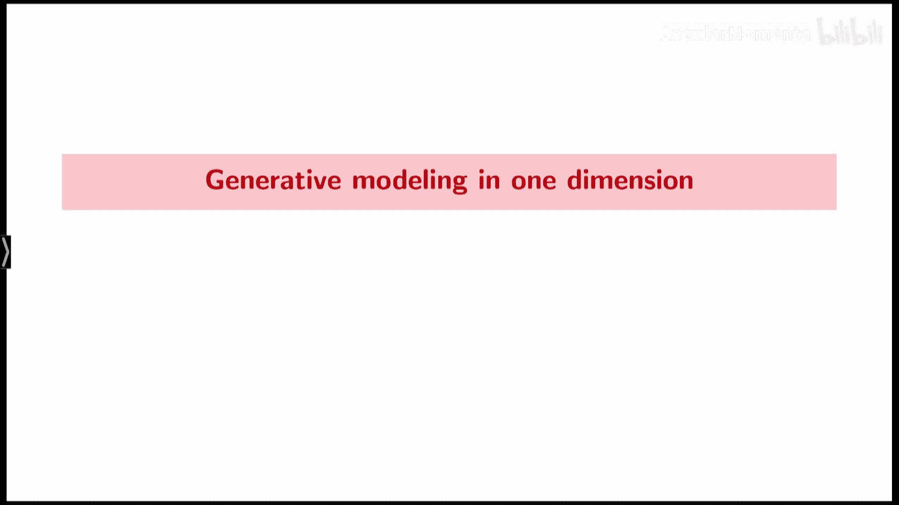

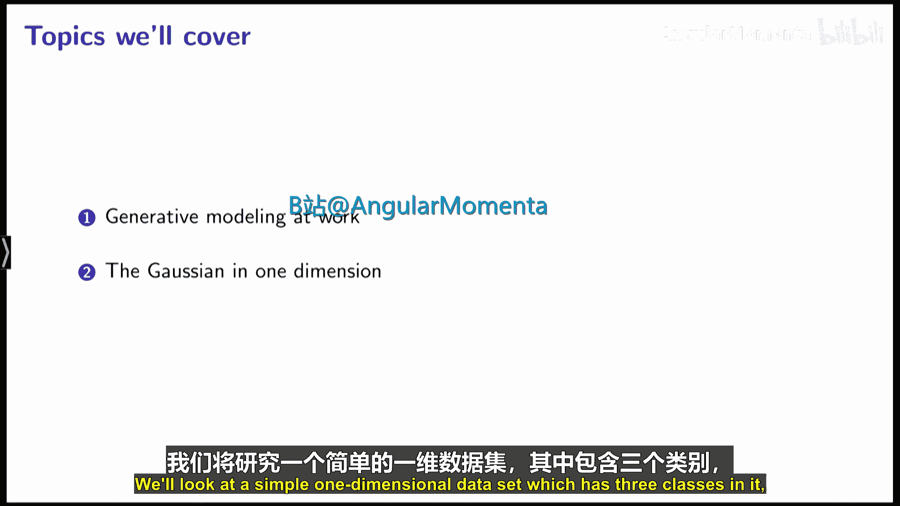

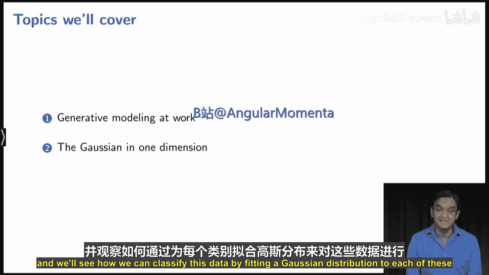

在本节课中，我们将学习生成式分类方法，并将其应用于一个简单的实际问题：根据葡萄酒的酒精含量来预测其生产酒庄。我们将使用一维高斯分布对每个类别的数据进行建模，并构建一个分类器。

---

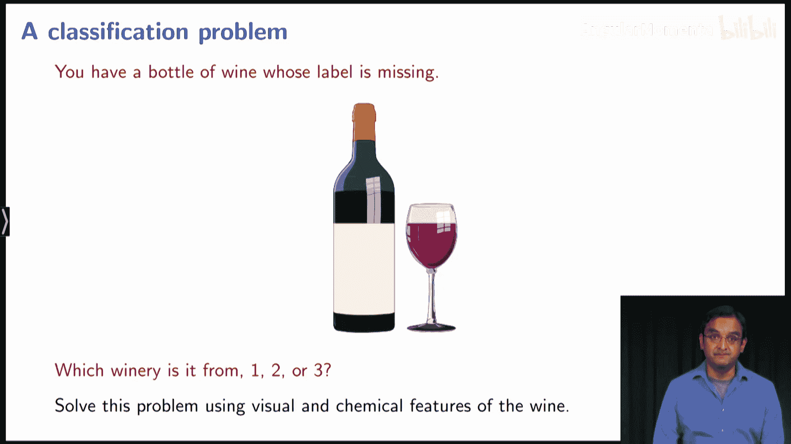

## 概述

我们之前简要介绍了分类的生成式方法。今天，我们将在一个包含三个类别的简单一维数据集上实际应用这种方法。我们将看到如何通过为每个类别拟合一个高斯分布来对数据进行分类。

## 问题设定：识别葡萄酒酒庄

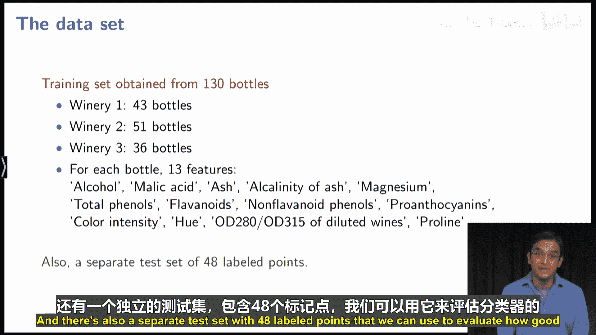

我们遇到的问题是：有一瓶葡萄酒，我们很喜欢它，但它的标签丢失了。我们想弄清楚它来自三个酒庄中的哪一个。我们将采用机器学习方法，测量这瓶酒的一些视觉和化学特征，并用这些特征来预测其标签（1、2或3）。

我们有一个训练集来帮助我们。这个训练集来自130瓶酒：43瓶来自酒庄1，51瓶来自酒庄2，其余36瓶来自酒庄3。对于每一瓶酒，我们测量了13个特征（如类黄酮、脯氨酸和镁含量等）。因此，每个数据点本质上是一个13维向量。

我们将使用这些数据构建一个分类器，该分类器接收新酒瓶的特征并预测其标签。此外，我们还有一个包含48个标记点的独立测试集，用于评估分类器的性能。

## 生成式方法回顾

上一节我们介绍了生成式分类的基本思想。本节中，我们来看看如何具体应用。生成式方法需要为每个酒庄单独拟合一个分布。对于酒庄1，我们拟合分布 **P₁(x)**；对于酒庄2，拟合 **P₂(x)**；对于酒庄3，拟合 **P₃(x)**。我们还需要知道每个标签的先验概率：酒庄1的葡萄酒所占比例 **π₁**，酒庄2的比例 **π₂**，酒庄3的比例 **π₃**。这些概率之和为1。

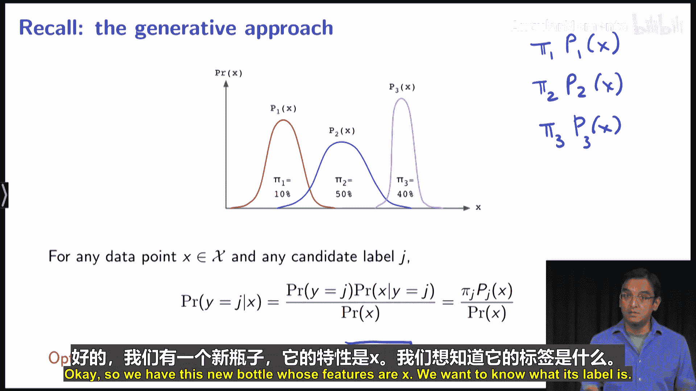

当我们得到一瓶新酒，其特征向量为 **x** 时，我们预测的类别 **j** 是使 **πⱼ * Pⱼ(x)** 最大的那个类别。这是因为根据贝叶斯规则，给定特征 **x** 时，标签为 **j** 的概率与 **πⱼ * Pⱼ(x)** 成正比。分母与 **j** 无关，因此可以忽略。

## 计算类别先验概率

首先，我们需要计算每个类别的先验概率（权重）。

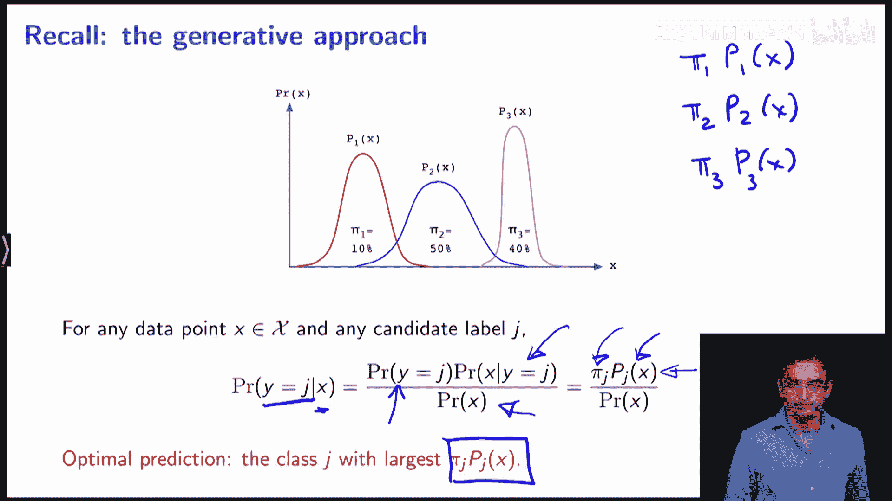

以下是计算过程：
*   酒庄1的权重：**π₁ = 43 / 130 ≈ 0.33**
*   酒庄2的权重：**π₂ = 51 / 130 ≈ 0.39**
*   酒庄3的权重：**π₃ = 36 / 130 ≈ 0.28**

可以看到，这三个数字相加等于1。拟合类别权重通常非常简单。

## 为每个类别拟合分布

更困难的部分是为每个类别拟合一个分布。我们的数据有13个特征，是一个13维数据集。为了简化，我们暂时只选取其中一个特征：酒精含量。这样，我们就把数据降到了一维。我们很好奇，仅凭酒精含量能多好地预测酒庄。

现在，我们需要为酒庄1的酒精含量数据拟合一个分布，为酒庄2和酒庄3的酒精含量数据也各拟合一个分布。我们选择哪种一维分布呢？默认的选择是高斯分布（正态分布）。

### 一维高斯分布

一维高斯分布就是熟悉的钟形曲线。它由两个参数指定：均值 **μ** 和方差 **σ²**。标准差 **σ** 是方差的平方根。我们使用简写 **N(μ, σ²)** 来表示这个分布。

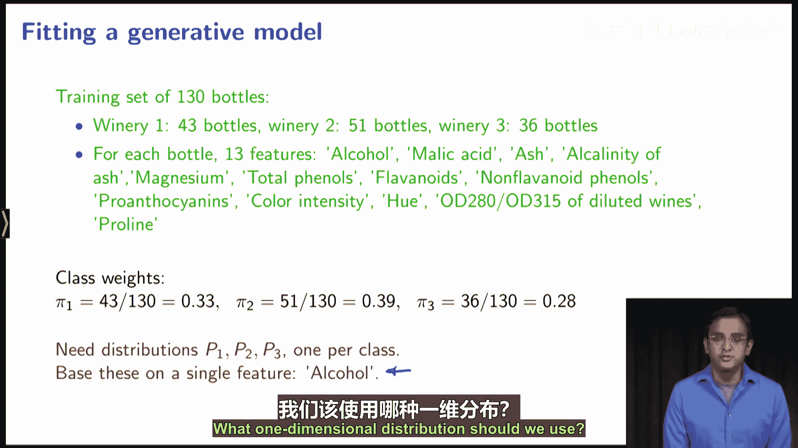

其概率密度函数由以下公式给出：
```
P(x) = (1 / √(2πσ²)) * exp(-(x - μ)² / (2σ²))
```

关于这个分布，我们可以说：
*   它以均值 **μ** 为中心。
*   关于均值对称。
*   大约三分之二的分布落在均值的一个标准差范围内。
*   大约95%的分布落在均值的两个标准差范围内。

### 为酒庄1拟合高斯分布

我们使用一个特征：酒精含量。酒庄1有43瓶酒的数据，即43个酒精含量数值。下图是这些数值的直方图，由于数据点少，直方图显得很锯齿状。

为了拟合高斯分布，我们需要计算出这43个数值的均值和方差。这非常快，只需几行代码。

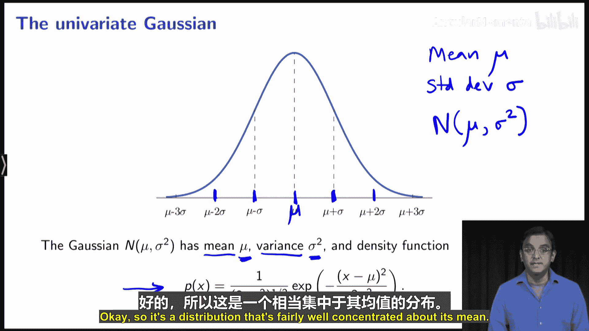

我们得到的结果是：
*   均值 **μ₁ = 13.72**
*   标准差 **σ₁ = 0.44**
*   方差 **σ₁² ≈ 0.2**

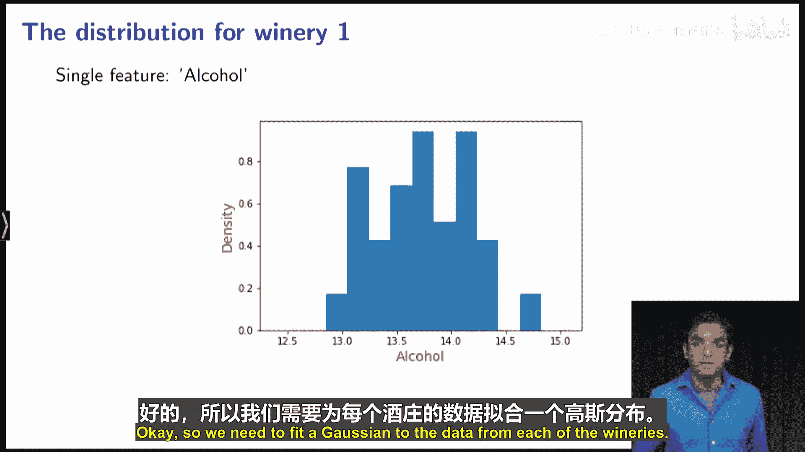

图中红色的平滑曲线就是我们为酒庄1拟合的分布密度函数 **P₁(x)**。

### 为酒庄2和酒庄3拟合高斯分布

我们对酒庄2和酒庄3进行完全相同的操作。

以下是拟合结果：
*   **酒庄2**（51个数据点）：均值 **μ₂ = 12.3**，方差 **σ₂² ≈ 0.28**。
*   **酒庄3**（36个数据点）：均值 **μ₃ = 13.2**，方差 **σ₃² ≈ 0.27**。

图中显示了三条曲线：**P₁(x)**（红）、**P₂(x)**（黑）、**P₃(x)**（绿），分别对应三个类别的分布。

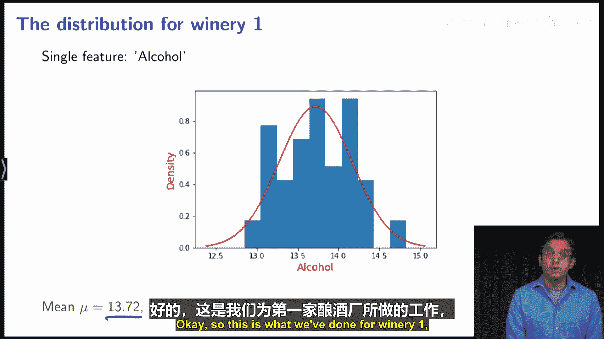

## 使用模型进行分类

现在，我们有了所有信息：先验概率 **πⱼ** 和每个类别的分布 **Pⱼ(x)**。我们如何对一瓶新酒进行分类呢？

当我们得到一瓶新酒，测量其酒精含量 **x** 后，我们选择使 **πⱼ * Pⱼ(x)** 最大的那个类别 **j**（1、2或3）。

让我们看几个例子：
1.  如果新酒的酒精含量是 **15**，那么酒庄2和酒庄3的分布在该点的密度几乎为零，因此我们会选择酒庄1（红色曲线）。
2.  如果酒精含量是 **11**，那么我们会选择酒庄2（黑色曲线）。
3.  如果酒精含量是 **12.5**，酒庄1的密度很低，我们会在酒庄2和酒庄3之间选择。由于 **π₂ (0.39) > π₃ (0.28)**，即使两者密度相近，我们最终也会选择酒庄2。

## 模型性能评估

我们将这个分类器应用于包含48个数据点的测试集。结果它错误分类了14个点。

因此，测试错误率为：
```
测试错误率 = 14 / 48 ≈ 29%
```

这个结果并不算很好，但远比随机猜测（约67%错误率）要强。

## 总结

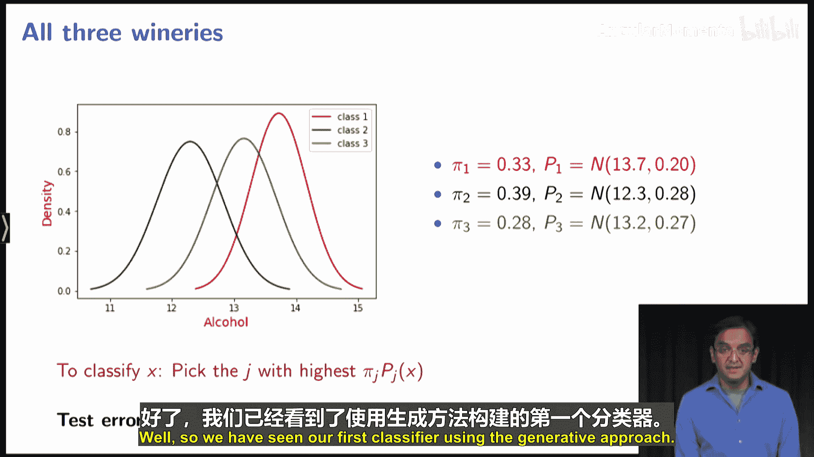

本节课中，我们一起学习了如何应用生成式方法构建我们的第一个分类器。我们通过一个葡萄酒酒庄识别的例子，演示了如何：
1.  计算类别的先验概率。
2.  为每个类别的数据（这里简化为一维酒精含量）拟合高斯分布。
3.  结合先验概率和似然（分布密度）使用贝叶斯规则对新样本进行分类。

该分类器的性能一般（29%错误率），主要是因为仅使用了单一特征。当我们引入更多特征时，其性能将能得到显著提升。为了理解如何做到这一点，我们将在接下来的课程中进一步深入概率论的知识。