# 012：二维生成式建模 🧮

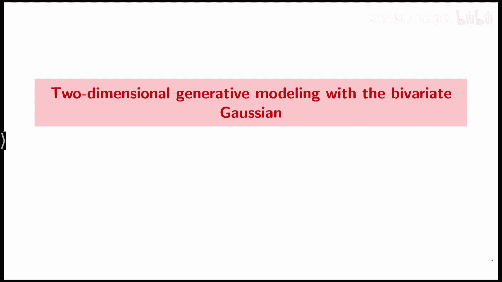

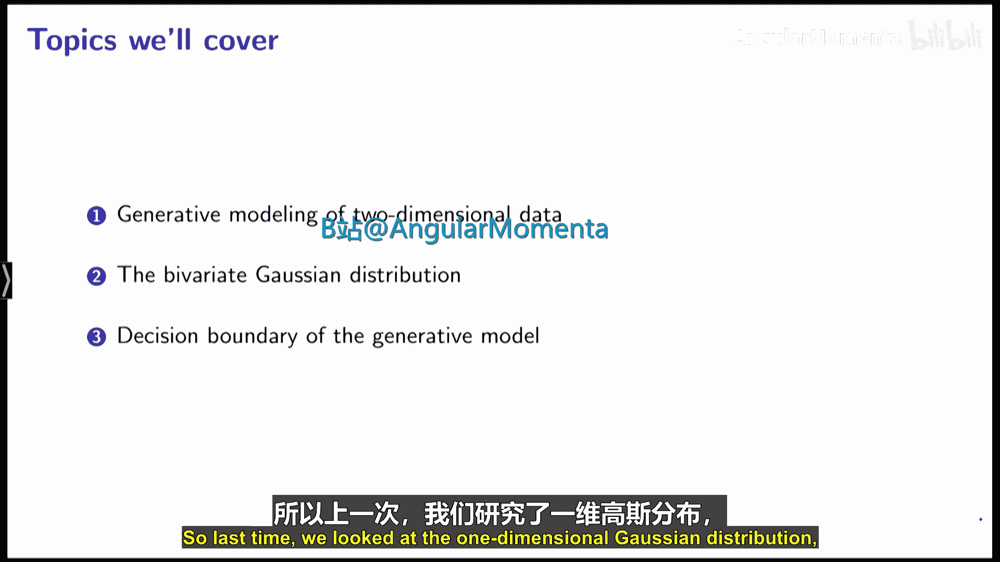

在本节课中，我们将学习生成式分类方法在二维空间中的扩展，即二维高斯分布。我们将了解如何利用两个特征之间的相关性来构建更准确的分类器，并以葡萄酒厂预测问题为例进行说明。

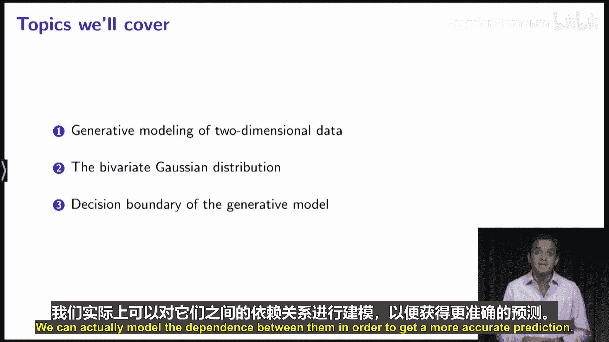

---

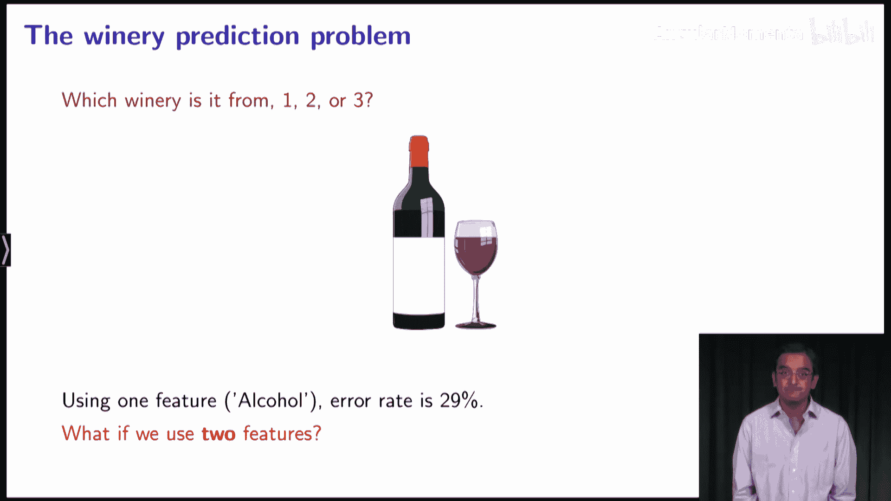

上一节我们介绍了一维高斯分布及其在生成式分类中的应用。本节中，我们来看看二维高斯分布。这种分布的一个激动人心之处在于，它允许我们建模特征之间的依赖关系。

例如，如果我们试图根据一个人的胆固醇水平和血压来预测其是否患病，我们无需假设这两个特征是独立的。我们可以实际建模它们之间的依赖关系，以获得更准确的预测。

## 运行示例：葡萄酒厂预测问题 🍷

回顾一下，在这个问题中，我们有一瓶葡萄酒，从每瓶酒中测量13个视觉和化学特征。我们希望利用这些特征来预测这瓶酒来自哪个酒厂（酒厂1、2或3）。上一节我们只使用了13个特征中的一个，发现仅使用该特征时错误率约为29%。本节我们将使用两个特征，并观察错误率如何显著下降。

该数据集包含一个由130瓶酒组成的训练集（43瓶来自酒厂1，51瓶来自酒厂2，36瓶来自酒厂3），以及一个包含48个标记点的独立测试集。上次我们使用的特征是酒精含量。这次我们将增加第二个特征：类黄酮含量。这是葡萄酒中出现的一类化学化合物。

以下是使用两个特征可能更有帮助的原因。上次我们只有一个特征（酒精含量），并为三个酒厂的数据分别拟合了高斯分布。结果发现这三个分布重叠严重，分离度不高，因此单独使用该特征进行分类的效果不佳。

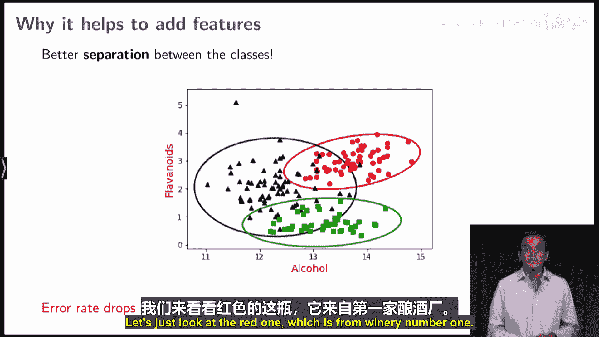

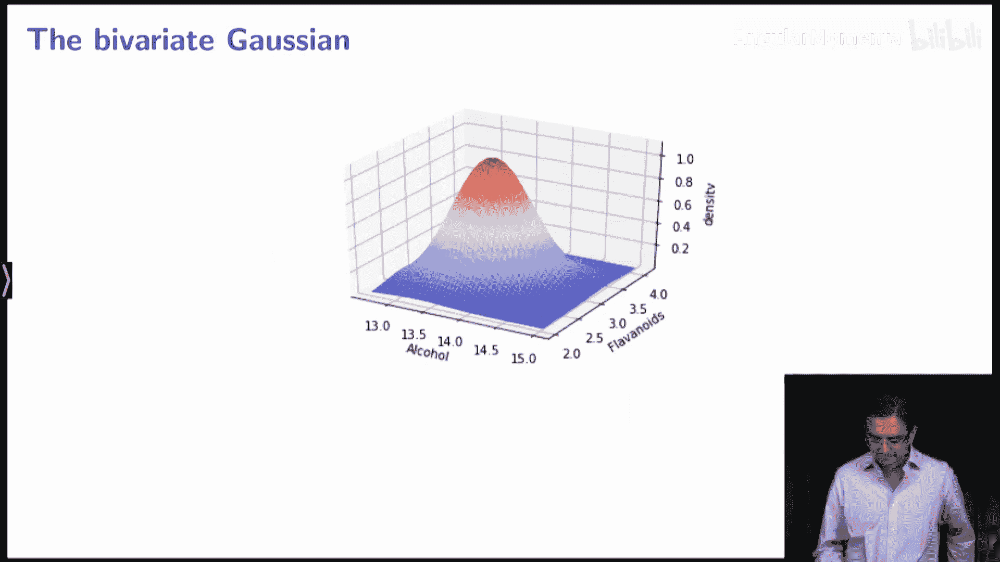

当我们引入第二个特征时，情况发生了变化。下图是一个散点图，每个点代表130个训练点中的一个（红色来自酒厂1，黑色来自酒厂2，绿色来自酒厂3）。每个点根据其酒精含量和类黄酮含量绘制在二维平面上。可以看到，不同类别的点之间存在相当明显的分离，这让我们有希望利用这两个特征实现更好的分类。

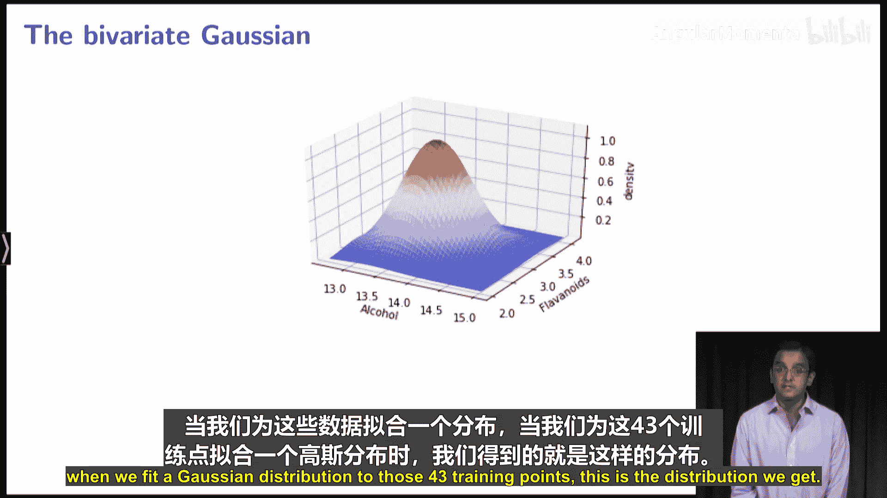

我们将遵循生成式方法，为酒厂1、2和3的数据分别拟合一个分布。这些分布将呈现为类似椭圆的形状。事实证明，这样做可以将错误率从29%大幅降低至8%。

## 理解二维高斯分布 📊

这些椭圆代表什么？让我们聚焦于其中一个，例如代表酒厂1的红色分布。当我们为那43个训练点拟合一个高斯分布时，得到的就是这个分布。

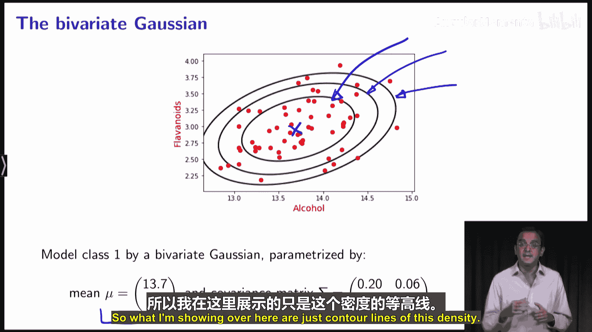

它是一个定义在二维平面上的分布，为每个可能的酒精含量和类黄酮含量组合分配一个密度值。在三维图中，基底是酒精和类黄酮值构成的二维平面，高度代表该点的密度。这就是二元高斯分布的样子。

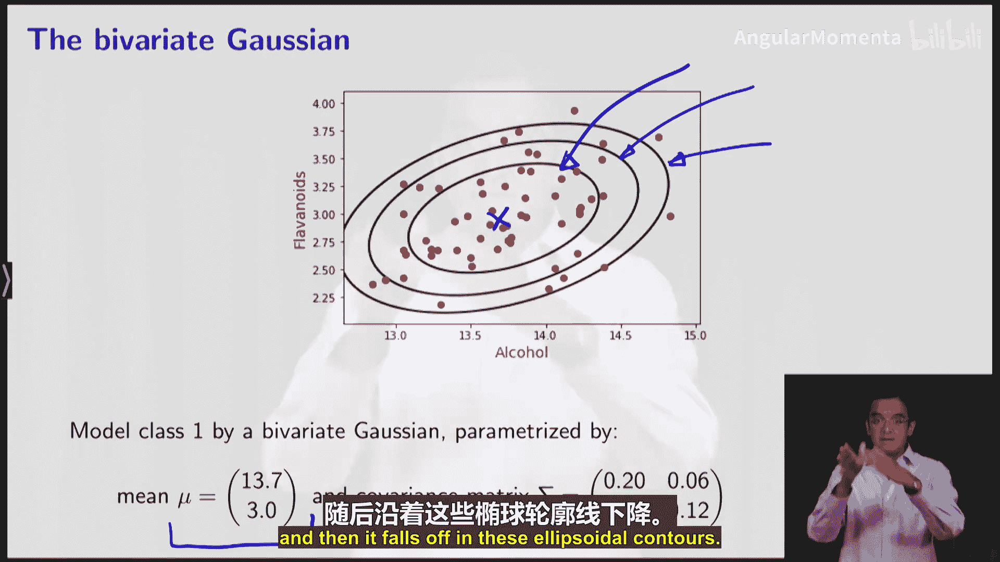

为了更容易理解，我们通常用等高线来表示。下图用红色显示了原始的43个二维训练点。我们为这些点拟合了一个高斯分布。该分布有两组参数：一个均值和一个协方差矩阵。

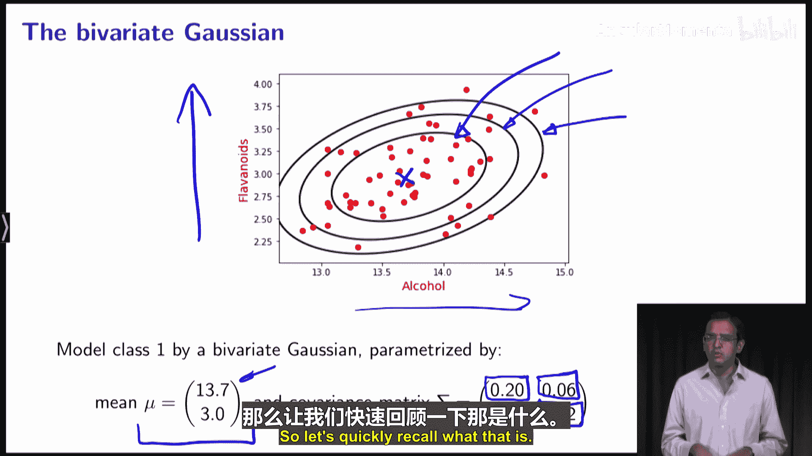

均值是一个二维点，它是分布的中心，也是密度最高的点。随着远离均值，密度会下降，并以椭圆等高线的形式递减。例如，密度为0.4的点可能构成一个椭圆，密度为0.3的点构成另一个更大的同心椭圆，依此类推。

## 参数详解：均值与协方差矩阵 🔍

均值很容易理解，它就是分布密度的中心点。

协方差矩阵是一个2x2矩阵。左上角的数字是x1方向（酒精含量）的方差。右下角的数字是x2方向（类黄酮含量）的方差。有趣的是非对角线上的数字，即协方差 `σ12`（或 `σ21`），它衡量了两个特征之间的依赖关系。

让我们快速回顾一下两个随机变量 `X1` 和 `X2`（例如酒精和类黄酮）的协方差是什么。`X1` 有均值 `μ1`，`X2` 有均值 `μ2`。协方差的标准定义是：
`Cov(X1, X2) = E[X1 * X2] - E[X1] * E[X2]`
当协方差为正时，表示存在正相关；为负时表示负相关；为零时表示两个变量不相关。

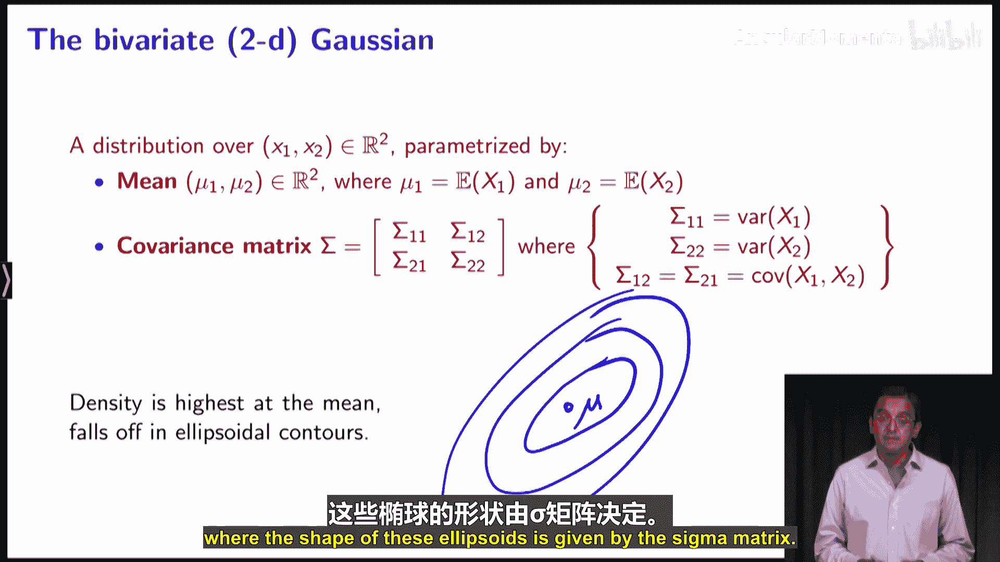

## 二维高斯分布的形式化描述 📝

二维高斯分布是定义在整个二维空间上的分布，为每个点 `(x1, x2)` 分配一个密度。最高密度的点是均值 `μ = (μ1, μ2)`。分布的其他参数是方差和协方差参数，它们构成一个2x2的对称矩阵 `Σ`：
- `Σ[1,1]` 是 `X1` 的方差。
- `Σ[2,2]` 是 `X2` 的方差。
- `Σ[1,2] = Σ[2,1]` 是 `X1` 和 `X2` 的协方差。

分布密度的具体公式如下：
`p(x) = (1 / (2π √|Σ|)) * exp( -1/2 * (x - μ)^T * Σ^{-1} * (x - μ) )`
其中：
- `|Σ|` 表示矩阵 `Σ` 的行列式。
- `Σ^{-1}` 是 `Σ` 的逆矩阵。
- `(x - μ)^T` 是位移向量 `(x - μ)` 的转置。

公式前面的部分是归一化常数，确保密度总和为1。关键部分在指数项内。密度仅取决于点 `x` 与均值 `μ` 的位移 `(x - μ)`。当 `x = μ` 时，指数项为0，密度最高。随着 `x` 远离 `μ`，该数值增大，密度呈指数下降。

## 示例解析 🎯

为了加深理解，我们看两个具有相同均值 `(1, 1)` 但不同协方差矩阵的高斯分布示例。

**左侧分布**：
- 协方差矩阵为 `[[4, 0], [0, 1]]`。
- `X1` 的方差为4，标准差为2。
- `X2` 的方差为1，标准差为1。
- 协方差为0，表示 `X1` 和 `X2` 不相关。
- 从散点图可以看出，数据在 `X1` 方向上的伸展程度是 `X2` 方向的两倍，且分布没有倾斜，与坐标轴对齐。

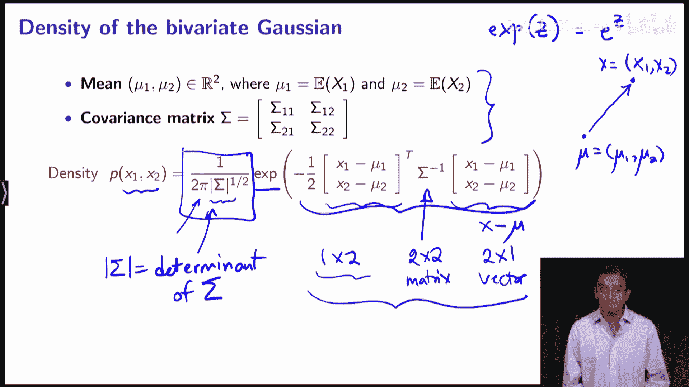

**右侧分布**：
- 协方差矩阵为 `[[4, 1.5], [1.5, 1]]`。
- `X1` 和 `X2` 的标准差与左侧相同。
- 但协方差为1.5，表示 `X1` 和 `X2` 之间存在正相关。
- 从散点图可以看出，数据点呈现出向上的倾斜趋势，反映了这种相关性。

## 应用于葡萄酒厂分类 🏆

现在回到葡萄酒厂的例子。我们为酒厂1（红点）、酒厂2和酒厂3的数据分别拟合了一个高斯分布，并绘制了代表性的等高线。

当一个新的数据点 `x` 到来时，我们使用贝叶斯规则进行预测。我们有先验类别概率 `π1, π2, π3`。我们选择使 `πj * p_j(x)` 最大的类别 `j` 作为预测结果。

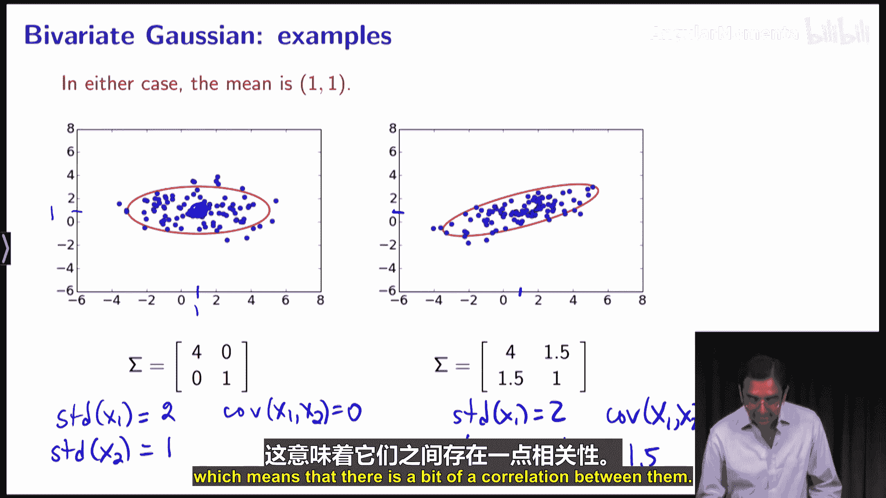

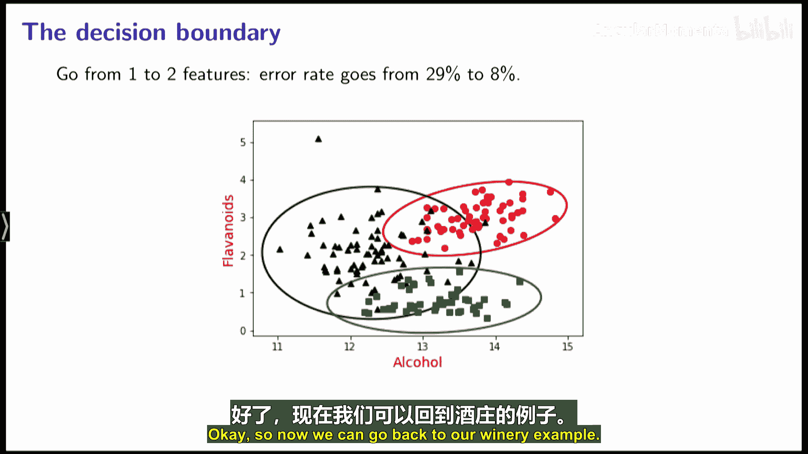

由此产生的决策边界如下图所示。边界内的区域被预测为来自对应的酒厂。这个边界形状有些奇特。它的函数形式是什么？既然使用两个特征已将错误率降至8%，那么使用更多特征能否做得更好？我们如何建模多个变量之间的相关性？

我们将在接下来的课程中看到所有这些问题的答案。

---

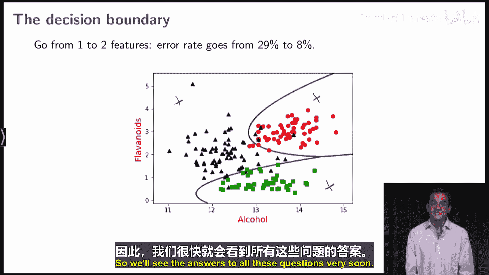

本节课中，我们一起学习了二维高斯分布及其在生成式分类中的应用。我们了解了如何通过均值和协方差矩阵描述分布，如何解释特征间的相关性，并看到了在葡萄酒厂预测问题中，使用两个相关特征能显著提升分类性能。下一节，我们将探讨如何将这些概念扩展到更高维度。