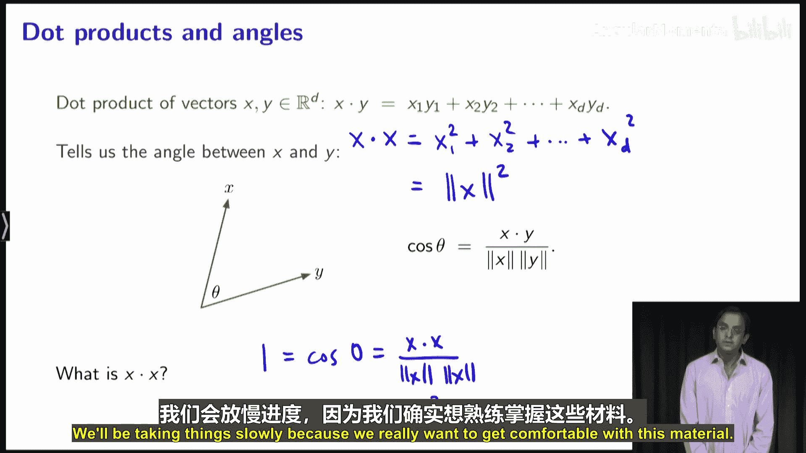

# 013：线性代数 I 📐

在本节课中，我们将学习线性代数的基础知识，这是机器学习中最核心的数学工具。我们将重点介绍如何使用向量和矩阵表示数据，学习基本的记法，并深入理解点积的概念及其几何意义。

---

## 数据表示：向量与矩阵

在之前的课程中，我们越来越多地接触到向量和矩阵。它们逐渐渗透进来，我们无法再回避它们。虽然许多同学可能已经接触过线性代数，但为了确保大家都能掌握，我们将对本课程所需的概念和技能进行一次全面的回顾。

线性代数是机器学习中最基础的数学，因此需要深入理解。

考虑一个包含四个点的数据集。我们可以将每个点表示为一个向量。例如，右下角的点是向量 `[5, 2]`。左上角的点是 `[3, 5]`。其附近的点是 `[2, 4]`。左下角的点是 `[1, 1]`。

我们也可以将整个数据集表示在一个矩阵中。例如，我们可以让每个数据点作为矩阵的一行，形成一个 4 行 2 列的矩阵（4x2 矩阵）：

```
[ [1, 1],
  [2, 4],
  [3, 5],
  [5, 2] ]
```

或者，我们也可以将数据点作为列，形成一个 2 行 4 列的矩阵（2x4 矩阵）：

```
[ [1, 2, 3, 5],
  [1, 4, 5, 2] ]
```

在本课程中，我们将主要采用第一种约定，即将数据点作为行。

---

## 向量与矩阵的记法

现在，我们来回顾一下索引记法。

一个在 D 维空间中的向量 **x** ∈ ℝᴰ，我们将其写作列向量，其条目索引为 x₁ 到 x_D。

一个 R x D 的矩阵，意味着它有 R 行和 D 列，总共有 R * D 个条目。位于第 I 行、第 J 列的条目记为 M_IJ。我们称其维度为 R x D。

同样，我们可以将向量描述为 D x 1（D 行，1 列）。

---

## 转置操作

对向量或矩阵最简单的操作之一是取转置，即交换行和列。

例如，对于一个列向量 **x** = `[1; 6; 3; 0]`（4x1），其转置 **x**ᵀ 写作行向量 `[1, 6, 3, 0]`（1x4）。

对于一个矩阵 **A** = `[ [1, 2, 0, 4]; [9, 8, 5, 6]; [3, 3, 3, 3] ]`（3x4），其转置 **A**ᵀ 是将第一行变为第一列，第二行变为第二列，以此类推，得到一个 4x3 的矩阵：`[ [1, 9, 3]; [2, 8, 3]; [0, 5, 3]; [4, 6, 3] ]`。

形式上，转置 **A**ᵀ 由以下公式定义：`(Aᵀ)_IJ = A_JI`。不难看出，对矩阵进行两次转置，会得到原矩阵：`(Aᵀ)ᵀ = A`。

---

## 加法与减法

向量和矩阵的加减法非常简单，只需按元素进行。

例如，向量 `[1, 2, 3]` 加上 `[4, 5, 6]` 等于 `[5, 7, 9]`。

对于矩阵 `[[2, 1], [0, 2]]` 加上 `[[1, 2], [3, 4]]` 等于 `[[3, 3], [3, 6]]`。

加减法很容易，更有趣的是乘法。

---

## 向量点积

本节我们将讨论最基本的一种乘积：两个向量之间的点积。

假设我们有两个 D 维向量 **x** 和 **y**。它们的点积记为 **x** · **y**。

计算点积的方法是：将对应坐标相乘，然后将所有乘积相加。

**公式**：`x · y = x₁*y₁ + x₂*y₂ + ... + x_D*y_D`

让我们看一个例子。在二维平面中，向量 **x** = `[3, 4]`，向量 **y** = `[-4, 3]`。它们的点积计算如下：
`x · y = (3 * -4) + (4 * 3) = -12 + 12 = 0`

有趣的是，观察这两个向量，它们看起来彼此垂直（呈90度角）。点积为零与垂直之间是否存在关系？确实存在。

---

## 点积与夹角

两个向量之间的点积可以告诉我们它们之间的夹角。

**公式**：对于任意两个向量 **x** 和 **y**，它们之间的夹角为 θ，则有：
`cos(θ) = (x · y) / (||x|| * ||y||)`
其中，`||x||` 表示向量 **x** 的长度（模）。

例如，如果点积为零（**x** · **y** = 0），则 `cos(θ) = 0`，这意味着 θ = 90 度。我们将彼此垂直的向量称为**正交**向量，这在本课程中是一个非常重要的概念。现在我们有了一个简单的正交性测试方法：检查点积是否为零。

---

## 方向向量与单位向量

向量的另一种用途是指示方向。如果我们只关心方向，那么向量的长度并不重要。因此，常见的做法是将向量**归一化**为长度为 1，这样的向量称为**单位向量**。

当我们处理单位向量 **u** 和 **v** 时，夹角公式变得特别简单，因为分母 `||u|| * ||v|| = 1 * 1 = 1`。因此，`cos(θ) = u · v`。

---

## 向量与自身的点积

最后，我们来看一个关于点积和夹角的问题：向量与自身的点积是什么？

**方法一（直接计算）**：`x · x = x₁² + x₂² + ... + x_D²`。这正是向量 **x** 的欧几里得长度的平方 `||x||²`。

**方法二（利用夹角公式）**：向量与自身的夹角是 0 度。`cos(0) = 1`。代入公式：`1 = (x · x) / (||x|| * ||x||)`，可得 `x · x = ||x||²`。两种方法得到相同的结果。

---

## 总结




本节课中，我们一起学习了线性代数的基础知识。我们介绍了如何使用向量和矩阵表示数据，学习了转置操作、基本的加减法，并重点探讨了向量点积的定义、计算方法及其重要的几何意义——点积可以衡量向量之间的夹角和正交性。我们还了解了单位向量的概念。掌握这些基础是理解后续更复杂机器学习算法的关键。