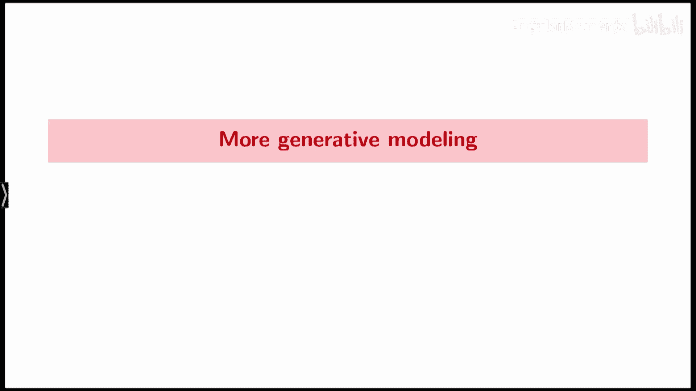
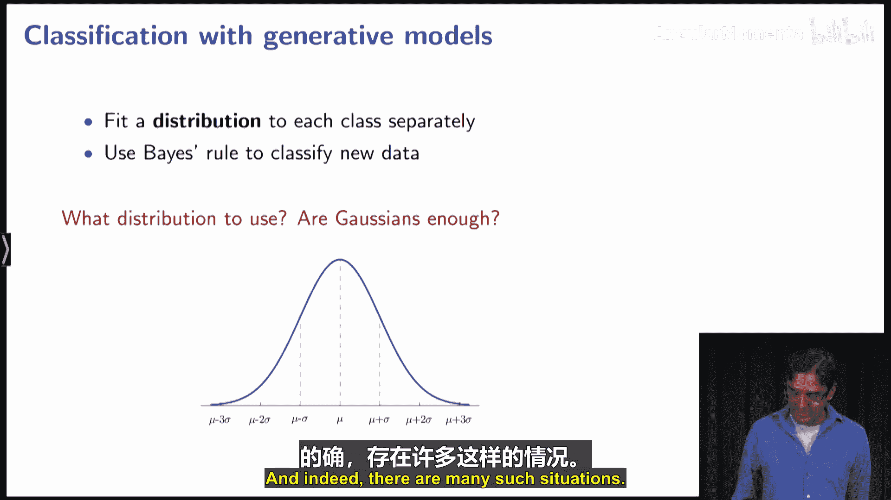
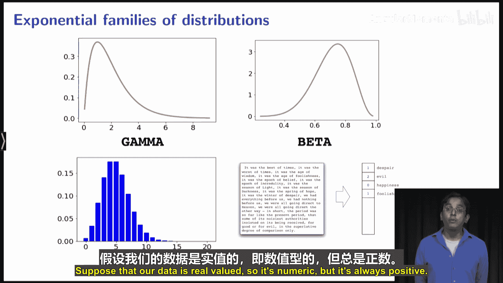
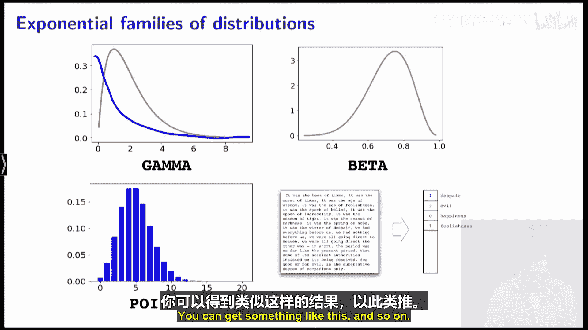
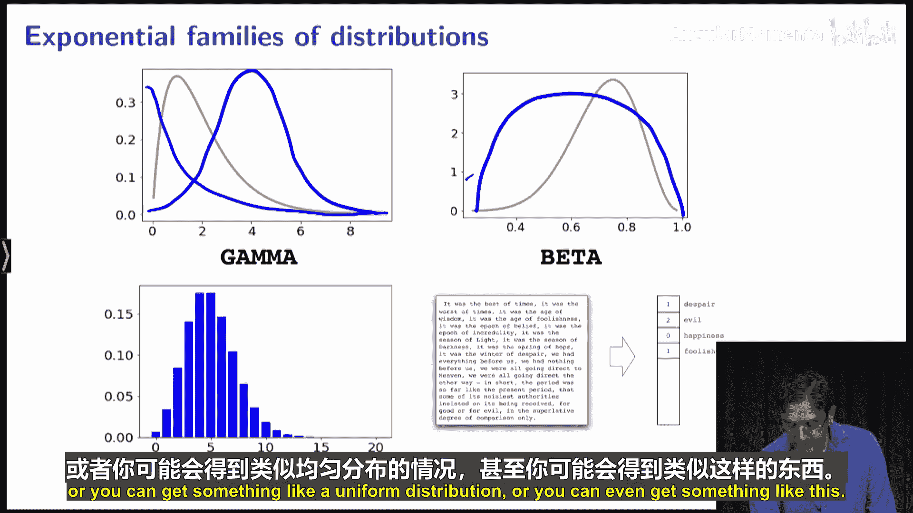
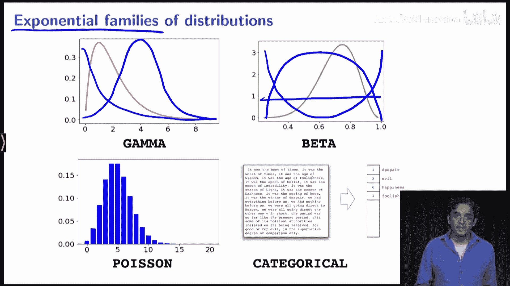
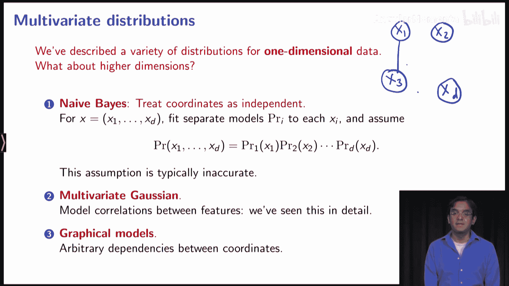

# 018：生成式建模进阶 🚀

在本节课中，我们将要学习生成式建模的进阶内容。我们将超越高斯分布，探索更多适用于不同数据类型的概率分布，并了解如何将这些分布组合起来处理高维数据。

## 从高斯分布到更广泛的分布

上一节我们介绍了通过为每个类别拟合高斯分布来构建分类器的方法。本节中，我们来看看当高斯分布不适用时，我们可以选择哪些其他分布。

在生成式分类方法中，核心思想是为每个类别单独拟合一个概率分布。当新数据点出现时，我们使用贝叶斯规则对其进行分类。到目前为止，我们只专注于为每个类别使用高斯分布。这确实是最重要的情况。但是，是否存在高斯分布不合适的情况呢？确实，存在许多这样的情况。

### 处理不同类型的一维数据

以下是几种常见的数据类型及其对应的合适分布：

**情况一：数据为正值实数**
假设我们的数据是实数值，因此是数值型的，但它总是正值。在这种情况下，使用高斯分布有时会显得有点奇怪，因为高斯分布的定义域是整个实数轴（包括正数和负数）。是否存在仅定义在正实数轴上的分布呢？一个主要的例子是伽马分布，如上图左上角所示。伽马分布由两个参数指定，就像高斯分布一样。随着参数的变化，你可以得到许多不同的形状，例如这里显示的红色曲线，或者其他形状。

**情况二：数据位于特定区间内**
如果数据是实数值，但总是位于特定区间内，例如0到1之间。在这种情况下，使用高斯分布会显得奇怪，因为它的定义域是所有实数；使用伽马分布也会显得奇怪，因为它的定义域是所有正实数。是否存在仅定义在一个区间上的分布呢？在这种情况下，一个非常常见的选择是贝塔分布，如上图右上角所示。与高斯分布和伽马分布一样，它由两个参数指定，并且可以呈现多种不同的形状，可以像这样，或者像一个倒置的碗，或者像均匀分布，甚至像这样。

**情况三：数据为整数值**
假设你拥有实值数据，它是数值型的，但所有数据点都是整数。例如，如果数据由计数组成（例如，夜间去急诊室的人数、加州特定地区发生地震的次数），就会出现这种情况。如果数据是正整数，那么高斯分布、伽马分布、贝塔分布都不完全合适，因为它们是为任意实数定义的分布。在这种情况下，最常见的选择是泊松分布，如上图左下角所示。它由单个参数（分布的均值）指定，并为每个非负整数（0, 1, 2, 3...）分配一个概率。这个分布被证明非常适合各种数据。

**情况四：数据为有限类别**
如果我们拥有的数据甚至不是数值型的，而是有有限多种可能的结果呢？例如，假设我们想为特定文档语料库中出现的单词拟合一个分布。我们想要每个单词的概率。这里有有限多种可能性（有限多个单词），我们将使用的分布是分类分布。它非常简单，只是为每个特定结果（每个特定单词）分配一个概率。

所有这些分布——伽马分布、贝塔分布、泊松分布、分类分布——在高斯分布不完全适用的情况下都非常有用。这四种分布，连同高斯分布，实际上属于一个更广泛的概率分布类别，称为指数族。伽马分布是指数族的一个特例，贝塔分布是指数族的另一个特例，高斯分布也是指数族的一员。那么，什么是指数族呢？遗憾的是，我们没有时间深入探讨。但简而言之，指数族是具有特定函数形式的分布，这种形式使它们易于处理，例如，非常容易进行参数估计。

## 处理高维数据

我们已经讨论了一系列适用于一维数据的分布，如伽马分布、贝塔分布等。我们如何处理高维数据呢？有没有办法以某种方式组合这些分布？事实证明，基本上有三种标准选择。

以下是三种处理高维数据的标准方法：

**1. 朴素贝叶斯**
第一种方法是假设不同的坐标是独立的。这被称为朴素贝叶斯。假设你有D维数据，坐标从x1, x2一直到Xd。如果x1是任意实数值，我们可以为其拟合一个高斯分布。如果x2由整数计数组成，我们可以为其拟合一个泊松分布。如果x3恰好位于一个固定区间内，我们可以为其拟合一个贝塔分布。通过这种方式，我们为每个单独的坐标拟合一个分布。现在，当我们想要整个向量x的概率时，我们只需取x1的一维概率乘以x2的一维概率乘以x3的一维概率，一直乘到最后一个坐标Xd的一维概率。这假设了坐标x1到Xd彼此之间都是独立的，但这很少是真实的。然而，尽管有这个错误的假设，这种特定方法在实践中往往非常有效，这就是朴素贝叶斯。

**2. 多元高斯分布**
第二种选择是使用我们讨论过很多的多元高斯分布。多元高斯分布不假设坐标是独立的，它允许我们建模坐标之间的两两相关性，正如我们所见，它使用起来确实非常简单。

**3. 通用图模型**
第三种选择是使用通用的图模型。遗憾的是，这超出了本课程的范围。但简而言之，图模型使用一个图来表示多个坐标上的概率分布。如果有D个坐标，每个坐标都有一个节点（x1一个节点，x2一个节点，一直到Xd一个节点）。如果两个坐标之间存在某种依赖关系，图中这两个节点之间就会有一条边。在完全通用的情况下，图模型允许我们为单个坐标x1, x2等使用任何分布，并且允许我们建模这些坐标之间的任意依赖关系，这是一种非常强大的方法。

## 总结

本节课中我们一起学习了生成式建模的进阶内容。生成式建模是一种非常流行的分类方法。它简单、高效且非常易于理解。我们首先探讨了高斯分布不适用时，可以选用的其他一维概率分布，如伽马分布（适用于正值实数）、贝塔分布（适用于固定区间）、泊松分布（适用于整数计数）和分类分布（适用于有限类别）。这些分布都属于更广泛的指数族分布。接着，我们了解了处理高维数据的三种主要策略：**朴素贝叶斯**（假设特征独立）、**多元高斯分布**（建模特征间的相关性）以及更强大的**图模型**（建模任意依赖关系）。生成式方法为分类问题提供了一个强大而直观的框架。