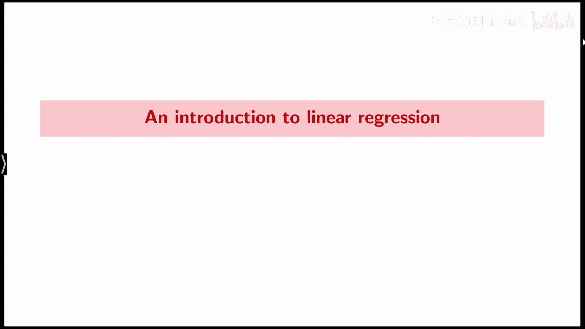
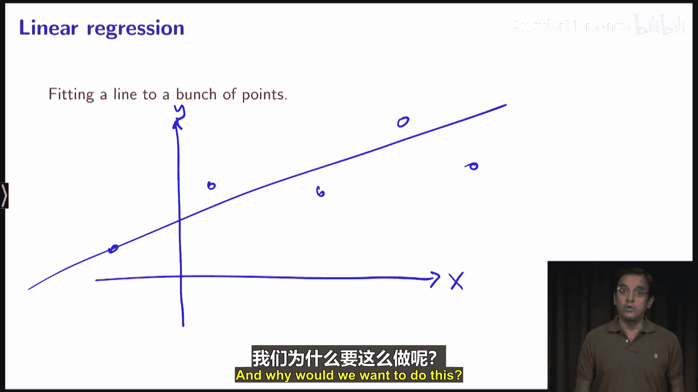
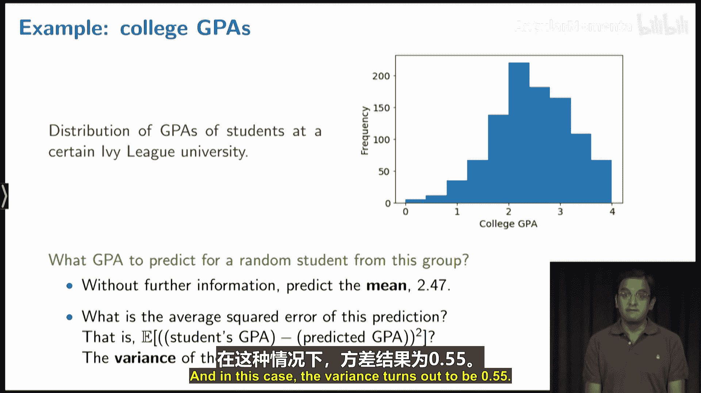
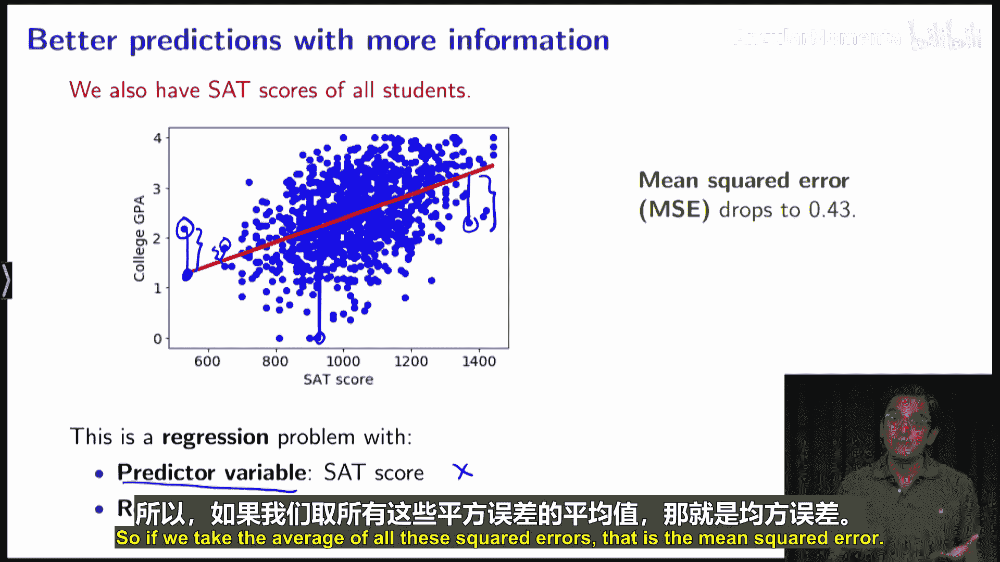
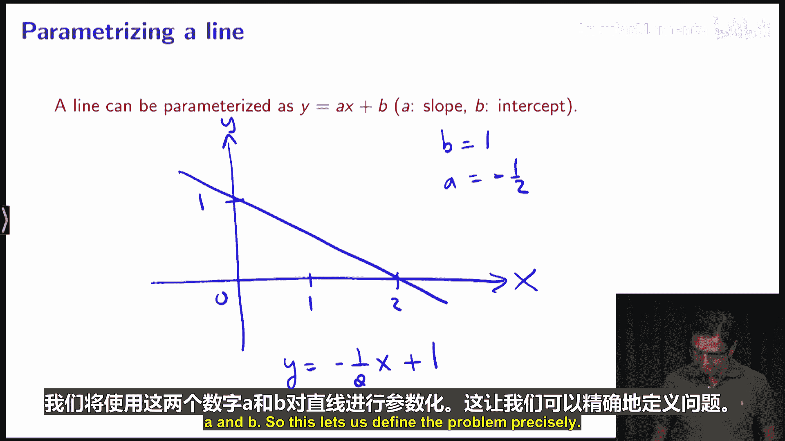
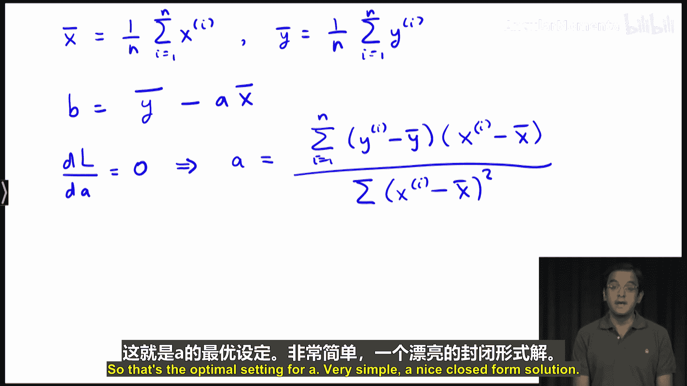

# 019：线性回归导论 📈

在本节课中，我们将学习线性回归的基本概念。我们将从分类问题转向回归问题，重点关注一维情况，即如何用一条直线拟合一组数据点。我们将定义预测变量和响应变量，并将回归问题形式化为一个优化任务，最后使用基础微积分求解。

## 从分类到回归 🔄

在过去的几周里，我们一直专注于分类问题。今天，我们将转换思路，开始研究回归问题。本节将介绍问题的一维版本，这有助于我们定义一些基本概念，如预测变量和响应变量。我们将看到如何将此问题表述为优化任务，以及如何使用基础微积分求解。

## 一维回归：拟合一条直线 📊

在一维情况下，回归就是为一系列点拟合一条直线。这是我们以前都见过的场景：我们有一个X轴和一个Y轴，以及一组点。我们想为它们拟合一条直线，但没有一条直线能完全穿过所有点。因此，我们只希望找到一条大致从它们中间穿过的线。我们究竟该如何做到这一点？又为什么要这样做呢？

## 一个预测示例：GPA与SAT分数 🎓

让我们看一个小例子。某所常春藤盟校收集了其新生班级的数据。在大一学年结束时，他们记录了每个人的GPA。这就是你在这里看到的直方图：GPA（平均绩点）是一个介于0到4之间的数字，显示在水平轴上；垂直轴是频率，即获得该成绩的人数。在这种情况下，最常见的成绩大约在2.25左右，即C+。

假设一个随机学生出现，我们想预测他或她的GPA。我们会预测什么分数？根据这些信息，一个合理的做法是简单地预测这个分布的均值。这很容易计算。如果我们这样做，结果在这种情况下是2.47。

这个预测有多好？评估其质量的一种方法是看它的平均平方误差。一个学生随机出现，这是他们的实际GPA，我们预测了这个特定值2.47。如果我们看这两者之间的差异并求平方，它的期望值是多少？仔细观察，这正是方差的公式，即这个分布的方差。在这种情况下，方差结果是0.55。

## 引入预测变量：降低误差 📉

现在，这所大学还收集了其他信息。除了每个人的大一GPA，他们还有高中时的SAT分数。这是两者相互对应的散点图：水平轴是SAT分数，垂直轴是大学GPA。你可以看到数据略微向上倾斜，这表明存在正相关关系。

在这种情况下，我们可以看看SAT分数是否有助于我们预测大学GPA。我们继续，拟合一条像这样的直线。现在我们将讨论如何精确地拟合这条线，但暂时，让我们先看看如何使用它。

假设一个随机学生出现，我们想预测他或她的GPA。现在我们找出SAT分数，假设是1200分。SAT分数是1200，我们只需向上找到这条线，然后横移，我们的预测是3，我们预测GPA为3。

当我们使用这个额外的信息进行预测时，结果平均平方误差下降了，降至约0.43。因此，这个额外的信息实际上非常有帮助。

这是一个经典的回归问题。有我们想要预测的东西，称为**响应变量**，即大学GPA。然后有帮助我们做出这个预测的信息，那些是**预测变量**。在这种情况下，只有一个预测变量，即SAT分数，所以这是x（帮助我们做出预测的东西）。然后是我们实际想要猜测的值，即Y（大学GPA）。

那么平均平方误差到底是什么？让我们看看这些数据。看这里的这个人。使用我们的线，对该人的预测实际上会在这里。所以存在一定量的误差，我们可以将其平方，看看那个平方误差。再看看这里的这个人。那个人的平方误差是这个距离的平方。再看看这个，那个人的平方误差是这个距离的平方，它小得多。再看看这个人，他们的平方误差实际上相当大。如果我们取所有这些平方误差的平均值，那就是平均平方误差。

## 参数化直线：斜率和截距 📐

我们如何拟合这种形式的直线？首先是要弄清楚如何参数化一条直线。一种方便的方法是将一条直线写为 **`y = ax + b`**，其中 **`a`** 是直线的斜率，**`b`** 是y轴截距。

例如，假设我们有我们的x轴和y轴。我们有一条像这样的直线，也许这里是2，这里是1。那么y轴截距是直线与y轴相交的地方，即1。在这种情况下，斜率是向下的，所以它将是负数，在这种情况下斜率是负二分之一。因此，这条直线的方程是 **`y = -0.5x + 1`**。

因此，我们将使用这两个数字A和B来参数化一条直线。

## 定义优化问题：最小化损失函数 ⚙️

这让我们可以精确地定义问题。我们给定一组数据点，这些是XY对。X和Y都是实数。X是预测变量，在我们的例子中是SAT分数；Y是我们想要猜测的东西，即响应变量，在我们的例子中是GPA。因此，我们有n个这种形式的数据点。

我们想找到一条直线，换句话说，我们想找到定义一条直线的参数A和B。我们想要的是找到导致最小平均平方误差的直线。这就是由这个公式给出的。如果我们看第i个数据点 **`x_i`**，那么使用这条直线AB，我们对 **`x_i`** 的预测将是这个，这将是我们猜测的值。正确的值是 **`y_i`**。

因此，在第i个数据点上产生的平方误差是这个项。现在我们取那个并对所有数据点求平均，这就是平均平方误差。这是我们试图最小化的损失函数。

这里发生了一些有趣的事情：我们正在将一个学习任务形式化为一个优化问题，即寻找最小化某种损失函数的参数的问题。这种优化方法在机器学习中被证明是极其富有成果的，我们将会看到更多这样的例子。

## 求解最优参数：微积分方法 🧮

让我们继续看看如何最小化这个损失函数。我们想要最小化这个具有两个参数A和B的函数L。我们可以直接求导数并设为零。这是通常的微积分方法。

由于有两个参数，我们需要对它们各自求导。为了最小化，我们将简单地将关于A的导数和关于B的导数设为零。

让我们继续计算这些导数。关于B的导数可能稍微简单一些，所以让我们从它开始。L关于B的导数是什么？L是一个大的求和，和的导数是导数的和，所以我们先写下来。现在，我们如何求那个的导数？我们那里有一个平方项。

有一个通用规则：如果我们对某个东西的平方 **`u^2`** 求导，结果将是 **`2u * du`**，即2u乘以u关于B的导数。对我们来说，u是这个东西。这就是u，我们想求它的导数，所以先写下2u。然后我们取u关于B的导数，实际上就是-1。所以乘以-1。这就是整个导数，我们想将其设为零。

由于我们将其设为零，我们可以直接消去-1和2。让我们看看我们得到了什么。我们得到 **`Σ y_i = a * Σ x_i + n * b`**，因为我们对b从i=1求和到n，所以是n乘以b。

让我们继续解出b。这告诉我们 **`b = (1/n) * Σ y_i - a * (1/n) * Σ x_i`**。这是b的最优设置。

那么这里的这些项是什么？这个项是什么？嗯，那只是平均y值，即平均响应值。那个东西是什么？那只是平均x值，在我们的例子中就是平均SAT分数。让我们以更紧凑的形式写下来。我们记住这个方程。

我们说的是，让我们看看平均x值，我称之为 **`x̄`**。所以我们取所有x的平均值。再看看所有Y的平均值 **`ȳ`**。结果证明，b的最优设置是平均y值减去a乘以平均x值。这完全说得通：我们希望 **`y = ax + b`**。当然我们无法完全得到这个，但b是平均y值减去a乘以平均x值，这完全合理。

我们仍然需要解出a，我们通过将L关于a的导数设为零来做到这一点。然后我们进行计算，这次的代数运算稍微复杂一些。但我可以直接告诉你最终答案是什么。如果你愿意，可以在家尝试这些步骤，只是稍微麻烦一些。

结果证明，a的最优设置很简单，是x和y的协方差除以x的方差。所以它是这种形式：你取所有Y，减去它们的平均y，然后看它们与x的协方差。然后，你除以X减去平均x的平方。这就是a的最优设置。非常简单，一个漂亮的闭式解。

## 总结 📝

本节课中，我们一起学习了线性回归的基本介绍。今天我们只讨论了单预测变量的一维情况。下次，我们将把这种方法推广到多个预测变量。