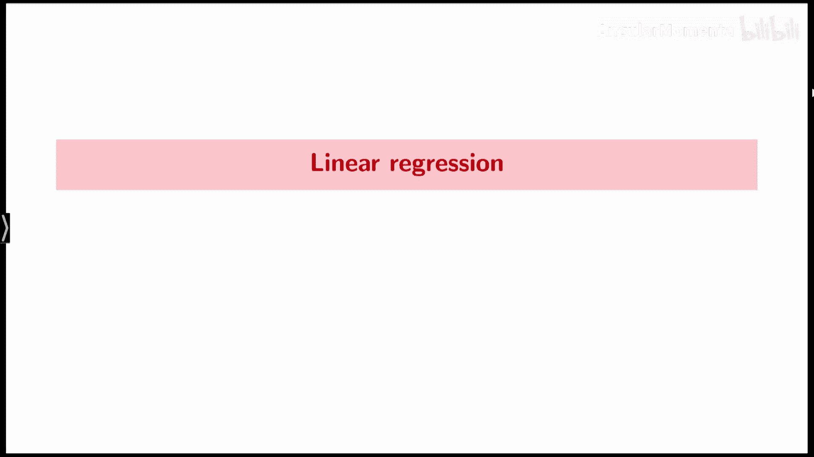
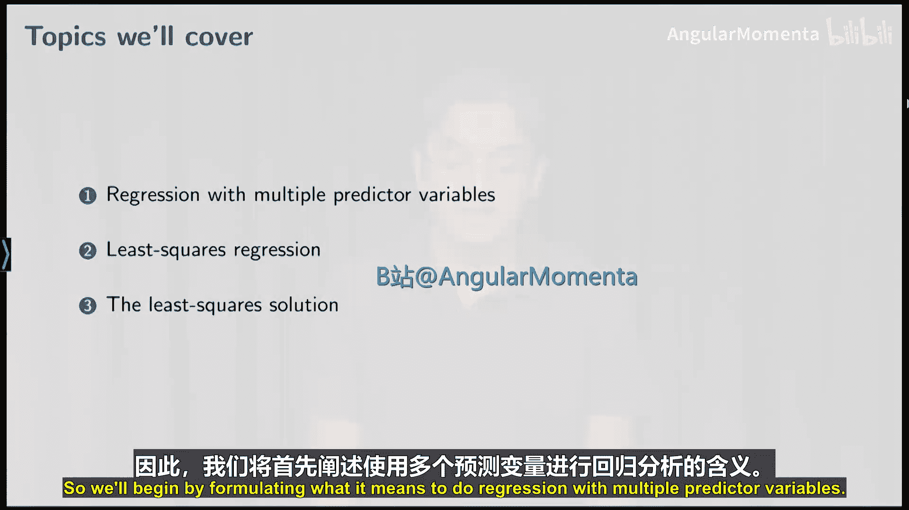
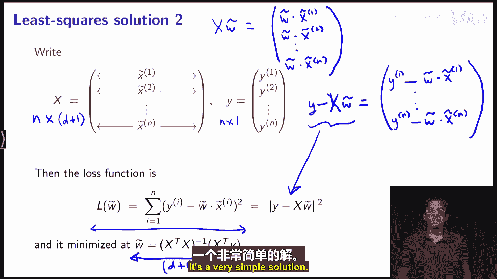

# 020：线性回归 📈

在本节课中，我们将学习线性回归，这是一种用于预测连续数值的统计方法。我们将从一维数据扩展到多维数据，并学习如何通过最小二乘法找到最佳拟合线。

## 概述

上一节我们初步了解了线性回归在一维数据上的应用。本节中，我们将深入探讨完整的最小二乘回归。这是一种简单而强大的方法，也是统计学的基石之一。

## 多维数据的回归问题

我们将学习问题表述为一个带有明确损失函数的优化任务。然后我们会发现，这个优化任务实际上很容易解决。

作为示例，我们将使用一项糖尿病研究的数据。该研究的目标是评估哪些特征可能影响疾病的进展速度。例如，在固定时间段内病情恶化的程度。

数据收集自442名糖尿病患者。对于每位患者，测量了10个可能影响疾病进展的特征，包括年龄、身体质量指数（衡量超重程度的指标）、平均血压以及各种血液血清测量值。

这10个特征为每位患者测量后，患者在一年后返回，测量一个表示疾病在一年内进展程度的数值，该数值称为Y。这是一个经典的回归问题，我们有一个响应值Y，并希望根据一系列预测变量来预测这个响应。我们有10个这样的变量X1到X10，可以将它们打包成一个10维向量。

我们希望将Y建模为X的线性函数。让我们看看这意味着什么。

当我们只有一个变量X时，X的线性函数是这样的：Y = wX + b，其中w是斜率，b是截距。当我们有10个变量时，线性函数看起来是这样的：w1x1 + w2x2 + ... + w10x10，最后再加上截距项b。

我们可以更简单地将其写为 **w·x + b**，其中我们将系数w1到w10打包成一个单独的向量w。这是线性函数的一种简洁形式。

这就是我们将要拟合到数据的模型类型。在任何给定的点x上，我们的预测将是w·x + b，而正确值是y。因此，误差需要以某种方式惩罚。我们将使用平方损失，即我们预测的值与实际值之间的平方差。

这直接引出了最小二乘回归问题。我们有n个数据点，在我们的案例中有442名患者，所以n=442。点x1到xn是我们的D维向量，我们有10个特征，所以d=10。然后我们还有响应值y1到yn。

基于这些数据，我们想要学习一个线性函数，换句话说，我们想要学习参数w和b。我们希望选择能够最小化总平方误差的线性函数，即最小化所有数据点上第i个数据点的平方误差之和。

这是一个非常简单的损失函数。我们希望找到能够最小化这个损失函数的向量w和值b。

结果证明，对于最优的w和b，有一个很好的闭式解，我们很快就会看到。但首先，让我们看看在糖尿病数据上会发生什么。

假设我们根本没有预测变量，我们只需要预测y，我们会预测y的什么值？我们会预测y的平均值，即均值。在这种情况下，均方误差将仅仅是y的方差。

在糖尿病示例中，这个方差结果是5,930。这可能看起来有点大，但实际上这些y值，即疾病的进展程度，是像100、200、300这样的数字，所以当y是200时，y的平方是40,000。相对于这个，大约6,000的方差似乎是合理的。

现在假设我们加入一个预测特征，例如使用身体质量指数。这里显示的是一个散点图，x轴是身体质量指数，y轴是疾病进展的y值。这是442个数据点的散点图。我还显示了通过最小二乘回归得到的线。

使用这条线，均方误差显著下降到3,890。然后我们可以加入第二个预测变量，例如使用其中一个血清测量值，均方误差进一步下降。然后我们可以继续使用所有10个变量，使均方误差最小，为2,860。

在计算上，所有这些不同的计算都非常简单，因为对于w有一个很好的闭式公式。事实上，这是整个课程中少数几个优化测试有如此简单解决方案的情况之一。

## 优化问题的简化

让我们看看它是如何工作的。我们再次将线性函数拟合到数据，线性函数是这种形式：如果我们有d个特征。

这里的截距项很重要，但它有点突出，有点不方便，因为它看起来与其他所有项都略有不同。在进行优化时，例如，我们必须将其单独处理。

幸运的是，有一种方法可以使其消失，基本上是通过将其吸收到w中。让我们看看如何做到这一点。

这是将b吸收到w向量中的技巧。我们做的第一件事是向数据x添加一个额外的特征，只需在所有数据点前面加一个1。例如，如果我们有一个看起来像这样的数据点，我们写下相同的东西，但在前面加一个1。所以每个点x现在变成了一个新点，我们称之为x波浪，它只是1后面跟着原来的x。这些新点x波浪现在是d+1维。

接下来，我们将b和w放在一起，并称该向量为w波浪。现在让我们看看我们的线性函数会发生什么。我们的线性函数是w·x + b，但这完全等同于w波浪·x波浪，因为w波浪是(b, w)，而x波浪是(1, x)，所以它正好是b + w·x。

因此，我们成功地将线性函数重写为没有b的形式，通过向数据点和w向量添加一个额外的特征。所以现在我们只需要优化w波浪。这是新的损失函数，我们希望找到w波浪，再次导致数据集上的最小平方误差。

## 矩阵形式与闭式解

正如我们将看到的，对于w波浪有一个很好的公式。推导公式的第一步实际上是将这个损失函数纯粹重写为矩阵向量乘积。我们为什么要这样做？结果证明，这为w波浪带来了一个简洁的表达式。

让我们看看会发生什么。这是我们的损失函数，我们将用矩阵和向量来重写它。实际上，这通常是非常有用的。部分原因在于，像Python这样的标准平台具有高度优化的矩阵数学例程，用于矩阵和向量乘法。同时，它们在诸如for循环之类的事情上可能非常慢。

因此，如果你能以某种方式将你的for循环重写为矩阵向量乘积或矩阵矩阵乘积，你的代码可能会显著加速。但是，我们如何以这种方式重写呢？让我们看看这个损失函数，我们有一个包含求和的损失函数，通常如果我们有一个求和，那会让我们想到一个for循环。

但我们可以重写它，让我们看看如何。首先，我们创建一个矩阵，每行一个数据点，所以有n行。当然，我们现在已经增强了我们的数据，我们添加了这个额外的特征，我们在每个向量前面加了一个1。所以我们有d+1列。这就是矩阵X。让我们创建一个包含所有响应值的向量，所以y是n×1。

现在让我们看看X乘以w波浪是什么。它是X的第一行与w波浪的点积，X的第二行与w波浪的点积，依此类推，正好是预测值。所以这正好是w波浪·x1，w波浪·x2，一直到w波浪·xn。

同样，如果我们看y - Xw波浪，那是什么？它简单地是误差向量。它是第一个点的误差，y1 - w波浪·x1，一直到最后一个点的误差，yn - w波浪·xn。特别是，这个向量的平方范数，也就是这里的这个量，正好是所有平方误差的总和，正好是损失函数。

因此，我们重写了我们的损失函数，没有任何求和，纯粹用向量和矩阵表示。在这一点上，我们可以求导数并将其设为零，结果证明解如下：我们将w波浪设为 **(X^T X)^(-1) X^T y**，这是一个(d+1)×(d+1)矩阵乘以X^T y，这是一个(d+1)×1向量。结果是一个(d+1)×1向量。当然，该答案中的第一项是我们之前称为b的截距项。

这是一个非常简单的解决方案。

## 总结

本节课我们一起学习了最小二乘回归。这是一种非常容易且强大的方法，在广泛的应用中都非常有用。这是统计学中许多内容的基础。