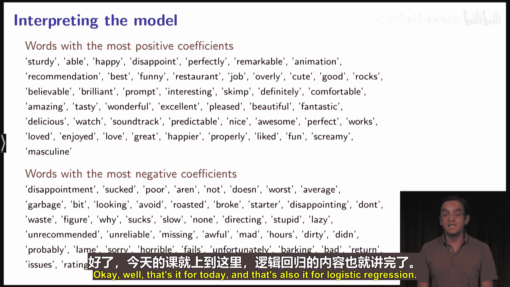

# 024：逻辑回归的应用 🧠

在本节课中，我们将通过一个具体的案例研究，学习逻辑回归如何应用于实际问题。我们将探讨如何将文本数据转换为机器学习模型可以处理的格式，并解读模型训练的结果与意义。

---

## 文本分类问题

我们想要解决的问题是文本分类。具体来说，我们获得一段关于产品、电影或餐厅的评论，需要判断它是正面评价还是负面评价。我们使用的数据收集自亚马逊和Yelp等网站，每条数据是从评论中提取的一个句子，并已被标记为正面（+）或负面（-）。

以下是几个例子：
*   **负面**：“needless to say I wasted my money”。关键词是“wasted”。
*   **正面**：“he was very impressed when going from the original battery to the extended battery”。关键词是“impressed”。
*   **负面**：“I have to jiggle the plug in order to get it to line up right to get decent volume”。这个句子没有明显的负面词汇，判断起来有些难度。
*   **正面**：“We‘ll order from them again”。这个句子也没有明显的正面词汇，同样具有挑战性。

这个任务并非轻而易举。逻辑回归的优势在于，它不仅能输出预测结果（正面或负面），还能给出相应的概率，从而帮助我们量化预测的不确定性。

我们拥有约2500个训练句子和500个测试句子。这个数据量并不算大。

---

## 文本向量化：词袋模型

为了运行逻辑回归，我们需要将句子转换为固定长度的向量。将文档转换为向量有一种非常标准的方法，称为**词袋表示法**。

以下是具体步骤：
1.  首先，确定一个词汇表。例如，我们可以选择数据集中最常见的5000个词。
2.  然后，每个文档（句子）将被表示为一个5000维的向量。向量的每个维度对应词汇表中的一个词。
3.  该维度的值，就是这个词在文档中出现的次数。

例如，假设词汇表的第一个词是“despair”。我们遍历文档，统计“despair”出现的次数（比如1次），那么向量第一个位置的值就是1。接着看第二个词“evil”，出现2次，则对应值为2。第三个词“happiness”未出现，值为0，以此类推。

需要指出的是，这种表示法生成的向量通常非常稀疏。对于一个只有10个词的句子，在5000维的向量中，最多只有10个非零值。

---

## 应用逻辑回归

现在我们已经准备好应用逻辑回归。我们将正面类别编码为+1，负面类别编码为-1。我们有2500个数据点，每个点都是一个5000维的向量。我们的目标是找到由权重向量 **W** 和偏置项 **b** 定义的线性函数，以最小化逻辑回归的损失函数。

正如上一节所介绍的，这是一个凸损失函数，可以使用局部搜索方法轻松优化，例如梯度下降、随机梯度下降或牛顿法等。它们都能找到正确的解。

本节课我们将使用**随机梯度下降**方法。这是一种非常重要的优化方法，我们将在下周详细讨论。目前，你可以将其理解为一个局部搜索方法：它从一个初始的 **W** 和 **b** 猜测开始，然后不断进行微调，最终收敛到正确的答案。

对于这个特定数据集，大约需要300次迭代才能使线性函数 **W** 和 **b** 收敛。每次迭代都会遍历整个数据集。随着迭代的进行，训练集上的损失函数持续下降。在前50次迭代左右，损失函数急剧下降，之后逐渐趋于平缓，最终停止变化。

训练结束后，我们得到了最终的分类器 **W** 和 **b**。它在测试集上的错误率是21%。考虑到这些句子的模糊性和难度，这个结果不算出色，但也不差。

---

## 分析错误案例

让我们看看模型犯的一些错误：

以下是模型预测错误的部分句子：
*   “not much dialogue， not much music， the whole film was shot as elaborately anestheically like a sculpture.”（实际：正面）——这个句子开头听起来有点负面，且没有明显的正面词汇。
*   “The last 15 minutes of movie are also not bad as well.”（实际：正面）——包含了双重否定“not bad”，容易造成混淆，模型预测为负面。
*   “if you look for authentic Thai food， go elsewhere.”（实际：负面）——“authentic Thai food”听起来不错，但“go elsewhere”却是负面，判断起来有难度。
*   “waste your money on this game.”（实际：负面）——这是一个非常棘手的句子。

---

## 理解模型的“置信度”

逻辑回归不仅输出分类，还输出一个介于0和1之间的概率值，我们可以将其视为一种**置信度水平**。

对于任意句子 **x**，我们得到一个概率值 **P(y=+1 | x)**。如果概率大于0.5，我们预测为正面；小于0.5则预测为负面。当概率接近0.5时，意味着模型非常不确定。置信度更高的预测，其概率值更接近0或1。

我们可以定义“边界”来衡量置信度：
*   **边界(Margin)** 的公式为：`|P(y=+1 | x) - 0.5|`
*   例如，概率高于0.8或低于0.2，可以认为是80%置信度（边界 ≥ 0.3）。
*   概率高于0.9或低于0.1，则是90%置信度（边界 ≥ 0.4）。

分析测试集数据发现：
*   大约75%的测试点具有90%或更高的置信度（边界 ≥ 0.4）。
*   大约55%的测试点具有99%或更高的置信度。

这表明逻辑回归模型即使在训练数据不多的情况下，也做出了许多非常自信的预测。这本身有点令人怀疑，因此值得探究这种置信度是否合理。

我们知道整体错误率是21%。但如果我们只看模型置信度高的那些点呢？
*   在模型90%置信度（边界≥0.4）的点上，错误率约为13%，远低于21%。
*   在模型99%置信度（边界≥0.49）的点上，错误率仅略高于10%。

这说明了两个问题：
1.  这些置信度水平需要谨慎看待。模型99%的置信度并不意味着它99%的情况下都是正确的。
2.  但这些置信度值确实提供了信息。通过关注高置信度的预测，我们可以有效降低错误率。

---

## 解读模型：重要的词汇

我们还可以探究模型做出预测的依据，即哪些词汇对决策的影响最大。这可以通过分析学习到的权重向量 **W** 来实现。**W** 是一个5000维的向量，每个维度对应一个词。

对预测影响最大的词汇，就是那些具有最大系数（权重）的词，无论是最大的正系数还是最大的负系数。

以下是具有最大正系数（倾向于预测为正面）和最大负系数（倾向于预测为负面）的部分词汇：

**正面词汇**：`beautiful`, `fantastic`, `excellent`, `wonderful`, `nice`, `awesome`, `perfect` 等。😊

**负面词汇**：`disappointing`, `stupid`, `lazy`, `dirty`, `bad`, `fails`, `unfortunately` 等。

这些词汇看起来是判断评论正面或负面的合理指标，结果非常符合直觉。

---

## 总结与预告

本节课中，我们一起学习了逻辑回归在一个文本情感分类案例中的完整应用流程。我们从定义问题开始，学习了如何使用**词袋模型**将文本数据转换为特征向量。接着，我们应用**逻辑回归**进行训练，并分析了模型的测试错误率、错误案例以及模型输出的**概率置信度**所蕴含的信息。最后，我们通过解读权重向量，发现了模型认为最重要的正面和负面词汇。

我们暂时搁置了一个重要讨论：如何实际优化这些损失函数。像**凸性**和**随机梯度下降**这样的概念和技术，是现代机器学习的核心。接下来，我们将花些时间，仔细深入地研究这些内容。

下次课见！