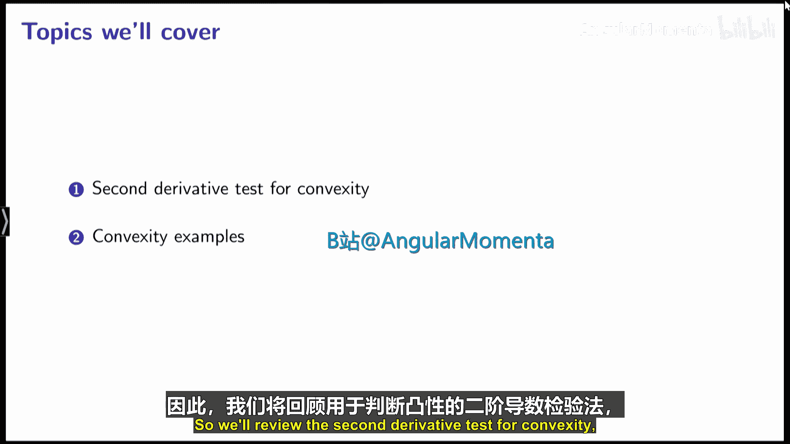
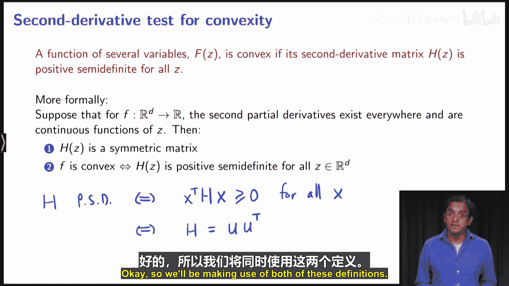
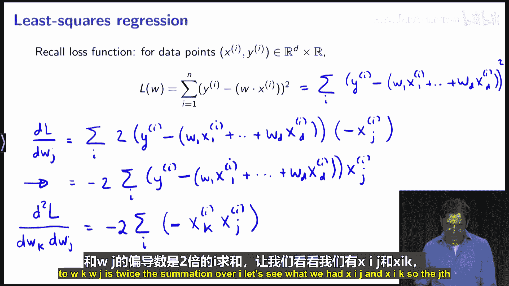
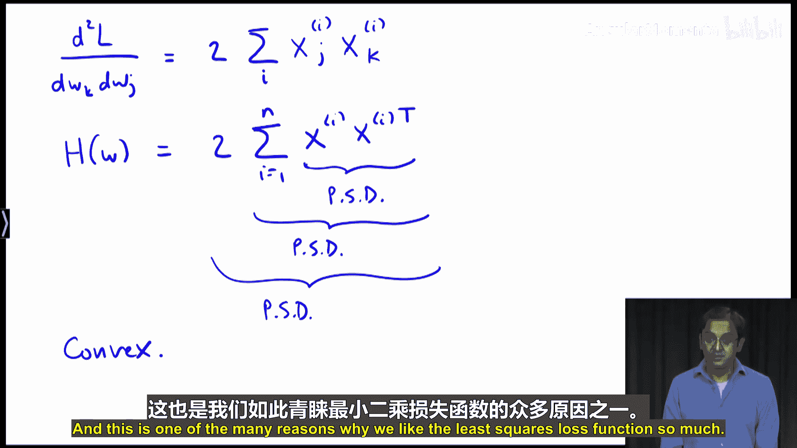

# 030：凸性_II 🔍

在本节课中，我们将学习如何判断一个函数是否为凸函数。凸性在机器学习中至关重要，因为许多算法都涉及最小化损失函数，而函数的凸性决定了我们如何有效地进行优化。我们将回顾凸性的二阶导数检验方法，并通过一系列例子来加深理解。

## 概述 📋

我们已经了解了凸函数的定义。对于一个具有D个变量的函数，如果其在整个定义域上的二阶导数矩阵（即Hessian矩阵）是半正定的，那么该函数就是凸的。本节课，我们将具体学习如何应用这个检验方法。

## 二阶导数检验法回顾 📐

对于一个D维变量的函数，其凸性可以通过其Hessian矩阵来判断。Hessian矩阵是一个D×D的矩阵。如果该矩阵在所有点都是半正定的，则函数是凸的。

那么，什么是半正定矩阵呢？一个矩阵H是半正定的，如果对于任意向量x，其定义的二次型总是非负的，即满足：
**xᵀHx ≥ 0**

此外，还有一个更实用的等价定义：一个矩阵是半正定的，当且仅当它可以写成**U Uᵀ**的形式，其中U是任意实矩阵。在后续的示例中，我们将同时运用这两种定义。

## 示例分析 📝

以下是几个具体的函数凸性判断示例。

### 示例一：平方范数函数

首先，我们来看一个简单的例子：函数 **f(x) = ||x||²**。这个函数是凸的吗？

第一步是计算其Hessian矩阵。我们上次已经计算过，其Hessian矩阵是**2I**，即两倍的单位矩阵。

现在判断这个矩阵是否半正定。对于任意向量z，计算二次型：
**zᵀ (2I) z = 2 zᵀ z = 2 ||z||² ≥ 0**
由于结果总是非负的，因此矩阵2I是半正定的。另一种看法是，2I是一个对角元素全为正数的对角矩阵，这直接表明它是半正定的。

因此，函数 **f(x) = ||x||²** 是凸函数。它实际上是经典凸函数 **y = x²** 在多维空间中的推广。

### 示例二：点积平方函数

接下来，我们看一个稍复杂的例子。设u是D维空间中的一个固定向量，定义函数 **f(z) = (u · z)²**，其中z是变量。这个函数是凸的吗？

我们首先计算其一阶导数。对zⱼ求导：
**∂f/∂zⱼ = 2 (u · z) uⱼ**

接着计算二阶导数，对zₖ求导：
**∂²f/∂zₖ∂zⱼ = 2 uⱼ uₖ**

因此，Hessian矩阵是一个D×D矩阵，其(j, k)元素为 **2 uⱼ uₖ**。这可以简洁地写成：
**Hessian = 2 u uᵀ**

根据我们之前的等价定义，矩阵 **u uᵀ** 本身就具有 **U Uᵀ** 的形式，因此是半正定的。乘以常数2后，它仍然是半正定的。

所以，函数 **f(z) = (u · z)²** 也是凸函数。

### 示例三：最小二乘损失函数

现在，我们来分析一个在机器学习中至关重要的函数：最小二乘回归的损失函数。假设我们有n个数据点 **(xᵢ, yᵢ)**，其中xᵢ是D维向量，yᵢ是实数标量。我们希望找到一个权重向量w，使得线性预测 **w · xᵢ** 与真实值yᵢ的误差平方和最小。损失函数定义为：
**L(w) = Σᵢ (yᵢ - w · xᵢ)²**

我们需要判断L(w)是否为凸函数。首先计算其一阶导数。对wⱼ求导：
**∂L/∂wⱼ = Σᵢ [ -2 (yᵢ - w · xᵢ) xᵢⱼ ]**

然后计算二阶导数，对wₖ求导：
**∂²L/∂wₖ∂wⱼ = Σᵢ [ 2 xᵢⱼ xᵢₖ ]**

因此，整个Hessian矩阵可以表示为：
**Hessian = 2 Σᵢ [ xᵢ xᵢᵀ ]**

这里，每个 **xᵢ xᵢᵀ** 都是一个D×D的矩阵，并且具有 **U Uᵀ** 的形式，所以每个都是半正定的。半正定矩阵的和仍然是半正定的，乘以正常数2也保持半正定性。

因此，最小二乘损失函数 **L(w)** 是一个凸函数。这也是我们如此青睐最小二乘法的重要原因之一——其凸性保证了优化过程能找到全局最优解。

## 总结 🎯

本节课我们一起学习了如何利用二阶导数检验函数的凸性。我们回顾了半正定矩阵的定义和性质，并通过三个由浅入深的例子进行了实践：
1.  平方范数函数 **f(x) = ||x||²**。
2.  点积平方函数 **f(z) = (u · z)²**。
3.  最小二乘回归的损失函数 **L(w) = Σ (yᵢ - w·xᵢ)²**。

我们验证了这些函数都是凸的。掌握凸性的判断方法，为我们接下来学习高效的优化算法和更复杂的分类模型奠定了坚实的基础。