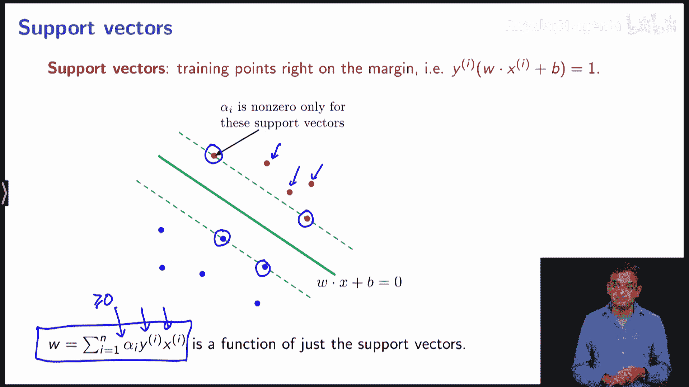
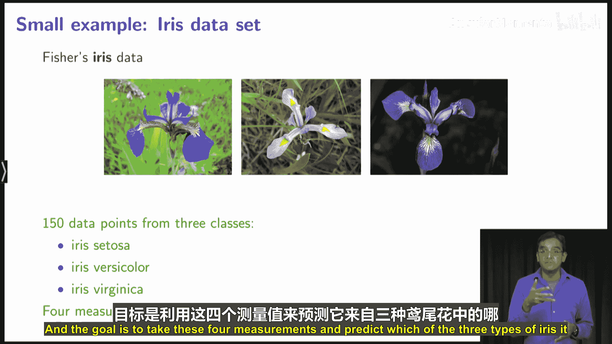
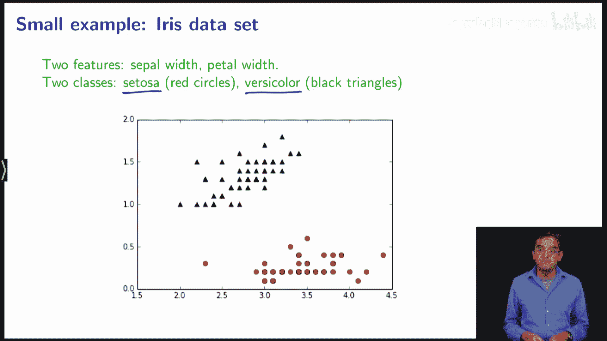
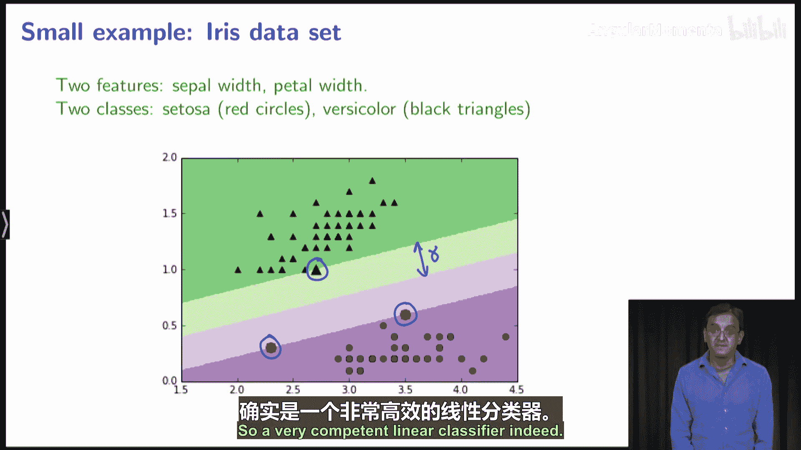

# 032：支持向量机 I 🧠

在本节课中，我们将学习一种性能卓越的线性分类器——支持向量机。我们将从线性分类器的“间隔”概念开始，然后探讨如何找到具有最大可能间隔的线性分类器。这最终会引出一个凸优化问题，其解具有一个独特的性质：它仅依赖于少数几个被称为“支持向量”的训练点。

## 线性分类器的间隔

上一节我们介绍了感知机算法及其收敛定理。该定理指出，如果数据集是线性可分的，感知机算法保证能找到一个完美分隔训练集的线性分类器。然而，它可能返回众多可行解中的任意一个。

那么，如果我们想要那个最“居中”、周围“缓冲”区域最大的分类器呢？例如下图中的这条线。我们该如何形式化地定义和寻找它？

## 问题形式化

我们的设定如下：我们有训练数据，包含 N 个点 `x1` 到 `xN`（特征向量），以及对应的二元标签 `y`（取值为 +1 或 -1）。我们希望找到一个线性分类器，即参数 `w` 和 `b`，使其能完美分类数据。

完美分类的条件可以简洁地写为：对于所有训练点 `i`，满足：
`y_i * (w·x_i + b) > 0`

为了讨论间隔，我们将这个条件改写为一个更强的形式：
`y_i * (w·x_i + b) >= 1`

为什么可以这样做？如果存在 `w` 和 `b` 使得原条件成立（所有值 > 0），那么通过按比例放大 `w` 和 `b`，总能使所有值 >= 1。因此，这个新条件与原问题的可行性是等价的。

## 间隔的几何意义

改写后的条件带来了清晰的几何解释。决策边界是 `w·x + b = 0`。而 `w·x + b = 1` 和 `w·x + b = -1` 则是两条平行的超平面。

我们的条件要求：所有正类点（`y=+1`）必须位于右侧超平面（`w·x + b = 1`）的右侧；所有负类点（`y=-1`）必须位于左侧超平面（`w·x + b = -1`）的左侧。这样，两类点之间就形成了一个“缓冲区”，没有任何点落在这个区域内。

这个缓冲区的宽度就是“间隔”（margin），记作 γ。间隔有一个简单的计算公式：
`γ = 1 / ||w||`

因此，为了最大化间隔，我们需要最小化权重向量 `w` 的范数。

## 优化问题

综合以上，支持向量机的核心优化问题可以表述为：

**最小化**：`(1/2) * ||w||^2`
**约束条件**：对于所有 `i = 1, ..., N`，`y_i * (w·x_i + b) >= 1`

这是一个凸优化问题，因为目标函数（`w` 的范数平方）是凸函数，而所有约束条件都是关于 `w` 和 `b` 的线性不等式。凸优化问题通常可以高效求解。

## 支持向量与对偶解

凸优化理论中的对偶性告诉我们，最优解 `w*` 具有一种特殊形式：
`w* = Σ_{i=1}^{N} α_i * y_i * x_i`

其中，`α_i` 是大于等于零的系数。一个关键的性质是：**大多数 `α_i` 的值会是零**。只有那些恰好位于间隔边界（即满足 `y_i*(w·x_i+b)=1`）的训练点，其对应的 `α_i` 才大于零。这些点被称为**支持向量**。

因此，最终的分类器仅由这些支持向量决定。即使数据集有上百万个点，如果只有几百个支持向量，那么模型也只需要依赖这几百个点。

## 示例：鸢尾花数据集

让我们看一个支持向量机在实际数据集上工作的例子。我们使用著名的鸢尾花数据集，它包含三种鸢尾花的测量数据。为了进行二元分类可视化，我们只取其中两类（Setosa 和 Versicolor），并只使用两个特征（花瓣宽度和萼片宽度）。

数据集明显是线性可分的。感知机算法能找到某个分隔超平面，但支持向量机会寻找具有最大间隔的那个。

上图展示了支持向量机找到的解。它返回了一个非常“居中”的线性分类器。这个分类器仅依赖于三个训练点——即图中的三个支持向量。间隔 γ 是图中所示的距离，这是在该数据上可能达到的最大间隔。

## 总结

本节课中，我们一起学习了支持向量机的基本原理。我们专注于数据线性可分的情况，通过最大化分类间隔来定义优化问题，并了解到其解可以表示为支持向量的线性组合，这使得模型具有稀疏性和鲁棒性。

然而在实践中，数据往往不是线性可分的。下一节课，我们将探讨如何将支持向量机的方法扩展到更一般的、任意数据的情况。