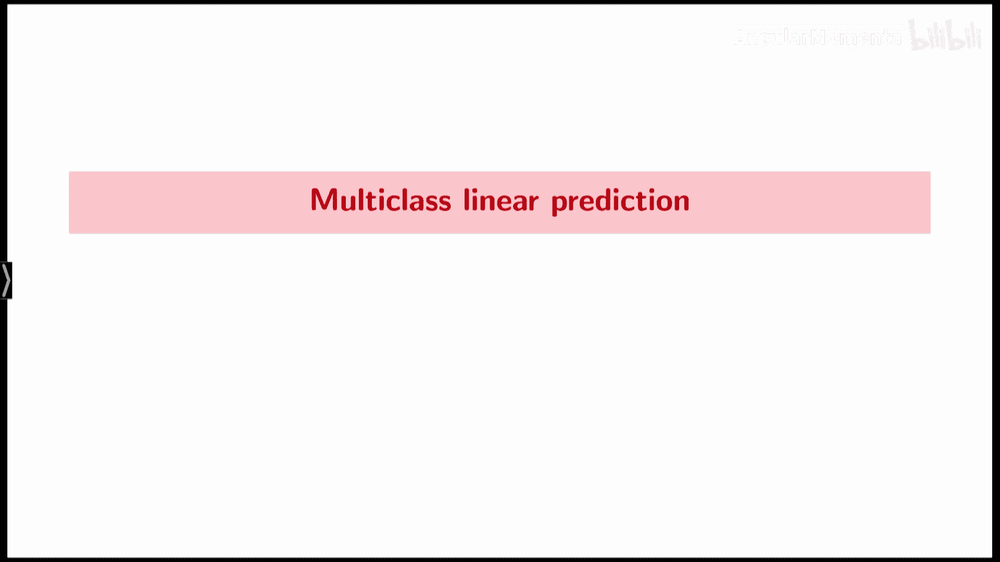
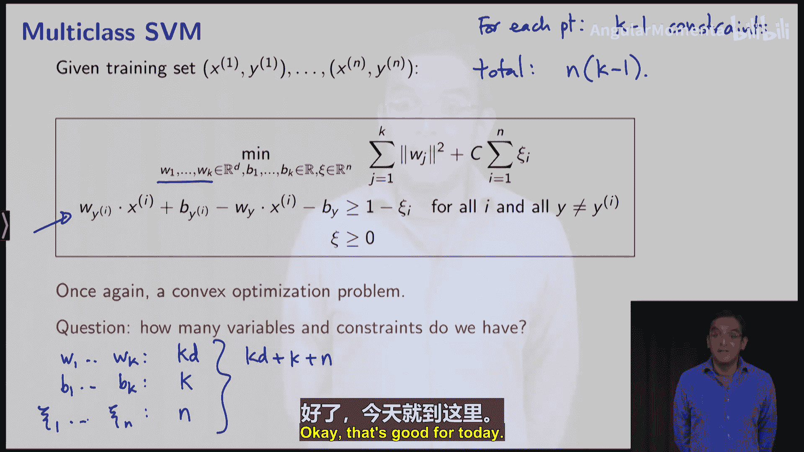

# 035：多分类线性预测 📈

在本节课中，我们将要学习如何将线性分类方法从二分类问题扩展到多分类问题。我们将看到，通过一个简单而统一的框架，可以轻松地扩展逻辑回归、感知机算法和支持向量机，使其能够处理多个类别。

---

## 从二分类到多分类

上一节我们介绍了多种线性分类方法，但它们都只适用于标签为+1或-1的二分类情况。本节中我们来看看，当存在更多类别时，我们该如何处理。

一些方法天生就支持多分类，例如最近邻算法和生成式模型。最近邻算法能自动适应任意数量的类别。生成式模型则为每个类别单独拟合一个高斯分布或其他分布。

然而，线性分类器似乎有些棘手，因为一条直线只有两侧。为了理解核心思想，让我们回顾高斯生成模型。在那里，我们为每个类别拟合一个高斯分布，每个类别都有自己的二次函数。当新数据点到来时，每个类别评估其二次函数，得分最高的类别获胜。

我们可以将类似的思想应用于线性分类：让每个类别拥有自己的线性函数。

---

## 多分类线性模型框架

假设我们的数据点 **x** 位于 D 维空间，即 **x** ∈ ℝᴰ。标签有 K 个可能的值，例如 1, 2, ..., K。

我们将为每个类别分配一个线性函数：
*   类别 1：**w₁**·**x** + b₁
*   类别 2：**w₂**·**x** + b₂
*   ...
*   类别 K：**wᴋ**·**x** + bᴋ

其中，每个 **wⱼ** 是一个 D 维向量，每个 bⱼ 是一个偏移量（标量）。

**预测规则**：当新数据点 **x** 到来时，每个类别计算其线性函数的值。我们预测具有**最大值**的那个类别作为标签。

公式表示为：
**预测标签** = argmaxⱼ ( **wⱼ**·**x** + bⱼ )

---

## 多分类逻辑回归

对于二分类逻辑回归，我们只有一个线性函数 **w**·**x** + b，并通过 sigmoid 函数计算概率。

现在扩展到 K 个类别。我们为每个标签 j 设置线性函数 **wⱼ**·**x** + bⱼ。给定点 **x**，其标签为 j 的概率与 exp(**wⱼ**·**x** + bⱼ) 成正比。

为了使所有类别的概率之和为 1，我们需要进行归一化。因此，**多分类逻辑回归**（也称为 Softmax 回归）的概率公式为：

P(y = j | **x**) = exp(**wⱼ**·**x** + bⱼ) / Σₖ₌₁ᴷ [ exp(**wₖ**·**x** + bₖ) ]

**学习过程**：给定训练集 { (**xᵢ**, yᵢ) }，我们通过最大化训练数据的似然（或等价地，最小化负对数似然）来学习所有参数 {**wⱼ**, bⱼ}。这是一个凸优化问题，可以使用标准软件包求解。

---

## 多分类感知机算法

感知机算法代码简洁。我们可以将其修改以处理多分类，修改后的算法同样简短。

以下是算法步骤：
1.  **初始化**：将所有 K 个线性函数的参数 **wⱼ** 和 bⱼ 设置为 0。
2.  **迭代**：遍历训练数据。
3.  **预测**：对于每个数据点 (**x**, y)，根据当前参数计算预测标签 ŷ = argmaxⱼ ( **wⱼ**·**x** + bⱼ )。
4.  **更新**：如果预测错误（ŷ ≠ y），则更新**两个**线性函数的参数：
    *   对于**正确标签 y**： **w_y** ← **w_y** + **x**， b_y ← b_y + 1
    *   对于**预测标签 ŷ**： **w_ŷ** ← **w_ŷ** - **x**， b_ŷ ← b_ŷ - 1
5.  重复直到所有数据点被正确分类或达到迭代次数上限。

该算法找到的是一个能完美分类训练数据的线性分界，但这个边界由多个线性片段组成，且不一定是最优的（例如，没有最大化间隔）。

---

## 多分类支持向量机

我们也可以将支持向量机扩展到多分类。目标是找到一个能正确分类所有数据点的线性函数集，同时最大化“间隔”并允许一些误差（软间隔）。

以下是**多分类软间隔SVM的凸优化问题**：

最小化： (1/2) Σⱼ₌₁ᴷ ||**wⱼ**||² + C Σᵢ₌₁ᴺ ξᵢ

约束条件：对于每一个训练样本 (**xᵢ**, yᵢ) 和每一个错误标签 r (r ≠ yᵢ)：
**w_{yᵢ}**·**xᵢ** + b_{yᵢ} ≥ **w_r**·**xᵢ** + b_r + 1 - ξᵢ
且 ξᵢ ≥ 0

**变量说明**：
*   **wⱼ**, bⱼ： 每个类别的线性函数参数。
*   ξᵢ： 松弛变量，允许第 i 个样本违反间隔约束。
*   C： 正则化参数，控制对误分类的惩罚力度。

**规模分析**：
*   **变量总数**： K×D (所有 **w**) + K (所有 b) + N (所有 ξ) = KD + K + N
*   **约束总数**： 每个样本有 (K-1) 个约束（正确类别需击败所有其他类别），总共 N × (K-1) 个约束。

这个优化问题可以通过现成的凸优化求解器来解决。

---

## 总结

本节课中我们一起学习了如何将线性分类方法扩展到多分类场景。核心思想是为每个类别分配一个独立的线性函数，并通过比较这些函数的值来进行预测。

我们具体探讨了三种方法的扩展：
1.  **多分类逻辑回归**：使用 Softmax 函数将线性输出转化为概率分布。
2.  **多分类感知机**：通过简单的加/减更新规则，在误分类时调整正确和错误类别的权重。
3.  **多分类支持向量机**：构建一个凸优化问题，在最大化间隔的同时，要求正确类别的分数高于其他类别一个单位（减去松弛变量）。

这个统一的框架强大而简洁，使我们能轻松应对现实世界中常见的多类别分类问题。