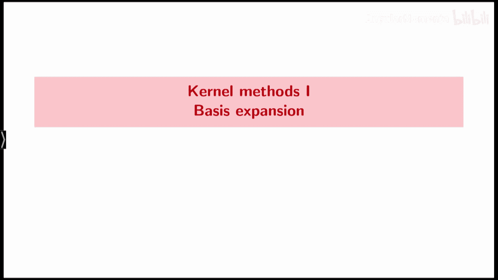
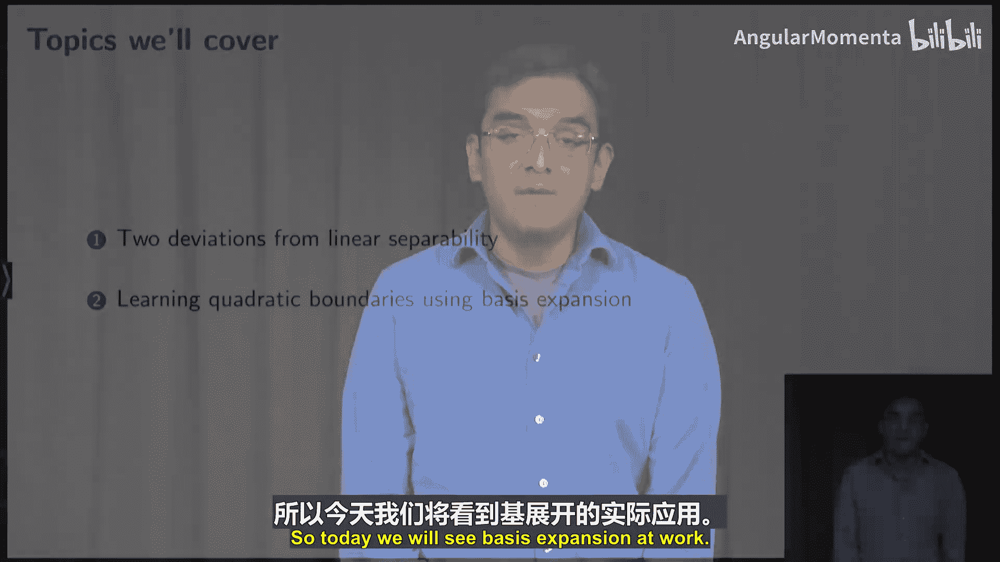
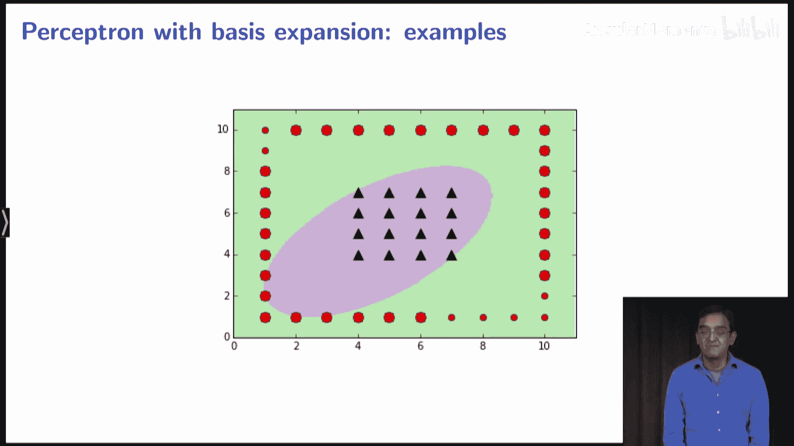

# 036：基扩展 🔄





在本节课中，我们将开始学习核方法。这些方法能实现一个非常神奇的功能：它们允许我们使用线性分类器（如感知机或支持向量机）来生成二次、多项式甚至更复杂的决策边界。实现这一目标涉及几个核心概念，我们将逐一详细讲解。今天，我们将首先了解基扩展的工作原理。

## 线性可分性的局限

在之前对分类问题的研究中，我们已经了解到，如果数据是线性可分的，那么问题就很简单。例如，我们可以使用感知机算法来学习分类器。

然而，线性可分性常常不成立，主要有两种情况：
1.  数据近似线性可分，但存在少数位于错误一侧的点。
2.  数据完全不是线性可分的，决策边界可能是抛物线等二次函数。

对于第一种情况，我们可以使用软间隔支持向量机等方法轻松处理。本节课，我们将重点探讨如何处理第二种情况，即学习二次决策边界。

## 基扩展的核心思想

假设我们有一个二维数据集，特征为 `x1` 和 `x2`。决策边界是一个抛物线，其方程可能类似于：
```
x1 = x2^2 + 5
```
这是一个关于 `x1` 和 `x2` 的二次边界。

基扩展的核心思想是扩展输入的表示。具体做法如下：
原始数据是二维的，包含特征 `x1` 和 `x2`。我们将使用一个映射函数 `φ(x)` 来扩展表示，使其包含五个特征：
```
φ(x) = [x1, x2, x1^2, x2^2, x1*x2]
```
这样，原始位于 `R^2` 空间的数据点，就被映射到了 `R^5` 的高维空间。

关键在于，原本在二维空间中的二次决策边界 `x1 - x2^2 - 5 = 0`，在高维空间 `φ(x)` 中变成了一个线性边界。我们可以将其表示为：
```
w · φ(x) + b = 0
```
其中，权重向量 `w = [1, 0, 0, -1, 0]`，偏置 `b = -5`。

**公式解释**：通过基扩展，我们将非线性问题（二次边界）转换为了高维空间中的线性问题。

## 扩展到更高维度

如果原始数据是 `d` 维的，为了学习一个二次决策边界，我们需要创建一个扩展表示 `φ(x)`，它包含：
*   所有原始特征：`x1, x2, ..., xd`
*   所有特征的平方项：`x1^2, x2^2, ..., xd^2`
*   所有特征的两两组合项（交叉项）：`x1*x2, x1*x3, ..., x_{d-1}*xd`

这个扩展表示的维度是：
```
维度 = d + d + C(d, 2) = 2d + d(d-1)/2
```
这大致是 `O(d^2)` 的复杂度。在这个高维空间中，任何关于原始特征的二次边界，都变成了关于 `φ(x)` 的线性边界。

## 实现：感知机算法的基扩展

要让感知机算法学习一个二次边界，方法非常简单：我们只需将原始感知机算法中所有出现输入向量 `x` 的地方，替换为扩展后的向量 `φ(x)` 即可。

**代码描述**：
```python
# 原始感知机更新规则
w = w + y_i * x_i

# 基扩展后的感知机更新规则
w = w + y_i * φ(x_i)
```
其中，`φ(x_i)` 是如上定义的扩展特征向量。

## 基扩展感知机示例

让我们通过两个例子来看基扩展感知机的效果：

1.  **非线性可分数据集**：下图展示了一个包含两类（黑色三角形和红色圆形）的数据集，它显然不是线性可分的。
    
    运行基扩展感知机算法后，它学习到了一个完美的二次决策边界（看起来像一段抛物线）。虽然在二维空间中这个边界是弯曲的，但在对应的五维嵌入空间中，它实际上是一个线性的超平面。

2.  **另一个复杂数据集**：另一个明显非线性可分的数据集。
    
    算法学习到了一个椭圆形的决策边界。同样，这个椭圆在二维空间是二次曲线，但在高维特征空间 `φ(x)` 中，它对应的是一个将两类数据完美分开的线性超平面。

## 总结与展望

本节课中，我们一起学习了核方法的第一个关键概念——**基扩展**。我们了解到，通过将原始特征映射到更高维的空间（例如，添加平方项和交叉项），可以将原始空间中的非线性分类问题（如二次决策边界）转化为高维空间中的线性分类问题。这使得像感知机这样的线性模型能够学习复杂的非线性模式。

我们实现这一点的方法非常简单：只需在标准感知机算法中用扩展后的特征向量 `φ(x)` 替换原始特征 `x` 即可。



基扩展展示了核方法的初步威力，但这仅仅是开始。它存在一个明显的挑战：当原始维度 `d` 很大时，扩展后的维度 `O(d^2)` 会急剧增长，导致计算和存储成本变得非常高。在接下来的课程中，我们将探讨核技巧，这是一种无需显式计算高维向量 `φ(x)` 就能在高维空间中进行运算的巧妙方法，从而高效地解决这个问题。敬请期待下一讲！