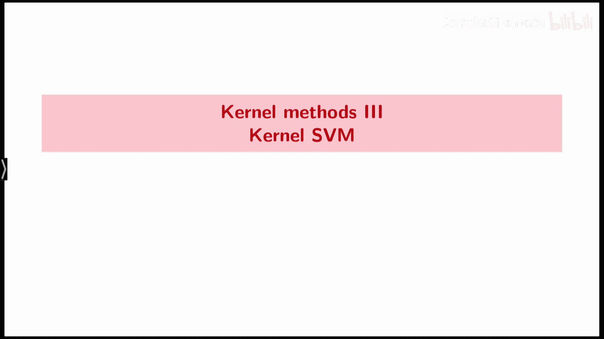
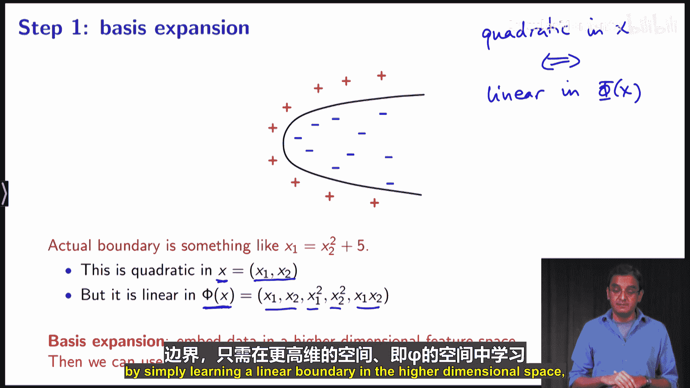
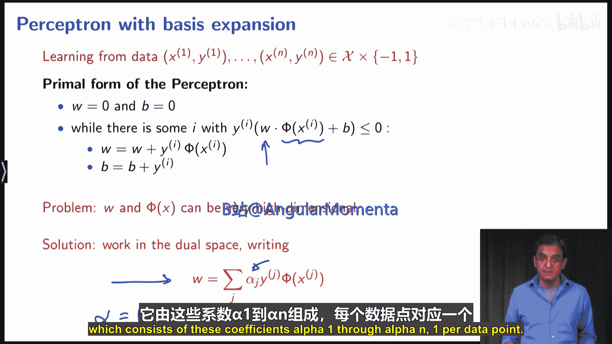
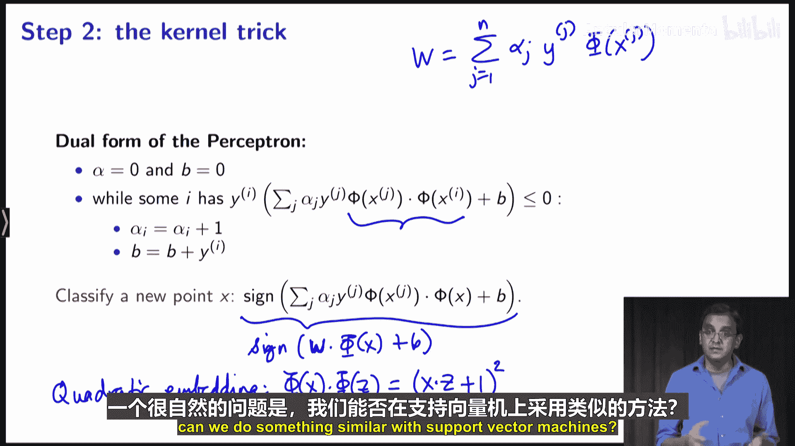
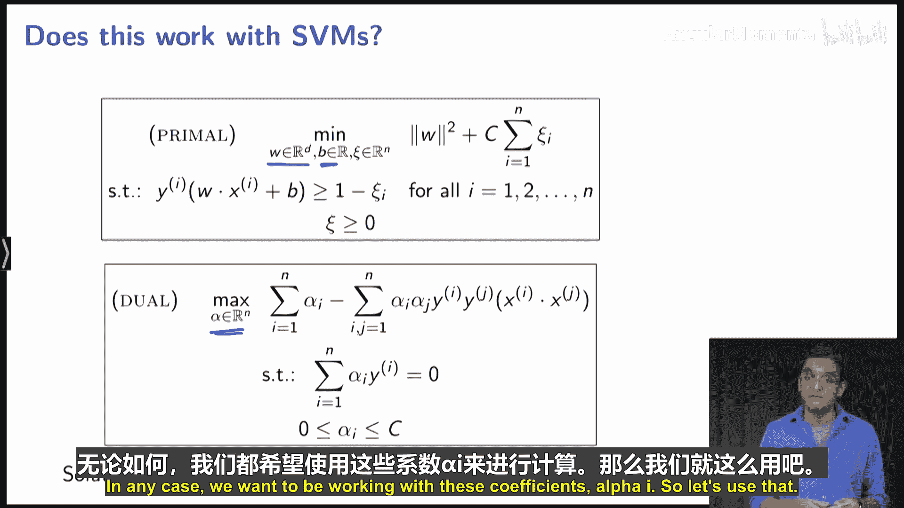
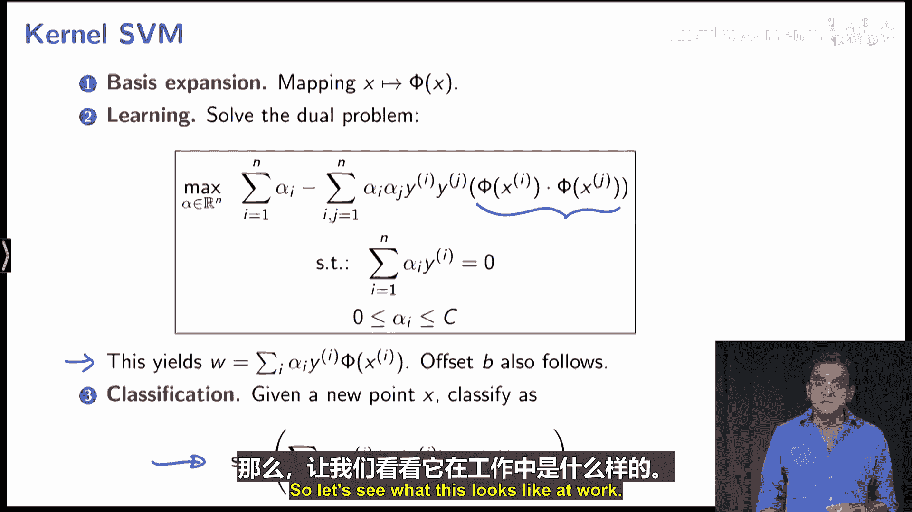
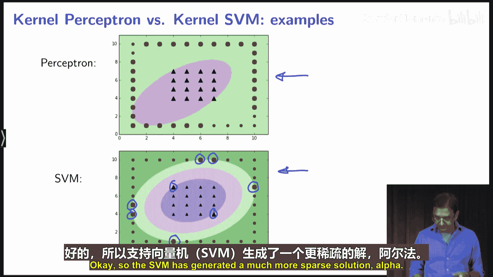
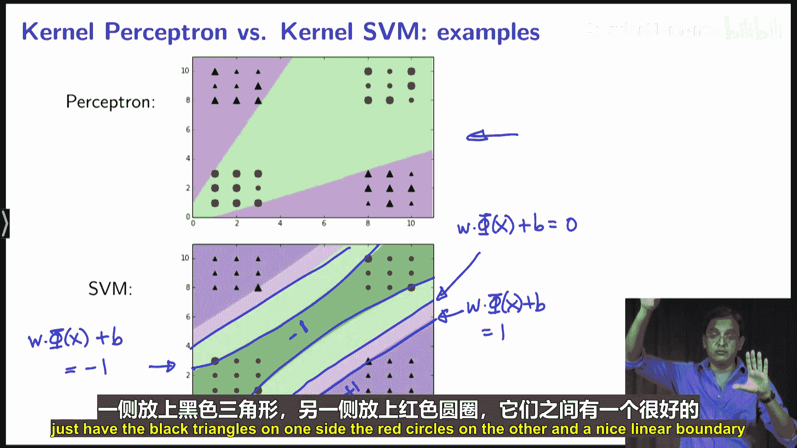
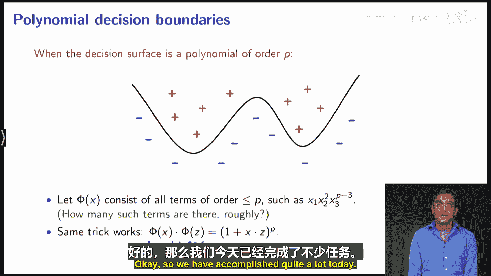

# 038：核支持向量机 🧠

在本节课中，我们将学习如何将核技巧应用于支持向量机，从而高效地学习复杂的非线性决策边界，特别是多项式边界。

上一节我们完整地介绍了核技巧。它为我们提供了感知机算法的高效版本，能够学习任意的二次决策边界。本节中，我们将看到可以对支持向量机做同样的事情，并且更进一步，超越二次边界，学习任意阶的多项式边界。

我们的首要任务是将支持向量机“核化”。然后，我们将探讨如何获得多项式决策边界。

## 快速回顾

在过去的几节课中，我们一直在研究如何使用线性分类的简单方法来学习二次决策边界。到目前为止，我们使用了两个技巧。

第一个技巧是**基扩展**。其核心思想是用扩展后的向量 **φ(x)** 替换原始数据向量 **x**。如果原始数据向量具有特征 x₁, x₂ 等，那么扩展向量 **φ(x)** 将包含原始特征、这些特征的平方以及它们的成对乘积（如 x₁x₂）。

这样做的原因是，如果一个函数在 **x** 上是二次的，那么它在 **φ(x)** 上就是线性的。因此，我们可以在原始空间 **x** 中学习一个二次边界，方法是在更高维的空间 **φ(x)** 中简单地学习一个线性边界。

这为我们带来了**带基扩展的感知机算法**，它只是普通的感知机算法，只不过我们将 **x** 替换为 **φ(x)**。

然而，这个算法有一个显著的缺点：这些扩展向量 **φ(x)** 和权重向量 **w** 的维度可能极高。例如，在MNIST手写数字数据集中，原始数据向量的维度是784，但扩展向量 **φ(x)** 的维度超过了30万。这使得它们处理起来非常不便。

因此，我们提出的解决方案是**核技巧**。其关键思想是不直接处理 **w**，而是处理其对偶表示。从感知机算法的形式可以看出，在任何时刻，**w** 向量都具有以下形式：**w = Σ αⱼ yⱼ φ(xⱼ)**。这是因为我们从 **w=0** 开始，唯一对 **w** 的操作就是加上 **yᵢ φ(xᵢ)**。系数 **αⱼ** 正是我们在第 j 个数据点上更新的次数。

因此，我们不使用 **w**，而是使用由这些系数 **α₁, …, αₙ** 组成的对偶形式。以下是感知机算法的对偶形式，可以看到所有关于 **w** 的提及都消失了。我们完全使用 **α** 工作：将它们初始化为1，遍历数据，如果在某个点（比如第 i 个点）上犯错，我们只需增加对应的系数 **αᵢ**，并相应地调整偏置 **b**。

为了分类一个新点 **x**，我们使用公式：**sign( Σ αⱼ yⱼ φ(xⱼ)·φ(x) + b )**。这等同于 **sign( w·φ(x) + b )**，只是我们用系数 **α** 的表达式替换了 **w**。

所有这些操作都非常简单，除了一件事：看起来我们必须计算这些扩展数据向量之间的点积。然而，我们上次看到，对于二次嵌入，我们可以非常容易地计算这些点积。具体来说，**φ(x)·φ(z) = (x·z + 1)²**。因此，整个算法变得极其高效。

## 核化支持向量机

既然核技巧在感知机上效果如此之好，一个自然的问题是：我们能否对支持向量机做类似的事情？

对于支持向量机，我们通过求解一个优化问题来进行学习。我们见过这个问题的两种形式：原始形式和对偶形式。在原始形式中，我们直接求解 **w** 和 **b**。在对偶形式中，我们求解系数 **α**，其解释与感知机中的相同，即 **w = Σ αᵢ yᵢ φ(xᵢ)**。

我们应该使用哪种形式？看起来对偶形式已经让我们朝着目标迈进了一半，因为我们无论如何都希望使用这些系数 **α**。因此，让我们使用对偶形式。

以下是**核支持向量机**的步骤。我们有一个特定的嵌入（例如，用于二次决策边界的嵌入），现在我们求解对偶优化问题。我们的数据点是 **(xᵢ, yᵢ)**。对于对偶问题，我们需要计算所有 **φ(xᵢ)** 和 **φ(xⱼ)** 之间的点积。这没问题，我们已经知道这些点积可以高效计算。我们计算这些点积，同时还有标签 **yᵢ** 和 **yⱼ**（只是+1或-1），然后将所有这些交给优化包，它会返回 **α**。

为了进行分类，我们再次使用规则 **sign( w·φ(x) + b )**，或者我们可以代入 **w** 的对偶形式，得到分类规则：**sign( Σ αⱼ yⱼ φ(xⱼ)·φ(x) + b )**。这一切都非常直接，使用的正是我们在核感知机中发展出来的相同思想。

## 实际效果

让我们看看它在实际中的效果。

这里有一个我们之前见过的数据集。这是感知机算法得出的边界，它是一个二次边界（椭圆），效果不错。但看看核支持向量机得出的边界，它更加美观，位置居中。图中加粗显示的点是支持向量，只有8个。因此，最终的 **α** 向量大部分为零，只有8个坐标非零。相比之下，感知机算法最终使用了几乎所有的数据点。所以，支持向量机产生了一个稀疏得多的 **α** 解。

再看另一个例子，这是一个非线性可分的数据集。感知机算法得出某个二次边界，而这是支持向量机得出的边界。

这条线是决策边界，其公式为 **w·φ(x) + b = 0**。假设绿色点是-1类，紫色点是+1类。那么这边的边界是 **w·φ(x) + b = -1**，对应的另一边边界是 **w·φ(x) + b = 1**。

这些边界在二维空间中看起来是二次的，但在更高维的嵌入空间（那个五维空间）中，它们只是线性的超平面。在五维空间中，黑色三角形在一侧，红色圆圈在另一侧，中间有一个具有最大间隔的漂亮线性边界。

## 扩展到更高阶多项式

我们已经取得了很大进展。我们找到了一种方法，可以使用感知机或软间隔支持向量机来获得二次决策边界。可以说，我们已经解决了学习二次决策边界的问题。

现在让我们更进一步，看看是否能获得更复杂的决策边界，比如更高阶的多项式边界（不仅仅是二次，可能是三次或四次多项式）。例如，下图是一个多项式决策边界。

这个多项式的阶数是多少？它看起来转折了三次，所以阶数至少是四。我们能学习这样的决策边界吗？事实证明，我们可以使用几乎相同的技巧轻松做到这一点。

那么，在这种情况下，我们的嵌入 **φ(x)** 是什么？和往常一样，我们取原始特征 **x₁** 到 **x_d**。但现在，我们还加入所有阶数最高为 **p** 的项，其中 **p** 是我们想要的多项式的阶数。例如，假设我们想要一个四次多项式的边界，那么 **p=4**。

我们的扩展向量 **φ(x)** 将包含所有原始特征，以及所有阶数不超过4的项，例如 **x₁⁴**、**x₂² x₇²**、**x₁ x₂ x₃ x₄** 或 **x₁³ x₈** 等。所有指数之和为4或更小的项都包含在内。

这样的项非常多。实际上，这类项的数量大约是 **d^p**，其中 **d** 是原始向量的维度，**p** 是多项式的阶数。但如果我们这样做，我们仍然可以继续使用我们的线性分类器技术，因为任何在 **x** 上是 **p** 次多项式的函数，在这个表示 **φ(x)** 中都是线性的。

为了使这可行，这些表示现在确实非常庞大，我们甚至无法写出一个这样的数据点。那么，有我们可以使用的核技巧吗？有没有一种方法可以高效地计算这些点积？

事实证明，确实有。**φ(x)** 和 **φ(z)** 的点积再次变得非常简单：**(x·z + 1)^p**。事情的发展简单得超乎想象。

## 总结

本节课中，我们一起学习了以下内容：

*   我们为感知机和支持向量机都创建了核化版本。
*   我们看到了如何轻松高效地使用它们来学习任何类型的多项式决策边界。
*   核技巧的惊人之处在于，我们还能用它做更多的事情。

核技巧的潜力巨大，让我们拭目以待，下次课再见。