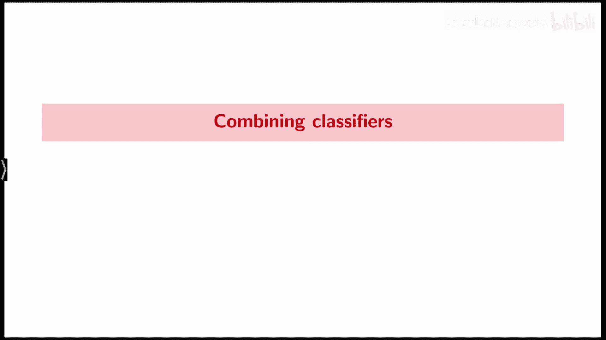
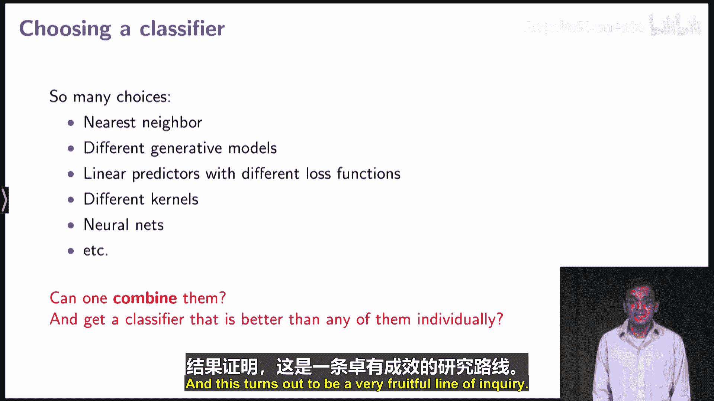
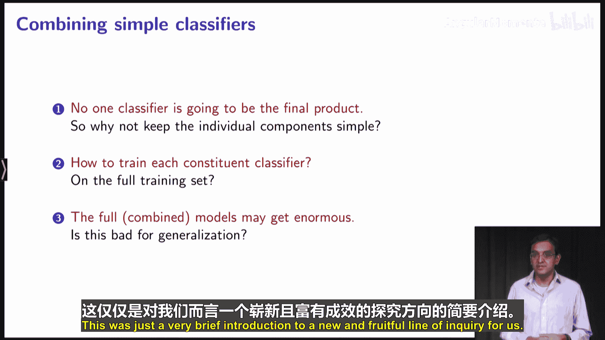

# 040：组合简单分类器 🧩

在本节课中，我们将转变思路，从一个全新的视角来审视学习过程。这将引导我们了解一些最成功的现成分类系统。

我们之前已经讨论过许多不同类型的分类器，例如最近邻分类器、基于不同分布的生成模型、逻辑回归或支持向量机等线性预测器，以及使用核方法的非线性决策边界。很快，我们还将接触到神经网络。

但有一个问题我们尚未考虑：**我们能否将一堆不同的分类器组合起来，得到一个比其中任何一个单独模型都更优的结果？** 答案是肯定的。事实证明，这是一条非常富有成果的研究路线。

---

## 组合分类器的基本问题 🤔

上一节我们介绍了组合分类器的核心思想。本节中，我们来看看在开始研究组合分类器这一整体业务时，会浮现出哪些基本问题。

以下是组合分类器时需要考虑的几个关键问题：

1.  **模型的简单性**：我们将组合多个模型，因此其中任何一个模型都不是最终产品。这意味着单个模型无需完美。或许我们可以让它们保持简单。事实上，我们可以让它们非常简单，例如，仅依赖于一个特征的分类器。
2.  **模型的训练方式**：我们需要一个模型集合，并以某种方式组合它们。但这些模型该如何训练？我们是在同一个训练集上分别、独立地训练它们，还是可以采取更巧妙的方法？例如，我们能否一次训练一个模型，每次都专注于当前表现不佳的训练集区域？
3.  **泛化问题**：我们将组合大量模型。最终模型可能非常庞大，参数数量巨大。这是否意味着我们也需要海量数据来学习所有这些参数？

这些就是我们在开始研究组合分类器时，将潜伏在背景中的一些基本问题的例子。

---

## 总结与预告 📚

本节课中，我们一起学习了组合简单分类器的基本概念和潜在优势。我们探讨了这种方法的可行性，并提出了在实施过程中需要解决的几个关键问题，包括模型的简单性、训练策略以及泛化能力。

这只是一个非常简短的介绍，为我们开启了一条全新且富有成果的研究路线。下次课，我们将正式开始学习决策树。