# 042：提升法 🚀

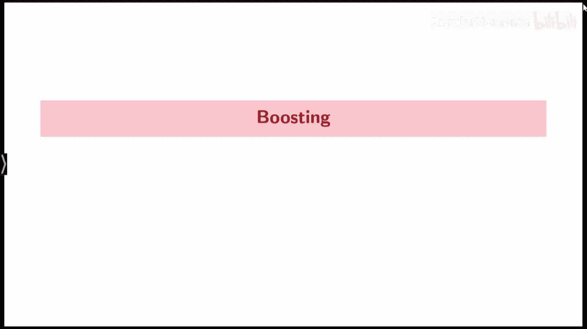

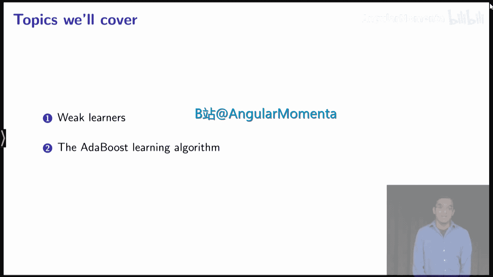

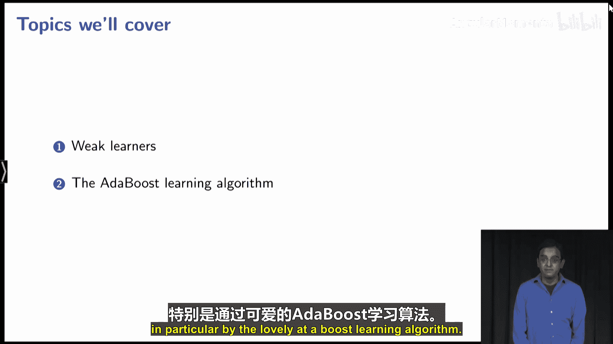

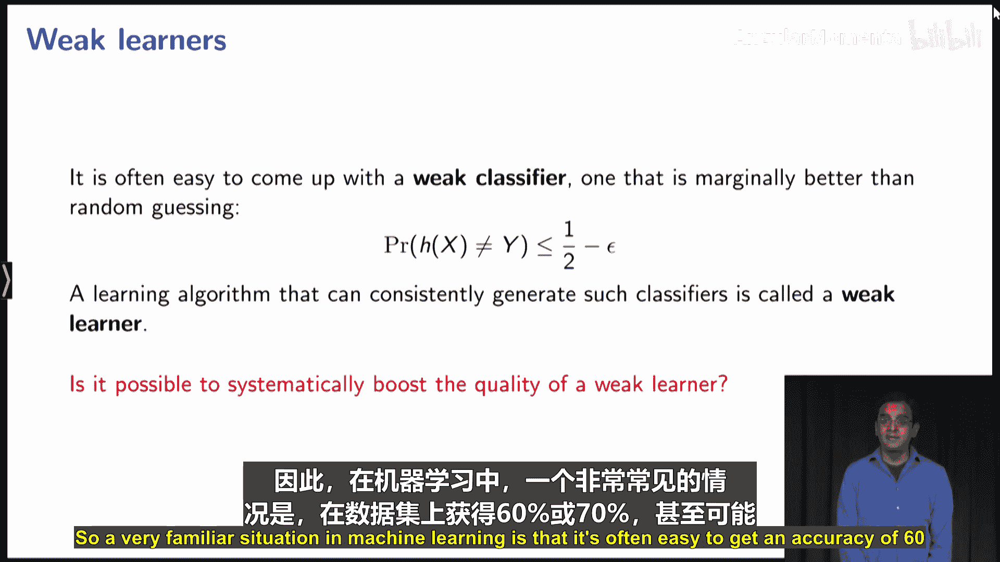

在本节课中，我们将要学习一种巧妙组合简单分类器的方法，它被称为“提升法”。我们将从介绍“弱学习器”的概念开始，然后探讨如何通过提升法，特别是可爱的AdaBoost算法，来克服这类学习器的不足。

---

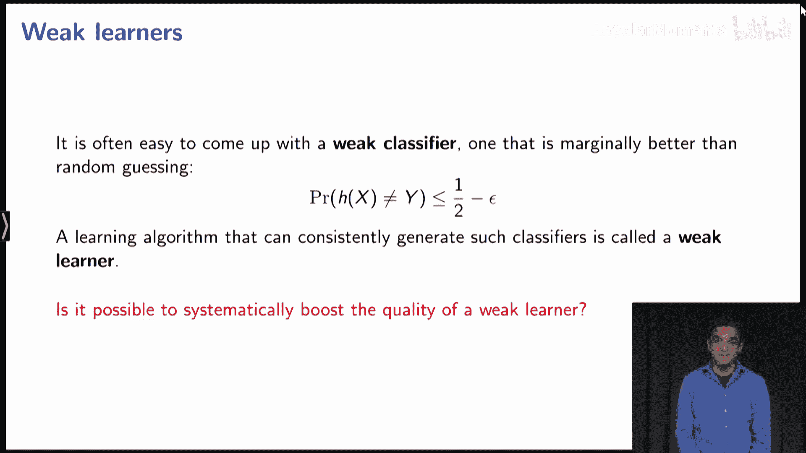

## 弱学习器与提升法的基本思想

上一节我们介绍了提升法的目标。本节中我们来看看其核心思想。

在机器学习中，一个常见的情况是，在数据上获得60%、70%或80%的准确率通常比较容易，但后续的提升则需要付出巨大努力。

让我们更抽象地思考这个问题。一个**弱分类器**是指其性能**优于随机猜测**的分类器，即其错误率低于50%，但可能好得不多，例如错误率为45%或49%。一个**弱学习器**则是一种能够反复生成此类弱分类器的学习算法。

那么，我们能否提升弱学习器的性能？能否利用弱学习器来生成质量高得多的分类器？这就是提升法所做的事情。

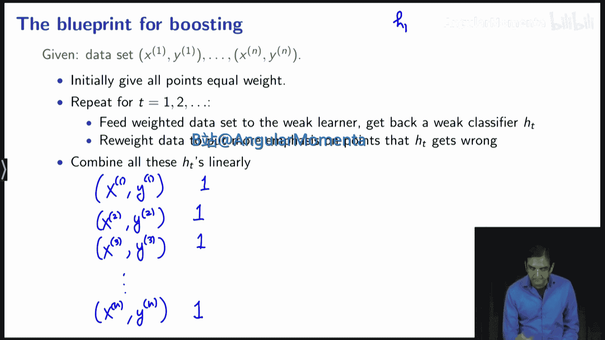

以下是提升法的基本思路：

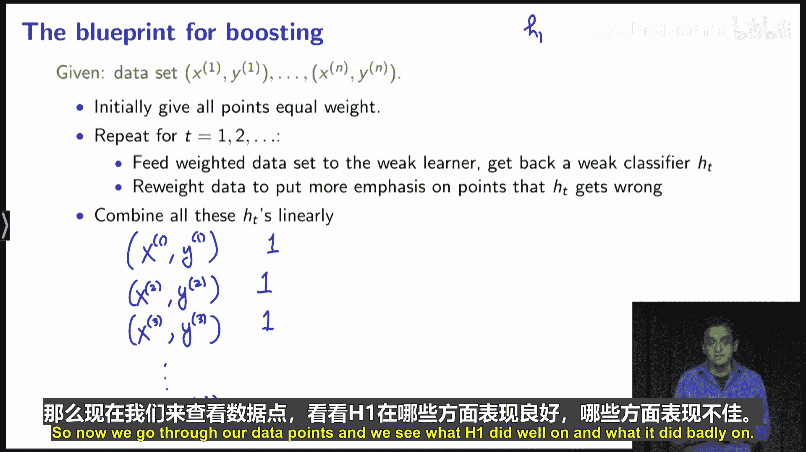

假设我们有一个数据集 `(x1, y1) ... (xn, yn)`，并且我们拥有一个弱学习器。我们不知道它的具体工作原理，它是一个黑盒分类算法：我们输入数据，它返回一个弱分类器，唯一保证的是这个分类器优于随机猜测。

这听起来并不那么令人放心。我们如何利用它来获得高质量的分类器呢？

首先，我们假设这个弱学习器允许我们为数据点附加权重。这意味着我们可以指定每个数据点的重要性，例如，某个点的权重为2，相当于该点在数据集中出现了两次。大多数学习算法都能在不显式复制数据点的情况下处理权重。

---

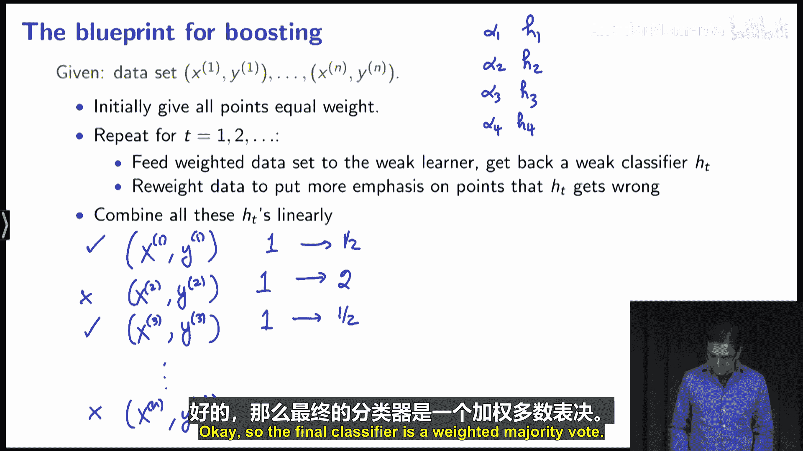

## AdaBoost算法详解

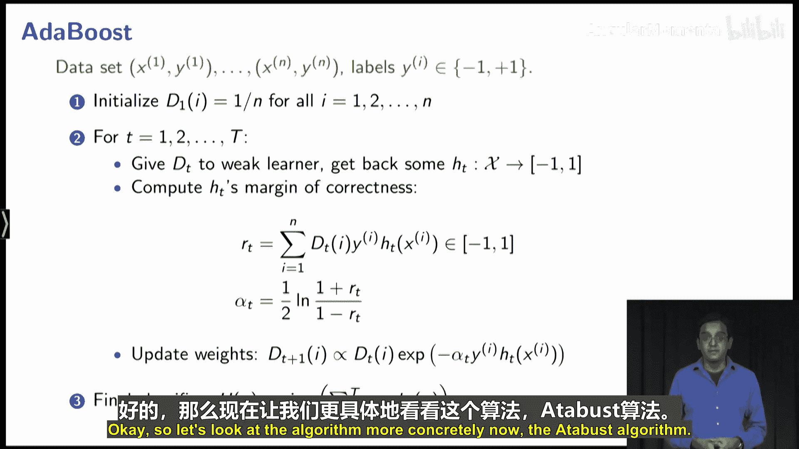

上一节我们介绍了提升法的基本思想。本节中我们来看看其具体实现——AdaBoost算法。

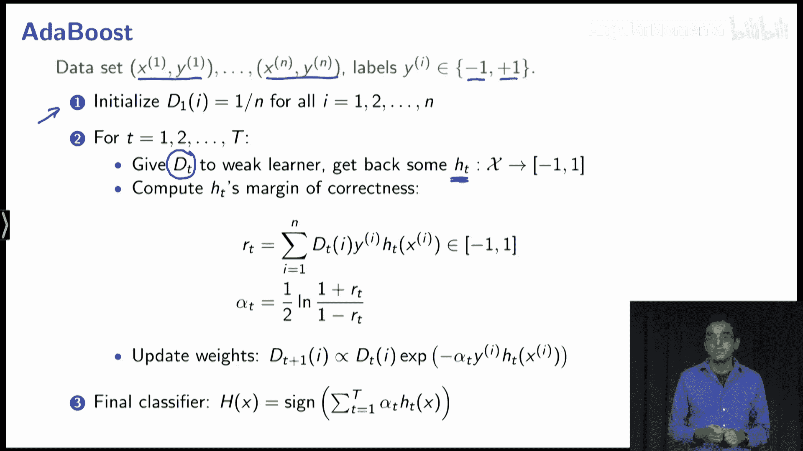

AdaBoost算法的整个过程可以概括如下。我们有一个数据集，其标签为 `-1` 或 `+1`。在任何时刻，我们都有一个对数据点的加权分布，在时间 `t` 的权重分布称为 `D_t`。

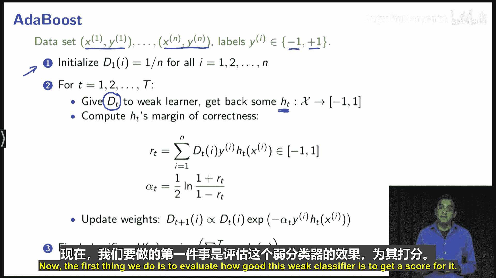

初始权重是赋予所有点相同的权重，例如 `1` 或归一化的 `1/m`。

然后我们开始多轮提升。在每一轮中：
1.  我们将加权数据集输入弱学习器，它返回一个弱分类器 `h_t`。
2.  我们评估这个弱分类器的好坏，为其计算一个分数 `r_t`。
3.  我们根据 `h_t` 的表现更新数据点的权重：对于分类正确的点，降低其权重；对于分类错误的点，提高其权重，以便后续学习器更关注这些困难点。
4.  我们为这个弱分类器 `h_t` 计算一个权重 `α_t`，用于最终的投票组合。

经过 `T` 轮后，我们得到一系列弱分类器 `h1, h2, ..., hT` 及其对应权重 `α1, α2, ..., αT`。

最终的分类器是所有这些弱分类器的加权多数投票。对于一个新点 `x`，我们计算加权和 `Σ α_t * h_t(x)`。如果结果为正，则预测 `+1`；如果为负，则预测 `-1`。

以下是算法中的核心公式：

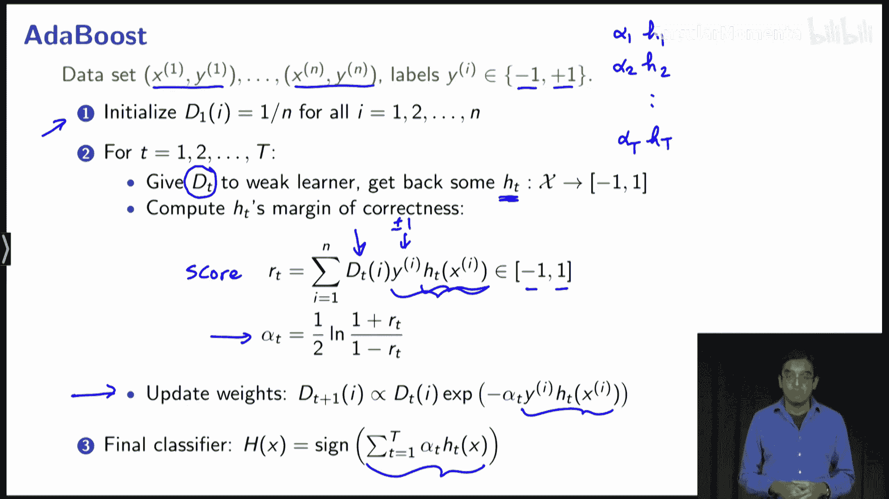

*   **弱分类器分数**：`r_t = Σ_i D_t(i) * y_i * h_t(x_i)`
    *   这个分数在 `-1` 到 `+1` 之间。`+1` 表示完全正确，`-1` 表示完全错误，`0` 类似于随机猜测。
*   **弱分类器权重**：`α_t = 0.5 * ln((1 + r_t) / (1 - r_t))`
    *   表现越好的分类器，其权重 `α_t` 越高。
*   **数据点权重更新**：`D_{t+1}(i) = (D_t(i) * exp(-α_t * y_i * h_t(x_i))) / Z_t`
    *   其中 `Z_t` 是归一化因子，确保 `D_{t+1}` 是一个概率分布。分类错误的点权重会增加。

---

## AdaBoost工作示例

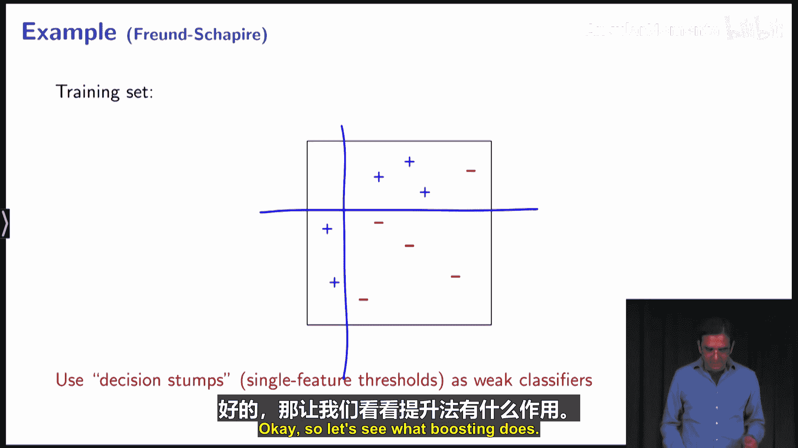

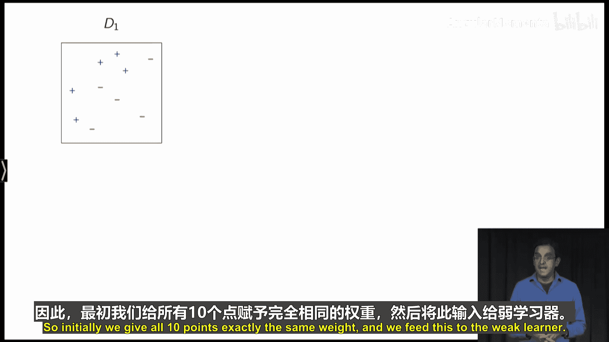

上一节我们介绍了AdaBoost的算法步骤。本节中我们通过一个具体例子来看看它是如何工作的。

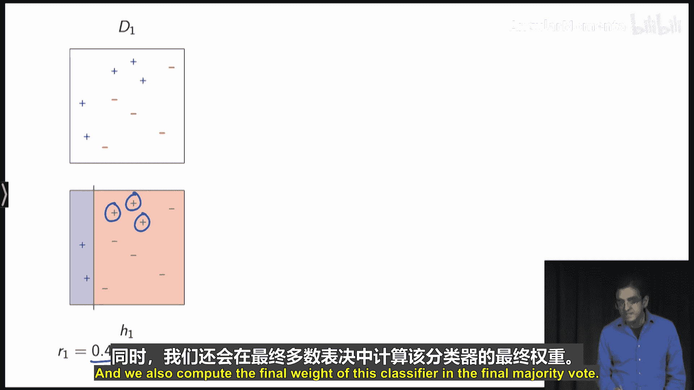

这是一个由AdaBoost的创建者Yoav Freund和Robert Schapire设计的简单示例。

我们有一个二维训练集，包含10个点（5个正类，5个负类）。我们将使用提升法构建分类器。此例中，弱学习器生成的弱分类器是简单的**水平或垂直分割线**（也称为“决策树桩”），例如“如果x1 > 某个阈值，则预测+1，否则预测-1”。

以下是AdaBoost的运行过程：

1.  **第一轮**：所有点初始权重相同。弱学习器可能生成第一条分割线（例如一条垂直线）。这条线分错了3个点（错误率30%）。我们计算其分数 `r1` 和权重 `α1`。然后，我们增加那3个被分错点的权重，减少分对点的权重。
2.  **第二轮**：将更新权重后的数据集输入弱学习器。由于第一轮分错的点现在权重很高，弱学习器必须生成一个不同的分类器来更好地处理它们，例如另一条垂直线。这条新线又会分错另一组点（比如另外3个）。我们再次更新权重，增加这新一轮分错点的权重。
3.  **第三轮**：重复此过程，弱学习器可能生成一条水平线。假设此时我们停止。

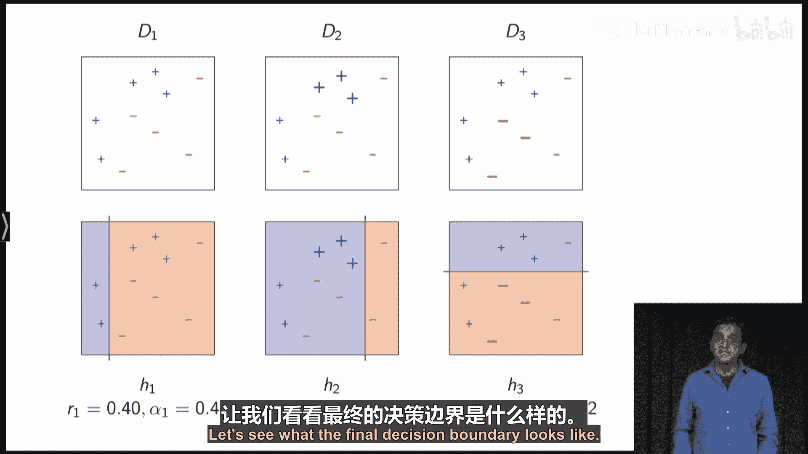

现在我们有了三个决策树桩 `h1, h2, h3` 及其权重 `α1, α2, α3`。最终的分类是它们的加权投票。

即使每个基分类器（弱分类器）都非常简单（仅基于单个特征的阈值），但通过加权组合，最终得到的决策边界是非线性的，并且在这个例子中完美分类了所有训练数据。

---

## AdaBoost的理论保证与扩展

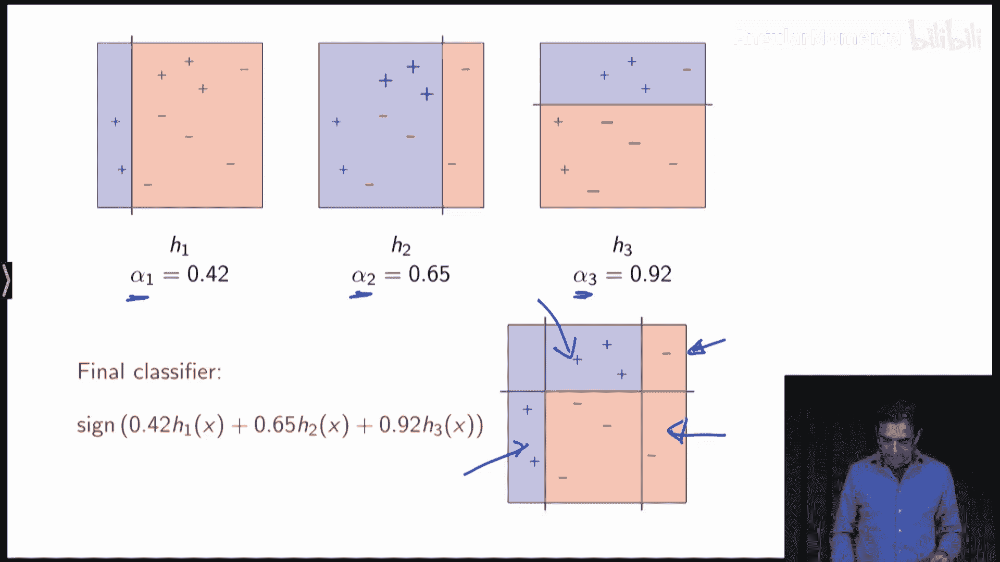

上一节我们看到了AdaBoost在实践中如何组合简单模型。本节中我们来看看其强大的理论性质以及一些扩展应用。

AdaBoost有一个非常惊人的数学性质：只要弱学习器每一轮产生的弱分类器错误率都低于 `1/2`（即优于随机猜测，设错误率为 `1/2 - γ`，`γ > 0`），那么经过 `T` 轮提升后，最终分类器的**训练误差会以指数速度下降至零**。这是一个非常强大的保证，意味着我们可以将仅比随机猜测好一点点的弱分类器，组合成一个任意高精度的强分类器。

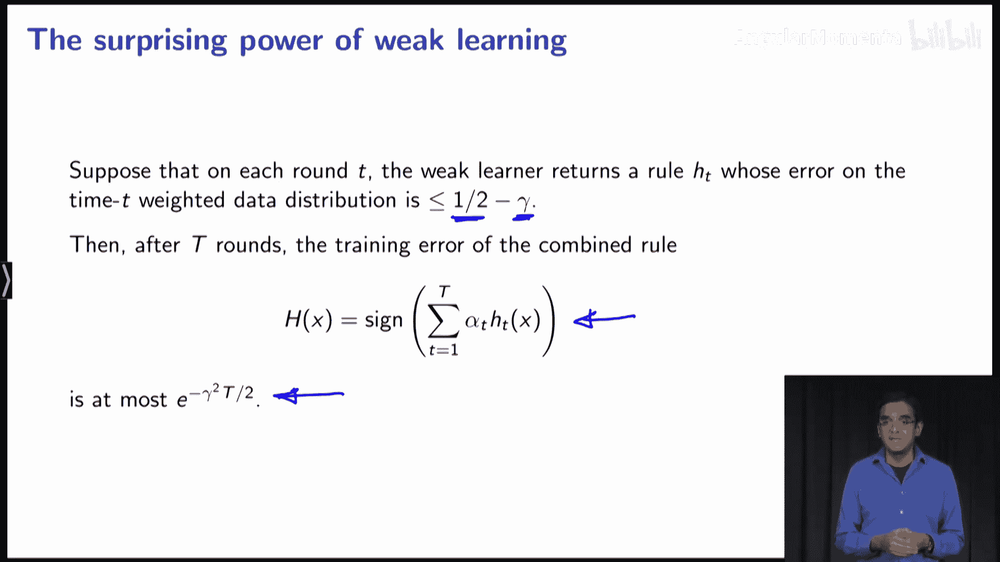

在实际应用中，常用的弱分类器选择包括：
*   **决策树桩**：如示例所示，这是最简单的决策树（只有一个分裂点）。提升的决策树桩集合通常与**决策树**进行比较，因为决策树也是由树桩（分裂节点）组成的，只是以分层方式组织。
*   **决策树**：也可以将整个决策树作为弱分类器进行提升。这样会生成一系列树，有时被称为“森林”。这引出了我们下次课将深入探讨的“随机森林”概念。

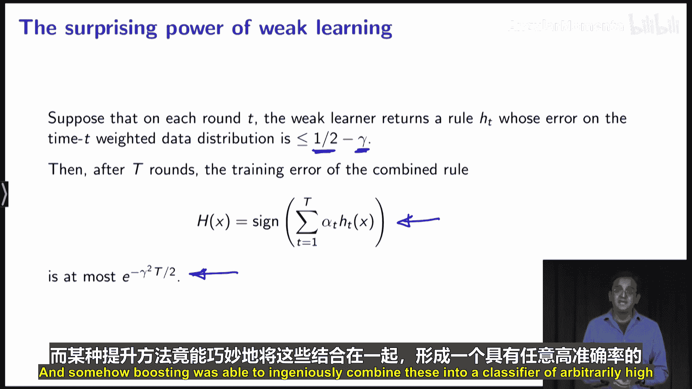

---

## 总结

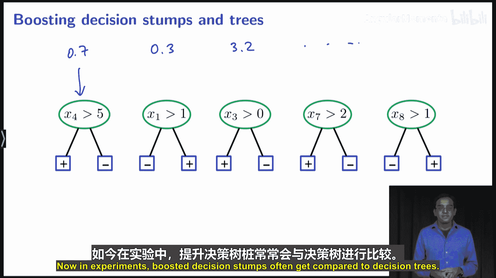

本节课中我们一起学习了提升法，特别是AdaBoost算法。

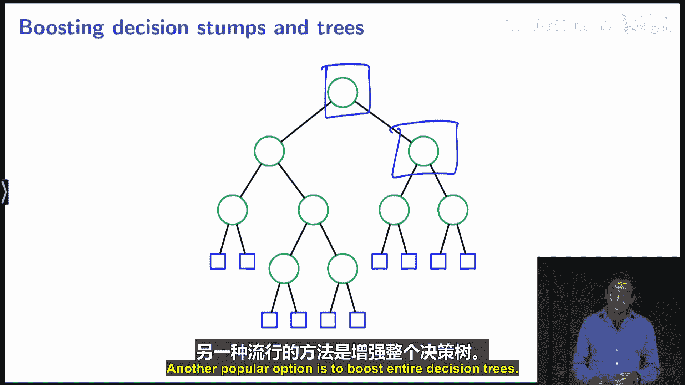

我们从**弱学习器**的概念出发，理解了如何通过迭代地调整数据权重、组合多个弱分类器，来构建一个强大的最终模型。AdaBoost算法通过为每个弱分类器分配权重，并对分类错误的数据点给予更多关注，有效地将一系列“略好于随机”的规则整合起来。

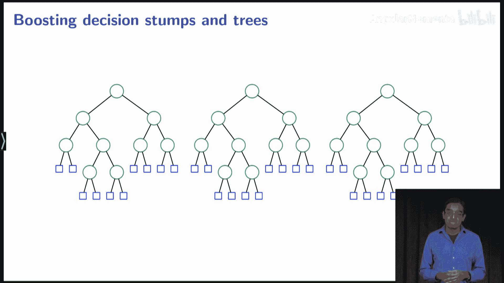

我们看到了AdaBoost在简单示例中的工作过程，并了解了其**指数级降低训练误差**的理论保证。最后，我们提到了提升法可以与不同的基学习器（如决策树桩或完整决策树）结合使用，形成高效且性能优异的集成分类系统。

提升法是一个简单、高效且性能强大的现成分类工具，其思想在机器学习领域影响深远。