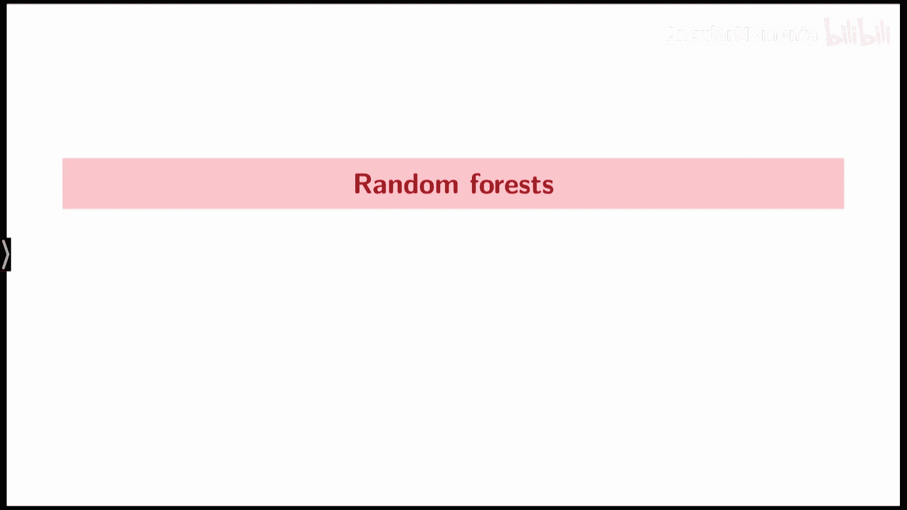
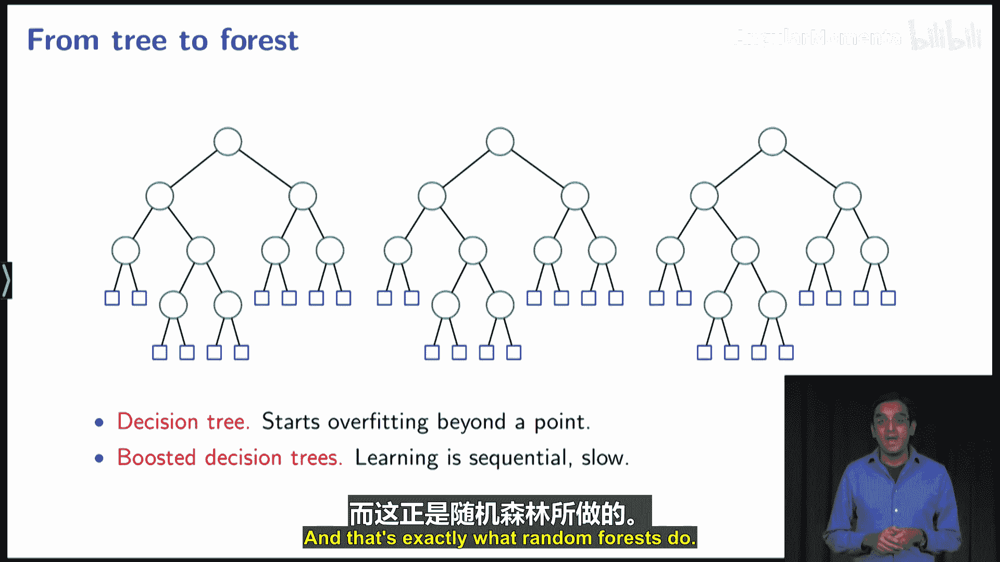
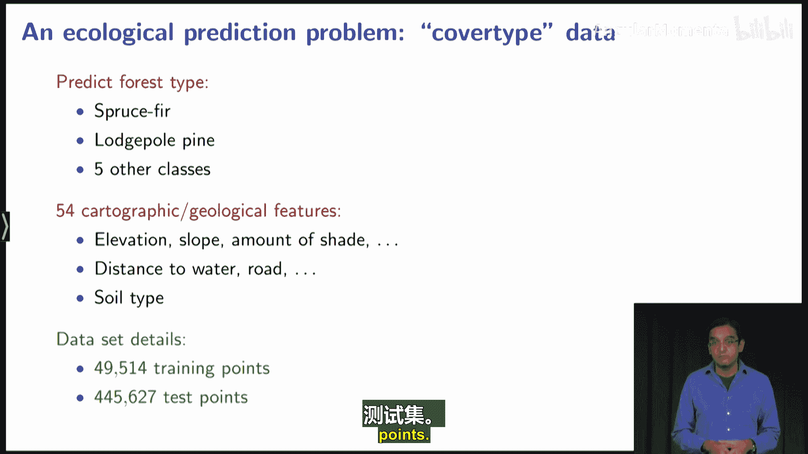
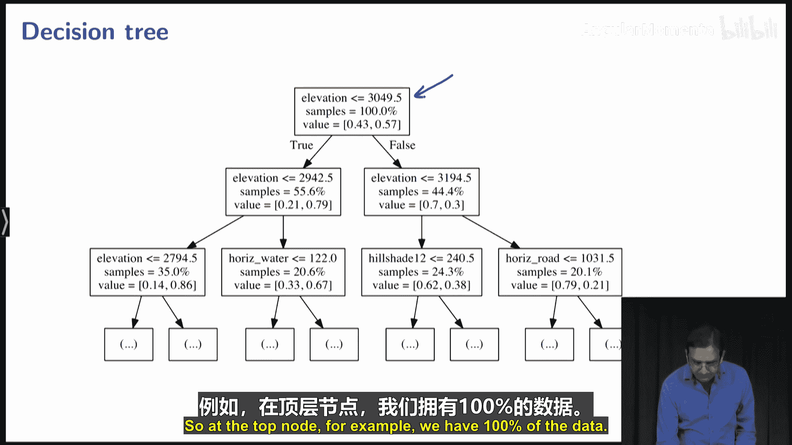
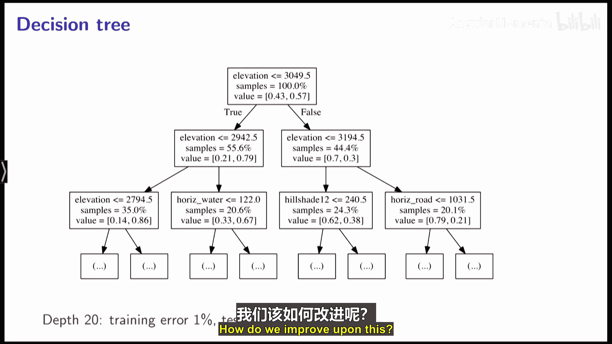
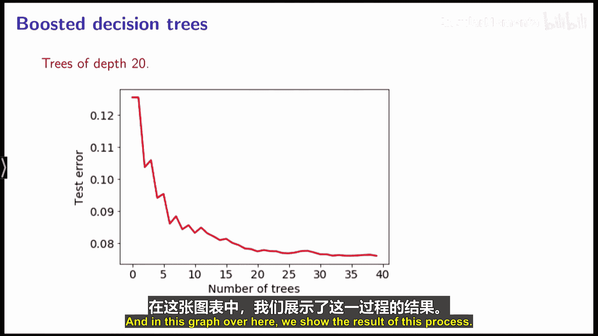
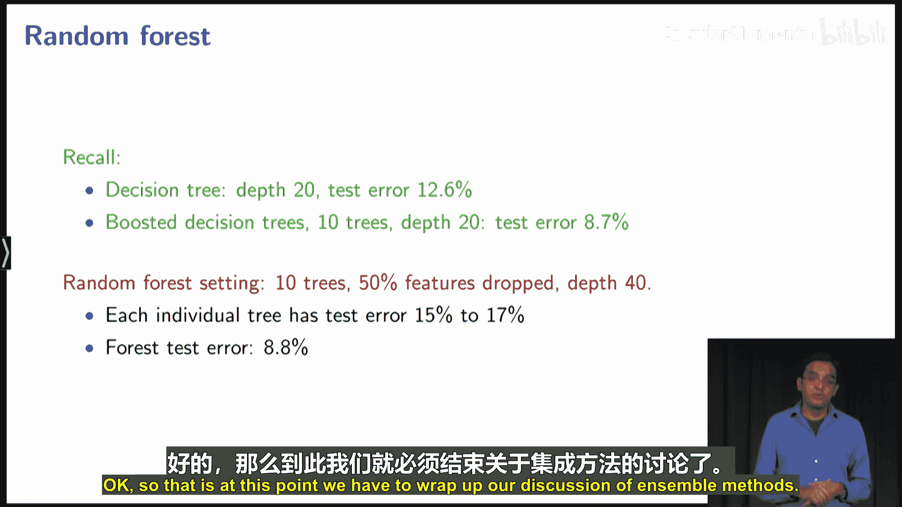

# 043：随机森林 🌲

在本节课中，我们将要学习一种被称为“随机森林”的集成学习方法。我们将从理解什么是分类器集成开始，然后详细探讨随机森林的构建过程，最后通过一个实验来对比决策树、提升方法和随机森林的性能。

## 集成方法与随机森林概述

提升方法通常被称为一种集成方法，因为它会生成一个分类器的集合或集成。

本节我们将探讨另一种极其流行的集成方法，它因其极端的简单性和在实际中的优异性能而广受欢迎，这种方法被称为随机森林。

我们将从观察树分类器的集成（有时也称为森林）开始。然后，我们将了解随机森林是如何构建的。最后，我们将进行一个实验，将我们对决策树、提升方法和随机森林的讨论整合在一起。

## 决策树的局限性与改进思路

我们已经讨论了很多关于决策树的内容。这些是非常有吸引力的分类器。它们会问一些问题（在图中由圆形节点表示），然后将我们引向一个叶子节点，在那里做出预测。

理论上，决策树可以拟合任何数据集。但在现实中，它们存在一个问题：一旦树开始变得太大，它就会开始对数据过拟合。随着树变得过大，训练误差会持续下降，但我们真正关心的测试误差却开始上升。因此，最佳性能通常由一棵中等大小的树实现。

那么，如何改进这一点呢？一种方法是使用提升方法来创建一整批树。我们不是继续生长单棵树（这会使情况更糟），而是重新开始一棵树，专注于第一棵树犯的错误。完成第二棵树后，我们再开始第三棵决策树，专注于前两棵树的错误，依此类推。

随着我们不断添加越来越多的树，训练误差会下降，而且测试误差也经常会下降。这是一个非常有吸引力的方案。然而，一个不便之处是，这个过程必须顺序进行。我们必须等待第一棵决策树完成，才能开始第二棵树，因为这告诉我们如何重新加权数据点。同样，我们必须等待第二棵树完成，才能开始第三棵树。所有这些有时可能相当慢。

如果能并行构建所有这些树，那该多好。要做到这一点需要什么呢？如果我们想同时构建一整批树，我们首先必须确保这些树最终彼此之间有很大不同。拥有多个相同树的副本是没有意义的。

那么，如何确保你并行构建的这些树都彼此不同呢？一个很好的方法就是在树构建过程中简单地引入随机性，而这正是随机森林所做的。

## 随机森林的构建过程

让我们看看随机森林是如何构建的。假设我们有一个包含 N 个数据点的数据集，比如在 D 维空间中，我们称这个数据集为 S。假设我们想要构建一个包含 T 棵树的集合。如果我们愿意，我们可以并行完成。

我们将构建 T 棵决策树。在构建每棵树时，我们将使用两种随机化方法。

以下是构建随机森林的两个关键随机化步骤：

1.  **数据重采样**：我们不会使用原始数据集 S，而是对数据进行重采样。具体做法是，我们从 S 中**有放回地**随机抽取 N' 个点，作为我们的数据点集。通常，N' 被设定为 N。
2.  **特征随机选择**：在树构建过程中，当我们在一个节点需要进行分割时，我们不会考虑所有 D 个特征。相反，我们会**随机选择 K 个特征**，并且强制只能从这 K 个特征中选择一个进行分割。通常，K 被设定为类似 `sqrt(D)` 的值，或者一个固定的比例，如 `D/2`。

这样做可以在树之间创造多样性，从而创造一种鲁棒性。这些树必须以多种不同的方式得出正确的答案（正确的标签）。这是一种非常有趣的随机性。事实上，当我们研究神经网络时，我们会看到类似的做法，通常被称为“丢弃法”。

使用这两种随机性，我们得到了一组 T 棵树，它们彼此之间都相当不同。

现在，当需要预测一个新点 x 的标签时，我们只需让 x 通过所有树，获得每棵树的“投票”（即每棵树的预测标签），然后采取**多数投票**。

## 实验：森林类型预测

让我们看一个简单的例子，它将所有这些内容整合在一起。既然我们一直在讨论树，我认为看一个关于森林类型的生态学例子是合适的。这就是“覆盖类型”数据集。

它包含了从美国国家森林各个地点收集的数据。每个数据点都是从一小块土地（30米 x 30米）收集的。从这块土地上测量了 54 个特征。这些特征包括海拔、坡度、阴影量、到道路的距离、土壤类型等。基于这些特征，目标是预测这块土地的森林类型。

总共有七种森林类型，但在这个特定的数据集中，有两种类型完全主导了其他类型，它们是云杉和黑松。为了简化，我们实际上剔除了其他数据点，所以本质上我们有一个二元分类问题。数据量非常大，我们将其分为约 50,000 个点的训练集和约 450,000 个点的测试集。

### 单棵决策树的性能

第一步是将一棵决策树拟合到数据上。我们像往常一样生长这棵树，在某个时刻它开始过拟合。在这个案例中，我们选择在深度为 20 时停止生长树。当我们这样做时，我们发现训练误差为 1%，测试误差约为 12.6%。这已经很难再大幅改进了。

### 提升方法的性能

我们如何通过使用提升方法来创建一整批决策树来改进这一点呢？我们固定决策树深度为 20，并创建了总共 40 棵树的集合。图表显示了随着我们添加越来越多的树，测试误差是如何下降的。

当我们只有一棵树时，测试误差是 12.6%。随着我们添加更多的树，测试误差持续下降，最初急剧下降，然后逐渐趋于平稳，达到略低于 8% 的错误率。这效果很好。为了与随机森林进行比较，我们选择了一个固定数量的树，比如 10 棵树。

### 随机森林的性能

现在让我们看看在这个数据上构建随机森林会发生什么。我们决定使用 10 棵树。在构建随机森林时，在每次分割节点时，不允许使用所有可能的特征。我们随机选择其中一部分特征，然后将注意力限制在仅这些特征上。

在我们的案例中，我们将这个比例设定为 50%。因此，当我们在分割一个节点时，我们从 54 个特征中随机选择 50%。然后，我们要求分割必须涉及这些选定的特征之一。为了补偿这一点，我们允许树变得更大，将深度从 20 增加到 40。

我们以这种方式构建了 10 棵树。结果发现，如果你查看随机森林中生成的任何一棵单独的树，其测试误差在 15% 到 17% 之间。这比单棵决策树的误差要差得多，这是因为树构建过程中的所有约束和随机性。

然而，这 10 棵树彼此之间足够不同，以至于对它们进行多数投票，产生了一个好得多的分类器，其测试误差仅为 8.8%。这比单棵决策树好得多，并且与由 10 棵决策树组成的提升森林相当。

## 总结

本节课中我们一起学习了随机森林。我们看到的最后一种方法——随机森林，它实际上是两样东西的巧妙结合：决策树的表达能力，以及随机化算法的思想。最终，它是一种简单、易用且高性能的分类方法。