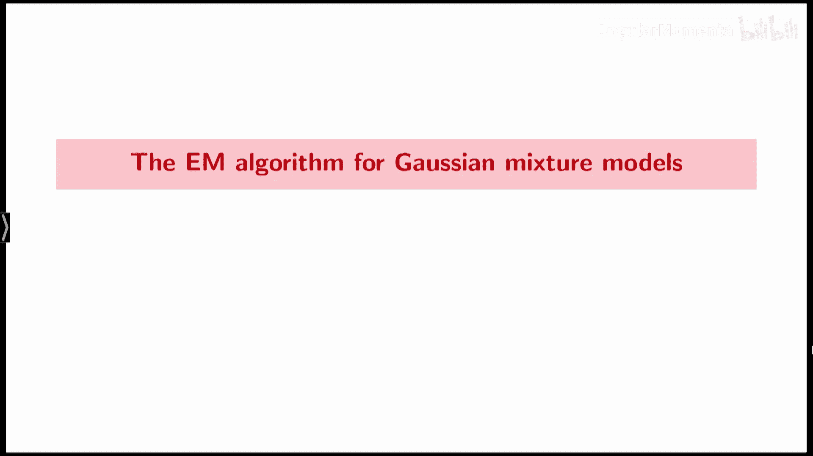
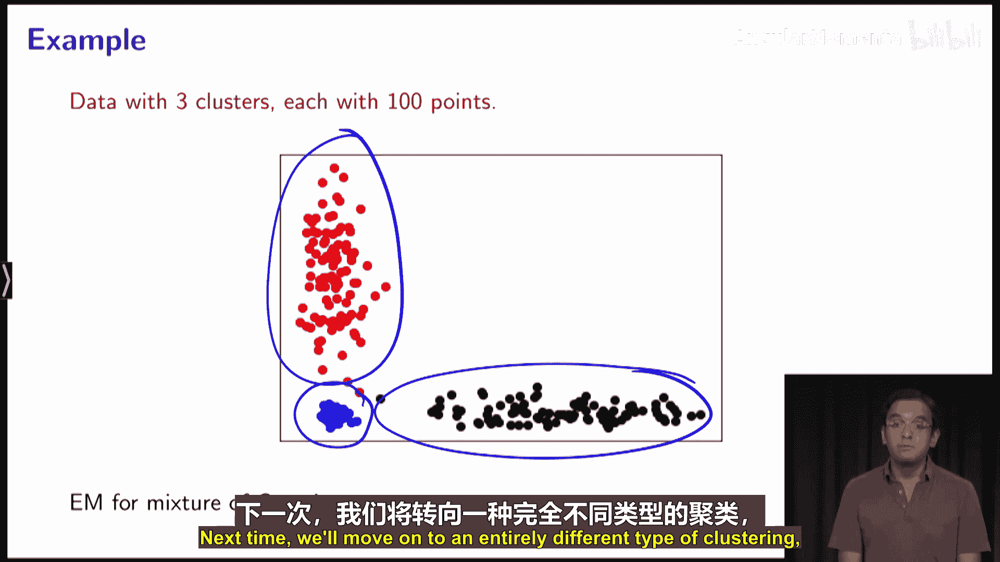

# 047：基于高斯混合模型的聚类 📊

在本节课中，我们将学习一种不同于K均值聚类的算法——期望最大化（EM）算法。该算法基于高斯分布，能够处理更一般形状和大小的数据簇。我们将从介绍高斯混合模型开始，形式化聚类问题的优化目标，并学习通过EM算法这一简单的局部搜索方法来解决它。最后，我们将通过实例来观察其效果。

## 从K均值到高斯混合模型

上一节我们介绍了K均值聚类算法。它虽然简单有效，但在处理大小不一或非球形簇时存在局限。本节中，我们来看看另一种同样流行但能适应更广泛簇形状的算法——EM算法。

EM算法基于高斯分布。因此，我们首先需要引入**高斯混合模型**。这是一种为包含簇的数据生成模型。

## 高斯混合模型：形式化定义

高斯混合模型的核心思想是：我们有一组数据点，希望将其聚类。在聚类后，我们为每个簇拟合一个高斯分布。

最终，我们将得到K个簇。每个簇由一个高斯分布 \( P_j \) 描述，其中 \( j = 1, 2, ..., K \)。在D维空间中，第j个簇的高斯分布由其**均值向量** \( \mu_j \)（一个D维向量）和其**协方差矩阵** \( \Sigma_j \)（一个D×D矩阵）指定。这些参数描述了该簇的数据分布密度。

此外，我们还会为每个簇记录一个**混合权重** \( \pi_j \)，它表示数据中来自该簇的比例。例如，如果所有簇大小相近，那么 \( \pi_1, \pi_2, \pi_3, \pi_4 \) 都大约为0.25。

通过组合这些簇的密度，我们得到一个覆盖整个数据空间的**高斯混合分布**。该分布对任意点 \( \mathbf{x} \) 赋予的密度为：
\[
P(\mathbf{x}) = \sum_{j=1}^{K} \pi_j \cdot P_j(\mathbf{x})
\]
这个公式的含义是：点 \( \mathbf{x} \) 的概率取决于它来自哪个簇。我们对所有可能的簇求和，其中“来自簇j的概率”是 \( \pi_j \)，而“在簇j中观察到点 \( \mathbf{x} \) 的概率”是 \( P_j(\mathbf{x}) \)。

## 最大似然估计与优化问题

我们的目标是用高斯混合模型拟合数据。假设我们有N个D维数据点 \( \mathbf{x}_1, ..., \mathbf{x}_N \)。拟合过程结束后，我们将得到一组参数：混合权重 \( \pi_1, ..., \pi_K \)，以及K个高斯分布的均值 \( \mu_j \) 和协方差矩阵 \( \Sigma_j \)。

我们希望找到能使观测数据**似然性最大**的参数。数据在混合模型下的概率（似然）是每个数据点概率的乘积：
\[
\mathcal{L} = \prod_{i=1}^{N} P(\mathbf{x}_i) = \prod_{i=1}^{N} \left( \sum_{j=1}^{K} \pi_j \cdot \mathcal{N}(\mathbf{x}_i | \mu_j, \Sigma_j) \right)
\]
其中 \( \mathcal{N} \) 表示高斯密度函数。

最大化该似然等价于最大化其对数，也等价于最小化其**负对数似然**（我们的损失函数）：
\[
\mathcal{L}_{\text{loss}} = -\sum_{i=1}^{N} \log \left( \sum_{j=1}^{K} \pi_j \cdot \mathcal{N}(\mathbf{x}_i | \mu_j, \Sigma_j) \right)
\]
我们的优化目标是找到参数 \( \{\pi_j, \mu_j, \Sigma_j\} \) 来最小化这个损失函数。

然而，这个损失函数**不是凸函数**，其表面存在许多局部最优解，找到全局最优解是NP难问题。因此，我们采用**局部搜索**策略。

## EM算法：期望最大化

EM算法就是一种局部搜索过程。它从一个初始的参数猜测开始，然后通过迭代逐步改进。

以下是EM算法的步骤概述：

1.  **初始化参数**：随机选择K个数据点作为初始均值 \( \mu_j \)，将混合权重 \( \pi_j \) 初始化为 \( 1/K \)，并将所有协方差矩阵 \( \Sigma_j \) 初始化为整个数据集的协方差矩阵。
2.  **迭代改进（主循环）**：
    *   **E步（期望步）**：基于当前的高斯分布参数，计算每个数据点 \( \mathbf{x}_i \) 属于每个簇j的“责任”或权重 \( w_{ij} \)。
        \[
        w_{ij} = \frac{\pi_j \cdot \mathcal{N}(\mathbf{x}_i | \mu_j, \Sigma_j)}{\sum_{l=1}^{K} \pi_l \cdot \mathcal{N}(\mathbf{x}_i | \mu_l, \Sigma_l)}
        \]
        这相当于一个“软分配”，数据点以一定的概率权重属于所有簇，而不是硬性分配到单一簇。
    *   **M步（最大化步）**：基于E步计算出的权重 \( w_{ij} \)，更新所有参数，以最大化数据的期望似然。
        *   **更新混合权重**：新的 \( \pi_j \) 是数据点属于簇j的平均权重。
            \[
            \pi_j^{\text{new}} = \frac{1}{N} \sum_{i=1}^{N} w_{ij}
            \]
        *   **更新均值**：新的 \( \mu_j \) 是所有数据点的加权平均，权重为 \( w_{ij} \)。
            \[
            \mu_j^{\text{new}} = \frac{\sum_{i=1}^{N} w_{ij} \mathbf{x}_i}{\sum_{i=1}^{N} w_{ij}}
            \]
        *   **更新协方差矩阵**：新的 \( \Sigma_j \) 是基于加权数据的协方差估计。
            \[
            \Sigma_j^{\text{new}} = \frac{\sum_{i=1}^{N} w_{ij} (\mathbf{x}_i - \mu_j^{\text{new}})(\mathbf{x}_i - \mu_j^{\text{new}})^T}{\sum_{i=1}^{N} w_{ij}}
            \]
3.  **重复**E步和M步，直到参数收敛（变化很小）。

## 算法对比与示例

为了理解EM算法的优势，我们来看一个包含三个不同形状和大小簇的二维玩具数据集示例。

以下是使用不同方法的结果：

*   **K均值聚类**：由于K均值假设球形簇且对初始化敏感，多次运行可能得到不同且不理想的聚类结果（例如，错误地将不同大小的簇切分或合并）。
*   **EM算法（高斯混合模型）**：EM算法能够一致地找到我们预期的三个簇。这是因为它通过高斯分布显式地建模了每个簇的形状（协方差矩阵）和大小（混合权重），从而能够适应椭圆形和大小不一的簇。

## 总结

本节课中，我们一起学习了基于高斯混合模型（GMM）的聚类方法。我们首先形式化了将数据建模为多个高斯分布混合的优化问题，即最大化数据的似然。由于该问题非凸且复杂，我们引入了**期望最大化（EM）算法**作为一种有效的局部搜索解决方案。EM算法通过交替执行**E步**（软分配数据点）和**M步**（更新模型参数）来迭代优化模型。与K均值相比，GMM通过协方差矩阵能够捕捉簇的椭圆形状，通过混合权重适应不同簇的大小，因而在处理更复杂结构的数据时更具灵活性。下一节，我们将转向另一种完全不同的聚类方法，旨在发现数据中的层次结构。