# 049：线性投影 📐

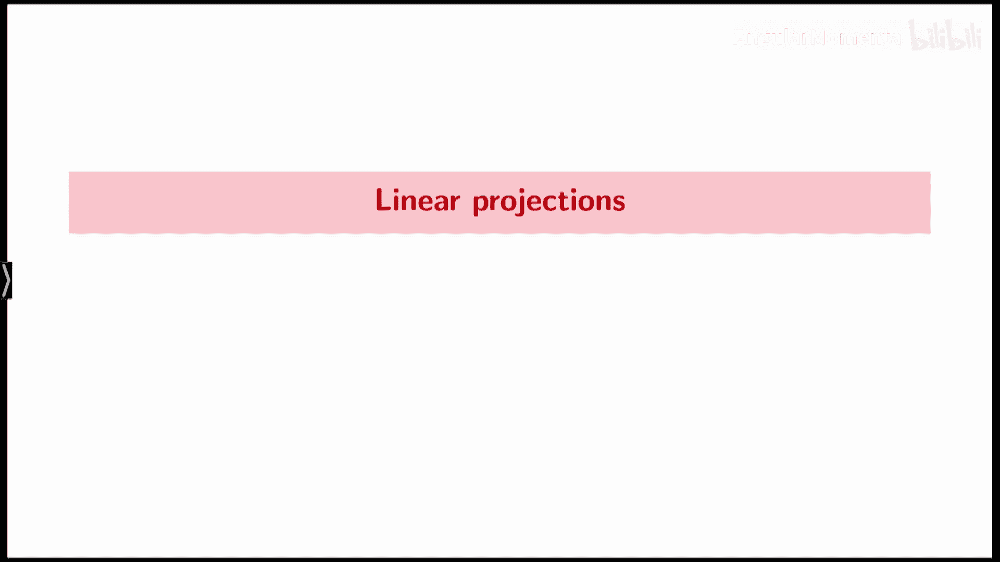

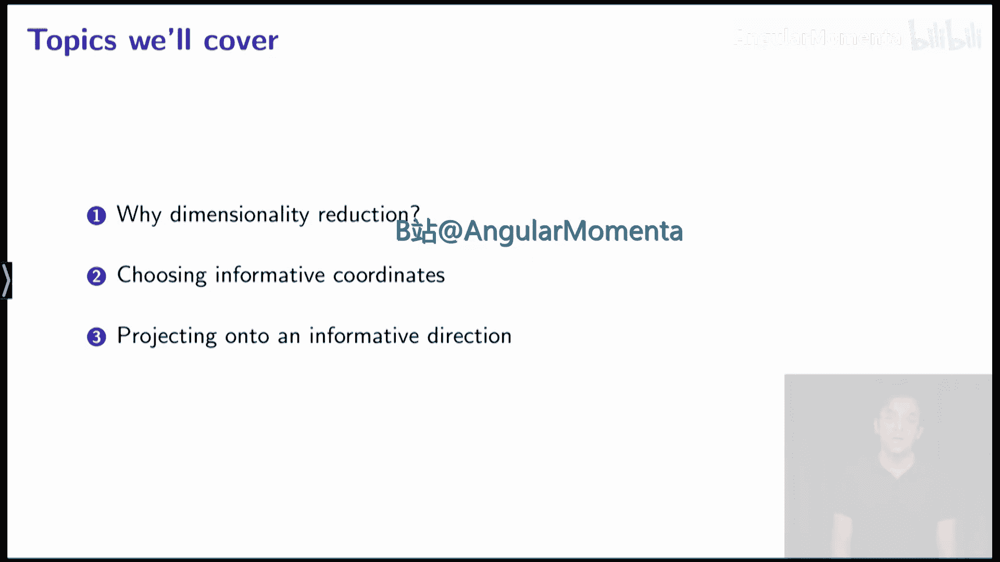

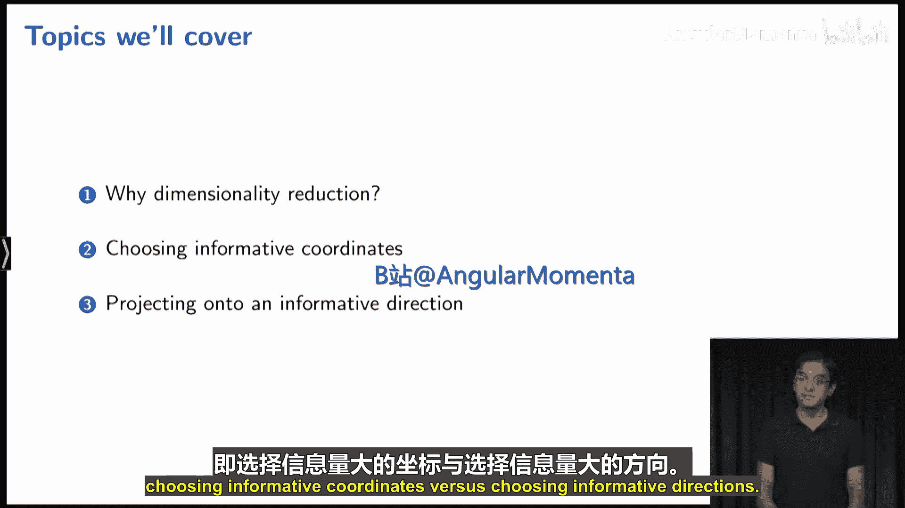

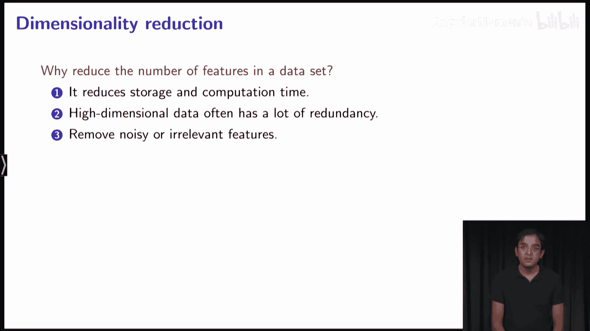

在本节课中，我们将要学习一种非常有效的表示学习方法——线性投影。我们将从讨论降维开始，然后探讨两种不同的降维思路：选择信息丰富的坐标与选择信息丰富的方向。

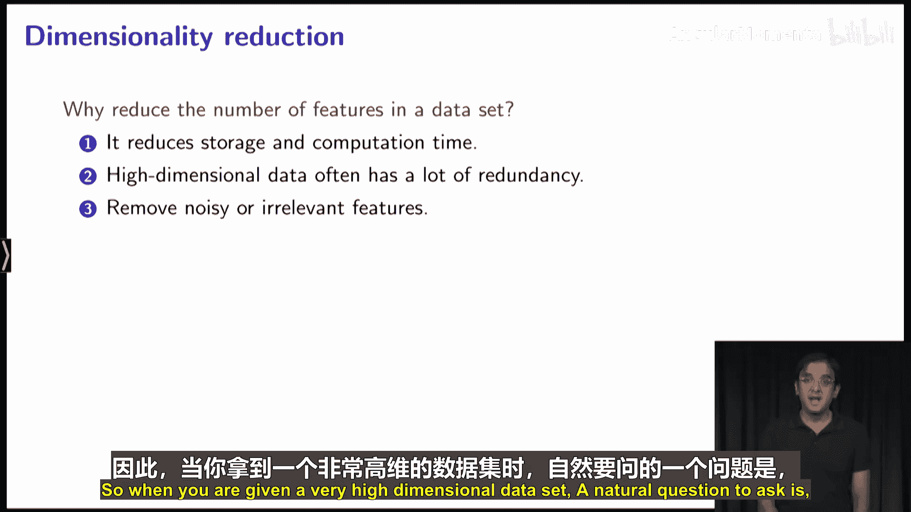

## 降维的必要性

当我们面对一个非常高维的数据集时，一个很自然的问题是：维度真的需要这么高吗？是否存在某种方法，可以在保留数据中全部或绝大部分信息的同时，降低其维度？

如果能实现这种降维，将带来诸多好处：
*   **计算与存储效率**：更低的维度意味着更快的计算速度，更重要的是，更小的内存需求。
*   **减少冗余**：高维数据通常包含大量冗余。例如，在基因表达分析中，经常有成组的基因作为一个单元共同作用。我们真的需要为它们每一个都设置单独的特征吗？还是可以将它们组合成一个单一的组特征？
*   **剔除噪声**：降维是剔除无关或噪声特征的绝佳机会。例如，在查看某人的医疗记录以评估其患病风险时，其中的社会安全号码等信息就是纯粹的噪声，应该被丢弃。

## 降维方法一：选择信息丰富的坐标

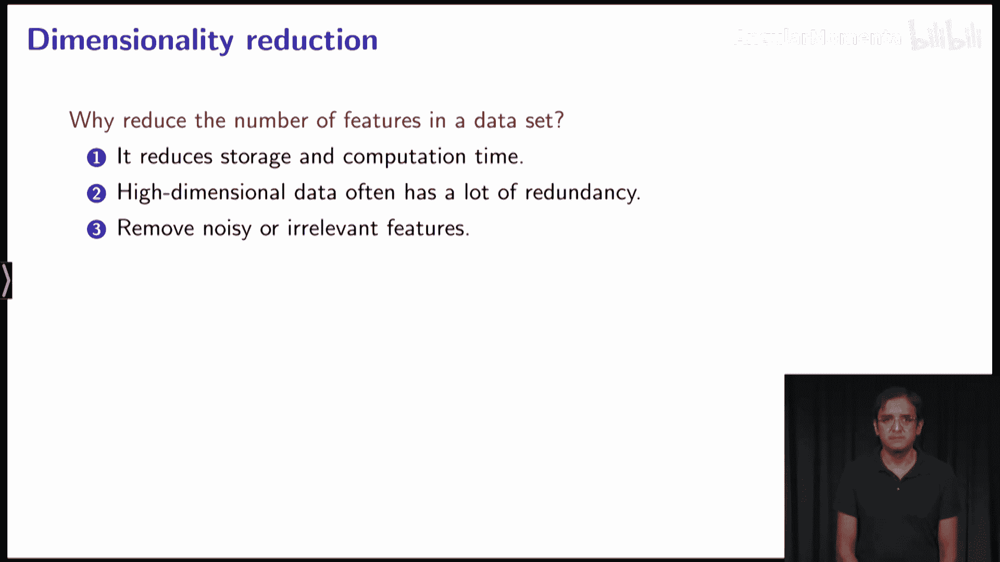

那么，我们如何进行降维呢？让我们从一个简单的例子开始。

这是一张来自MNIST数据集的数字图片。这些图像都是28x28像素，因此可以表示为一个784维的向量（将第一行像素、第二行像素等依次排列而成）。

这个维度必须是784吗？我们能否以某种方式降低它？我们当然可以丢弃一些像素。例如，四个角落的像素几乎总是关闭的，不包含信息。这样，我们就将维度从784降到了780。虽然降幅不大，但这是一个开始。

在我们过于兴奋之前，应该退一步思考一下我们刚才做了什么。为什么我们可以丢弃这些像素？因为它们总是具有相同的值，这意味着它们的方差为零。这给了我们一个启示：如果我们想丢弃更多坐标（像素），为什么不选择方差最低、信息量最少的那些呢？

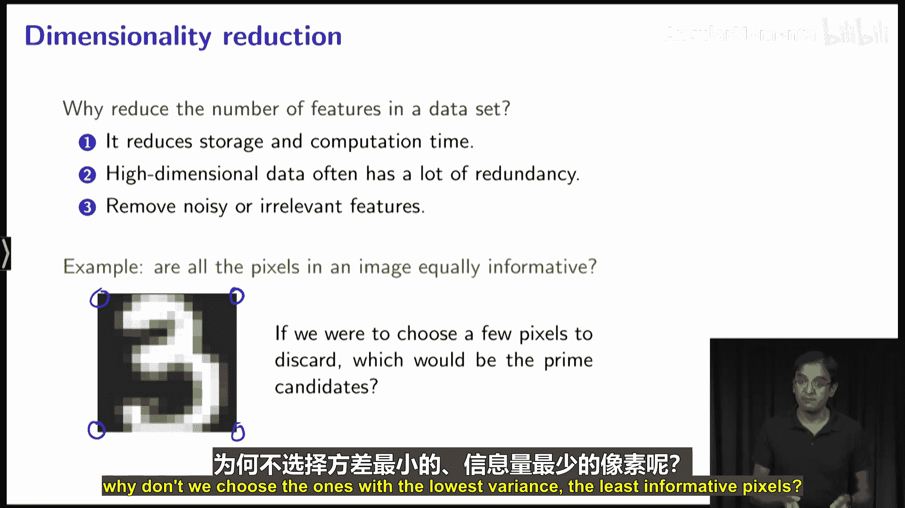

下图展示了当你这样做时会发生什么。让我们来解释一下。

如果我们查看所有784个坐标（即完整表示），其总方差就是每个像素方差的总和。公式表示为：

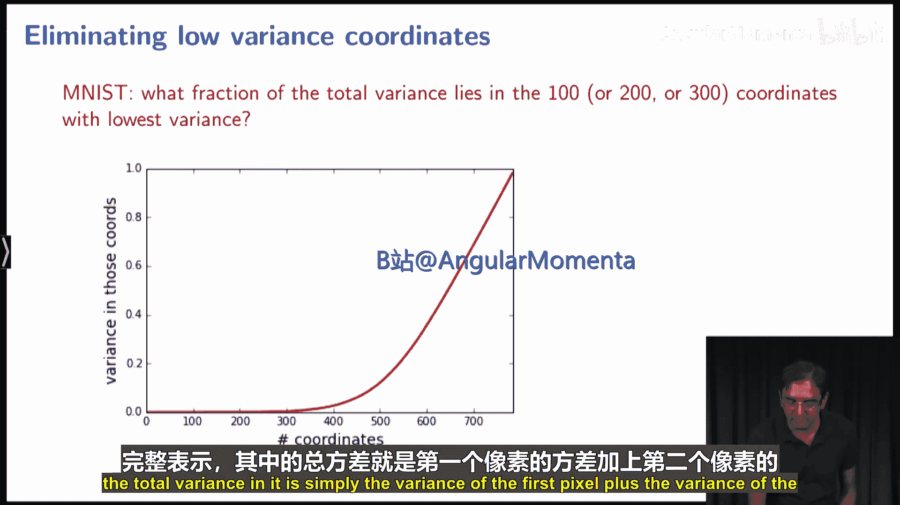

**总方差 = Σ (像素 i 的方差)**，其中 i 对所有坐标求和。

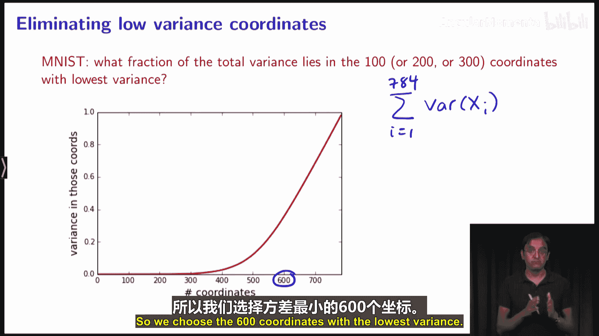

这张图显示的是，当你丢弃一些方差最低的坐标时，会损失多少总方差。例如，假设我们丢弃方差最低的600个坐标，我们会损失大约40%的总方差。

有趣的是，我们可以丢弃300到400个像素，而在此过程中几乎不损失任何方差。这很棒，我们可以轻松地将维度从约800降到约400。然而，事实证明我们可以做得比这好得多，实际上可以将维度降到更接近50甚至更少的水平。但要做到这一点，我们需要一种更通用的投影概念。

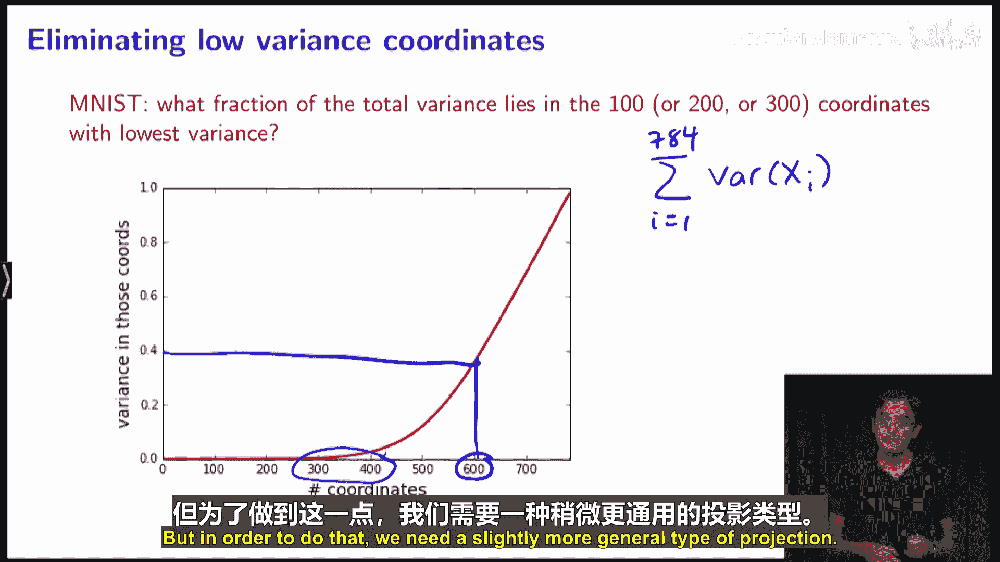

## 降维方法二：选择信息丰富的方向

为了解释这一点，让我们看看这个二维数据集。它有两个特征，x1 和 x2，沿着这两个方向都有相当大的方差，因此我们自然不会倾向于丢弃其中任何一个。

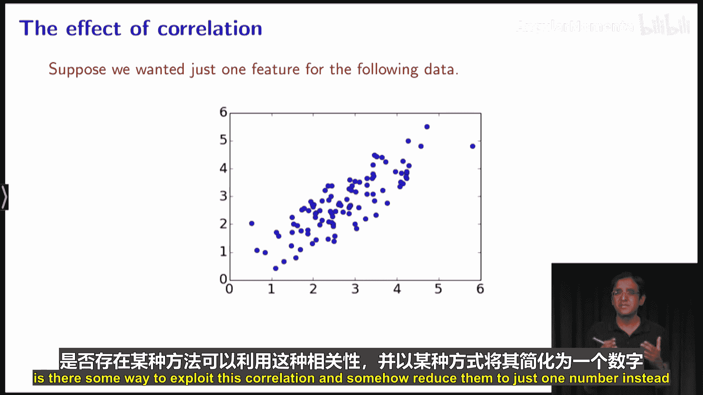

但如果你观察这些数据，会发现两个特征之间存在很强的相关性。问题是，有没有办法利用这种相关性，将它们简化为一个数字而不是两个？答案是肯定的，方法就是投影到图中所示的红色方向上。

这种投影意味着什么？以这个点为例，我们将它投影到红线上，得到这个值。我们用这个距离（一个数字）替换了原来的二维点。同样地，对于这个点，我们将其投影到线上（即找到线上最近的点，这意味着必须以直角与线相交），并用这个长度替换它。

通过这种方式，数据集被压缩到了一维。由于这些点大体上都靠近这条线，因此在这个过程中没有损失太多信息。那么，这条红线到底是什么方向？事实证明，这是**方差最大**的方向。这是什么意思呢？

## 理解投影与方差

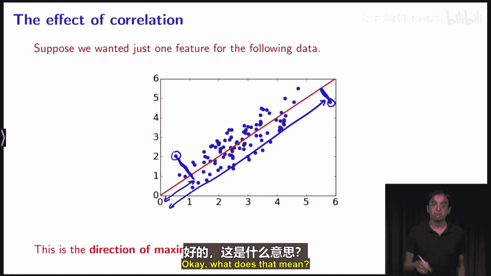

一旦我们不再局限于坐标轴，就有无限多个方向可以投影。我们可以投影到这个方向，也可以投影到那个方向，等等。

假设我们投影到x1轴方向。那么，一个点 (x1, x2) 就被映射到它的第一个坐标 x1。投影数据的方差就是 x1 的方差。

假设我们投影到x2轴方向。那么，点 (x1, x2) 就被映射到 x2。投影数据的方差就是 x2 的方差。

但我们没有理由将自己限制在坐标轴投影上。我们也可以投影到另一个方向，比如这样。如果我们投影到任意一个这样的方向，那么点 (x1, x2) 将被映射为 x1 和 x2 的某个线性组合，即映射为 **a*x1 + b*x2** 这种形式的单个数字，其中 a 和 b 是常数。

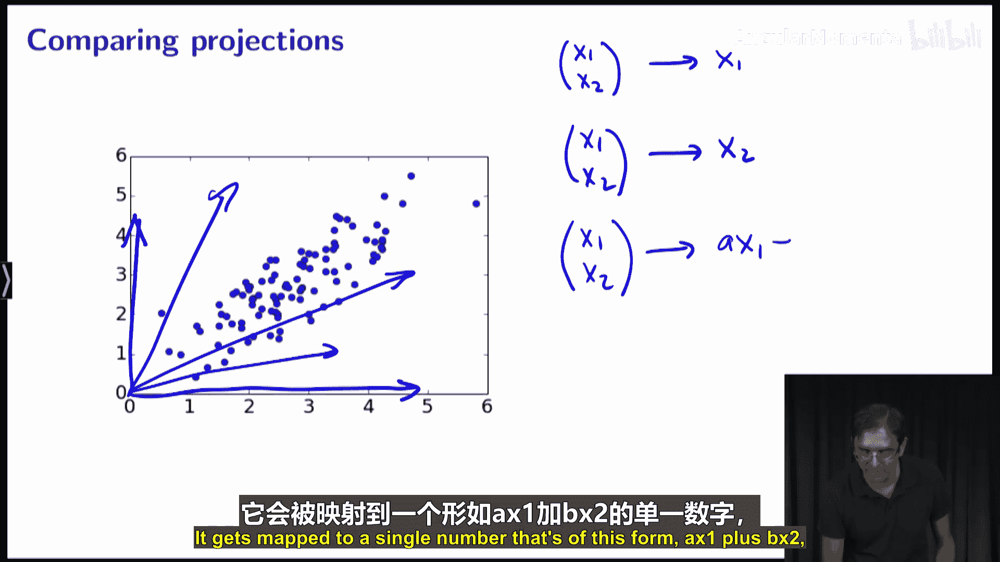

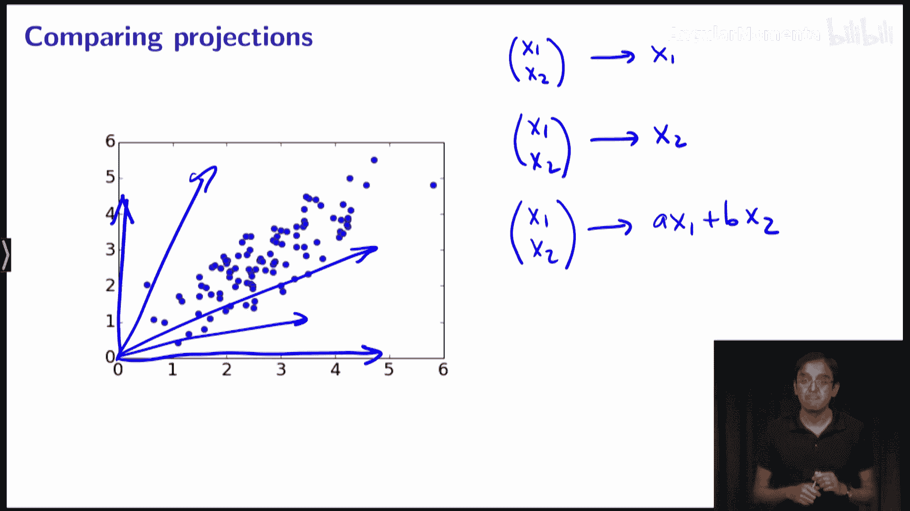

同样，我们得到一个一维值，并且可以讨论这些数字的方差。我们想要找到的是，沿着哪个方向，这些投影数据能获得**可能的最大方差**。这可以很容易地求解，但在深入之前，我们需要从数学上形式化投影的确切含义。

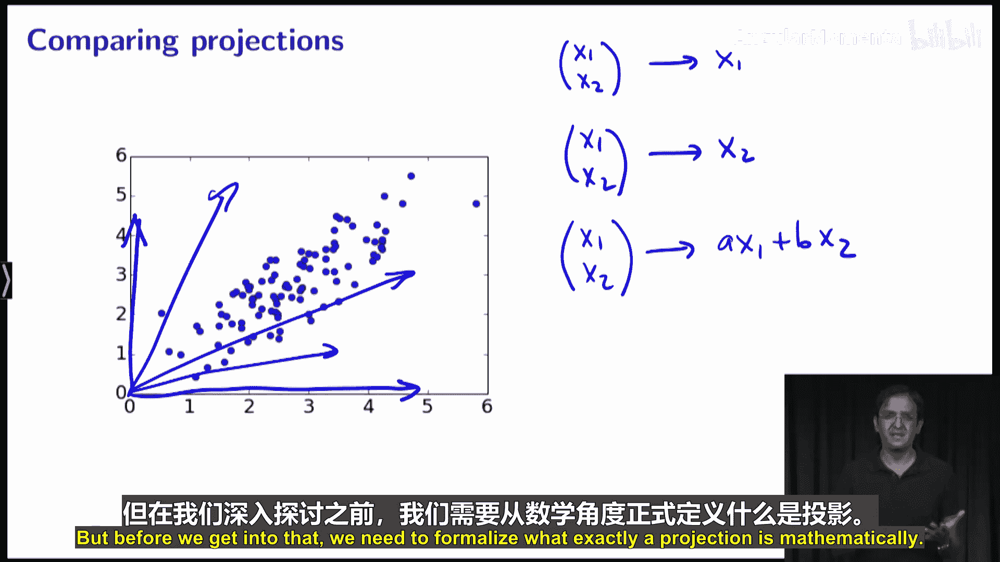

## 投影的数学定义

我们想要投影到某个方向，比如这个方向。这个特定向量的长度并不重要，因此投影到这个方向与投影到那个方向是相同的。为了方便起见，我们通常将其**归一化为单位长度**。因此，当我们投影到某个方向时，我们用**一个单位向量**（长度为1的向量）来表示该方向。

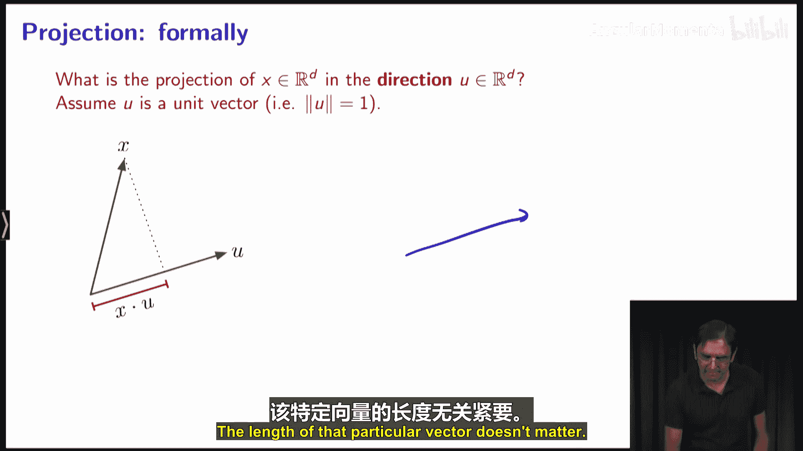

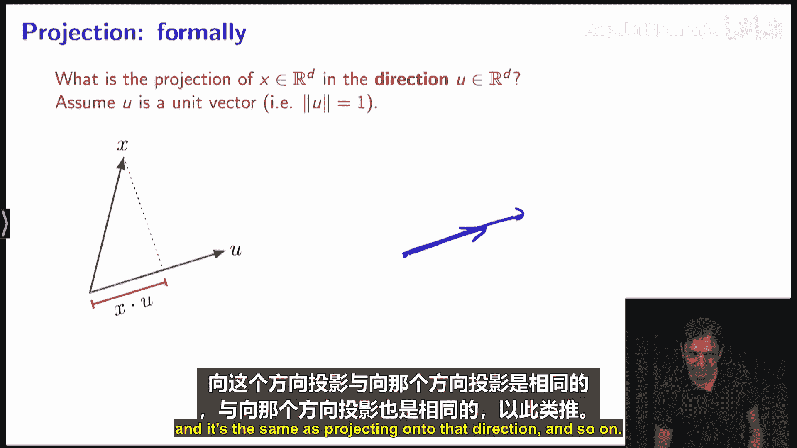

例如，假设我们想投影到方向 (3, 4)。这是一个单位向量吗？它的长度是 sqrt(3² + 4²) = 5，不是单位向量。为了使其成为单位向量，我们只需除以长度，使用 (3/5, 4/5)。这就是我们要投影到的方向。

那么，如何进行投影呢？现在我们有一个要投影到的方向 **u**。一个点 **x** 在该方向上的投影是什么？它简单地就是 **x** 和 **u** 的点积。公式为：

**投影值 = x · u = u · x = uᵀx = xᵀu**

这个长度就是 **x · u**。为什么？解释起来其实很简单。让我们看看这个角度，称之为 θ。根据三角学，投影长度是 **x** 的长度乘以该角度的余弦值。当我们第一次讨论点积时，我们了解到点积实际上给出了两个向量之间的角度。公式为：

**cos(θ) = (x · u) / (||x|| * ||u||)**

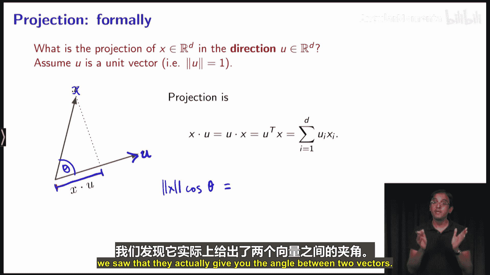

由于 **u** 是单位向量，其长度为1，因此公式简化为 **投影值 = ||x|| * cos(θ) = x · u**。所以，投影就是点积。

让我们看几个例子。这里有一个向量 **x = (2, 3)**，我们想把它投影到两个不同的方向上。

1.  投影到 x1 轴方向，即方向 (1, 0)。投影值就是点积 (2,3)·(1,0) = 2。正如我们所料。
2.  投影到方向 (1, -1)。首先需要确保它是单位向量。其长度为 sqrt(1² + (-1)²) = √2。为了使其成为单位向量，我们除以它的长度，得到 **u = (1/√2, -1/√2)**。现在计算点积：(2,3)·(1/√2, -1/√2) = (2-3)/√2 = -1/√2。答案就是 -1/√2。

## 总结

本节课中，我们一起学习了线性投影的基础知识。我们首先探讨了降维的必要性和好处，然后介绍了两种降维思路：通过丢弃低方差坐标来降维，以及通过将数据投影到特定方向（如方差最大的方向）来更有效地降维。我们正式引入了投影的数学概念，并发现它本质上就是向量的点积运算。

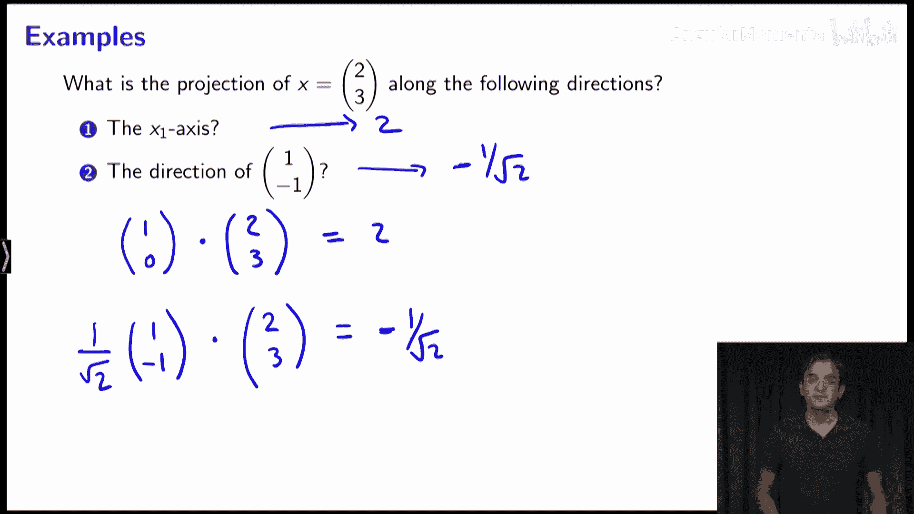

下一节课，我们将在此基础上，学习如何找到数据方差最大的方向。