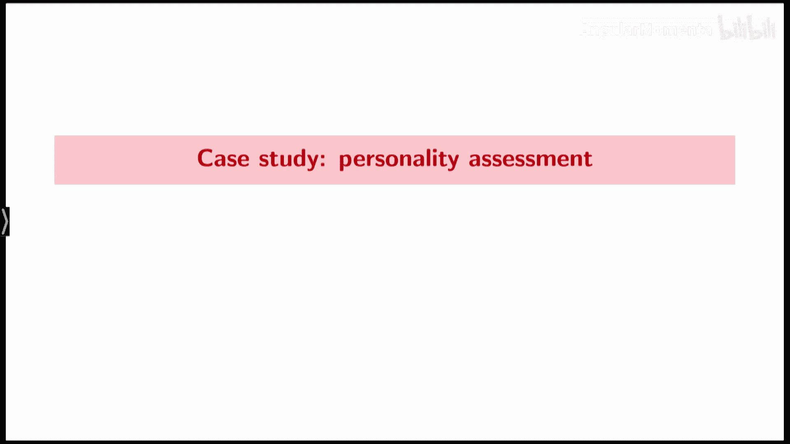
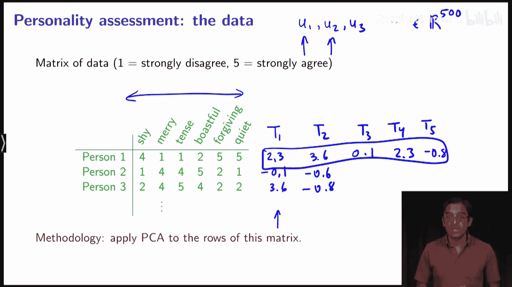
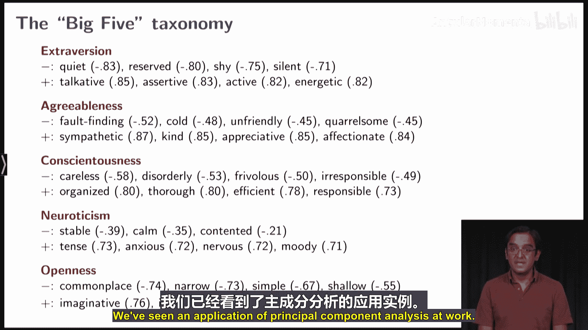

**机器学习基础：10-04-02：案例研究-人格评估**

在本节课中，我们将学习主成分分析的一个具体应用案例：如何量化人格特质。我们将看到，通过收集和分析数据，并结合PCA技术，研究者们能够将复杂的人格特征简化为几个核心维度。

主成分分析是一项已有至少一个世纪历史的基础工具，广泛应用于所有使用统计学的领域。今天，我们将通过一个具体案例，研究PCA在量化人格方面的应用。

我们每个人都有不同的人格，这些人格似乎是多维的。任何两个人在某些方面不同，在其他方面又相似。那么，有没有办法量化这一切呢？例如，我们能否将每个人的人格表示为某个低维空间中的一个点？这类问题一直困扰着人们。一些最杰出的思想家，如卡尔·荣格，曾提出过部分答案，但通常是各种定性的标准。如今，我们生活在一个数据收集的时代，似乎有可能将这个问题定量化。今天要讨论的，就是在这个方向上取得的一些进展。

起点通常被称为“词汇假说”。这是一个简单的想法：任何哪怕只有一丝一毫重要性的人格特质，都必然有一个对应的英文单词，例如“勇敢”、“敏感”或“恶意”。基于此，两位研究者在1930年代，奥波特和奥德伯特，坐下来仔细翻阅英语词典，寻找所有可以用来区分人的词汇。他们找到了18000个这样的词。然而，并非所有这些词都指代人格特质，有些词指的是“高”和“矮”这类特征。因此，他们进行了第二轮筛选，从这18000个词中进一步提炼出描述人格特质的词汇，最终得到了4500个词。这个列表仍然很大。但后来发现，其中很多词是同义词，例如“快乐的”、“愉快的”、“开心的”。于是，另一组研究者在1960年代手动将这些词聚类成同义词组，从而将列表缩减到大约500个不同的人格词汇。

此时，是时候进行数据收集了。数据收集的方式非常有趣。研究人员请来参与者，向每个人展示这500个词，并询问：“哪些词描述了您？”实际上，这个过程采用了更精细的方式。每个人会逐一看到这500个词，例如其中一个词是“害羞”，并被询问：“‘害羞’这个词是否描述了您？请用1到5分表示，1代表强烈不同意，5代表强烈同意，或者选择2、3、4。”通过这种方式，收集到了一个完整的数据矩阵。矩阵有500列（对应500个词），每一行是某个特定参与者的所有回答。

那么，给定这类数据，我们如何获得人格的低维表示呢？实际上有很多方法可以处理。一种思路是将列视为数据点并进行聚类。这将给我们带来相似人格词汇的簇。例如，如果结果发现害羞的人也倾向于宽容，那么这两个词就会归入同一个簇。或者，我们可以将行视为数据点，即每个人是一个数据点，然后对数据应用主成分分析、因子分析或其他形式的表示学习。研究者们基本上尝试了所有这些方法。结果在某种程度上相当一致。因此，今天我将描述PCA方法。

让我们从一些直观理解开始。假设有两个特质，比如“慷慨”和“信任”，它们恰好高度相关。这只是假设的例子，我不知道慷慨和信任是否真的如此。但如果它们完全相关，那么每个人对“慷慨”的回答将与对“信任”的回答完全相同。因此，所有答案都会落在y=x这条线上。如果我们要求主成分分析找出数据中的重要方向，它会找到这个方向。从这一个PCA方向，从这一个数字，我们将能够完美地重建“慷慨”值和“信任”值。这就是我们试图理解的直观概念。

现在，让我们看看实践中会发生什么。我们有一个数据矩阵。我们将每一行视为一个数据点，因此我们有500个词，即数据点位于500维空间中。现在应用主成分分析，我们得到主成分，假设它们是U1、U2、U3等。这些是500维空间中的方向。

选取第一个方向U1，即第一主成分。我们可以将第一个人的数据投影到这个成分上：只需取该人的行向量与U1进行点积。这给出一个数字，比如2.3。然后看第二个人在U1上的投影：取第二个人的行向量与U1点积，得到另一个数字，比如-0.1。接着处理第三个人，依此类推。通过这种方式，我们得到一整列数字。这本质上是一个新合成的“人格特质”，我们称之为特质T1。

然后，我们可以对第二主成分做同样的事情。取每个人的数据与方向U2的点积，得到另一组数字，称之为T2。接着可以计算T3、T4、T5等。如果我们计算到T5，那么对于每个人，我们就得到了五个新数字。本质上，这是将每个人嵌入到一个五维空间中，是对其人格的一种量化。

那么，这些特质具体指代什么？我们如何理解它们的含义？例如，特质T1是从数据中自动提取的合成特质，它捕捉了人格的哪个方面？为了弄清楚这一点，我们可以查看该特定列（即T1），然后遍历对应500个英文单词的原始列。我们看看其中哪些列与T1最接近，即哪些列与T1的夹角最小或点积最大。通过观察这些词是什么，我们就能了解T1捕捉了人格的哪个方面。然后对T2、T3、T4和T5重复此过程。

当我们这样做时，就得到了通常所说的“大五人格”分类法。

以下是具体结果：

*   **第一主成分 T1**：与“健谈的”、“自信的”、“活跃的”、“精力充沛的”等词具有很高的正点积；与“安静的”、“矜持的”、“害羞的”、“沉默的”等词具有很高的负点积。研究者们决定将这一合成特质命名为**外向性**。
*   **第二主成分 T2**：与“有同情心的”、“友善的”、“感激的”高度相关；与“挑剔的”、“冷漠的”、“好争吵的”负相关。这被称为**宜人性**。
*   **第三主成分 T3**：与“有条理的”、“彻底的”、“高效的”、“负责任的”高度相关；与“轻浮的”、“粗心的”等负相关。这被称为**尽责性**。
*   **第四主成分 T4**：与“紧张的”、“焦虑的”、“神经质的”、“情绪化的”有较大的点积。这被称为**神经质**。
*   **第五主成分 T5**：与“富有想象力的”、“聪明的”、“有独创性的”有较大的点积（可能不如前几个那么大）；与“狭隘的”、“肤浅的”负相关。这被称为**开放性**。

这些特质看起来都相当合理。有人可能会问，为什么不继续下去？为什么停在5个？为什么不提取第六、第七、第八主成分？事实证明，从那时起，结果开始变得不那么有说服力了。前五个特质（至少前四个）的一个优点是，当使用其他数据分析方法（如聚类或因子分析）时，也得到了类似的结果。然而，这种一致性在大约第五个特质之后就不复存在了，因此这确实是人们能够达成共识的子集。这种量化方法现在被用于许多场景，例如计算机化的婚恋匹配。

本节课中，我们一起学习了主成分分析的一个实际应用案例。我们看到了数据和PCA如何被用来回答关于人类的一些非常根本的问题。