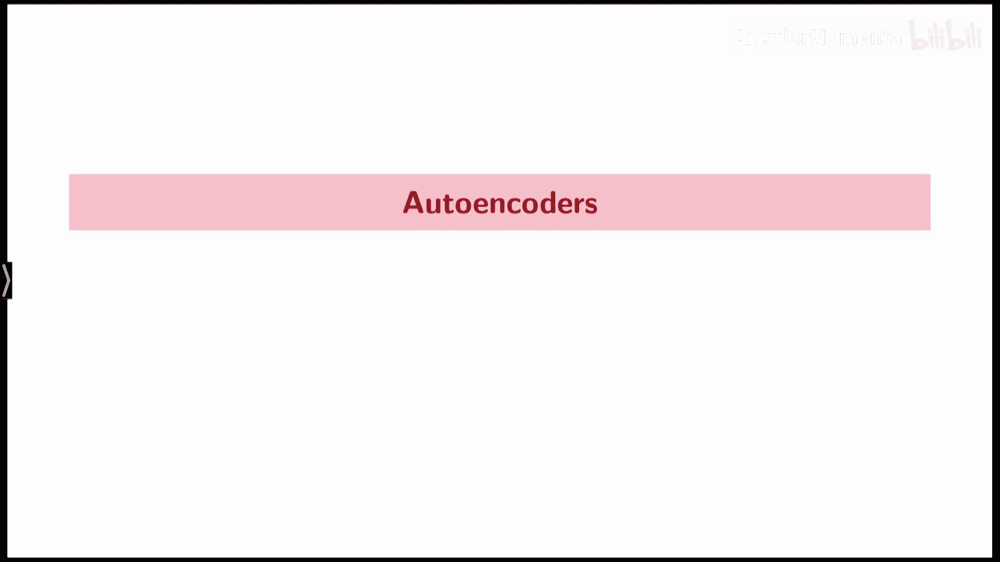
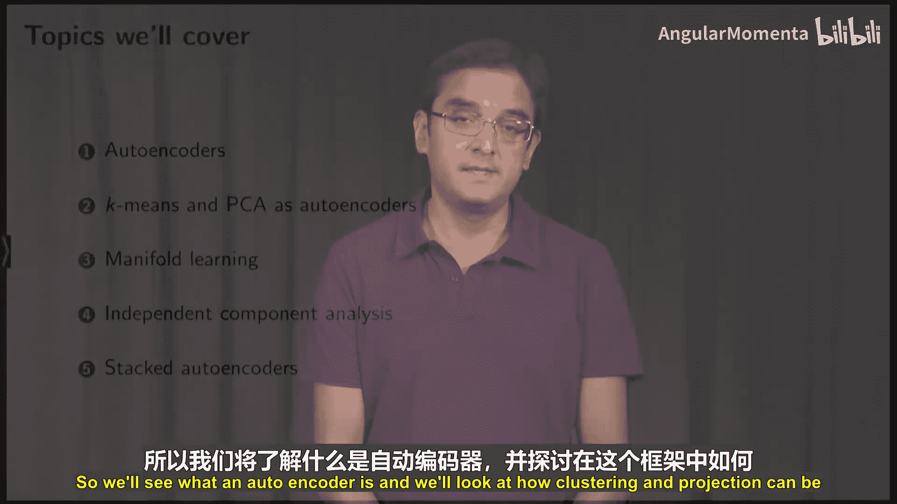
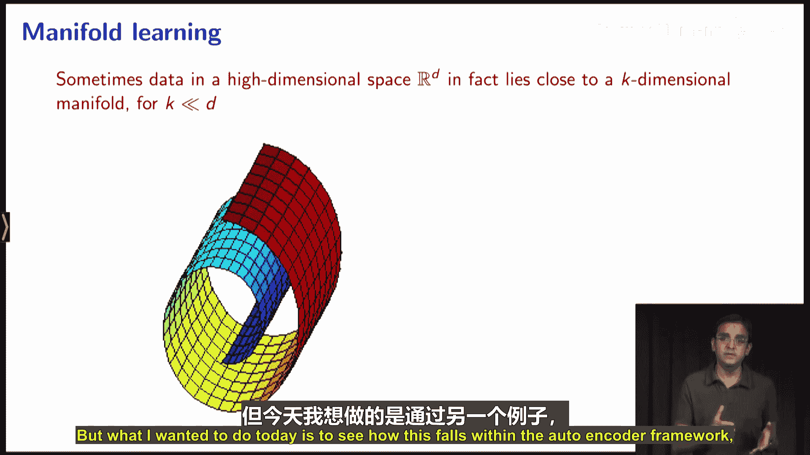
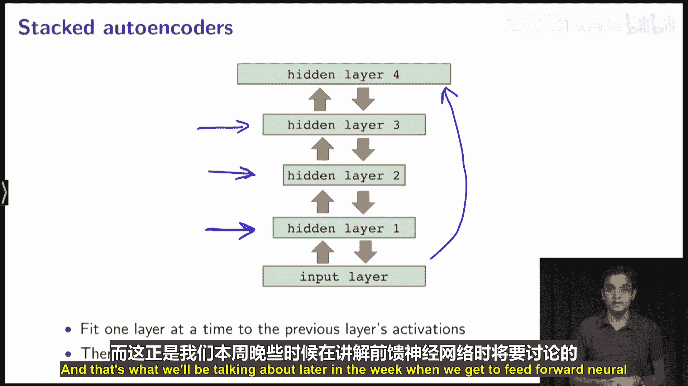

# 055：自编码器 🧠

在本节课中，我们将学习深度学习的一个重要概念——自编码器。自编码器是一种能够揭示数据潜在自由度的模型，它能产生一种新的数据表示形式。我们将探讨自编码器的基本框架，并了解聚类和主成分分析等经典方法如何自然地融入这个框架。此外，我们还将简要介绍流形学习和独立成分分析，并探讨如何通过堆叠自编码器来构建数据的多尺度层次化表示。

## 自编码器概述

自编码器的核心思想是学习数据的“编码”和“解码”过程，以揭示其内在结构。

在左侧，我们有一个D维的数据点，包含特征x1到xD。在右侧，是自编码器产生的表示，包含M个数值h1到hM。这些数值包含了数据中有用的信号或某些方面。

这种表示是需要被发现的，因此常被称为**潜在表示**或**隐藏表示**。我们将右侧的向量称为由M个隐藏单元组成的潜在或隐藏向量。

从原始数据点到这个潜在表示的映射可以看作是一个**编码**过程，由某个函数E给出。相反，从潜在空间回到原始空间的映射可以看作是一个**解码**过程，由某个函数D给出。

理想情况下，这个自编码过程不会丢失太多数据信息。也就是说，如果我们取一个数据点X，编码得到其隐藏表示，再解码它，我们希望能得到接近原始X的结果。这将是讨论自编码器时反复出现的最优性准则。

## 作为自编码器的聚类与投影

上一节我们介绍了自编码器的抽象概念，本节中我们来看看一些具体的聚类和投影问题如何用这个框架来表达。

### K均值聚类

K均值聚类问题中，我们有N个数据点，希望将它们分成K个簇，并为每个簇找到一个代表或中心。

在这个例子中，有10个数据点，我们希望将它们分成三个簇，并找到每个簇的中心。中心μ1、μ2和μ3如图所示。

我们可以用其最近的中心来近似每个数据点。这样产生的近似误差，例如对于这个点，就是这段距离。通常，使用平方距离会更方便。因此，对于第i个数据点，近似误差就是到其最近中心的平方距离。K均值聚类的目标是找到能产生最小可能近似误差的K个簇和K个中心。

这如何成为一个自编码器？在这种情况下，左侧是原始的D维数据点。此时的潜在表示就是簇标签。我们将每个点发送到1到K这些簇中的一个。

一种做法是让右侧的单元h1到hK代表各个簇。例如，如果x属于簇J，则hJ(x)被激活为1，否则为0。这样，隐藏表示就是一个二进制向量，一个由0和1组成的向量。实际上，除了标识x所属簇的那个位置是1外，其余都是0。

如果我们想用向量形式表示，可以说向量h是一个二进制向量。它是x的编码。如果x在簇J中，那么h就是第J位为1的0/1向量eJ。这就是编码函数。

那么解码呢？我们只知道簇标签，如何解码回原始空间？我们只需发送回该簇的均值μJ。因此，对特定向量eJ的解码就是μJ。

这个自编码器引起的误差是什么？如果我们取一个向量x，观察先编码再解码引起的误差，即这个平方距离，它正好是x到其最近中心μJ的平方距离。因此，我们看到K均值解实际上是这种特定类型的最优自编码器。

### 主成分分析

在PCA中，我们有一堆数据点。我们想要做的是找到一个从原始数据空间（如R^D）到某个低维空间（如R^K）的投影，并且我们希望找到一个能最大化投影数据方差的投影。我们已经知道这可以很容易地完成。

首先需要计算数据的协方差矩阵，一个D×D的矩阵。然后找到这个矩阵的前K个特征向量，这些就是我们要投影的方向。

如果我们想用矩阵形式表达，可以定义一个矩阵U，其列就是这些前K个特征向量u1到uK。这是一个D×K的矩阵。投影将原始空间中的向量x发送到U^T x。如果我们有一个投影空间中的向量，想将其映射回原始空间，这也很容易，重建是通过将R^K中的向量z发送到Uz来实现的，Uz位于R^D中。

这是一种什么样的自编码器？在自编码器的左侧，和往常一样，是原始数据表示，即D维向量x。在右侧，有K个隐藏单元。在这种情况下，这些单元就是x在不同方向上的投影。hJ(x)就是x在第J个特征向量上的投影，即x点乘uJ。

如果我们想用向量形式表示，那么x的嵌入h就是U^T x。如果我们有这个潜在空间中的一个K维向量，想将其发送回原始空间，解码操作将h发送到矩阵U乘以h。这显然是一个自编码器。

这种编码和解码过程引起的误差是什么？我们取一个点x，我们通过先编码再解码的结果来有效地近似它。这就是x减去U U^T x的平方距离。事实证明，PCA所做的就是找到最小化这种重建误差的投影。因此，PCA也是这种特定形式的最优自编码器。

## 其他类型的自编码器

我们已经看到K均值聚类和PCA很容易融入自编码器框架。事实上，还有许多其他类型的无监督学习可以很容易地用这种方式表达。以下是几个例子。

### 流形学习

流形学习的理念是，通常你拥有的数据是高维的，有很多特征（D个），但数据点位于或接近一个维度低得多的曲面（流形）上，其维度是某个远小于D的数K。

语音信号就是一个例子。当你有语音信号并想在计算机上表示它时，你可以通过使用大量不同的滤波器使其表示维度尽可能高。但归根结底，语音是由人的声道产生的，这是一个只有少数自由度的物理系统。因此，这是高维数据集接近低维流形的典型案例。

这是一个玩具示例。这里的数据是三维的，或者可能更高，但所有数据都位于这个二维曲面，这个瑞士卷形状的物体上。问题是，如果我们得到这种类型的数据，能否自动确定这个曲面？能否将高维表示映射到由网格线所示的二维坐标？我们能否在某种意义上“展开”这个曲面？有几种算法试图做到这一点。

这如何融入自编码器框架？左侧是原始的D维数据。这些数据被发送到右侧的K个数值，这些数值就是流形上的坐标。因此，编码过程将原始空间中的数据发送到其流形坐标，而解码过程则从流形上的坐标系返回到流形所在的原始空间。所以，这显然又是一个自编码器。

### 独立成分分析

独立成分分析是一种在信号处理和神经科学中非常流行的无监督学习形式。它是解决鸡尾酒会问题等方法之一。

当我们在一个派对上，有很多人在交谈和走动时，在任何给定时间，我们的耳朵会接收到许多不同对话的混合。我们如何能够将这些分开，并专注于某一个对话？我们如何分离所有这些对话？

如果我们试图让计算机做到这一点，我们可能会在房间的不同位置设置麦克风。每个麦克风接收到的声音信号是多个不同对话的混合。这就是左侧所示的情况，我们有D个输入单元，每个麦克风一个。每个单元都接收不同对话的混合，这是一个语音数据的时间序列。

假设实际上只有K个不同的对话在进行，我们想做的是获取这D个混合的声音信号，并恢复出K个纯净的对话，每个源一个。这就是自编码器的右侧。这个过程被称为独立成分分析，或者在这种情况下，有时被称为盲源分离。显然，这是自编码器的另一种形式。

## 堆叠自编码器与层次化表示

当前深度学习的革命，在某种意义上，是由研究人员找到堆叠自编码器的方法、以某种方式分层使用多个自编码器以获得多尺度表示所推动的。

其思想是，在底层是原始数据，即输入层。然后对其应用一个自编码器，以发现数据中的某些结构，提取数据中有趣的结构。接着，再对其应用一个自编码器，以在结构中发现结构，换句话说，是一种更高层次的结构，然后是更高层次的结构，依此类推。这样，你就得到了一个特征层次结构，这些特征具有越来越高的泛化水平。

例如，假设输入层是一幅图像。那么这里的第一个隐藏层可能包含一些非常低层次的结构，比如微小的边缘片段或小斑点。下一层可能包含稍高层次的结构，例如真正的边缘。然后随着你沿着链条向上，你会得到像小盒子或其他标准形状的东西，更复杂的物体就是由这些构成的。事实上，人类视觉皮层就有这种层次化处理方式，这为设计此类模型提供了灵感。

我们如何训练这样的模型？如何自动学习这种堆叠自编码器？一种非常自然的方法是自底向上逐层进行。

我们从输入层开始。然后学习一个能给我们第一个隐藏层的自编码器。接着，我们将该隐藏层中的值视为新的输入，并拟合另一个能给我们第二个隐藏层的自编码器，依此类推得到第三隐藏层。通过这种方式，我们得到了整个层次结构。此时，我们可以将输入到最终层的映射也视为一个自编码器，然后进行微调。

我们一直在讨论以纯粹无监督的方式进行。但事实证明，鉴于当前的技术水平，如果我们实际上使用大量标签数据以有监督的方式进行，效果会更好。这将是我们本周晚些时候讨论前馈神经网络时要谈到的内容。

## 总结

本节课中我们一起学习了自编码器。我们看到自编码是一个非常通用的框架，它让我们能够统一多种类型的无监督学习，例如聚类和投影。首先，这是一个非常有用的框架，它让我们能够识别这些不同类型表示学习之间的相似性和差异性。其次，它也提出了模块化组合不同类型表示学习的方法，正如我们在堆叠自编码器中看到的那样。