# 058：神经网络训练 🧠

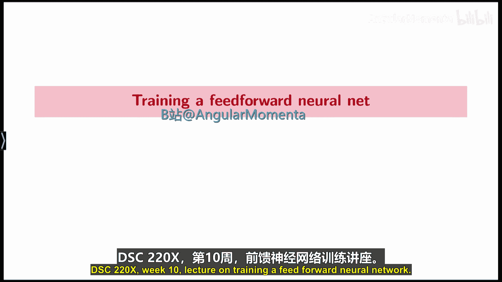

在本节课中，我们将学习如何训练前馈神经网络。我们将从定义合适的损失函数开始，然后探讨如何使用一种称为反向传播的巧妙方案，通过随机梯度下降算法来最小化这个损失函数。最后，我们还会介绍一些有助于模型良好泛化的实用技巧。

## 前馈神经网络架构回顾

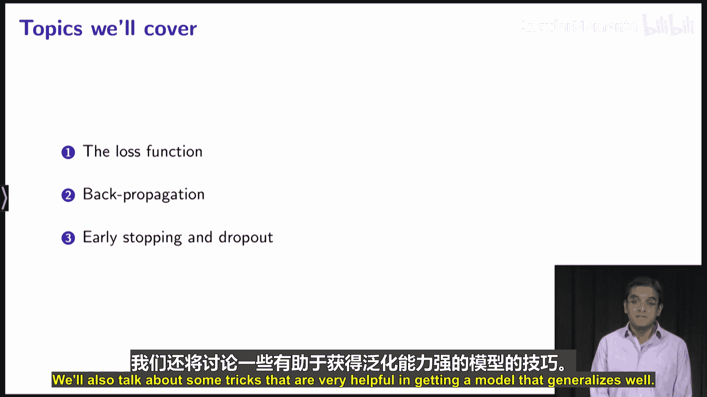

上一节我们介绍了前馈神经网络，这是一个表达能力极强的函数类别。本节中，我们来看看如何学习这些模型。

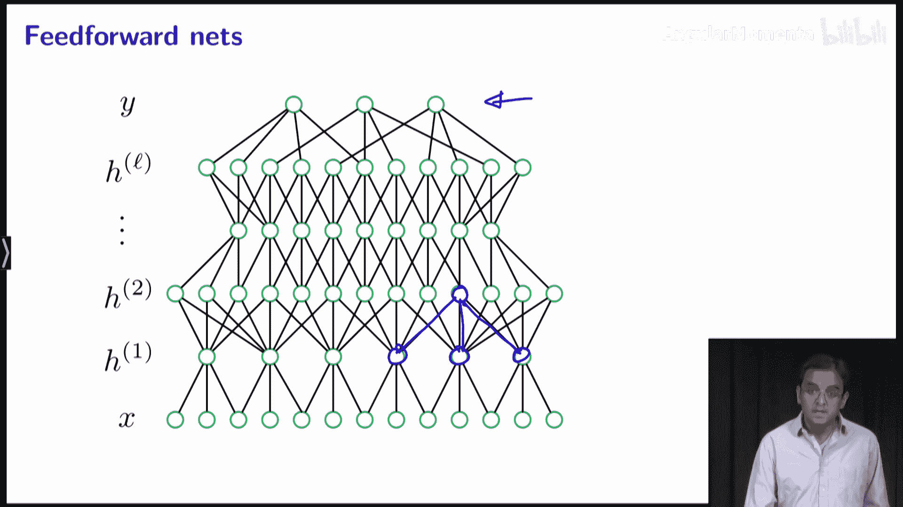

上图展示了一个前馈网络的结构。它包含大量按层组织的单元。最底层是输入层，用于呈现输入向量 **x**。计算从底部开始，一直向上进行，最终到达输出层 **y**。每个节点都是其父节点的简单函数。

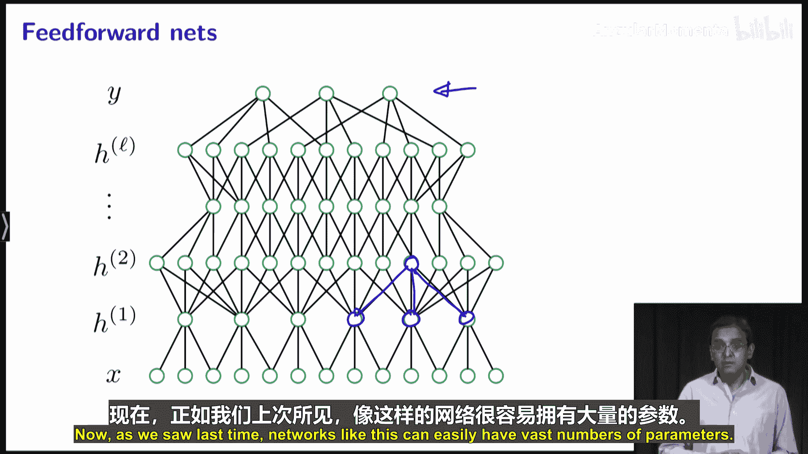

具体来说，每个节点的计算是其父节点的线性函数，然后经过一个非线性激活函数（通常是修正线性单元）。通过这种方式，计算向上传播并得到输出。正如我们上次所见，这样的网络可以轻松拥有大量参数。

## 定义损失函数

面对如此多的参数，我们如何使用训练集来学习它们呢？与往常一样，方法是将学习表述为一个优化问题，目标是找到能最小化合适损失函数的参数。

为了具体说明，假设我们使用神经网络解决一个分类问题，其中有 **k** 个标签。在这种情况下，最终的输出层将包含 **K** 个单元，每个标签一个。我们上次看到，可以通过在最后一层使用类似多类逻辑回归的方法（即使用 **softmax** 函数）来生成每个标签的概率。

我们想要学习的参数是整个网络的所有参数，即指定每个不同节点线性函数的参数。一旦我们固定了这些参数，我们就有了一个完全指定的网络。对于任何输入 **x**，它都能给出各种可能标签的概率。这很像逻辑回归。

实际上，我们可以遵循一些相同的方法论。对于每个数据点 **x**，我们得到 **K** 个可能标签的概率。因此，我们可以寻找能最大化训练集概率的参数 **W**（即这大量的参数）。也就是说，最大化每个数据点标签概率的乘积。

与往常一样，我们可以取其对数值使其变为求和，并在前面加上负号，得到一个需要最小化的目标。这样我们就得到了最终的损失函数。

给定一个包含 **n** 个训练点的数据集，我们希望找到一组参数 **W**（整个网络的参数），以最小化这个损失函数。请注意，这正是我们在逻辑回归中使用的损失函数，有时被称为**交叉熵**。

在逻辑回归的情况下，这是一个凸优化问题。但在处理神经网络时，情况还是这样吗？遗憾的是，并非如此。事实上，它离凸优化问题非常遥远。

## 损失函数的性质

在讨论损失函数时，我们总是区分两种情况。

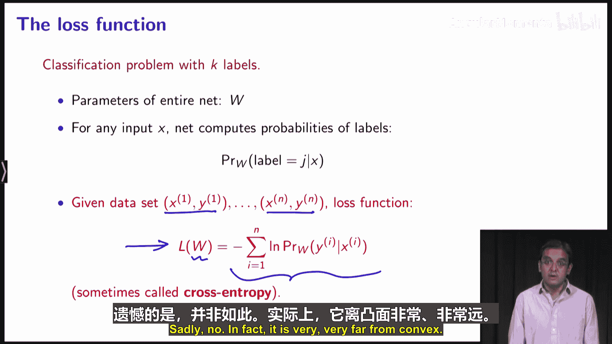

左边这种情况，损失函数表现不佳。它有许多局部最优解，我们可能会陷入其中，而且这些局部最优解的质量差异很大。如果我们最终陷入一个错误的局部最优解，那可能是一个相当糟糕的解。

我们喜欢的损失函数是右边这种，**凸损失函数**。事实上，到目前为止我们在课程中研究的几乎所有问题（如最小二乘法、LASSO、支持向量机等）都具有凸损失函数。唯一具有这种非凸成本函数的问题是 **K-Means** 聚类。我们曾指出，K-Means 是一个 NP 难优化问题，我们无法指望高效地找到最优的 K-Means 解。然而，有些算法能保证高效地找到接近最优的 K-Means 解。

不幸的是，神经网络优化完全是另一回事。它是高度非凸的，甚至没有太多希望找到必然接近最优的解。尽管如此，或许由于这些模型极强的表达能力，我们最终仍然经常能得到性能非常好的网络。

## 优化方法：梯度下降

那么，我们将如何进行这种最小化呢？与往常一样，我们将使用某种形式的梯度下降。我们已经研究过三种梯度下降的变体：**普通梯度下降**、**随机梯度下降** 和 **小批量随机梯度下降**。

这三种方法都从以某种方式初始化参数 **W** 开始，然后进行一系列更新，不断调整 **W**，并希望损失函数 **L(W)** 在整个过程中稳步下降。

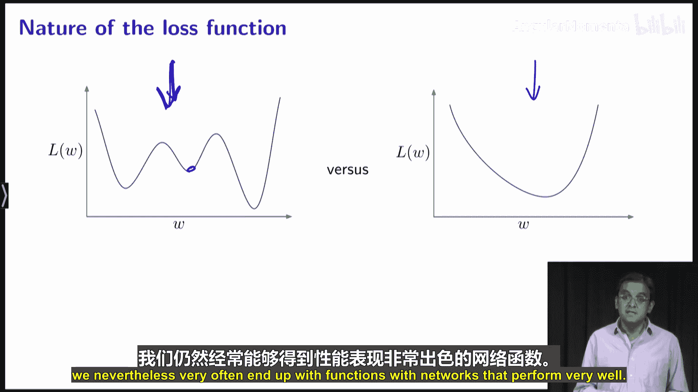

所有三种变体都基于使用损失函数对 **W** 的导数。在普通梯度下降中，每次更新都涉及使用整个数据集。如果数据集非常庞大（这在神经网络中很常见），这可能不切实际。另一个极端是随机梯度下降，每次更新只涉及一个数据点，这样好得多，但更新可能相当嘈杂。

一个很好的折衷方案是**小批量随机梯度下降**，更新既不涉及完整数据集，也不涉及单个点，而是涉及适度数量的数据点（例如每次 10 个数据点）。最常见的选择是某种形式的小批量随机梯度下降。

对于任何一种方法，我们需要计算的是损失函数相对于网络中每个参数的导数。我们知道，参数数量非常多。

## 计算导数：反向传播

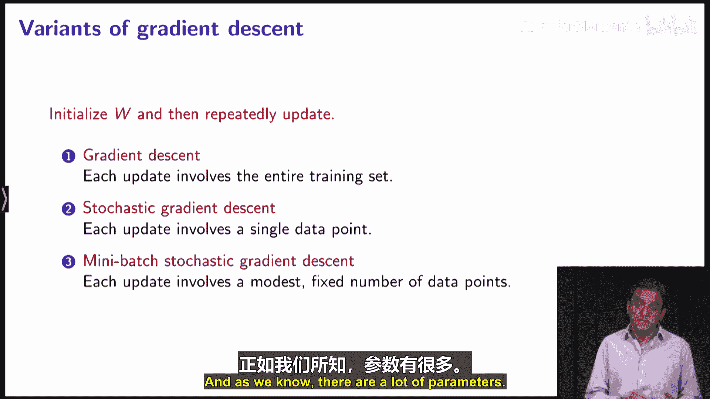

这是我们的网络。我们在底部输入 **x**，在顶部得到 **y**。一旦得到 **y**，我们就可以评估损失（正确标签的概率）。因此，我们需要损失函数相对于网络中每个参数的导数。请记住，这里的每条边都有一个关联的参数 **W**。我们需要损失函数相对于每个这样的参数 **W** 的导数。

我们之所以需要这些导数，是因为更新 **W** 的方式就是使用该导数——我们将沿着该导数的相反方向移动 **W**。

那么，我们如何计算所有这些导数呢？最容易计算的是最后一层中的参数，即沿着这些边的 **W**。正如我们所见，最后一层实际上只是多类逻辑回归，我们已经知道如何计算这些导数。

但是网络中更下方的参数呢？比如像这样的 **W**？我们如何计算损失函数相对于那个 **W** 的导数呢？事实证明，为了做到这一点，我们严重依赖于微积分中的**链式法则**。

### 链式法则

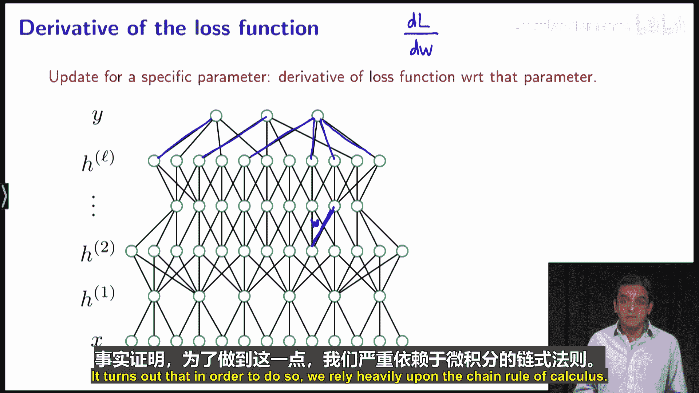

这是用完整数学符号写出的微积分链式法则。实际上，这是我们一直用来计算导数的规则。例如，假设要求计算 `(2x + 3)^10` 的导数。你会这样做：嗯，让我们把这个表达式 `2x + 3` 称为 `u`。那么我们在计算 `u^10` 的导数，那是 `10 * u^9 * du`。现在，`du` 是什么？`u` 是 `2x + 3`，所以 `du` 是 `2`。因此导数是 `10 * (2x + 3)^9 * 2`。

更一般地说，假设有一个函数 **h**，它是两个函数的复合：`h(x) = g(f(x))`。那么 `h(x)` 的导数就是 `g` 在 `f(x)` 处的导数乘以 `f` 在 `x` 处的导数。这正是我们在上面用到的规则。

让我们看看链式法则的另一种写法。假设有三个变量 **x**、**y** 和 **z**，其中 **y** 是 **x** 的函数，**z** 是 **y** 的函数。那么 **z** 对 **x** 的导数就是 **z** 对 **y** 的导数乘以 **y** 对 **x** 的导数。可以看到这与第一种表述是等价的。

### 应用于神经网络

我们如何将其应用于神经网络呢？为了简单起见，这些网络可能非常庞大。为了防止事情变得混乱，让我们只看一个每层只包含一个节点的网络。

因此，输入层 **x** 只是一个数字 **x**。第 1 层只包含一个节点 **h1**，第 2 层只包含一个节点 **h2**，第 3 层包含一个节点 **h3**。最后，我们有最后一层 **hL**。所以现在神经网络看起来就像一条单链。事实上，为了使符号完全一致，我们就把输入称为 **h0**。

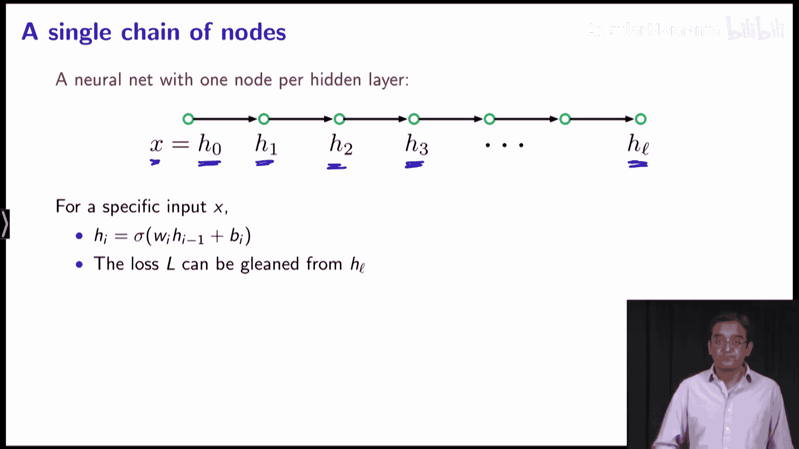

当我们得到一个输入 **x**（或等价的 **h0**）时，我们通过一次前向传播计算 **h1**、**h2**、**h3** 直到 **hL**。

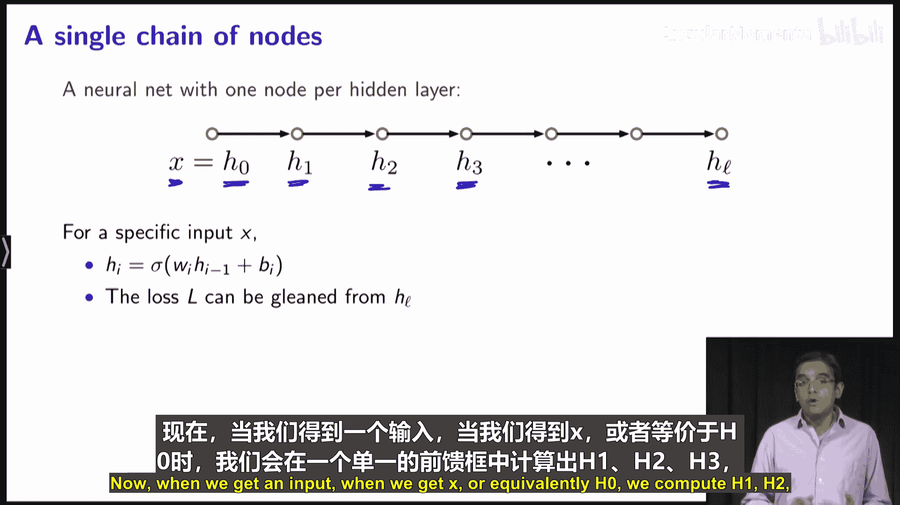

每个值，比如 **h3**，都是前一个节点的线性函数。线性函数的公式如下：`h_i = σ(W_i * h_{i-1} + b_i)`，其中 **σ** 是非线性激活函数（例如修正线性激活函数）。所以我们从 **x** 开始，计算 **h1**、**h2**、**h3** 等等。

一旦我们到达末尾，得到 **hL**，我们就可以从中得到概率 **P(y|x)**，并评估该点的损失。我们需要的是损失函数相对于每个参数的导数，特别是相对于每个 **W_i** 的导数。

我们如何获得这个导数呢？这有两个步骤。

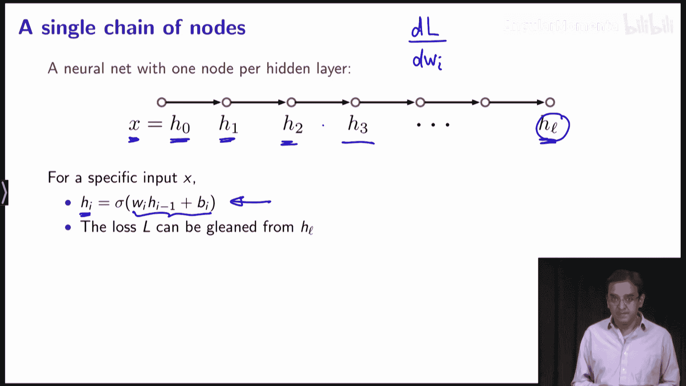

首先要注意，损失函数是这里一大堆东西（**W**、**b**、**h**）的函数。为了计算损失 **L** 对 **W_i** 的导数，事实证明，只需要知道损失函数相对于每个隐藏单元 **h_i** 的导数就足够了。这是因为链式法则。

我们想计算损失函数相对于 **W_i** 的导数，因为这能告诉我们如何调整 **W_i**。为此，让我们看看这个方程并应用链式法则。损失函数相对于 **W_i** 的导数，等于损失函数相对于 **h_i** 的导数，乘以 **h_i** 相对于 **W_i** 的导数。而计算 **h_i** 相对于 **W_i** 的导数相当简单，它就是 **σ** 在特定点 `(W_i * h_{i-1} + b_i)` 的导数，乘以这个内部表达式相对于 **W_i** 的导数（即 **h_{i-1}**）。

好的，我们已经在前向传播过程中计算了所有这些 **h** 值，所以我们知道右边所有这些项。我们唯一需要的就是损失函数相对于 **h_i** 的导数。如果我们有这个，那么我们就可以计算相对于 **W_i** 的导数。因此，第一个高层次的信息是：我们只需要损失函数相对于每个隐藏节点 **h1**、**h2** 等的导数。

那么，我们如何获得它们呢？事实证明，我们可以通过一次**反向传播**轻松获得它们。

### 反向传播算法

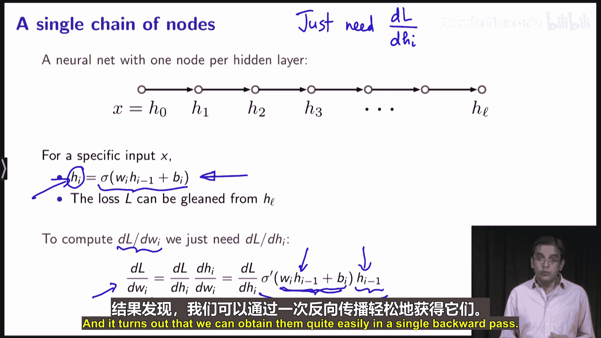

让我们看看这是如何发生的。这就是反向传播的思想。要得到损失函数在最后一个单元处的导数很容易，因为损失是该单元的直接函数。

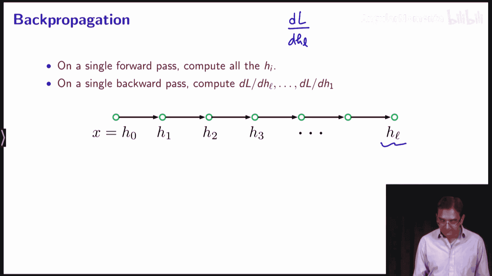

但是，假设我们已经向下进行了一定程度，现在我们想要损失函数相对于下一个隐藏单元 **h_i** 的导数。

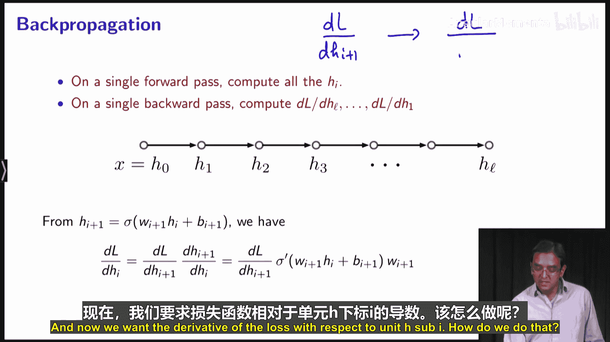

假设我们已经有了损失函数相对于单元 **h_{i+1}** 的导数。现在我们想要损失函数相对于单元 **h_i** 的导数。我们该怎么做呢？

我们写下 **h_{i+1}** 的公式，它是 **h_i** 的线性函数。然后我们应用链式法则。相对于 **h_i** 的导数，等于相对于 **h_{i+1}** 的导数，乘以 **h_{i+1}** 相对于 **h_i** 的导数。第二项我们可以直接从方程计算：它是 **σ** 在特定点 `(W_{i+1} * h_i + b_{i+1})` 的导数，乘以这个内部表达式相对于 **h_i** 的导数（即 **W_{i+1}**）。

同样，右边所有这些项都是我们已经有的。我们真正需要计算的只是 **h** 值，而我们在前向传播过程中已经获得了它们。

因此，给定相对于 **h_{i+1}** 的导数，我们可以轻松得到相对于 **h_i** 的导数。正如我们所见，这为我们提供了模型所有参数的导数。这被称为**反向传播**，它是动态规划的一种非常巧妙的运用，用于高效计算我们需要的所有导数。

## 扩展到更宽的网络

现在，等等，如果这只是针对看起来像一条链的神经网络（即每层只有一个隐藏节点的网络）呢？

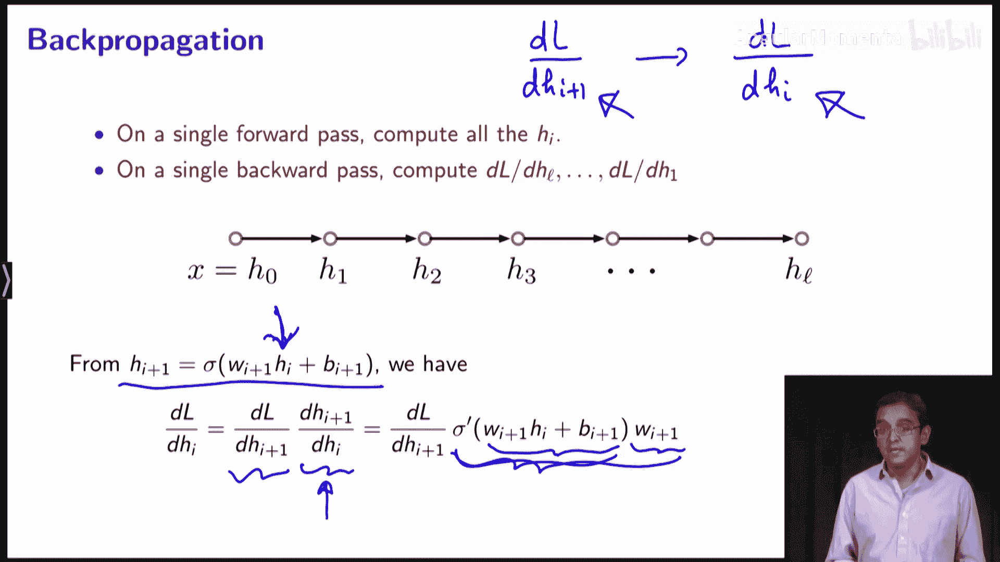

事实证明，这种情况包含了完整情况的所有复杂性。在扩展到更宽的隐藏层时，唯一真正改变的是事情变得更混乱，但基本思想完全保持不变。

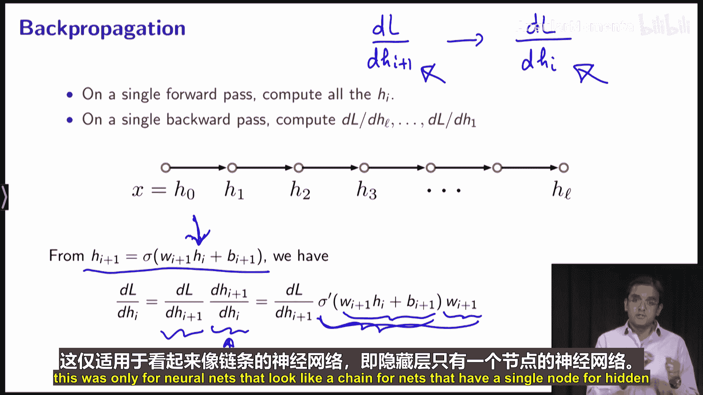

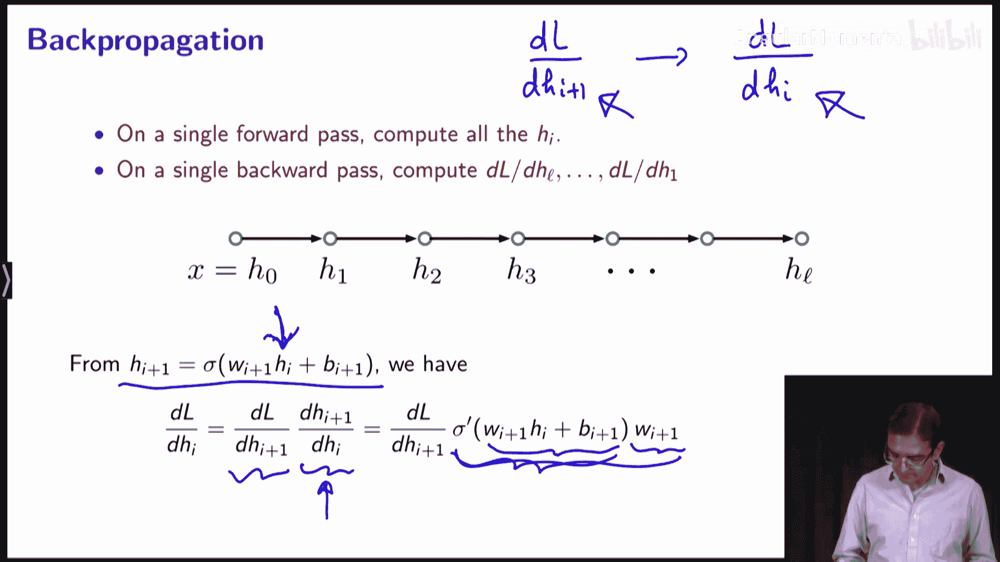

## 提高泛化能力的技巧

我们正在处理具有大量参数的模型，并且我们优化的损失函数是高度非凸的。鉴于这些情况，为了获得一个泛化能力良好的模型，我们必须稍微小心一些。

我们在讨论决策树和随机森林时，曾在程度轻得多的情况下见过这种情况。事实上，这些设置中的一些想法也已被引入神经网络。现在我们将讨论两个特定的想法，用于获得泛化能力更好的模型。

### 技巧一：早停

第一个技巧称为**早停**。我们的训练过程是：我们有一个训练数据集，并运行小批量随机梯度下降的迭代。

在运行这些迭代时，我们可以降低训练误差。由于参数非常多，这是我们完全可以预期能做到的事情。然而，这并不意味着我们真正关心的真实误差或测试误差也会随之下降。

事实上，测试误差可能以某种奇怪的方式表现：它可能在某个点开始上升，然后又下降，谁知道呢。为了更好地跟踪它，拥有一个单独的**验证集**会很有帮助。

我们可以这样做：运行训练迭代，每经过大约 100 次迭代，我们就切换到验证集，看看当前模型的表现如何。我们得到验证误差，这是实际误差的一个良好代理。然后我们看看，与 100 次迭代前相比，我们是否有所改进？如果我们改进了，很好；如果没有，我们可以简单地恢复到之前的模型（即 100 次迭代前的模型），并从该点重新开始优化。这是一个非常方便的技巧。

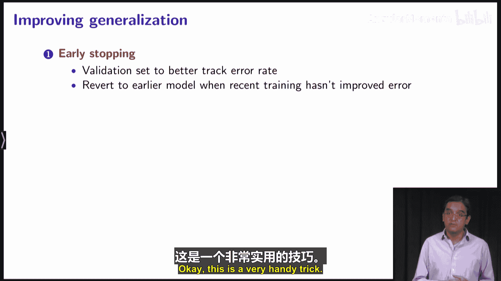

### 技巧二：Dropout

另一个被证明非常有用的技巧叫做 **Dropout**，这有点让人联想到随机森林。

我们在这里做的是：在训练期间，在呈现输入 **x** 之后，我们随机“杀死”一半的隐藏单元。更准确地说，对于每个隐藏单元，我们以某个固定概率（如 0.5）独立地删除它。因此，我们最终会删除一大堆隐藏单元，有效地将它们从图中移除。现在我们仍然运行前向传播计算，并为 **x** 获得一个标签，我们希望这个标签是正确的。

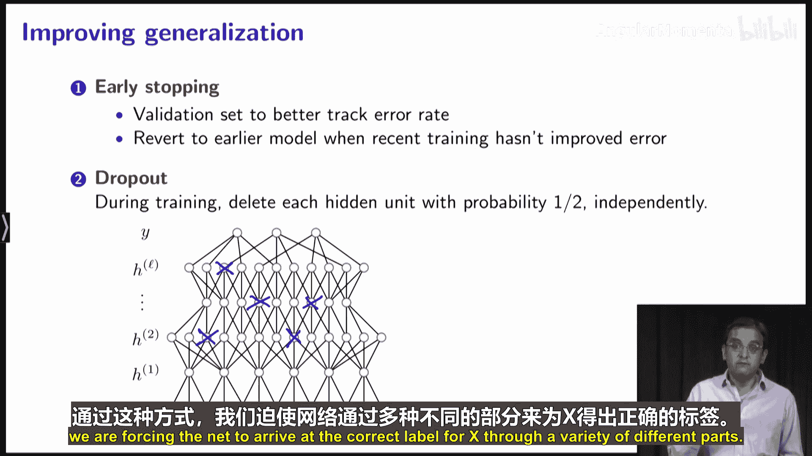

通过这种方式，我们迫使网络通过多种不同的路径来为 **x** 获得正确的标签。这引入了一种鲁棒性。

## 总结与工具

我们已经讨论了很多关于前馈神经网络的内容：它们是什么以及如何训练它们。其中很多内容都相当直接：损失函数的使用非常直观，随机梯度下降的想法非常自然。当涉及到细节时，比如使用反向传播计算所有导数，以及进行早停和 Dropout 等操作，这些在原则上似乎可行，但在实践中可能变得相当混乱和棘手。

幸运的是，你可能不需要自己实现所有这些。现在有一些像 **TensorFlow** 这样的软件包，它们处理了许多混乱的细节。你只需要指定网络架构以及每个单独节点的函数形式。一旦你做到了这一点，软件包就会处理剩下的事情：它计算出所有导数，负责训练，从而使神经网络更容易上手。

事实上，如果你想进一步学习神经网络，我认为目前最好的方法就是开始使用其中一个软件包来玩转数据。你已经具备了所需的基础知识，现在是时候出去开始实验了。

本节课中，我们一起学习了如何训练前馈神经网络。我们从定义交叉熵损失函数开始，认识到神经网络的优化是非凸的。接着，我们探讨了使用小批量随机梯度下降进行优化，并深入了解了利用链式法则高效计算所有梯度的核心算法——反向传播。最后，我们介绍了早停和 Dropout 这两个提高模型泛化能力的重要技巧。掌握这些基础后，你就可以借助现代深度学习框架开始实践了。