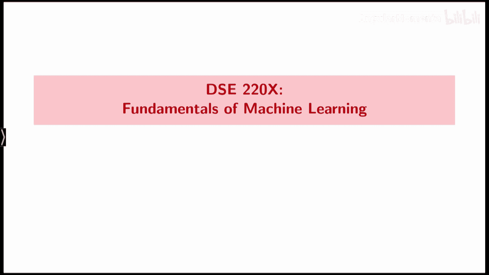
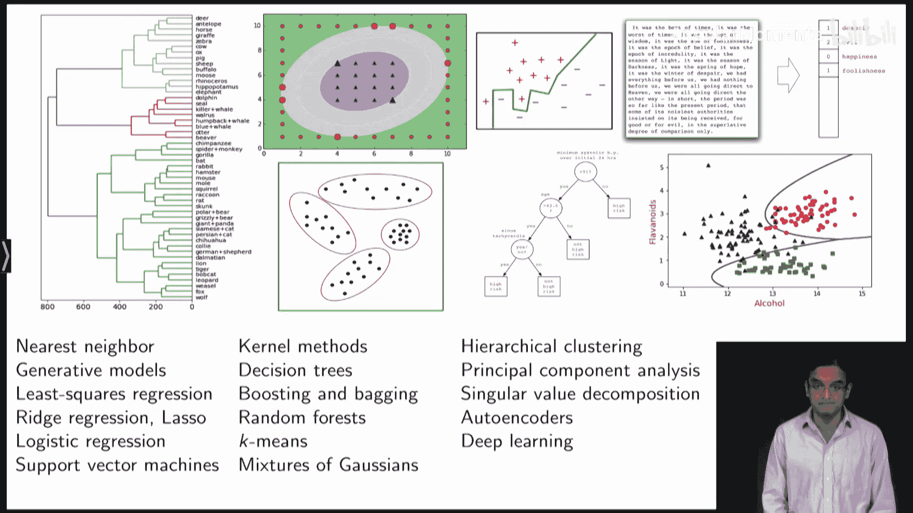
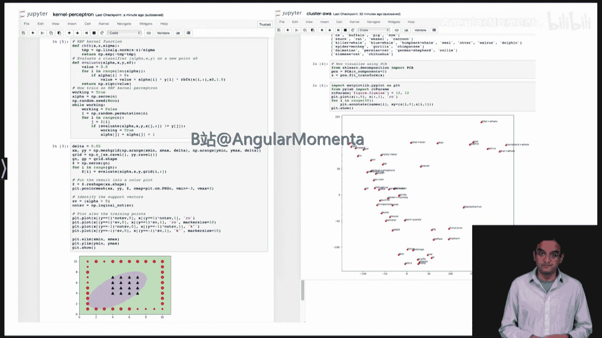

# 【加州大学圣地亚哥分校】机器学习基础  Machine Learning Fundamentals p01 01-01-02-课程介绍 -BV1TyFSziEZb_p1-

Welcome to DSE 220X Fundamentals of Machine Learning。In this course。

 you will get an intensive grounding in building models from data and using these models to make predictions。

We'll cover the most widely used machine learning methods， logistic regression。

 support vector machines。Colonel Methheads。Principple component analysis， random forests。

 neural nets， and so on。We'll see applications of these methods to problems in image understanding。

 sentiment analysis， language processing， personality testing， and many other domains。Most of all。

 well really delve into the fundamentals of these methods。

We won't think of them as recipes to be blindly followed。

But rather as interesting approaches that once understood are amenable to all kinds of modifications and improvements。

So in order to get to this level of understanding。We will go into the mathematical foundations of machine learning。

And there are basically three types of math that we'll need。Probability。

Linear algebra and optimization。We'll develop all three of these areas quite carefully。

Because they're really crucial to a mastery of machine learning。So at the end of the day。

 what are the skills that you will acquire from this course？First。

 a comfortable familiarity with the most widely used machine learning methods。What are they。

 How do they work， Why do they work。What kinds of data are they good for。

 what are their strengths and weaknesses， what is going on under the hood？

This will help you assess which method or methods are most suitable for a particular problem。

It'll also help you understand and interpret the results that you're getting。

The second skill that you'll get from this course is the ability to take existing methods and adapt them for a particular application。

😊，OkayNow sometimes it's okay to just use an off the shelf method。But very often。

 this gives a level of performance that is not quite what you were hoping for。

 and in order to get to the next level， what you need is to do something customized to either build upon an existing method and modify it in some way or perhaps to transform the data。

What are effective ways of doing this？Lost， but not least。

This course will give a sufficiently thorough grounding in the foundations of machine learning that it'll help you to keep up with this field that is really evolving very rapidly。

Now for each of the methods that we study。Youll get a Jupiter notebook or two。

That contains code and visualizations that illustrate the methodthhead on some suitable dataset sets。

And you can take these and play around with them to really get a feel for how these methods work。

There'll also be programming projects。That will give you the opportunity to think outside the box a little bit。

And to creatively build upon existing methods to solve new problems。At the end of the course。

 this collection of projects will essentially constitute a sort of repertoire， a portfolio of。

Self contained notebooks that you can show other people to impress your friends， for example。

Okay， so that's a little bit of an overview of the course。

 let me also tell you a little bit about myself。I'm a professor here at the University of California。

 San Diego， and I've been here for about 15 years or so。

The things I work on are machine learning and algorithms。

 these are the two areas that I care the most about。And this particular course。

 DSE 220X is closely modeled on a class that I teach here。

 and that basically I wanted to open up to a much broader audience。So I hope you like it。

