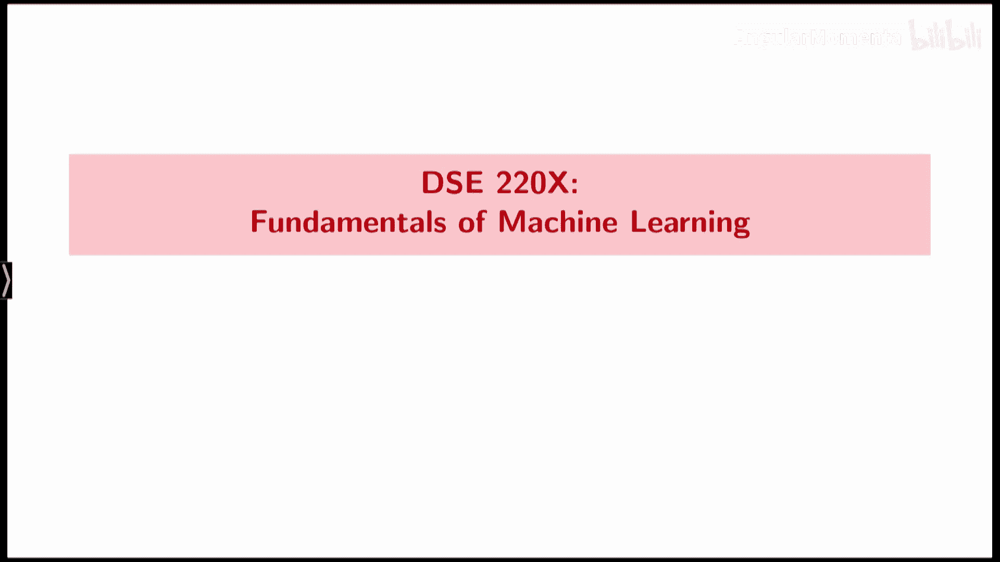
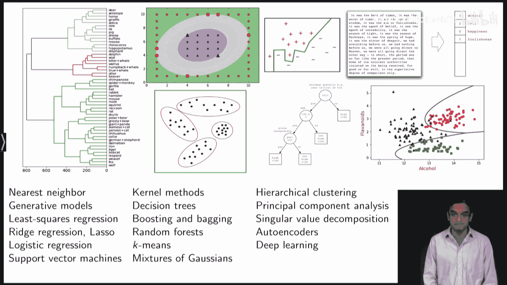
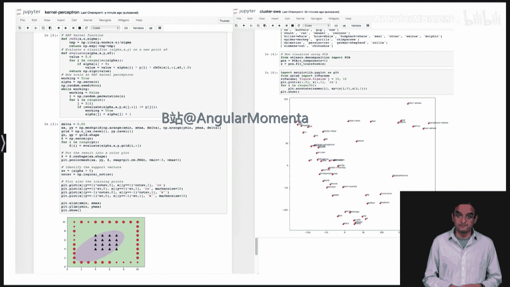

# 机器学习基础：01：课程介绍 🎯

在本节课中，我们将要学习《机器学习基础》这门课程的整体介绍。课程将概述学习目标、核心内容、所需技能以及课程结构，帮助你为后续的学习做好准备。

欢迎来到《机器学习基础》课程。在本课程中，你将获得关于从数据构建模型并使用这些模型进行预测的密集训练。

我们将涵盖最广泛使用的机器学习方法，包括逻辑回归、支持向量机、核方法、主成分分析、随机森林、神经网络等。我们将看到这些方法在图像理解、情感分析、语言处理、性格测试等众多领域的应用。最重要的是，我们将深入探讨这些方法的基本原理。

我们不会将它们视为需要盲目遵循的“食谱”，而是将其理解为一旦掌握，就可以进行各种修改和改进的有趣方法。

## 数学基础 🔢

为了达到这种理解水平，我们将深入机器学习的数学基础。基本上我们需要三种类型的数学：**概率论**、**线性代数**和**优化**。我们将非常仔细地讲解这三个领域，因为它们对于掌握机器学习至关重要。

## 你将获得的技能 🛠️

那么，在课程结束时，你将获得哪些技能呢？以下是核心收获：

*   **第一项技能**：对最广泛使用的机器学习方法有深入的熟悉度。它们是什么？如何工作？为何有效？它们适用于何种数据？各自的优缺点是什么？其内部机制如何？这将帮助你评估哪些方法最适合解决特定问题，并帮助你理解和解释所获得的结果。
*   **第二项技能**：具备改造现有方法以适应特定应用的能力。有时直接使用现成的方法是可以的，但通常这无法达到你期望的性能水平。为了更上一层楼，你需要进行一些定制化工作，要么在现有方法基础上进行修改，要么对数据进行转换。本课程将教你如何进行有效的改造。
*   **第三项技能**：本课程将为你打下足够扎实的机器学习基础，帮助你跟上这个飞速发展的领域。

## 课程实践与项目 💻

对于我们将学习的每一种方法，你都会获得一个或多个Jupyter笔记本。这些笔记本包含代码和可视化内容，展示了该方法在合适数据集上的应用。你可以使用它们并进行调整，以真正感受这些方法的工作原理。

课程还将包含编程项目。这些项目将给你机会跳出固有思维，创造性地在现有方法基础上构建新方案来解决新问题。在课程结束时，这些项目集合将构成一个作品集，即一系列独立的笔记本，你可以向他人展示，例如给你的朋友留下深刻印象。

## 关于讲师 👨‍🏫

以上是对课程的简要概述，接下来让我简单介绍一下我自己。我是加州大学圣地亚哥分校的教授，在这里工作了大约15年。我主要研究机器学习和算法，这两个是我最关心的领域。这门特定的课程DSE 220X，是紧密模仿我在这里所教的一门课程设计的，我希望将它开放给更广泛的受众。希望你喜欢它。

---

本节课中，我们一起学习了《机器学习基础》课程的整体框架。我们了解了课程将涵盖的核心机器学习方法、掌握这些方法所需的数学基础（**概率论**、**线性代数**、**优化**），以及通过课程你将获得的三项关键技能：深入理解主流方法、改造方法的能力和扎实的理论基础。此外，我们也了解了课程将通过Jupyter笔记本和编程项目提供丰富的实践机会。现在，你已经为开启机器学习之旅做好了准备。