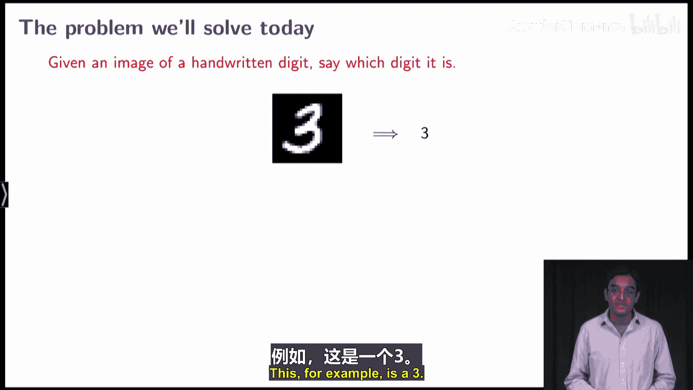
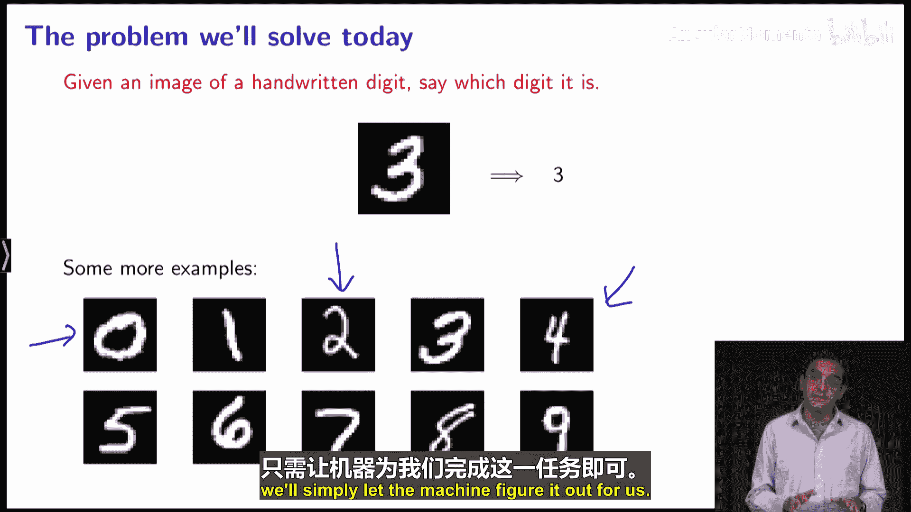
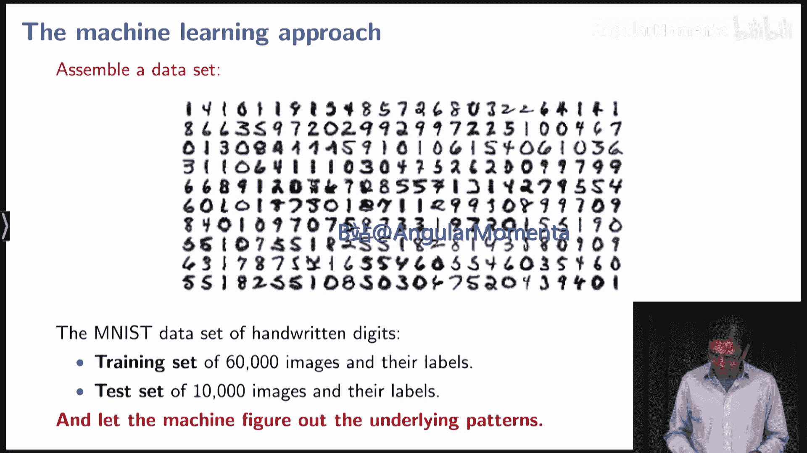
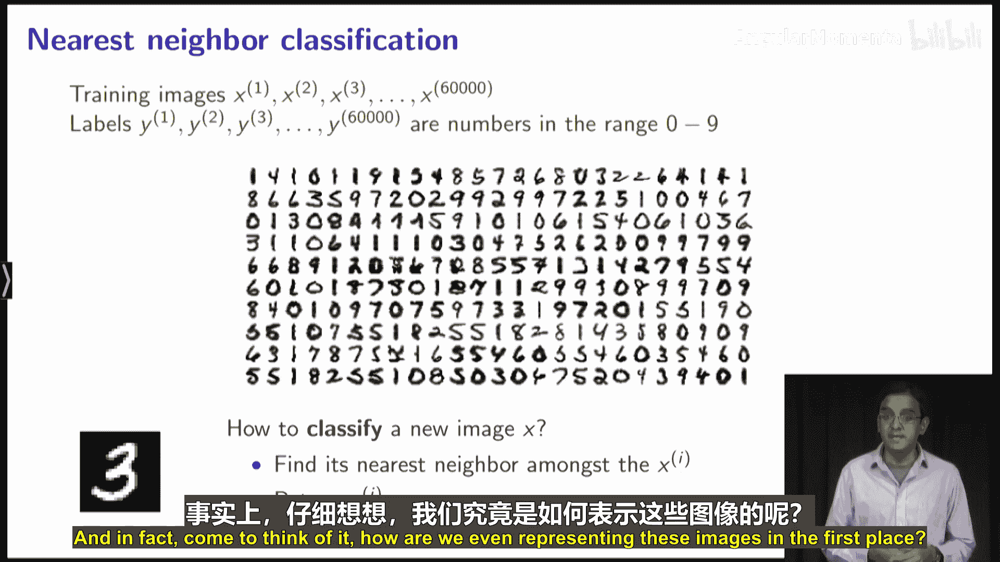
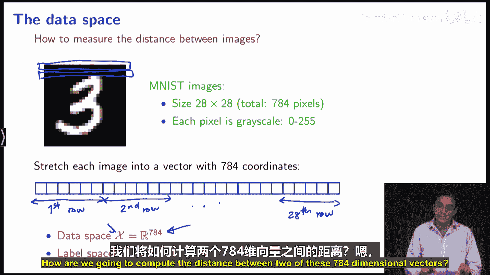
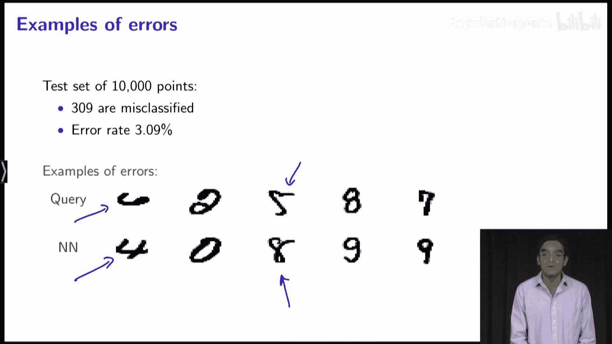

# 【加州大学圣地亚哥分校】机器学习基础  Machine Learning Fundamentals p03 02-02-02-最近邻分类 -BV1TyFSziEZb_p3-

Today， we will get a feel for machine learning by looking at one of the oldest and most enduring methods of classification。

Nearest neighbor。So we'll use this as a way to introduce the notion of a classification problem。

And also to introduce some basic machine learning terminology like training set， test set。

 training error， test error。We'll see how data can be represented as vectors in Euclidean space。

And how to compute distances between these vectors。

All of this will give us the background we need to put the one nearest neighbor classifier to work。

So here is the specific problem we'll be solving。 We're given a picture or image of a handwritten digit。

And we have to say which dig it is。This， for example， is a three。

And this is a zero。And that's a two， and that's a four， and that's a7， and so on。

So how can we approach this problem？Well， here's an idea。A zero has got one loop。

An ape has got two loops。A one has a single straight line。A four has got three straight lines。

What if。We write a little piece of software。That takes an image and counts how many loops it has。

And how many straight lines it has？And also， the relative positions of these loops and lines。

Maybe we could just take this information。And then write down a set of simple rules that figures out which digit it is。

Now， people tried this a long time ago， and it didn't work very well。

The first problem is that handwriting is super noisy。And as a result。

 it's not as easy to figure out the number of loops and lines as it might seem。

There's also a huge amount of variability in the way people write their sevens and their twos and so on。

And as a result， what was necessary was to create a huge number of rules to account for all the possible cases。

And even with all this effort， the final systems just did not work all that well。

So today we look at a very different approach， the machine learning approach。

Instead of trying to figure out the underlying patterns by ourselves。

We'll simply let the machine figure it out for us。

Now what the machine needs to figure out these patterns。Is a lot of data。And so first and foremost。

 we need to collect a data set of handwritten digits。😊，Each labeled with the correct digit。Luckily。

 such a data set is already out there。 It's called the Mnist data set。It has 60。

000 images of handwritten digits。Each labeled with the correct digit。

 and we can use this training set to learn a classifier。

 that is a function that takes an image and outputs what it thinks the correct digit it is。

Now MNIST also contains a separate test set of an additional 10，000 images。

We can use this test set to evaluate how good our classifier really is。

Now the method of classification that we'll talk about today。

Is perhaps the simplest method imaginable， its coal nearest neighbor。We have our training set of 60。

000 images。In order to classify a new image X。We simply look through this training set and find the image that is closest to x。

 the nearest neighbor of x。 and then we output the label of that nearest neighbor。That's it。Okay。

 so this is very simple。But in order to implement this， we do need a notion of distance。

 a notion of closeness between images。And in fact， come to think of it。

 how are we even representing these images in the first place？

So we will represent each image by a vector okay， now an Mist image。Is 28 by 28。

 so it's 28 pixels wide and 28 pixels high a total of 784 pixels。Each pixel by itself is gray scale。

 It has a value between 0 and 255， where 0 means completely black and 255 means completely white。

Okay。So in order to convert an image like this into a vector。

 we can simply just stretch it out into a vector with 784 coordinates。How do we do this？Well。

 we start by copying down the first row。So the first 28 pixels。And then the second row。

The next 28 pixels。And so on。All the way down to the very last row， the 28th row。And in this way。

 each image becomes a vector with 784 coordinates。So our data space。

 which we are going to denote by a script X。Is 784 dimensional Euclidean space。

 We will write it as R to the 784。Our label space， script Y is simply the set of possible digits0 to9。

Okay， so now we have a concrete way of representing the data and we can talk about distance functions。

How are we going to compute the distance between two of these 784 dimensional vectors？

Well， the most common distance function is Euclidean distance and so let's just start by reviewing what this is in two dimensions Okay so here are two points in two dimensional space x and Z。

The Euclidean distance between them is simply the length of the line connecting them。

The length of this line。Okay，Now if you look at these two points along the first coordinate。

They differ by two。And along the second coordinate， they differ by three。

And so the length of that line is the square root of two squared plus3 squared。In other words。

 the square root of 13。That is the Euclidean distance between Excelency。Now that's in two dimensions。

But in higher dimensions， the formula is pretty much the same thing。

To figure out the distance between X and Z， we simply look at how much X and Z differ on each individual coordinate。

We square these numbers， we add them up， and then we take the square root of the whole thing。

 that's Euclidean distance。Now we will write it using these double bars。

So this notation will always denote Euclidean distance unless we specifically say something different。

Okay。Good。So now we can put nearest neighbor to work Okay， we have our training set of 60，000 images。

And to classify a new image X， we're going to look through these 60，000 images。

Find the one that is closest in Euclidean distance to x under this 784 dimensional vector representation that we just discussed。

We're got to find that nearest neighbor and return its label。Okay， so how good is this classifier。

 how accurate is it？Well， let's look at some numbers。Okay。So we have a training set of 60，000 points。

 what is the error rate on this training set？Well， let's see for each training point。

 its nearest neighbor is itself。So it'll always get the right label。The training error is 0。Okay， so。

As you can tell， training error is in general not a good indicator of future performance。

 a performance on future data。And this is why we have our separate de。The error on the test set。

 the test error is a much better measure of the quality of the classifier。😊。

So what kind of error rate might we expect in this case？So before we get there。

 let's just do a little bit of a thought experiment。😊。

What would be the error rate of a random classifier Okay。

 that's a classifier that doesn't even look at the data。

 but just guesses a number from 0 to9 at random。 What error rate would this kind of classifier have。

Well， whatever the correct label is。It's going to guess that label with probability exactly one/10。

 so it's going to be wrong nine/ tenth of the time。 Its error rate will be 90%。

What about nearest neighbor， What is the aerated nearest neighbor on the test set。

It turns out to be 3。09%。Not bad at all。 Okay， there were 10，000 test points。

Nearest neighbor got 309 of them wrong。Not bad for a classifier。 That's so simple。

So now let's go and look at some of the mistakes that nearest neighbor made。So for example。

 on this image。This is what the nearest neighbor was。 And so it thought the image was a for。

On this image。The nearest neighbor was this。And so it told the label was8。Okay。

 and so these are just a random smattering of the mistakes。

And you can see that they're really quite understandable once you see what the classifier is doing。

Okay， well， that's it for now。We had seen our very first classifier。

And next time， we'll see how to make it better。