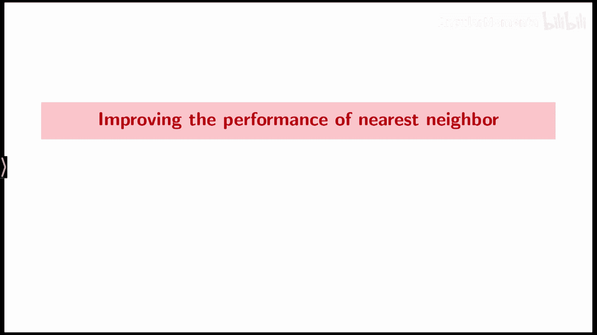
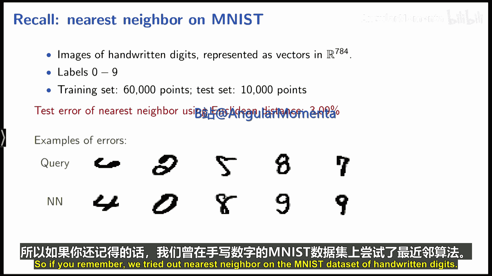
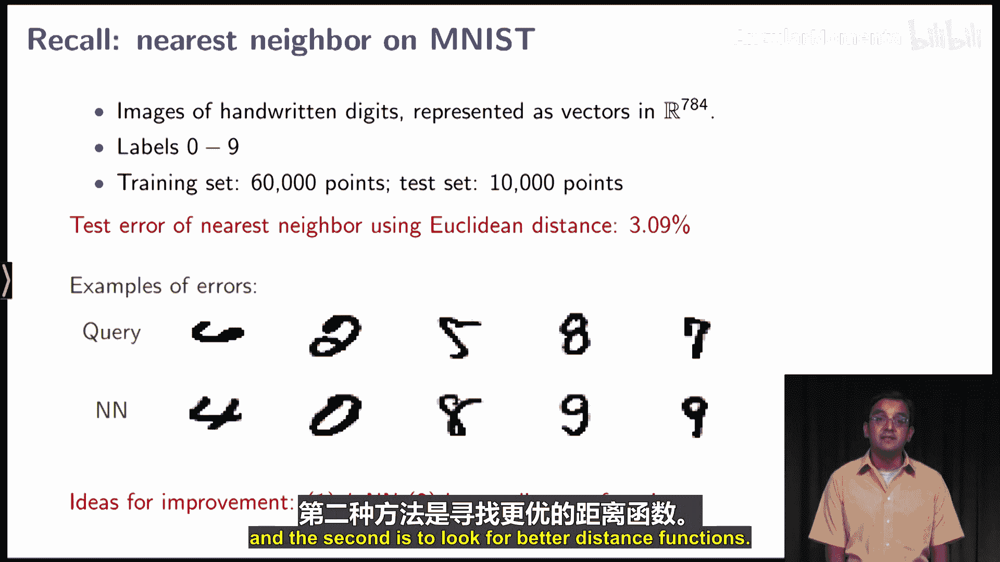
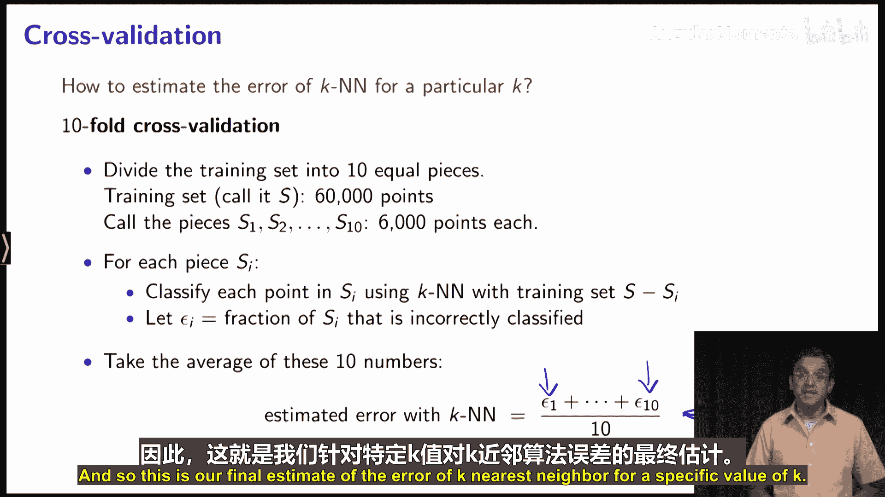
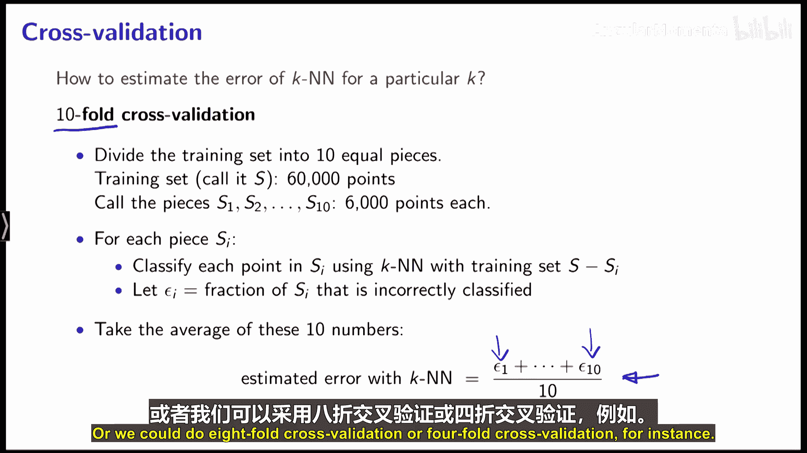
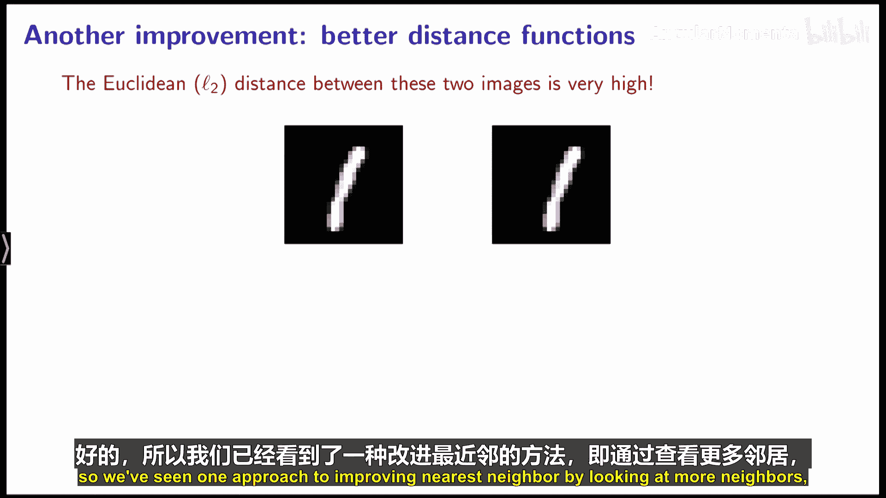
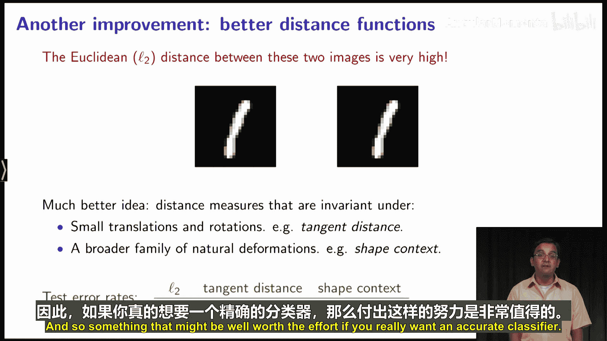
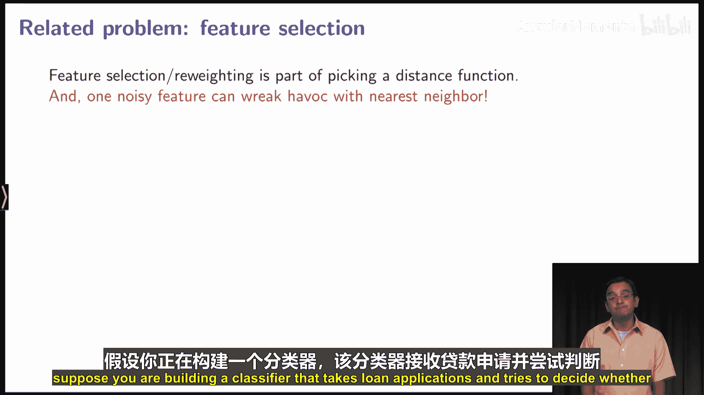
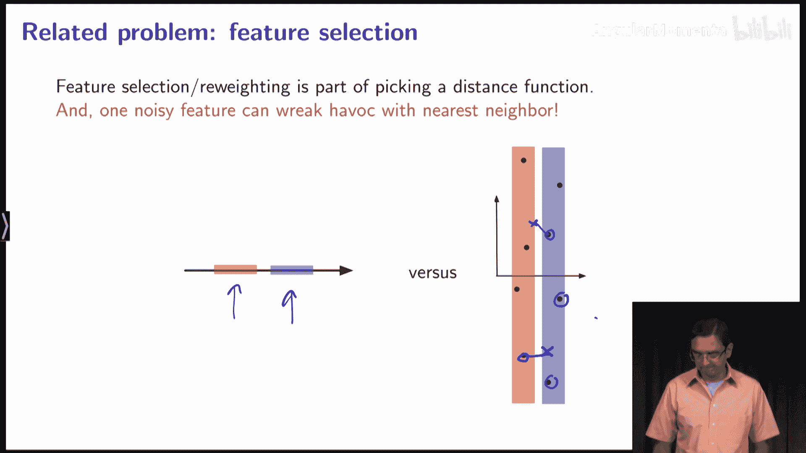
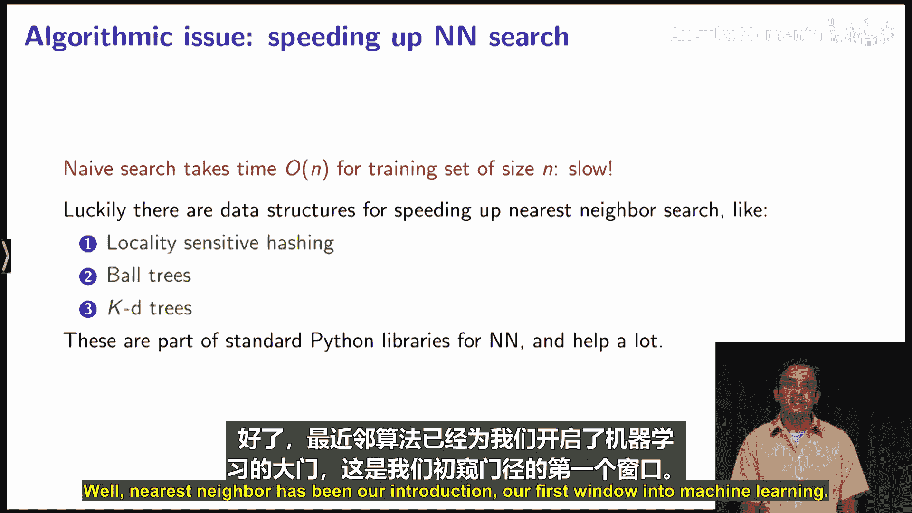

# 【加州大学圣地亚哥分校】机器学习基础  Machine Learning Fundamentals p04 02-03-02-优化最近邻算法 -BV1TyFSziEZb_p4-

So last time we saw the basics of nearest neighbor classification。

 and now we'll see how to take it to the next level。So if you remember。

 we tried out nearest neighbor on the M data set of handwritten digits。

And we found that it gets pretty reasonable performance。An error rate of 3。

09 per cent on a separate test set。 And these are some examples of the mistakes that it made。

How can we improve its performance even further。So let's look at two standard ways of doing this。

A first is to move to Can nearest neighbours， and the second is to look for better distance functions。

So K nearest neighbor classification， this is a very simple idea。When doing nearest neighbour。

Instead of simply looking for the very closest point in the test set。

 find the closest three points or the closest five points。They each have a label。

Return the majority label， or the most common label。Let's see how this does on Amnesst。Okay， so。

When k equals 1。This is just the same nearest neighbor class fire we saw last time。

 and it has an error rate of 3。09%。When K equals3， what we are doing in order to classify a new image is finding its three closest images in the training set。

And returning their majority label。If we do this， the error rate goes down slightly to 2。94%。

When we try larger values of k，5，7，9， and so on。The error rate starts going up again。Okay。

 now one thing that's important to mention over here is that these errors are measured on the separate test set。

Measuring errors on the training set is really a very poor indication of future performance。

So on this particular data set， vary K helps a little bit。But not dramatically， in other cases。

 it sometimes helps a lot。But how do we choose the right value of K。In this toy example。

 we had a separate de set， but that's not something we typically have in real life。

We'd only have the training set。And we've already made it clear that error on the training set is rather a poor indication of error in practice。

How do we deal with this？This is a rather tricky problem。

And it's a problem that's not limited to nearest neighbor。

This is something we see over and over again in machine learning。

 Many of the methods we study will have parameters like K that need to be set correctly。

 If we set them well， the method works well， If we set them poorly， the method works poorly。

 and we have to somehow set them using the training set alone。

A standard way of doing this is by something called cross validation。

So let me show you how this works for Ka nearest neighbor。

Suppose we want to evaluate a particular choice of k， for example，3 nearest neighbor K equals 3。

We want to estimate the error rate of three nearest neighbor， but using only the training set。

How would we do this？So here's how tenfold cross validation would work， we take our training set。

 those 60，000 points。And we divide it into 10 equal chunks， so 10 chunks of 6000 points each。

Let's call these S1， S2， S3， S4 all the way to S10。Now for each of these s subs。

 we'll do the following， we'll take just that chunk。And we'll think of it。As the test said。

And we'll think of the remaining nine chunks。As the training sit。And from each each point in S subi。

 each of the 6000 points in S subbi， we will classify it using the remaining 54，000 points。

That will give us an error rate for Scii， which we'll call Epsalon subi。

And once we've done this for each of these pieces， we have these 10 error rates。

 Epsilon 1 through Epsilon 10。Each of these individually is a fairly decent estimate of the error rate of Ca nearest' neighbor。

To get an even better estimate， we average the 10 of them。And so this is our final estimate。

Of the error of K nearest neighbor for a specific value of K。

Now， of course， we were wanted to experiment with multiple values of k。

 We'll try k equals 1 K equals 3， k equals 5 and so on。

 and in each case for each of these values of K we'll run 10 full cross validation。

 we'll get an error estimate and then we'll pick the K with the lowest error estimate。

 and that's how we find the K in K nearest neighbor。

Now what I've described though here is called tenfold cross validation。

Because we divide the data set into 10 equal pieces。

But we could also do five fold cross validation where we divided into five pieces， so the 60。

000 points would be divided into pieces of 12，000 points。

 or we could do  eight fold cross validation or4 fold cross validation， for instance。Okay。

But this lets us choose K。Okay， so we've seen one approach to improving nearests neighbor。

By looking at more neighbors， by looking at canerss， neighbors instead of just one。Another strategy。

 which works very well in many settings， is to look for better distance functions。Now。

 when we were running nearest neighbor on Amnist， we used Euclidean distance。

But actually Euclidean distance is not a good choice for images in general。

 so look at these two images， for instance。😊，They are actually exactly the same。

 except one of them is slightly scrolled to the right。Okay。Not a big difference to us。

 but what it means is that that vector representations are completely different。

 And so there's actually a significant L2 distance between them。Clearly。

 Euclidean distance is not a great choice for images。It's what we'd like。

Is to come up with a different distance function。That doesn't behave badly in this way with like a distance function。

 which doesn't change if you take one of the images and translate it slightly or rotate it slightly。

And people have looked into this and have come up with such a distance function called tangent distance。

Even better would be a distance function that is invariant under an even larger family of deformations。

 not just small translations and rotations， but maybe， for example。

 taking a line and making it slightly curved。One example of such a distance function is called shape context。

So these are better distance functions and what happens when you use these for doing nearest neighbor。

 what happens to the performance orem list？And as we can see。It improves dramatically。

With shape context， for example， the error rate drops well below 1%。In general。

 in using domain knowledge to pick better data representations and better distance functions and better similarity functions。

Can be very， very beneficial in classification。 And so something that might be well worth the effort if you really want an accurate classifier。

Now， one aspect of choosing a distance function。Is first just choosing the right features。

In the case of Mnt， the features we were using were the 784 individual pixels in the image。

 and these are all features that are arguably relevant to classification。

But in many other situations， the data has lots of features that are completely irrelevant to the classification task at hand。

So for example， suppose。

You are building a classifier。That takes loan applications。And。

Tries to decide whether the person is at risk of default。Now the data in this case。

 the loan application。Contains a lot of useful information， like age and income and so on。

 but also contains a lot of information that's completely irrelevant， like social security numbers。

 If you don't remove these features， they can wreak havoc with nearest neighbor。

 The distance computations could be completely dominated by these features。

So here's a pictorial depiction of this。😊，So on the left over here。

 we have a data set that's just in one dimension， and it has two labels， red。And blue。

The points with smaller x value are red， the points with higher x value are blue。

 they nicely separated and nearest neighbor will work extremely well on this one dimensional data。

On the right over here， we decide to add in an extra feature。Along the x2 axis。

This feature is completely irrelevant。And it completely wrecks the performance of nearest neighbor。

 Okay， so for example， let's say that these dots over here are the training points。

How would this point be classified， S this is a test point？Well， its nearest neighbor is this。

So it would be classified as red， but oh， that's not good。How would this point be classified？ Well。

 its nearest neighbor is this， So it would be classified as blue。Not good at all。

 So feature selection is very important。Pride using nearest neighbor。

Now， so far， we've been talking about。Improving the statistical performance of nearest neighbor improving the classification accuracy of nearest neighbor。

But another thing that's very important is the algorithmic side of things。

Near its neighbour search can actually be rather slow if the training set is large。

When we were doing nearest neighbor on Emist， for example， in order to classify a new image。

 we had to look through 60，000 training images。This is not pleasant。

 Can you imagine if the training set instead had a million images or 100 million images。

 it would render nearest neighbor completely impractical。More formally。

 if there's a training set of size in， a naive search for the nearest neighbor takes time proportional to N。

 which is very bad。The good news is that this problem is something that has been researched for several decades now。

 and people have come up with a variety of data structures for significantly speeding up nearest neighbor search。

 these data structures have names like locality sensitive hashing， ball trees。

 gay trees and there's a whole lot more of them。😊，The main thing is to be aware of them。

 They're part of standard libraries in Python， for example。And in some cases。

 they can reduce the search time from something like n to something more like log n。 and in general。

 they are quite helpful。Well。Nearest neighbor has been our introduction。

 our first window into machine learning， and we've used it to discuss basic concepts like trading error and test error。

 feature selection and cross validation。

Very soon we will come across all sorts of other methods for classification。

But nearest neighbor is the oldest of them all， and one of the simplest and most flexible。

