# 【加州大学圣地亚哥分校】机器学习基础  Machine Learning Fundamentals p05 02-04-02-距离函数 -BV1TyFSziEZb_p5-

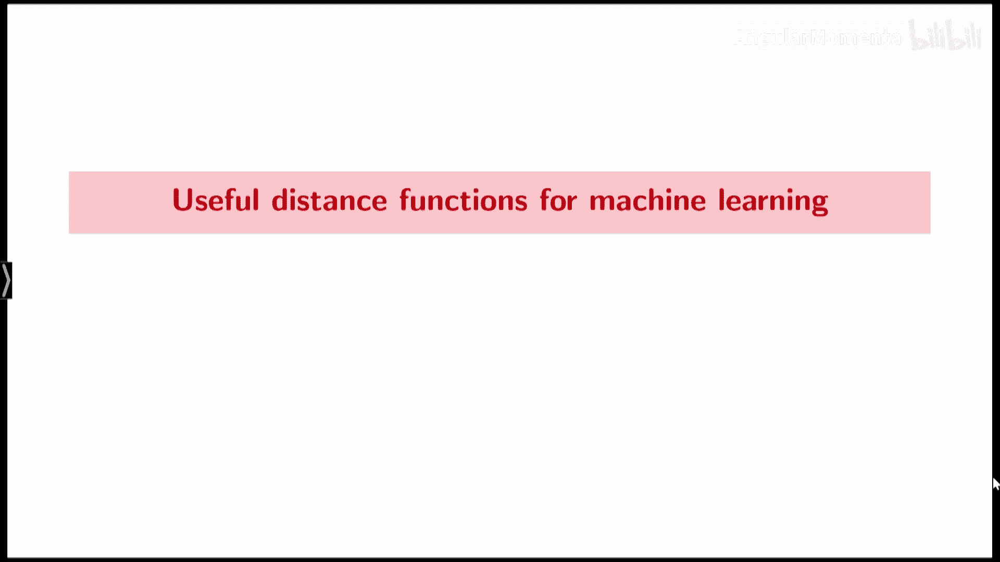

So when we were discussing nearest neighbor classification。

 we kept emphasizing how important it is to pick the right distance function。Now。

 it turns out that distance functions are critical to many different types of machine learning。

 and that there are a few distance functions that keep popping up again and again。

So what we'll be doing today is to look at two families of such distance functions。

 the LP norms and metric spaces。

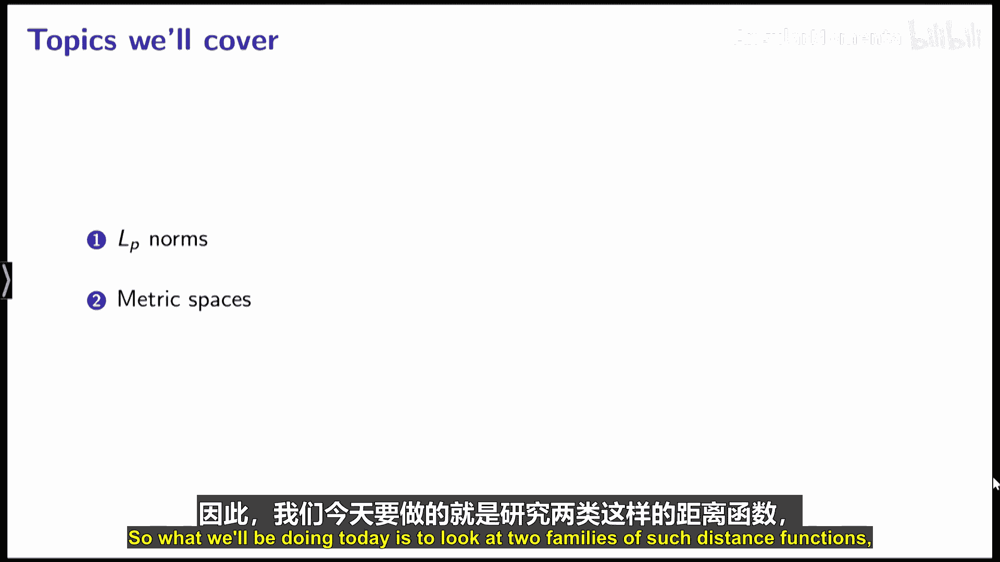

So let's start with LP norms。What's a good way to measure distance in M dimensional Euclidean space？

Well， there's L2 distance， which we saw last time。If you take out a ruler and you measure the distance between two points。

 that's L2 distance。 It's a very simple， intuitive distance function。

 and in many cases it's the default choice。But it turns out that L 2 is just one member of a much larger family of distance functions called the L P distances。

 And here's the general form of an L P distance。 So P can be any number from one to infinity。

And to compute the L P distance between two vectors， X and Z。

You look at that difference along each coordinate， you raise it to the P power。

 You add this up across all the coordinates， and then you take the P root of the whole thing。

So when you plug in Ps 2， for example， you just get back the previous formula for Euclidean distance。

But when you plug in a different value of P， like p equals 1， for instance。

You get a different distance function for p equals1， you get L1 distance。

Which is something that is also used a lot in machine learning。 Okay。

 so what is this distance function， Well， let's say we have two points， X and Z。 So this is X。

 And that's Z over there。L 2 distance is just distance as the crow flies。 That's the one we've seen。

 That's a very simple distance。

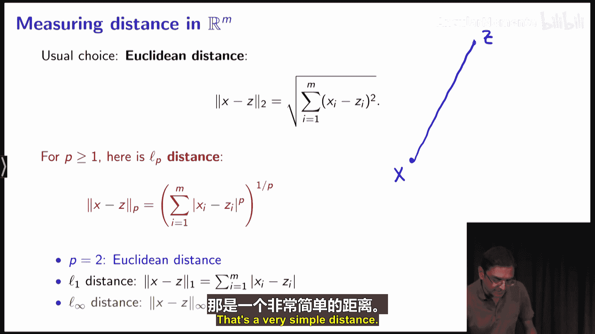

In L1 distance， you also want to get from Xcstas Z， but you're not allowed to go as the crow flies。

 You are forced to go along horizontals and verticals。 Okay。

 so the L 1 distance from ecsta Z is this plus this。It's the sum of those two legs。So mathematically。

 what we do is that we look at the difference along each coordinate and we simply add up those differences。

 so this is the difference along the first coordinate。😊。

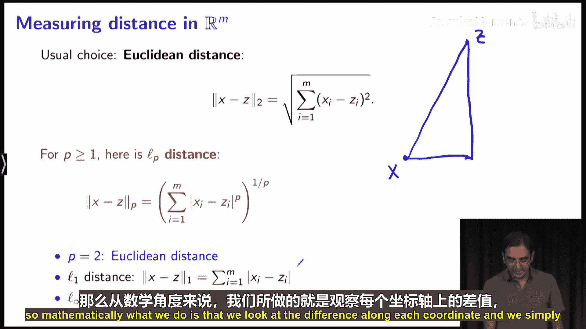

This is the difference along the second coordinate， and we add those two up。

 and that's at one distance。 a very important distance function。

Another interesting choice is L infinity distance， which is the last one here in green。

What L infinity distance does is to simply look at the single coordinate along which the distance between x and Z is the greatest。

 The single coordinate with the largest difference X I minus E I。

 So in the case of these two points over here， Z and X。

 the L infinity distance between them would simply be this。😊，Okay。

So you might wonder how we can plug in P equal to infinity in that formula over there。 We can't。

 P has to be a finite number， but what we can do is to take larger and larger values of P and then look at the limit。

 and that's how we get L L infinity distance。Okay， so these are three functions to bear in mind， L1。

 L2 and L infinity。

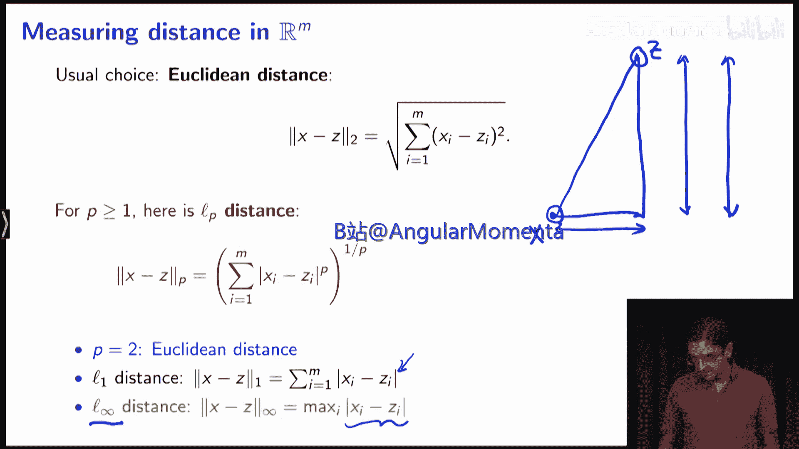

And let's see some examples of these now。Okay， so let's talk about length of vectors。

 So the length of a vector is simply its distance from the origin。 Okay。

 so let's say we have a vector over here， which is all ones。And this is a D dimensional space。

 so the vector consists of D1s。The length of the vector is its distance from the origin。

 from the all zeros point。

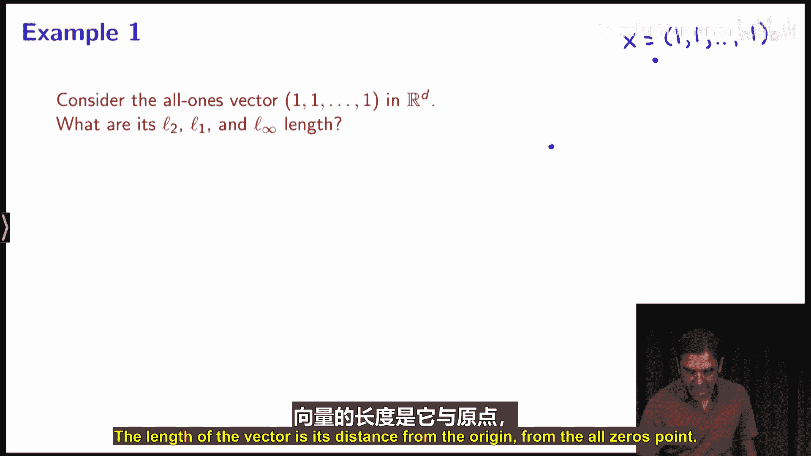

And we want to compute its length in L2， L1 and L infinity。

 So let's do L2 first since that is the most familiar distance function。

So we want to compute the L2 norm of x。Well plugging into the formula。

 the L2 norm is the square root of the first coordinate squared plus the second coordinate squared all the way to the deep coordinate squared。

Okay， so the L2 norm of x is just the square root of D。Okay， what about the L1 norm of x？

So let's draw this line over here。The L1 norm of x。Is。The first coordinate， absolute value。

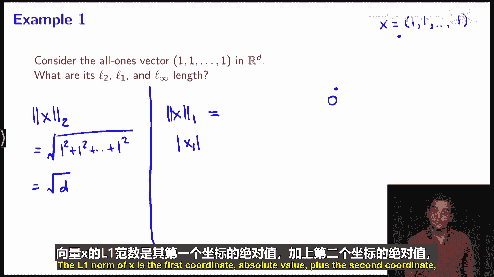

Plus， the second coordinate， plus all the way to the deep coordinate。And so the L1 norm is D。

Now let's do the L infinity norm。The L infinity norm of x。Is the coordinate along which。

The value is the largest。 And in this case， one could pick any of the coordinates。

 So the Elinfinity norm is just one。So the three norms give very different values。

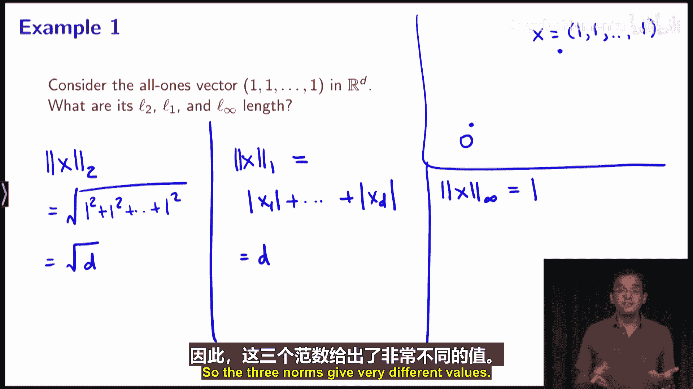

Let's look at another example。Okay， so now we are in R2， which is the plane。

And we want to draw all points whose L2 length is one。

So that's something that you might be familiar with， that's just a circle， okay。

 every point whose length is one。So in the L2 case。We have a circle。The unit circle。Okay。

 so this point is1。 that point is1。 and formerly， what we are looking for is all points， x1 x2。

 whose L2 norm is 1， in other words， for which x1 squared plus x2 squared。

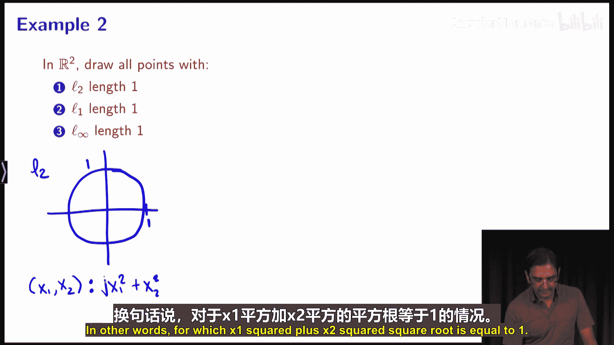

Square root is equal to one。And this is a circle。 This is the formula for the unit circle。

 so that's the familiar case。Now let's try L1。So we want all points whose length is1。

 So we want all points in the plane， all points x 1 x2， and we want the length to be 1。

 So the absolute value of x1。Plus the absolute value of x2 equals 1。

Let's see what points these are Okay， so let's draw the plane over here。Okay。

 so one example of such a point is the 0。10， because the coordinates add up to one。

Another one is the 。01。Now we're taking absolute value so we can also do minus10。-1 and 0 -1。Okay。

 so these are four points that lie on this shape。But we also have， for example， a half a half。

Which lies in the middle over here。And when we finally join all these points together。

 we see that it looks like this。Okay。

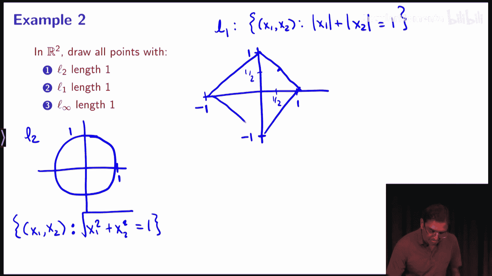

It has a diamond shape。 Okay， my diamond is a little bit skewed。

 but you can imagine what it's supposed to look like， okay。So that is the unit bowl for the L1 norm。

And what is it for all infinity？Well， this is what it turns out to be。Instead of a diamond。

 it just turns out to be a box。 case of that 0。 That's 1，1，-1。

And maybe you can check for yourself to see that that's really correct。

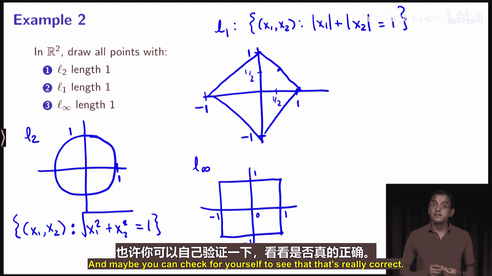

Okay， so we've talked a little bit about LP norms。

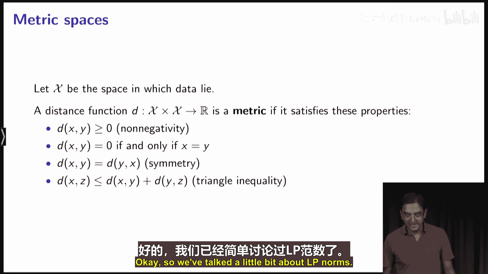

And these are distance functions that really come up a lot， especially P equals12 in infinity。

 so they're going to turn out to be very useful。

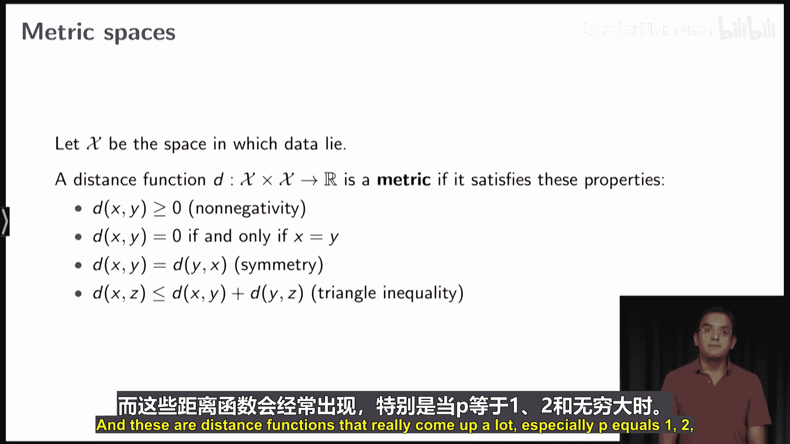

But there are many situations in which we need other distance functions。 Okay， so， for example。

 distance functions that are fine tune to a particular domain。

Or distance functions between objects that aren't even vectors， you know。

 distance functions between strings or graphs。These sort of things come up all the time in machine learning。

 So is there a broader family of distances， something that， for example。

 can be a distance function on an arbitrary space， not necessarily a space of vector。😊。

And there are a few such families， and perhaps the most important of them are distance metrics。 Okay。

 so let's go over the definition of this。 So we have X， which is any data space。

It could consist of vectors， it could be trees， it could be strings， any space， an arbitrary space。

Now we have a distance function D on x， so it's a distance function where you give it。

Two objects in x， and it returns a value， you know， maybe 3。6 or something like that， okay。Now。

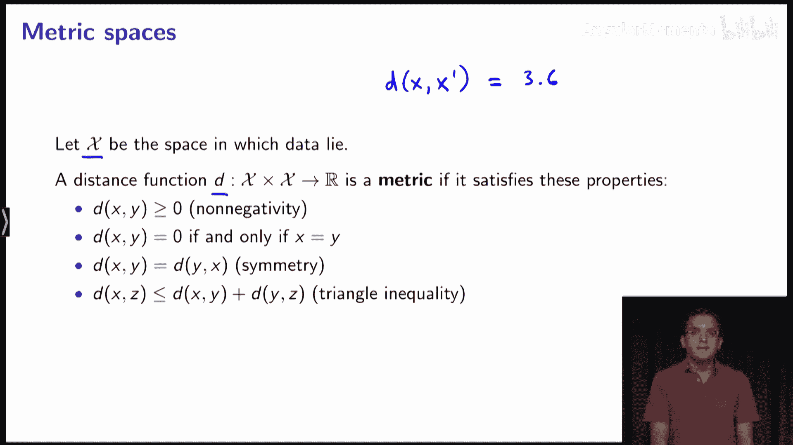

This distance function is called a metric if it happens to satisfy four properties。

 four basic properties。The first is that the distances should never be negative。

That sounds fairly reasonable。The second is。That the distance from a point to itself should be 0。

And moreover， these are the only cases in which the distance should be 0。

 so it should not be the case that the distance between two different points is 0。The third property。

Is that the distances should be symmetric， so the distance from x to y should be the same as the distance from y to x。

And the final property is the triangle inequality。 Okay。

 so what that says is that if you take any three points， X， Y， and Z。Then the distance from x to Y。

Is that most the distance the distance from x to z is that most the distance from x to y plus the distance from y to z。

And if that holds， then it satisfies the triangle inequality。

So any distance function that happens to satisfy these four properties is called a metric。And if we。

 if we find that the distance function we are using is a metric。

 it's useful because there are all sorts of things we can do with it。 For example， last time。

 we talked about methods for fast nearest neighbor search。

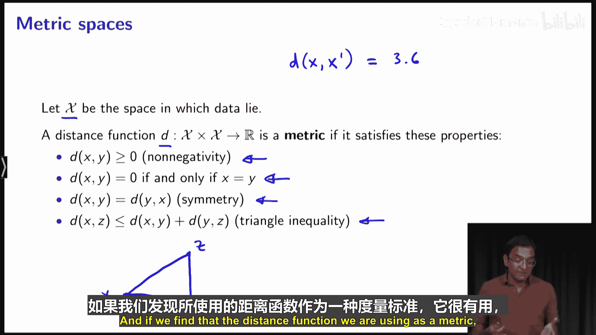

These data structures like bowl trees and kd trees and locality sensitive hashing and so on。Now。

 many of those methods work only for Euclidean distance。

 work only if you're doing nearest neighbors in Euclidean space。

But some of them work for arbitrary metrics。 So if the distance function you've chosen happens to be a metric。

 then you can use these to do fast nearest neighbor search。Okay。

So it's very useful to be able to choose distances that are metrics。

So let's look at some examples of metric distances。

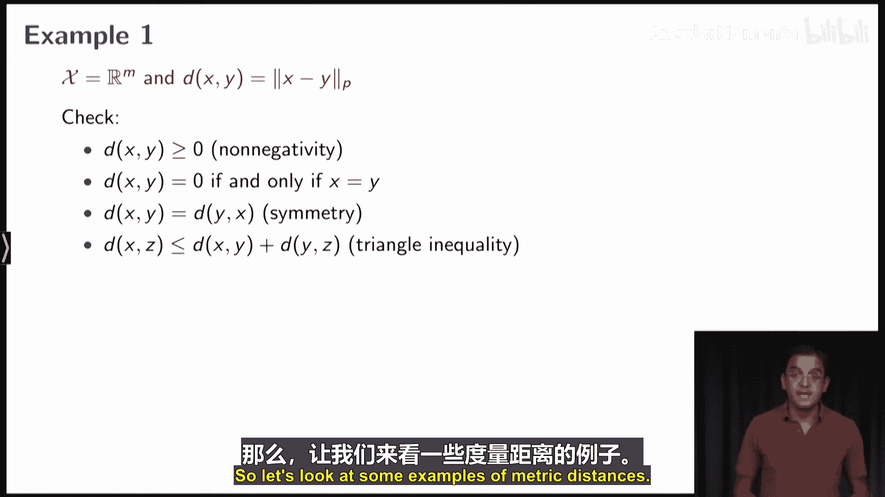

And the first example is the LP norms。 It turns out that any LP distance is a metric。

 so let let's pick one concretely， let's say L1 distance。

 So let's say the distance between two points is the L1 distance and let's say the points are in m dimensional space。

 so we take the sum over the m coordinates。Of the difference between the two vectors along that coordinateal。

 Okay， that's the L1 distance。 Why is this a metric。Well， in order to check that。

 we just have to go down those four properties and check them one by one。So first of all， is this。

 can this ever be negative no because of the absolute value， so first property is okay。

If x equals y is this0， Yeah， if x equals y， this is 0。If this is0， does that mean x equals y？Well。

 if this thing is0， it means that all of these absolute values are0。

 which means that x is equal to y。The second property is fine as well。

Symmetry is the distance from x to Y， the same as the distance from y to X yes。

And what about the triangle inequality， Does L1 distance satisfy the triangle inequality？Well。

One thing that's definitely true is that if you look at any one coordinate。The distance。

The difference between X I and Z I is at most the difference between X I and Y I plus the difference between Y。

 I and Z I。And now we just sum over all coordinates。And that gives us the triangle inequality。Okay。

 so L1 distance satisfies all the properties of a metric and all the LP distances do。

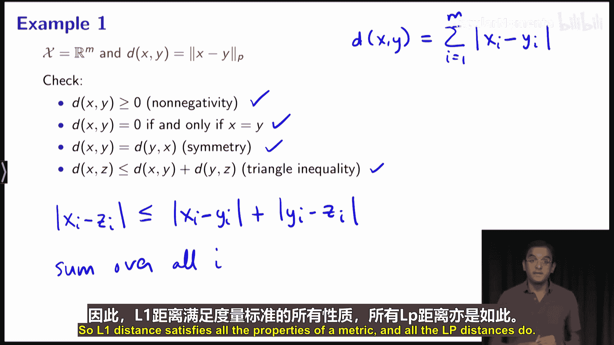

Okay， now let's look at an example where the input space does not consist of vector。 Okay。

 so let's say that we're dealing with strings over some alphabet。

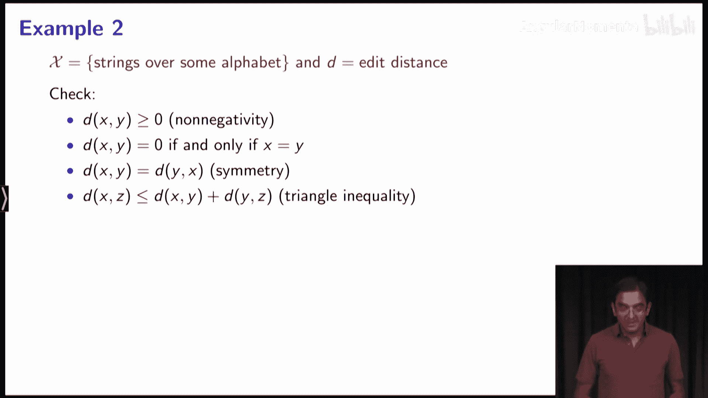

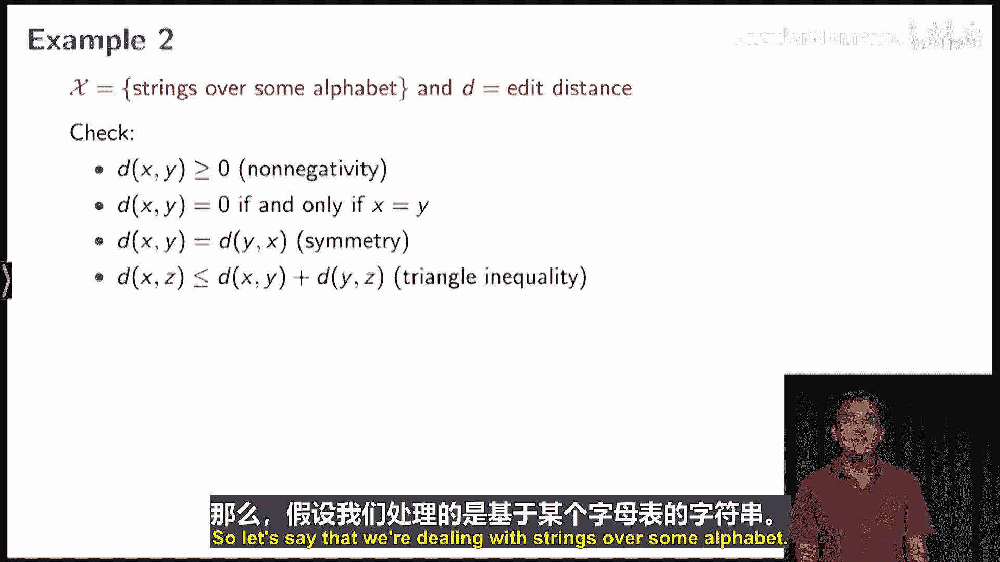

For instance， if we are dealing with DNA sequences。Then what we have are strings over A， C， G， and T。

 That's the input space。 Okay， what the star means is strings of arbitrary length over this alphabet。

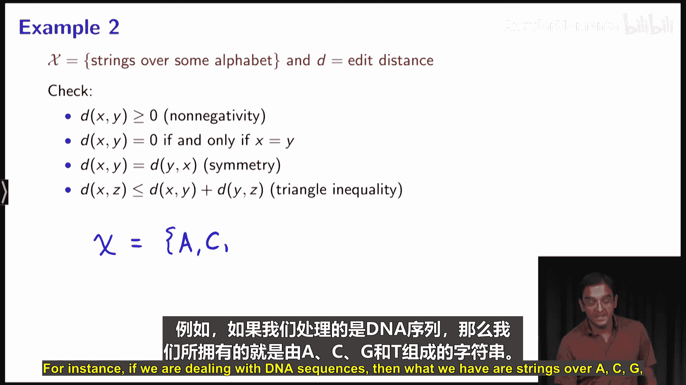

Okay， so we have two strings。Let's say ACC GT。And CC GT。 So we have these two strings。

And now we want a distance function。 What is the distance between x and Y。Now。

 there are many ways in which we can define this。 but from the biologist's point of view。

 they will look at these two and say， well， you know， actually， these are very similar。

Because you can get from X to Y by just deleting a。 If you were to remove a， they'd become the same。

 or equivalently， if you were to take Y and just insert an a at the beginning。You would get X。

So this kind of distance function that takes into account insertions。

 deletions and also substitutions is called edit distance。 Okay， And it turns out that it's a metric。

 so let's just define it the edit distance between two strings， x and y is the number of insertions。

 deletions and substitutions needed to get from x to y。

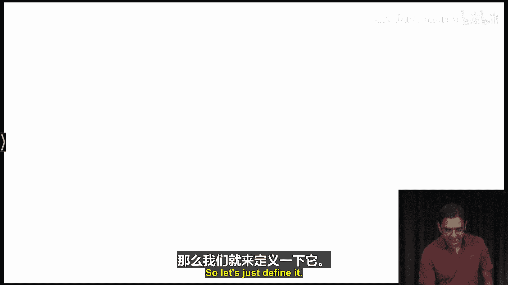

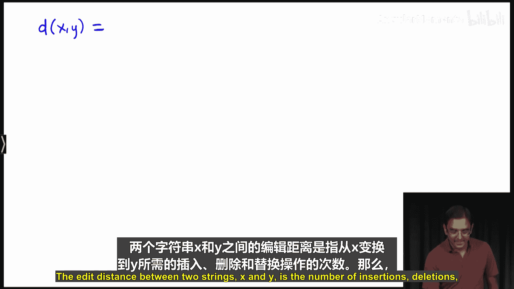

Okay。Okay。Yeah。So why is this symmetric， Well once again， we just have to go through the properties。

 Okay， so first of all。Is it always positive。Yes， okay。Is it the case that it's 0。

If and only if x equals y。Again， obviously， yes。Is it symmetric？

Is the number of steps to go from x to y， the number of insertions。

 deletions and substitutions to go from x to y， the same as to go from y to x。 Yes， it is。

 because a deletion is the reverse operation of an insertion。Okay， and finally。

 does it satisfy the triangle inequality。It does， and that's something you can also convince yourself。

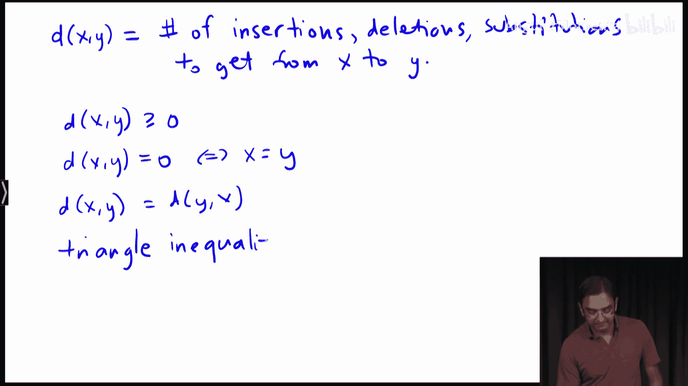

Okay， so here's an example of a distance function。That's really over a fairly arbitrary space。

 a distance function between strings。But it turns out to be a metric。

 which means that we can do all sorts of nice things with it。

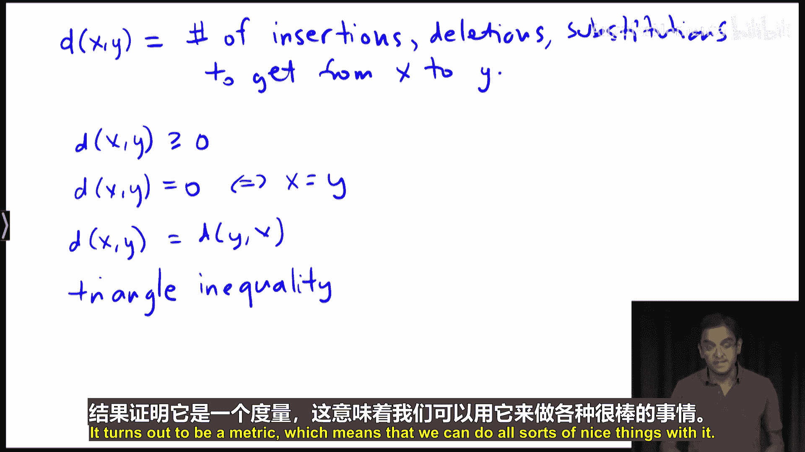

So the properties of the metric seem really minimal。It should be non negative。

 It should be symmetric， to satisfy the triangle inequality。 I mean。

 would we ever want to use a distance function that's not a metric， okay。And unfortunately。

 it turns out the answer is yes and here。What' shown here is the prototypical example of a distance function that's very widely used and is nothing close to being a metric。

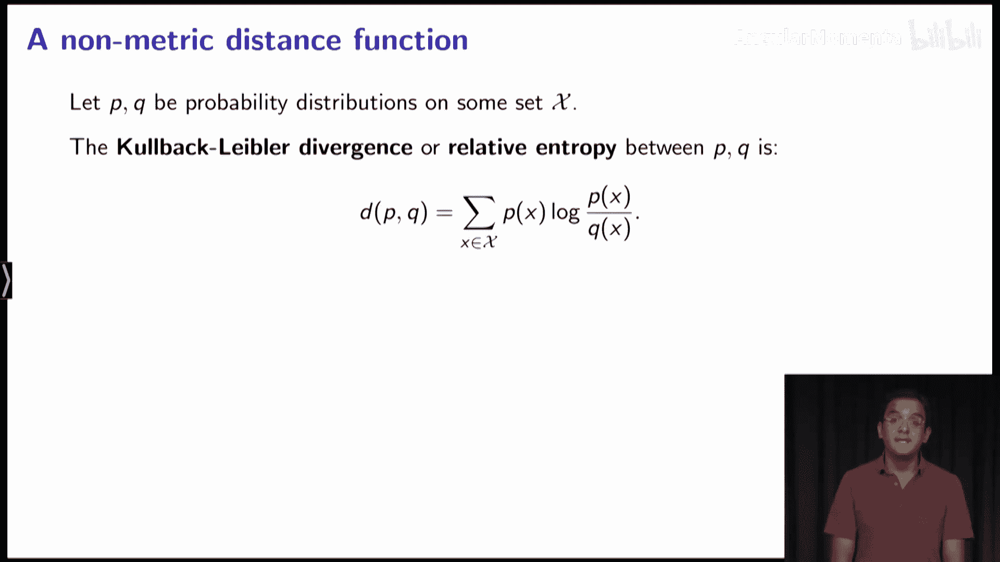

This is the relative entropy or the K L divergence。

 and it's one of the most standard distance functions between probability vectors。Okay。

 so what's a probability vector。 Well， a probability vector is just a vector that gives probabilities over different outcomes。

 Okay， so let's say we have four possible outcomes。

 An example of a probability vector is something like a half。A quarter， an 8， an 8。

It says the probability of outcome 1 is a half。 The probability of outcome 2 is a quarter。

 The probability of outcome 3 is an8。 The probability of outcome 4 is an8。 Okay。

 so it's a bunch of positive numbers that add up to one。

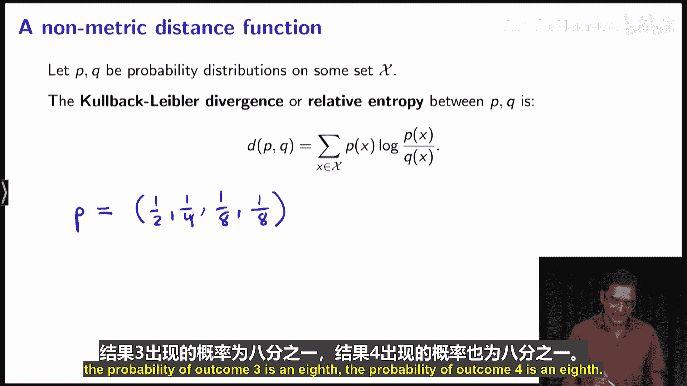

And another probability vector over， these four outcomes might be。A sixth， A third， A third， A sixth。

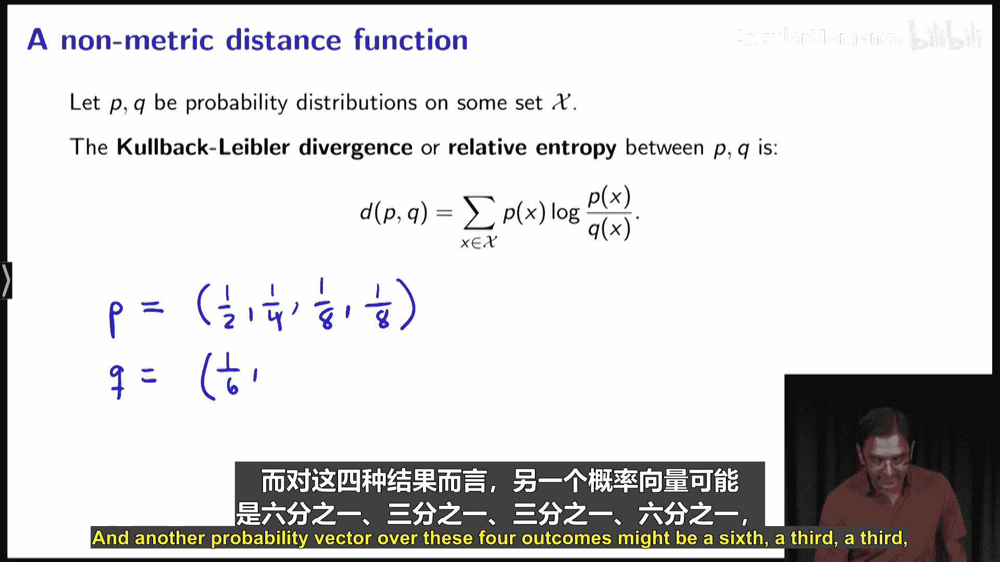

So how do we measure the distance between these two probability distributions？

Well one very natural way of doing that would be to simply look at the L1 distance between the vectors B and Q or the L2 distance。

And both of those are perfectly reasonable choices。But it turns out that in machine learning， very。

 very often， the distance measure of choice is the K L divergence。

Which a is summarized in this formula over here。 So let's see what that works out to in this case。

 So the distance between P and Q。Is the sum overall coordinates。

 so we' are now going to sum over the four coordinates。The first coordinate， we take a half log。

 a half over a sixth。So we're looking at the first coordinate over here。

We're comparing the two numbers， a half and a sixth。Now we look at the second coordinate。

 we get a quarter that's b of x log。P of x is a quarter。Over a third。Plus， an eighth log。

 an eighth over a third。Plus。1，8。Log1，8th over 16th。Very strange， okay。Now， thankfully。

 it turns out that this can never be negative。But that's about where the good news ends。 Okay。

 this is not a symmetric distance。 So the distance from Peter to Q is in general。

 not the same as the distance from Q to P。

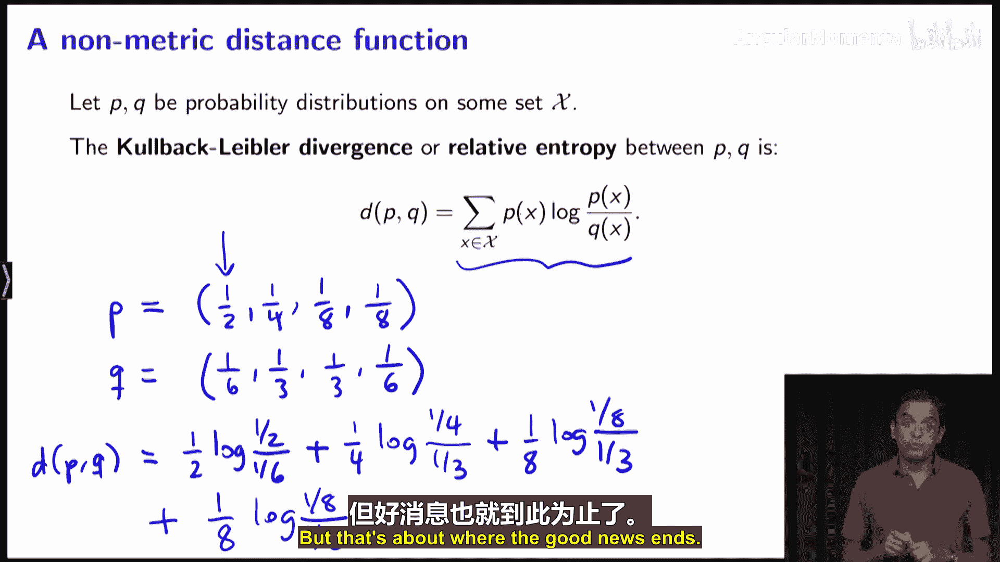

And it doesn't come close to satisfying the triangle inequality。Okay。

But it's a distance function we use all the time。Okay。

 so what we've done today is to talk a little bit about distance functions and to be honest。

 we've really just scratched the surface in terms of organizing the space of possible distances。😊。

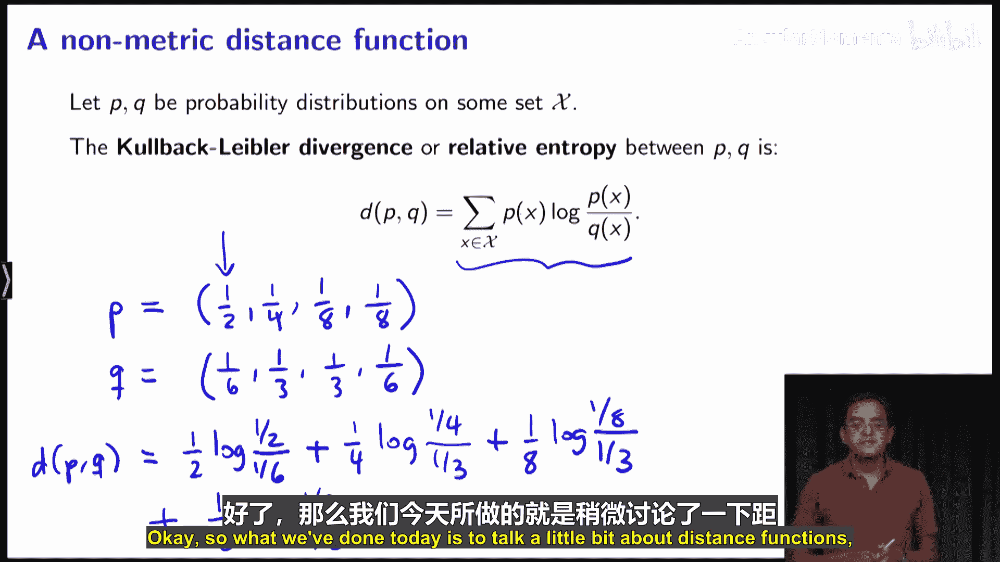

Now complementary to distance functions are similarity functions。

And that's something that we'll be seeing a lot more of later on in the course。

