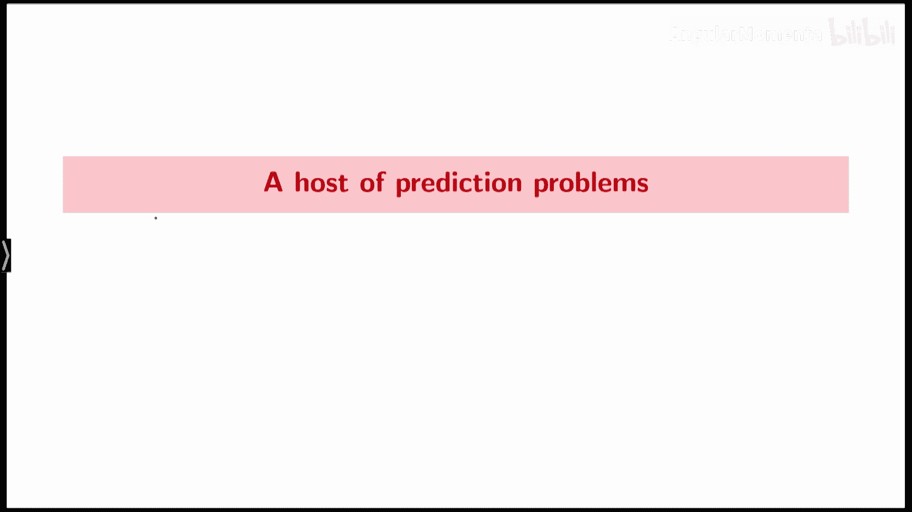
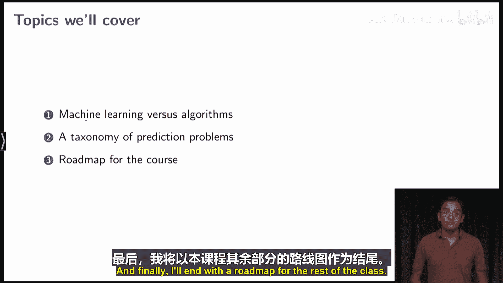
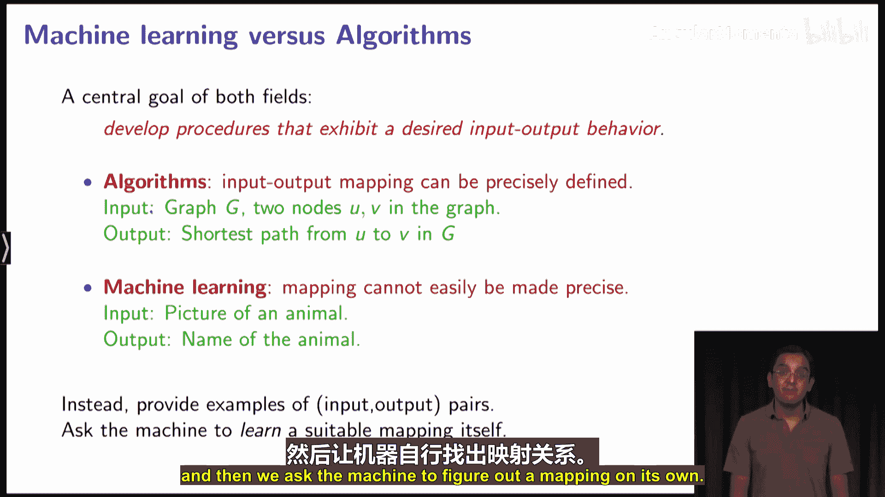
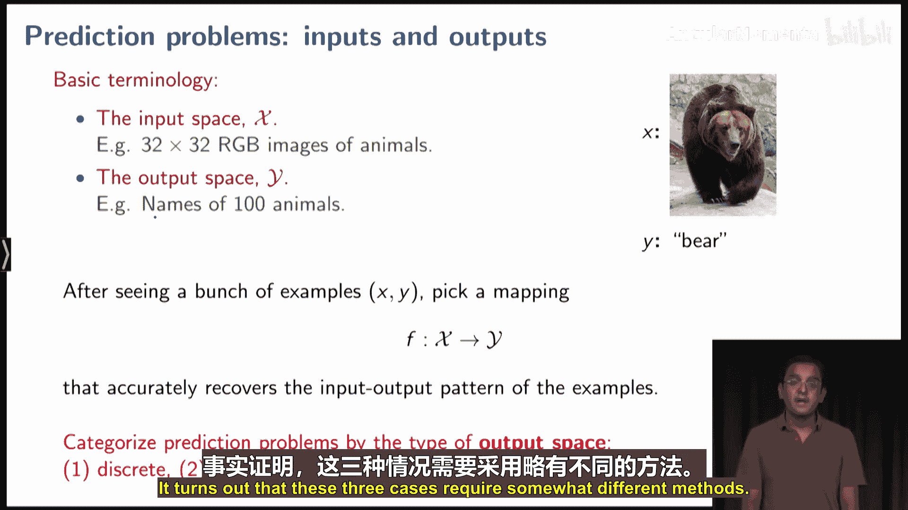
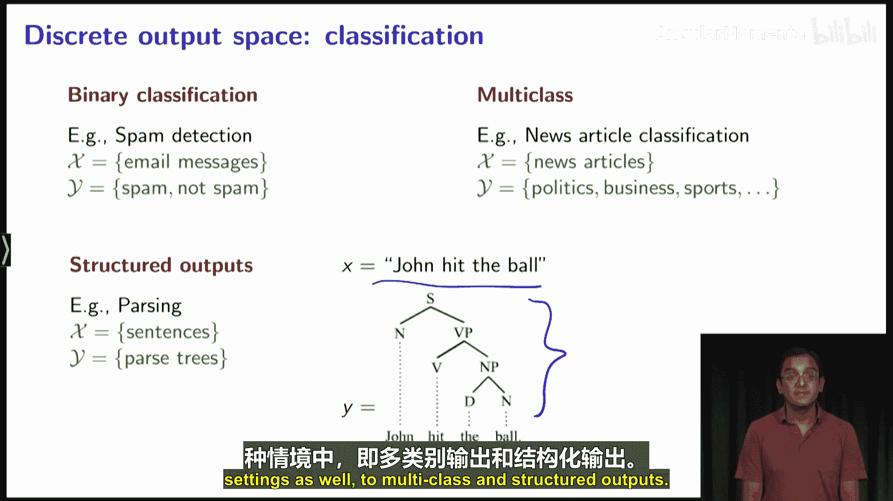
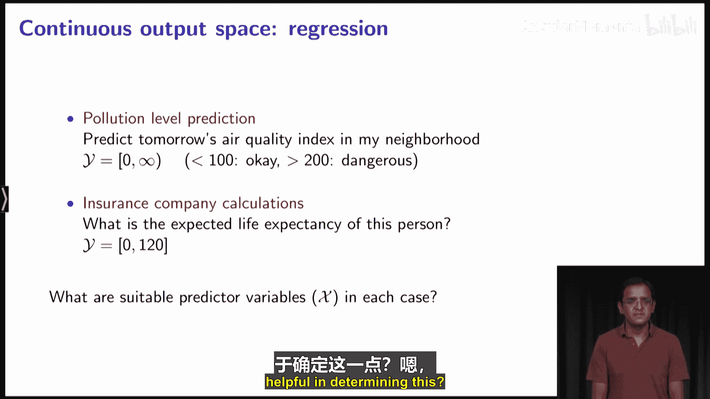
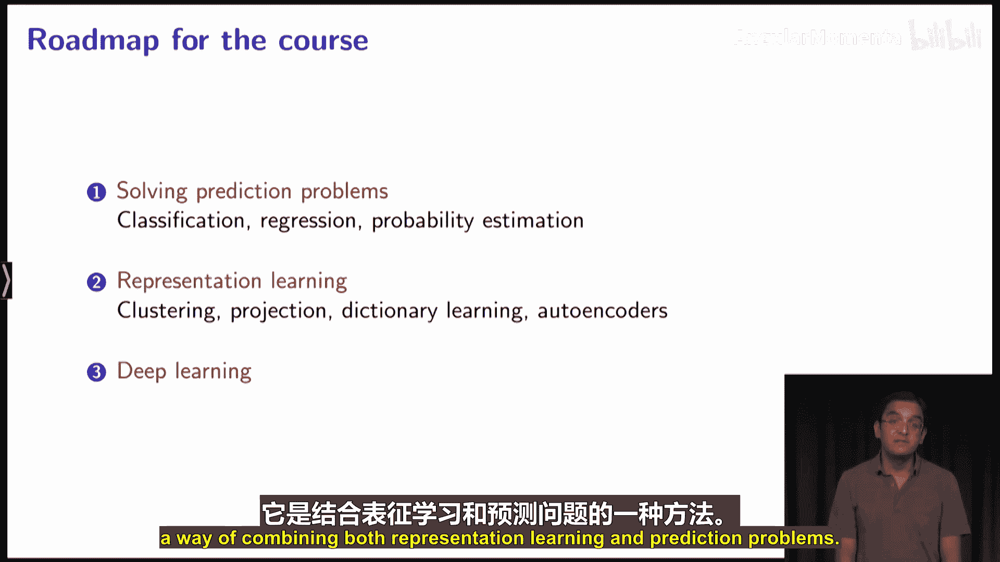

# 【加州大学圣地亚哥分校】机器学习基础  Machine Learning Fundamentals p06 02-05-02-预测问题 -BV1TyFSziEZb_p6-

Our very first concrete machine learning problem was classifying handwritten digits。

This is an example of a prediction problem。What I want to do today is to take a step back and to talk about prediction problems in a slightly more general and abstract way。

So we'll begin with a few remarks about the difference between machine learning and algorithms。

I'll then formalize the notion of a prediction problem and talk about a way in which we can organize this space。

 And finally， I'll end with a road map of the rest of the class。

Okay， machine learning versus algorithms。So in today's computer driven world。

 two core technologies on machine learning and algorithms。

What what is the similarity or difference between these？Well， interestingly。

 it turns out that both fields have a common central goal， and that is to develop procedures。

 little pieces of code。That exhibit a desired input output functionality。In algorithms， for example。

 people have spent decades looking the good ways to find shortest spot in grouts。

So the input is a graph along with two nodes in it。

And the desired output is the shortest path between those two nodes。

An algorithm is a precise set of steps that leads from the input to the desired output。

In machine learning， we also want to come up with procedures that go from an input to a desired output。

But the sort of problems that we are dealing with are of a different nature。

 so that it is very hard to list a precise set of steps that will get us to that output。Okay。

 so for example， let's say the input is the picture of an animal and the desired output is the name of the animal。

What are some precise steps？That will do this for us。 It's hard to imagine。In fact。

 the problem isn't even precisely defined。And so rather than try and come up with the algorithm ourselves。

 what we do is to collect a whole bunch of X Y examples of input output pairs。

 and then we ask the machine to figure out a mapping on its own。

So this is a prediction problem。There is an input space。 We'll always call it X。 for example。

 the space of all images of animals。And then there's an output space， for example， names of animals。

We have， in mind， some。Desired mapping from inputs to outputs。

 But it's not something that's possible for us to necessarily specify in a precise way。

And so we collect a training set of XY examples。The learning machine takes this training set and uses it to pick a mapping from X to Y。

A function thats the image of an animal and returns the name of the animal。

Or it returns the name that it believes to be correct。Typically。

 the way a learning algorithm works is by looking for a function。

 a mapping that does well on the training set。Good。Now there are many。

 many different types of prediction problems out there。

And one way in which it's common to categorize them is according to the type of output space。

 and there are three cases that we typically distinguish。When the output space is discrete。

When it's continuous and when it consists of probability values。

 it turns out that these three cases require somewhat different methods。

So let's look at the first case。So this is when the outputs are discrete。😊。

And this is a case that we call classification。 The simplest setting is binary classification。

 where there are just two possible outputs， good or bad plus or minus， yes or no。In spam detection。

 for example。The inputs X are email messages， and the desired output is just spam or not spam。

 There are just two choices。 It's binary。In very often， in classification problems。

 there are more than two possible outputs。 So， for instance， maybe the input is a news article。

 and the desired output is the subject matter of the article， politics， business， technologies。

 sports， entertainment， et cetera。 Okay， So that's called multi class classification。

And there are also cases in which the desired output is discrete。

 but it's something more complex that has some combinatorial structure to it。In passinging。

 for example， the input is a sentence like John hit the ball。

And the desired output is the parse tree for that sentence。 So this entire object over here。

So the output space is still finite。 It's still discrete。

 but it's more complex than it has a certain kind of structure to it。

What we'll be doing is devoting a large amount of attention to binary classification because this is a nice and simple setting in which to study prediction problems。

It'll then turn out that the methods we develop can generalize quite easily to the other two settings as well。

 to multi class and structured outputs。

Okay， so we've been talking about categorizing prediction problems by the type of output space。

 so when the outputs are discrete we call it a classification problem。

When the outputs are continuous， then we have a regression problem Okay so let's look at a couple of examples。

So the first example here is。Suppose we want to predict the pollution level tomorrow and we're interested in this because for instance。

 it will help us decide whether we are going to let the kids go out tomorrow or whether we should keep them indoors。

So how does one measure pollution level？😊，Well， one common way of doing it is by something called the air quality index。

 So this is a number， you know。A positive number， if it's less than 100 means the air quality is not too bad。

 if it's more than 100， that means that it's not good and if it's more than 200。

 it means that the air is absolutely dangerous。Okay。

So the output space now consists of positive numbers。 It's a continuous space。

Even if we only predict integer values， we still think of it as a continuous space because。

 for example， a prediction of 100 is very close to a prediction of 101 or a prediction of 102 and is very far from a prediction of 200。

 In other words， the wise lie on a scale。Okay。Let's look at another example。

 insurance company calculations。So one of the things that an insurance company is interested in when you apply for a policy。

Is how much longer do they expect you to live。Okay。And this determines， for example。

 how much they would charge you。So here， the number we want to predict。

 the y is the age at which you're going to die okay。

 and so let's say it's something in the range 0 to 120。And again。

 this is something that we could always round to the nearest integer。

 but we still think of it as a continuum because these numbers lie along a scale。Okay。

Now one interesting question is what？You know， just to sort of think about is。

What are suitable predictiveor variables for these kinds of regression problems， Okay。

 so for example， life expectancy。What are the sort of variables or what are the sort of pieces of information that might be helpful in determining this。

Well， this is actually a very well studied area。And。

The sort of information that people use is your age。Your gender， women tend to live longer。

 whether you smoke or not。Do you have high blood pressure and are you taking medicine for it。

 Do you have high cholesterol， Are you taking medicine for it。

Do you smoke and a few other such things。Thank you。Okay。

 so the final kind of output space we'll look at is when the Ys represent probabilities。Okay。

 so here， the output space is literally the range0 to 1。Now。

 this seems a little bit like regression because it is a continuous range。

But it turns out that this particular case does require specialized methods。

 and so we tend to treat it separately。Okay， so an example here is。😊，Credit card for detection。 Okay。

 so X， the input。Consisted the details of a credit card transaction。Okay。

What is the amount of the purchase， What is being bought， What is the name of the merchant。

 What is the zip code and so on。And why here the output we wish to predict is what is the probability that this transaction is fraudulent？

Okay， so this is a probability estimation problem。One。

One thing one interesting question over here is why not just think of this as binary classification。

 Why are we trying to predict the probability， Why not just say there are two possible labels。

 fraudulent or legitimate， and that's what we want to predict。So that's a good question。

It turns out that。It turns out that the reason we want to use probabilities is because the results of this prediction are going to be used。

As part of a larger decision making framework。And it's just one of the pieces of information that go into the decision。

So， for instance。If a transaction has got a high probability of being fraudulent， then， of course。

 the transaction should be denied。But if the transaction has a low probability of being fraudulent。

Should it be denied or not if， if it has just a small but significant probability being fraudulent。

Should we accepted or deny it。 Well， it might depend on other factors like the amount of the transaction。

 It's just a small transaction。 Then maybe it's O to take the risk。If it's a large transaction。

 then it should probably be denied。 So there are many factors that go into the decision。

 and in order to assess the risks correctly， it's very useful to have not just a binary prediction。

 fraudulent or legitimate， but an actual probability value。Okay。

 so we've been talking a lot about prediction problems。

 and indeed this is the bread and butter of machine learning and we'll be spending a lot of time on this in the course。

Is there anything other than prediction problems？Well。

 very often we receive a data set and we want to understand it better。

And don't necessarily have a specific prediction task in mind。We just want to know。

 is that interesting structure in the data are there clusters in it， for example。

So the sort of topics that come under this， which we can call representation learning。

Ts like clustering， projection， dictionary learning， and so on。

And we'll spend a little bit of time on this。And we'll end with deep learning， which is in a sense。

 a way of combining both representation， learning and prediction problems。

Okay， well， that is a。Little bit of an overview of the course。 Hopefully it's clear what lies ahead。

And next time， we'll begin with a systematic treatment of classification。

