# 【加州大学圣地亚哥分校】机器学习基础  Machine Learning Fundamentals p09 03-03-02-一维生成模型 -BV1TyFSziEZb_p9-

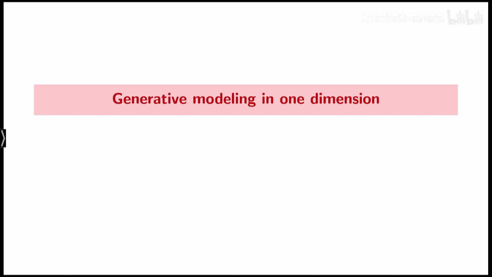

So we've talked a little bit about the generative approach to classification and today we'll put it to use。

We look at a simple one dimensional data set， which has three classes in it。

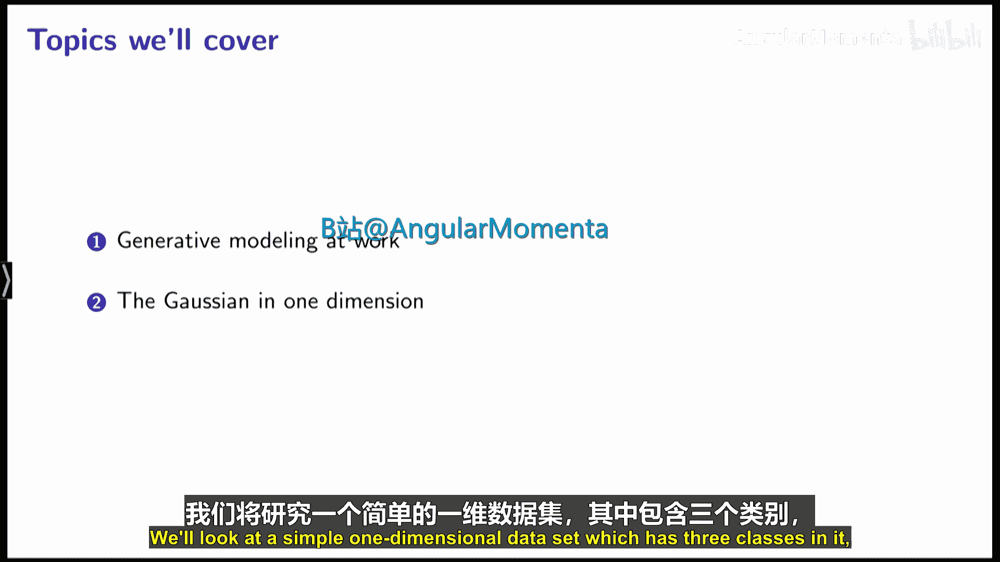

And we'll see how we can classify this data by fitting a Gaussian distribution to each of these classes。

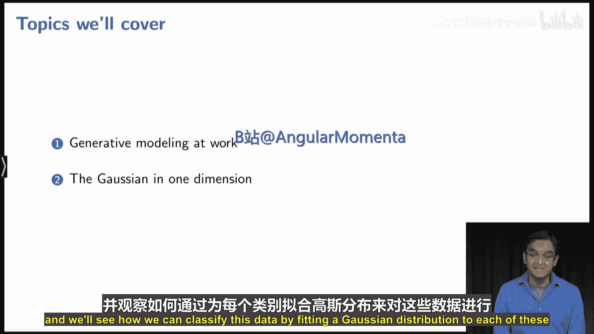

So here's the problem that we're dealing with。We have a bottle of wine and we like it。

 but its label is missing， and so we want to figure out which winery it is from， one， two or three。

We're going to take the machine learning approach and we'll measure some visual and chemical features of the bottle of wine and use this to predict the label1。

2 or3。

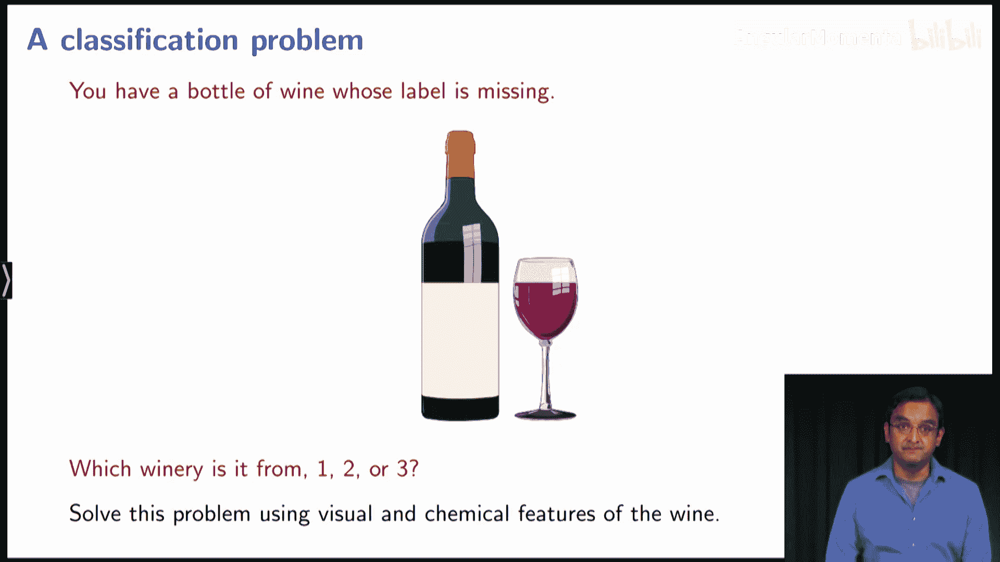

Now we have a training set to help us。And this training set was obtained from 130 bottles。

43 of these bottles were from winery 1，51 from winery 2， and the remaining 36 were from winery 3。

For each of these barholes。A data point was measured。Consisting of 13 features。 Now。

 these are features that make sense to wine experts。

 things like flavoroids and proline and magnesium levels。 Okay， but there are 13 such features。

And so the data points are essentially 13 dimensional vectors。

So we are going to use this data to build a classifier that takes the features from a new bottle。

And predicts the label 1，2 or3。 And there's also a separate test set with 48 labeled points that we can use to evaluate how good our classifier is。

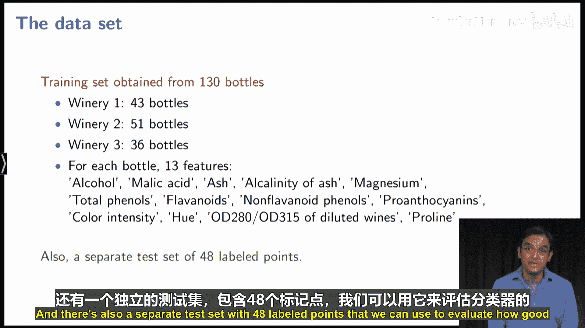

Okay。So let's quickly recall the generative approach to classification。

So what we need to do here is to fit a distribution to each winery individually so for winery 1。

 we fit some distribution， say P1 of x for winery 2， we fit a distribution P2。

And we have a distribution P3， which captures the data from winery3。We also need to know。

The probabilities of each of these labels。 So what percentage of the data。

 what percentage of bottles come from winery 1， That's by  one。

 What percentage of bottles come from winery 2， That's by 2 and by 3。 Okay。

 so these pies add up to one。And once we have all this information， that's our model。

When we get a new bottle of wine， X， we get its feature back to it， that's the x。

And the class we predict 1，203 is simply the class that maximizes phi J times pj of x。Okay。

 so in this case， because there are three classes， we simply compute by 1 times p1 of x。

And then we compute pi 2 times p2 of x。And p 3 times p3 of x。

And we take whichever of these is the largest。 Why do we do that exactly？ Well。

 this is a direct consequence of Bays rule。 Okay， so we have this new bottle whose features are X。

 We want to know what its label is。

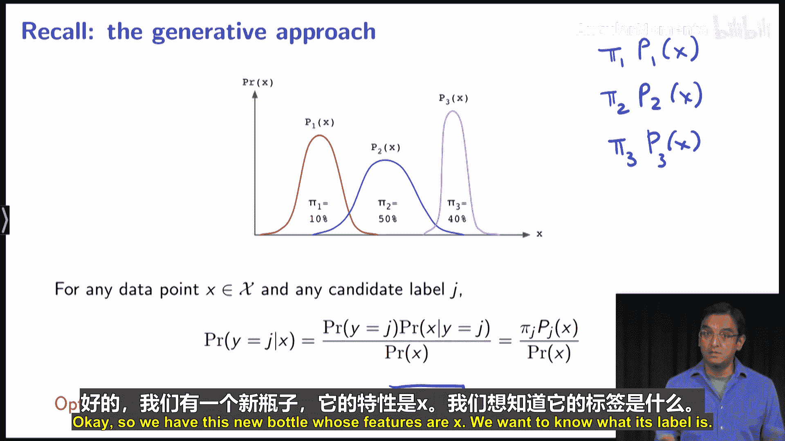

And so the label we are going to pick is the most likely label given X。

So what is the probability that the label is J given the specific feature is x using Bays rule。

 it's the probability of having label J。Times the probability of seeing X in label J。

Divided by the overall probability of seeing x。 so the probability that the label of J is J is just p sub J。

The probability that we would see X amongst the bottles from winery J。Is Pj of x。

And the denominator doesn't depend on Jay at all so we can ignore it。

So we are simply going to pick the label J that maximizes this equation over here。

And that's the generative approach。Okay。

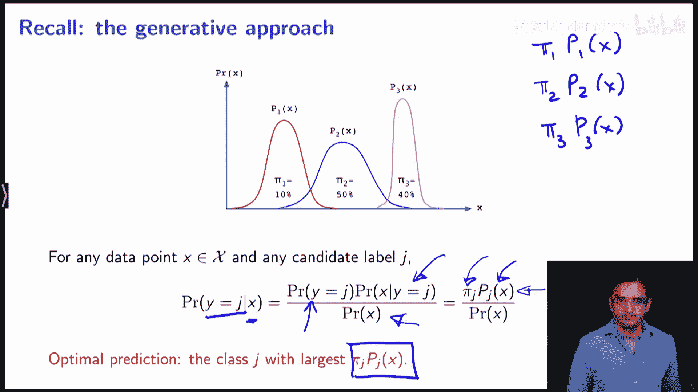

So let's go back to the data now。Right， so this is a summary of our data set。

 and the first thing we need to do is to figure out the probabilities of each of the individual classes。

So out of the 130 bottles， 43 of them are from winery one。That means the probability of winery 1。

 the weight of winery1 is 43 over 130。So P of 1， the weight of binaryry 1 is 43 over 130。

 which is about 0。33。Out of the hundred and 30 training bottles，51 are from winery， too。

So the probability of winery 2 is 51 over 130， which is 0。39。

And likewise the probability of winery 3 is 36 over 130， which is 0。28。

 and as you can see that these three numbers add up to 1。Good。So that balls easy and in general。

 fitting the class weights is very easy， almost trivial。😊。

The harder part is fitting a distribution to each class。Now， in this case。

 the data consists of 13 features， so it's a 13 dimensional data set。

 so we need a distribution over 13 dimensional space。We haven't yet seen how to do that。

And so let's just simplify things for the time being。And just pick one feature out of the 13， so。

We have these 13 features， we're just going to pick one of them。

Let's just go ahead and choose alcohol level as our feature。

And so we've now reduced the data to just one dimension。And we're curious。

 how well can we predict the winery using alcohol level alone。Okay。Good。

 so now we need to fit one distribution to the alcohol levels from winery  one。

Another distribution to the alcohol levels from winery 2 and a third distribution to the alcohol levels from winery 3。

What one dimensional distribution should we use？ Well， the default choice is the Gaussian。 Okay。

 so let's look at it。

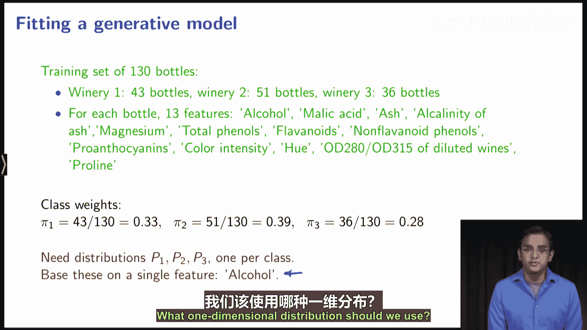

The Gaussian， in one dimension， is just the familiar bell curve。

It's a distribution that is specified by just two parameters， a mean and a variance。

I'm going to be denoting the mean by the Greek letter mu。And the variance。By the Greek letter。

 sigma squared。Okay， so the mean is mu。I'm just going to emphasize it by rewriting it。

And the variance is sigma squared， which means that the standard deviation is sigma。

We're going to refer to this distribution by using the shorthand。N of mu sigma squared。

The Gaussian with mean mu and vary sigma squared， the n stands for normal。

 and people call it that because a lot of data looks like this。

Now this particular distribution is a distribution over real numbers。

 its density is given over here by this formula。The density might look a little bit messy or complicated at this point。

But believe me， it will start seeming a lot more familiar as time goes on。

So what can we say about the distribution？So first of all， it is centered at the mean mue。

That's right here。It's symmetric about the meme。About two third of the distribution lies within one standard deviation of the mean。

About 95 per cent of the distribution lies within two standard deviations of the mean。 Okay。

 so it's a distribution that's fairly well concentrated about its mean。

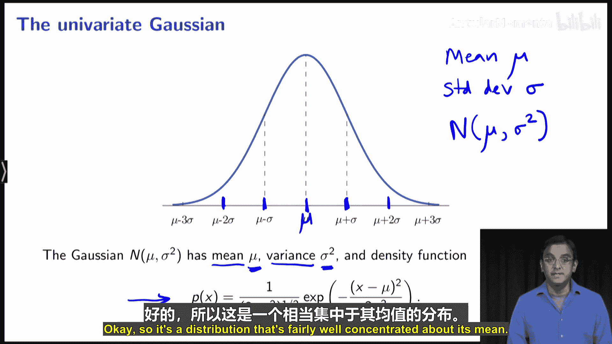

And these are the distributions that we're going to be using。Okay， so we need to fit a gause here。

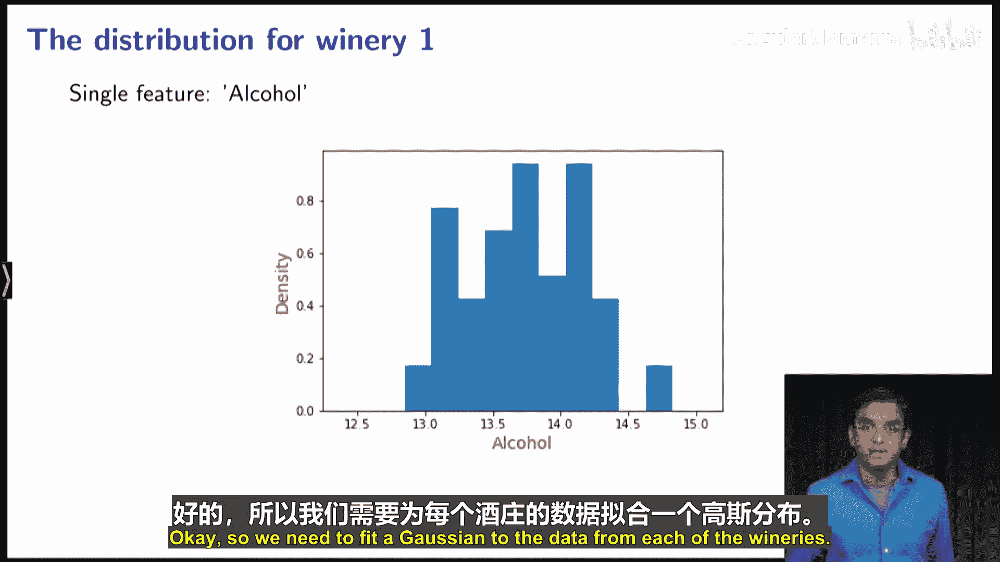

To the data from each of the wineries， Let's start from winery number one。 Okay。

 so we are using just one feature， alcohol。 And if you remember， we had 43 bottles from this winery。

 So we have 43 numbers，43 alcohol levels。And what I'm showing over here is just a histogram plot of these numbers。

As you can see， it's very jagged as a histogram always is if you have very few data points。

So how do we fit a Gaussian to this， Well， to fit a Gaussian wely to figure out the mean and the variance。

 So we take our 43 numbers， the 43 alcohol levels， and we compute their mean。

 and we compute the variance。 That's very quick。 It's just two lines of code。And what do we get？

This is the distribution we get。 the mean turns out to be 13。72。The standard deviation is 0。

44 so sigma is 0。44， which means the variance is the square of that Sigma squared is roughly 0。2。

And this is what the distribution looks like。 This red line is the density that we fit for winery。

 number one。As you can see， it's a nice smooth distribution compared to the lumpy mess that we started with。

Okay。So this will beve done for winery 1， and we're just going to go ahead and do exactly the same thing for winery2 and winery 3。

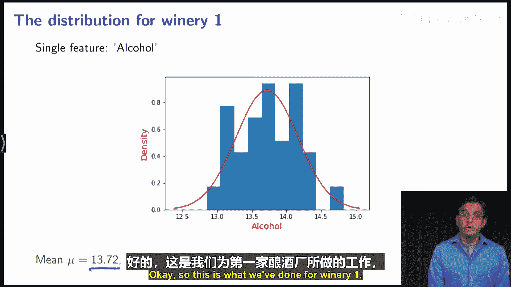

And this is the result， Okay， so we already talked about minor1。For winery too， it turned out that。

I think we had 51 bottles， So 51 numbers。 and their mean was 12。3。And the variance was 0。28。

And for binaryry 3， the mean was 13。2 and the variance was 0。27。 Okay。

 and you can see the three curves over here。诶。These are P1， P2 and P3。

 the distributions for each of the three classes。Okay。Now。

 are these distributions nicely separated from each other。No， not really。 In fact。

 they're kind of on top of each other。And this really gives us a hint that using this one feature alone。

We are not going to be able to classify wineries very accurately。

 but let's go ahead and see what we get anyway。So given all this information。

 given the stuff in this given these pies and this P1 P2P3。

 how do we classify a new bottle of wine okay？So we get a new bottle of wine。

 we measure its alcohol level x。And then we pick the answer J 1，2， or3。

 for which pi J times pj of x is the highest。 Okay， so for example。

 let's say that our new bottle of wine has an alcohol level of 15。 so it's over here。

Which one are we going to pick？Well。The black and green ones that's wineries 2 and3 have almost zero density at that point。

 so we're going to pick the red one， winery number one。

What if the bottle of wine has an alcohol level of 11。Then we would pay winery number two。

 the black one。What if it has an alcohol level of something like 12。5 over here。What will we pick。

 Well， we wouldn't pick the red1。 We'd pick either the black or the green。Okay。So。

So this is a case in whichry 2 and winery， winery 3， those two distributions。

 P2 and P3 have roughly the same density。So which one would we pick？Well。

 we would pick winery number2 because it has the higher class weight。 Okay， so remember。

 we are multiplying these two numbers together。So in that case。

 if the alcohol level is something like 12。7， we would end up picking winery number two。Okay。

 so we do all this and what kind of performance do we get？It turns out that the test errorss。

 we had a test set of 48 points。This misclassifies 14 of them。 And so the death error is 29 per cent。

That's not very good， but it's way better than random。Okay。Well。

 so we have seen our first classifier using the generative approach。

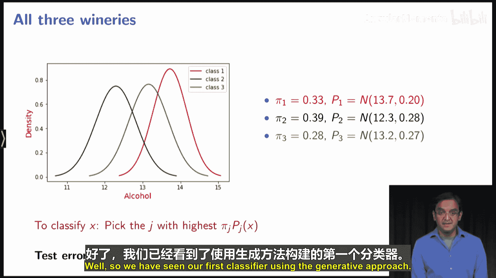

Its performance was somewhat mediocre because it was based on a single feature。

When we throw in a lot more features， we'll be able to improve its performance dramatically。

But in order to see how to be able to do this， we are going to delve a little further into probability。

