# 【加州大学圣地亚哥分校】机器学习基础  Machine Learning Fundamentals p10 03-04-02-概率论复习（二） -BV1TyFSziEZb_p10-

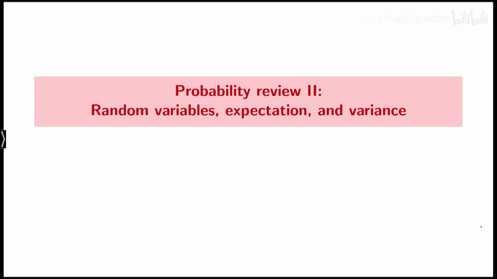

In our first probability review， we talked about the notion of a probability space。

So now we are ready to move on to the next major concept， which is that of a random variable。

What exactly is a random variable and how do we compute their expected value。

 variance and standard deviation？

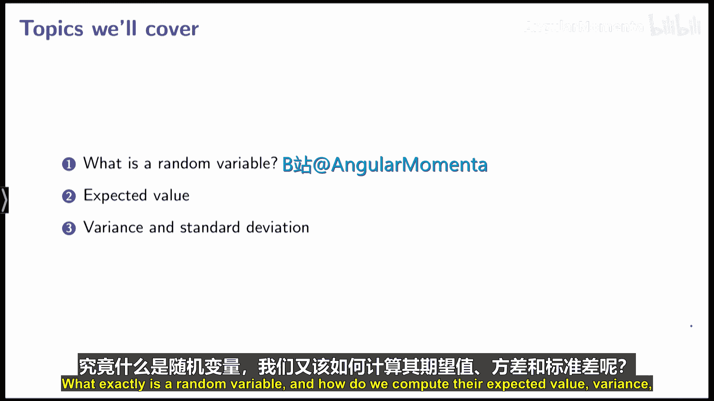

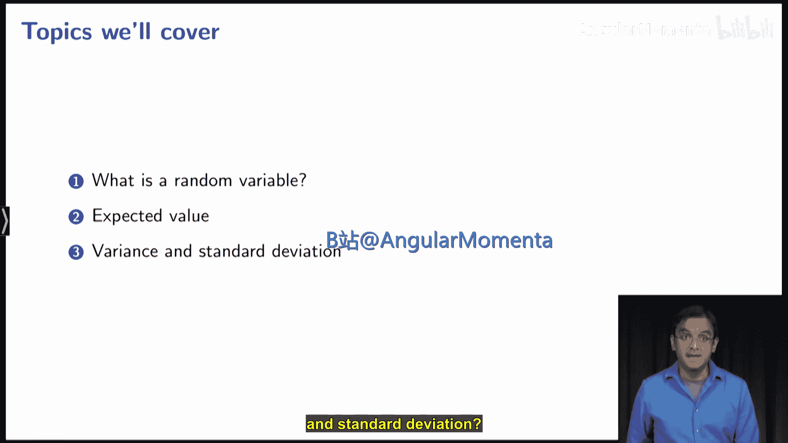

So as usual， let's start with an example。So suppose you roll two dies。

And you're interested in their sum。 Let's call this X。 Okay。

 so you aren't interested in exactly what die 1 comes out to or die2 comes out to。

 just in what their sum is， just in what they add up to。So for example。

 if the first die is1 and the second is1， then x equals 2。If the first die is1 and the second is2。

 the next equals 3 and so on。

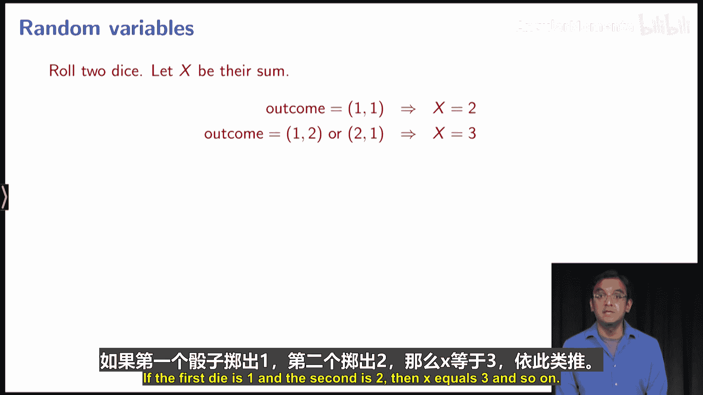

So this is a situation where the probability space has 36 different outcomes。

 six choices for the first die and six choices for the second die。

But we are only interested in a particular aspect of this outcome。The sum of the two die。

And this aspect， which we call x， can only take on 11 possible values。2，3， all the way up to 12。

X is a random variable。In general， when we have a probability space。

 a random variable is any function of the outcome。It captures some aspect of the outcome that we care about。

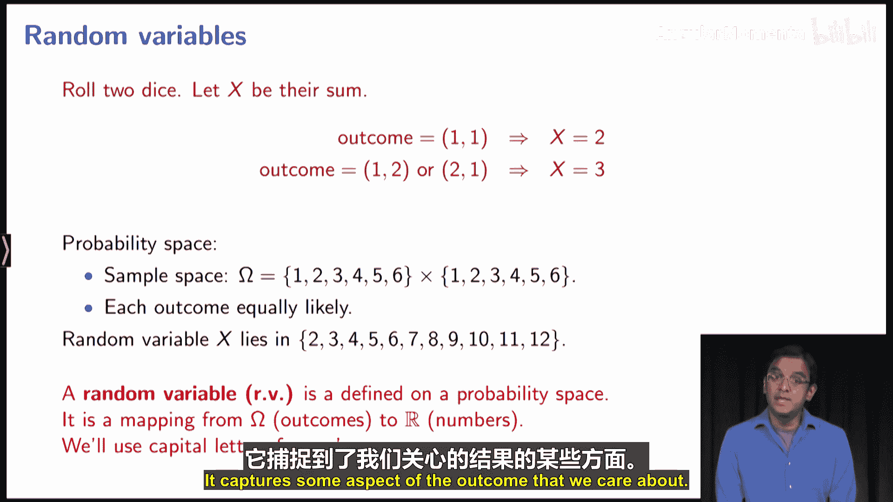

That's it。

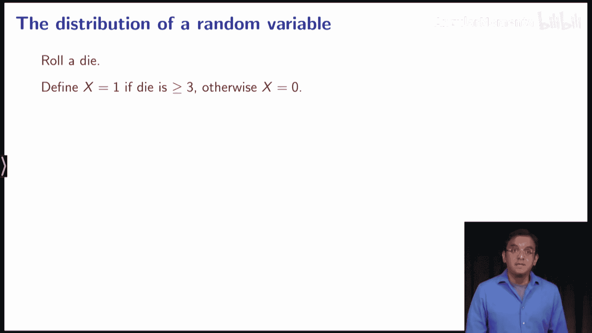

So let's see how we can determine the distribution of a random variable from the information in the underlying probability space。

 Okay， so here's another simple example。We roll the dye。

And this time we don't care about exactly what the die comes out to。

All we care about is whether or not it's greater than or equal to three。Okay。Given our interest。

The way we define a random variable is we say， okay， we have x。

 and we are only going to have it take on two possible values。

 We'll say x is1 if the die is greater than or equal to 3 and otherwise x is 0。

So the random variable we've defined in this case。

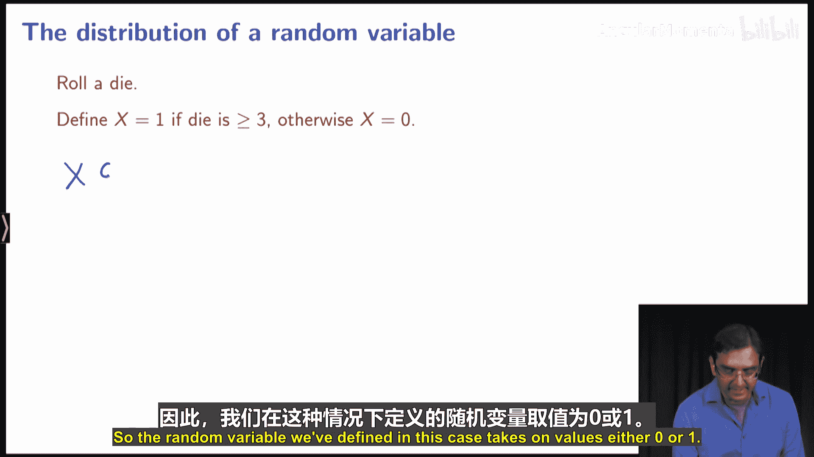

Takes on values， either 0 or 1。Yeah。And let's go ahead and compute its distribution。

The probability that x is 0。Is the probability？That this die comes out to either one or two。

Which is a third。And the probability that x is1。Is simply the probability that the die comes out to three。

 four， five or six。Which is two3。Okay。And in this way。

 we can out a distribution we can figure out the distribution of a random variable just by looking at the underlying probabilities of outcomes。

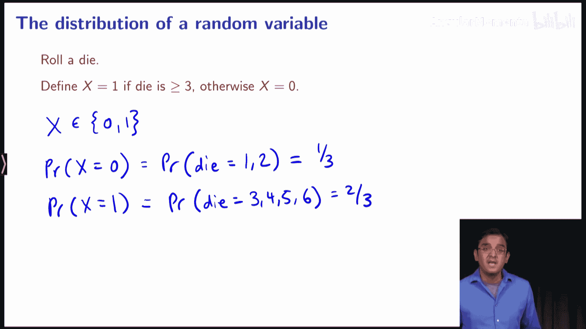

Now， once we have a random variables distribution。The next order of business is usually to compute the expected value of the random variable。

 also known as its mean。So the expected value of x is simply the average value of x if we were to repeat the experiment over and over and over again。

Okay， so it is a weighted average of all the possible values that x can take。

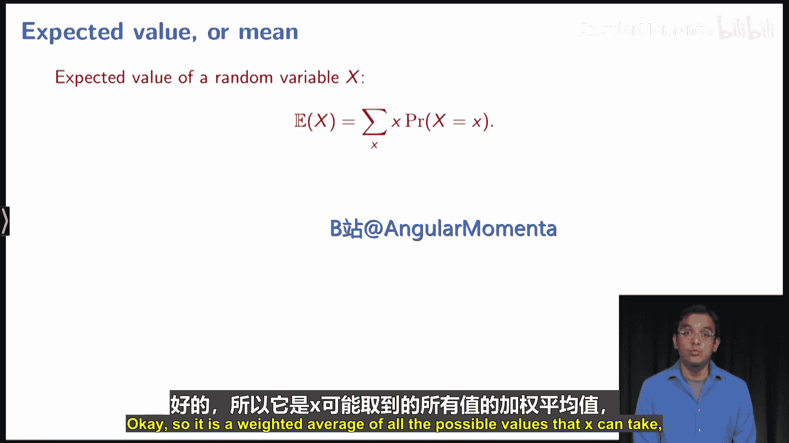

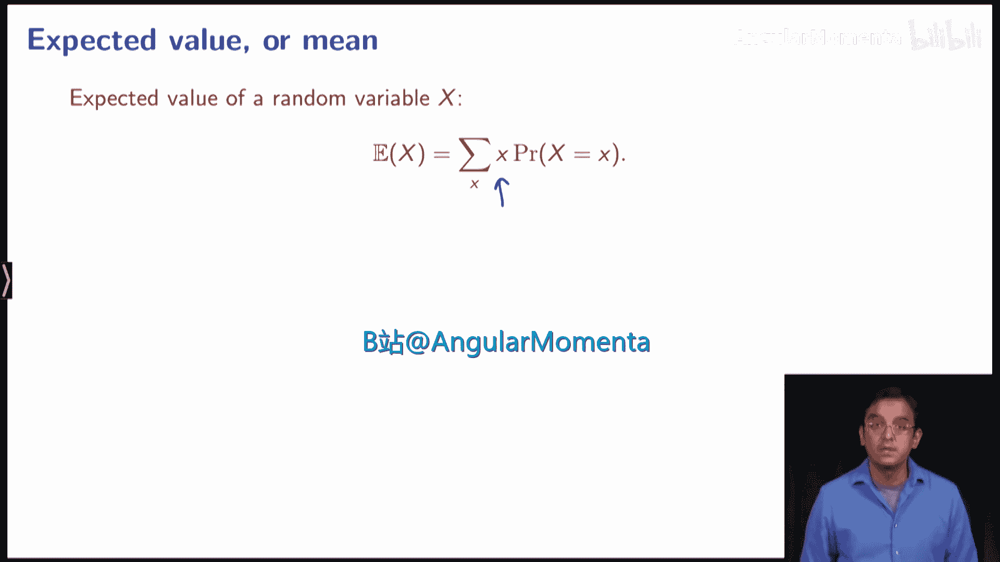

Where each value is weighted by its probability of occurring。

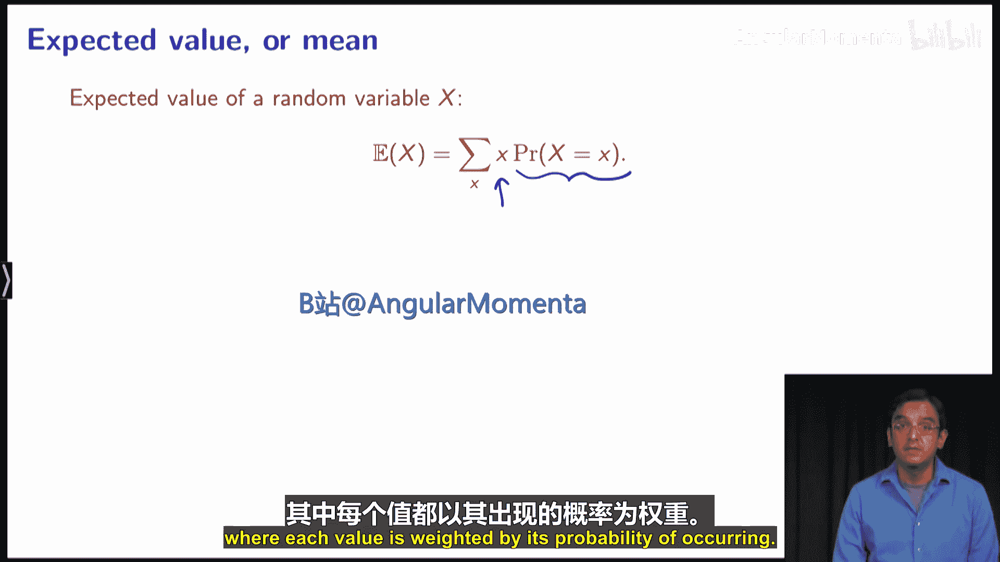

So it's a simple formula。And let's see it in use， let's look at a simple example。So we roll a die。

 let x be the number observed， what is its expected value， so in this case。

 x is something that takes on values 1，2，3，4，5 or 6。

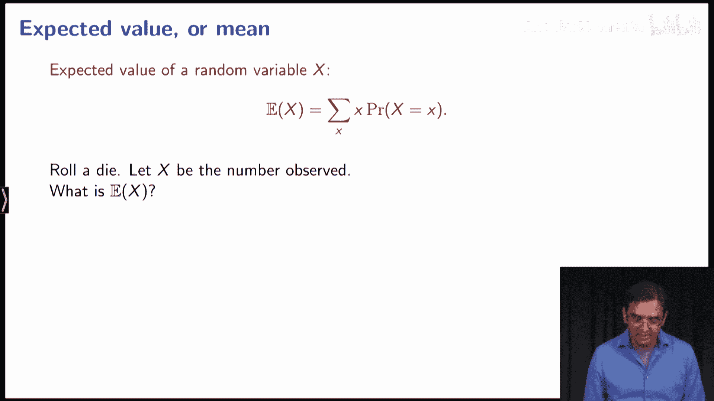

And so the expected value of x。Plugging into this formula。

Is simply an enumeration over all its possible values， so it takes on value1 with probability 16。

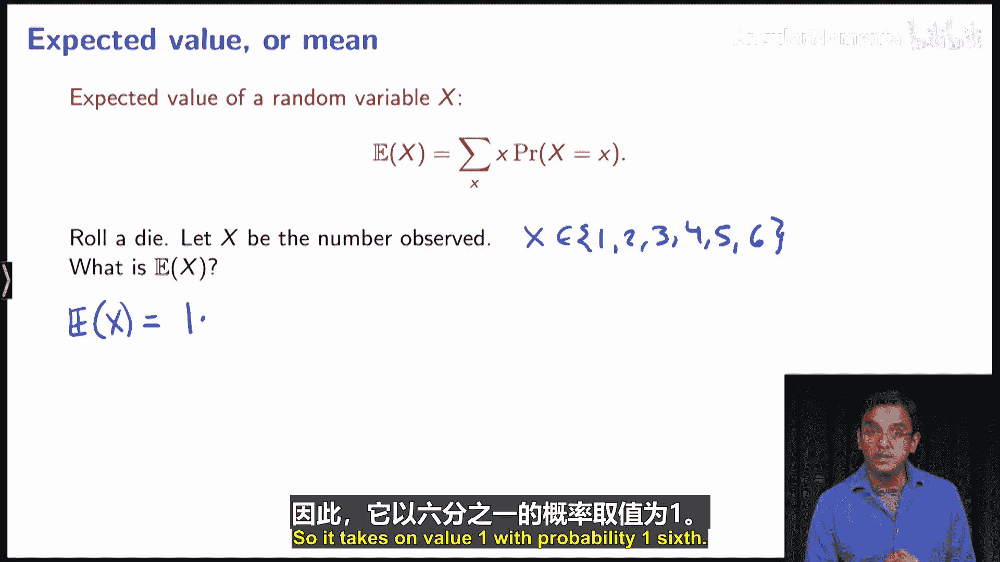

It takes on value 2 with probability 16。3 with probability 1，6。Four times1，6， five times 1，6。

 and six times  one6。

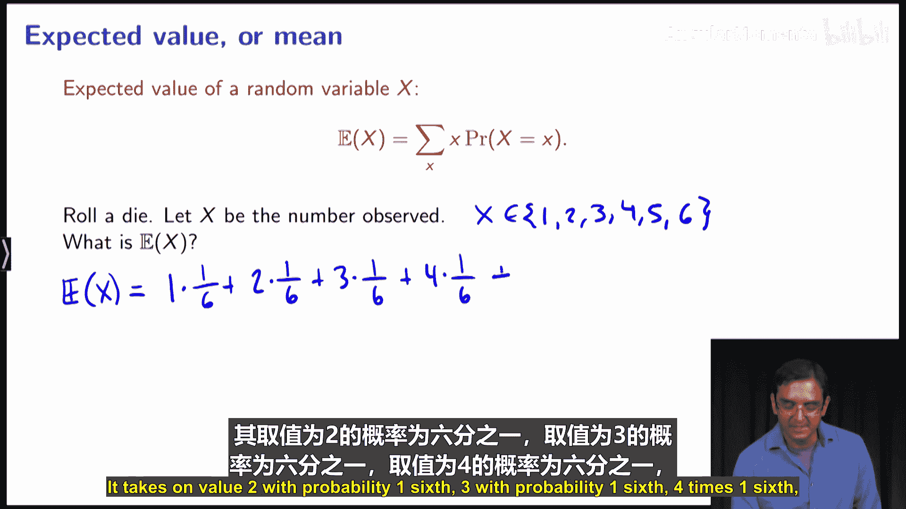

哎。And so you get the sum of numbers from one to 6， which is。21。So 21 over6。

 which is three and a half。

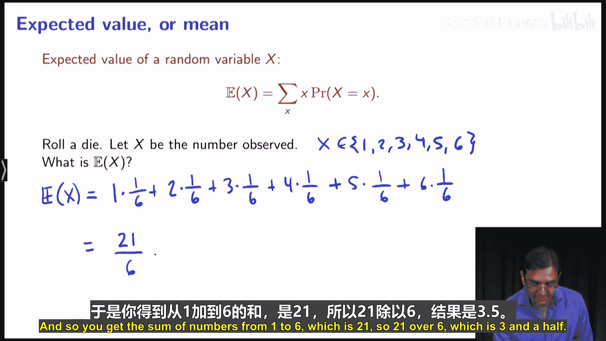

And so that's the expected value of x。Let's do another example。So this time you have a coin。

 but it's a biased coin， so the chance that it comes up heads is sum number P in the range here 1。

So you flip this coin。

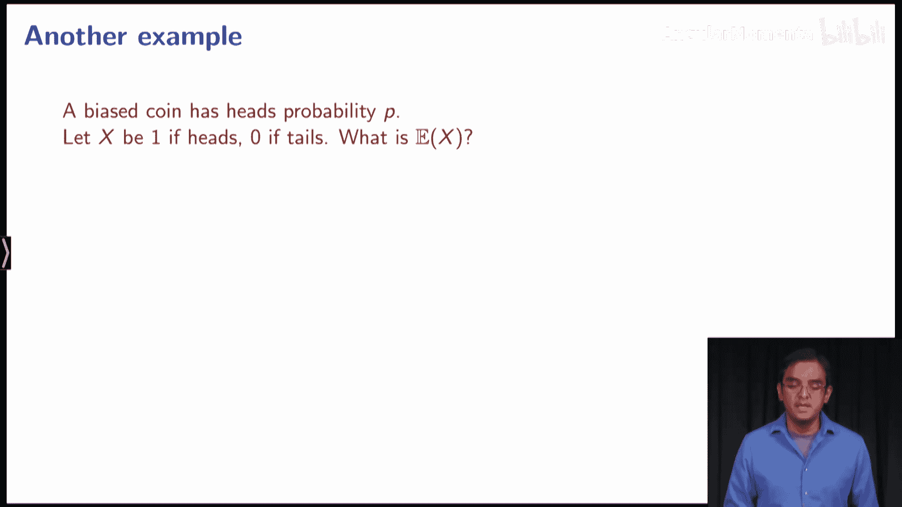

And the random variable is the random variable x is one if the coin comes up heads and0 if it comes up tails。

So what is the expected value of x？So once again， we just write out the formula。

 we look at all the possible values that x can take， it can take on the value 0。

Or it can take on the value1。The probability that it's 0 is 1 minus p。

And the probability that its' one is peak。

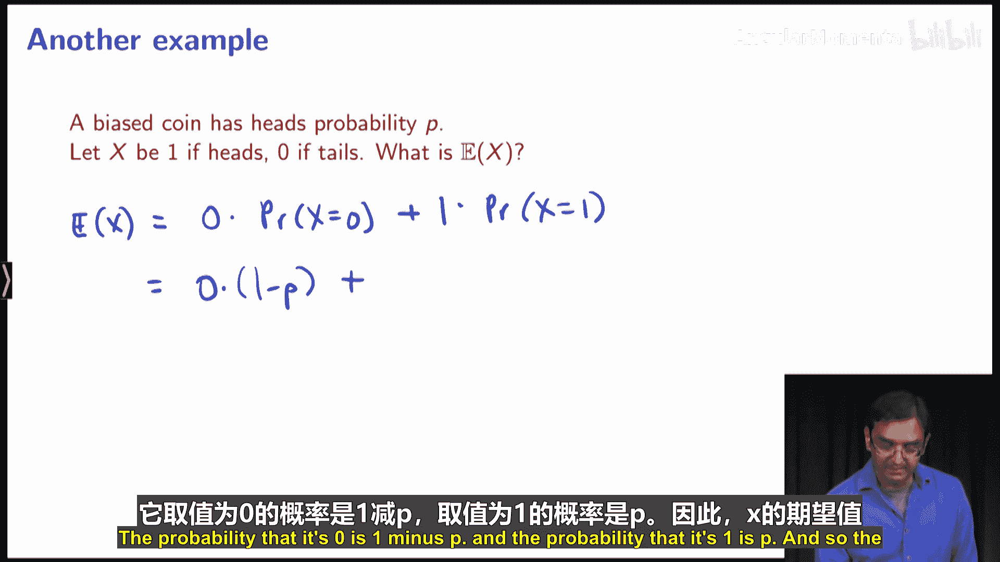

Until so the expected value of their existed。So now that we've seen some examples of expected values。

 let's look at a key property of these means。So suppose you have a bunch of numbers。

And you double all the numbers。 What happens to the average？ Well， if you double all the numbers。

 the average also gets doubled，What if instead of doubling the numbers。

 you increase every number by one？What happens to the average。Okay， so every number increases by one。

 then the average also increases by one。So let's summarize this in a slightly more general way。

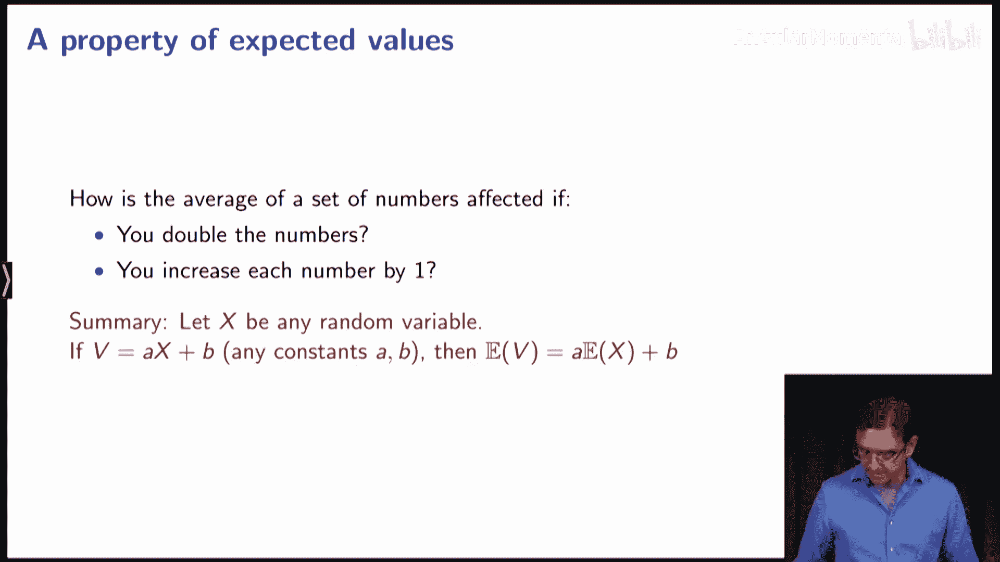

If you have any random variable x and you define a new random variable wheat V。

To be some constant times x plus some other constant， like 2 x plus 1。Or 4 x -3。

What is the expected value of V， What is the mean of V， Can you figure it out from the mean of x。

 Yes， it's simply the mean of x times a plus B。And this is a linearity property that helped simplify many calculations。

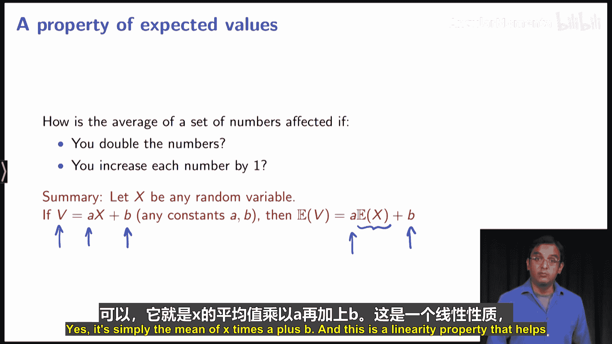

Now， in general， a random variable x can take on many possible values。

What if we just wanted to summarize the distribution of X by a single number？

What number would we pick， Probably its mean。Okay， so let's go ahead and denote the mean by the Greek letter mu。

どぞ。

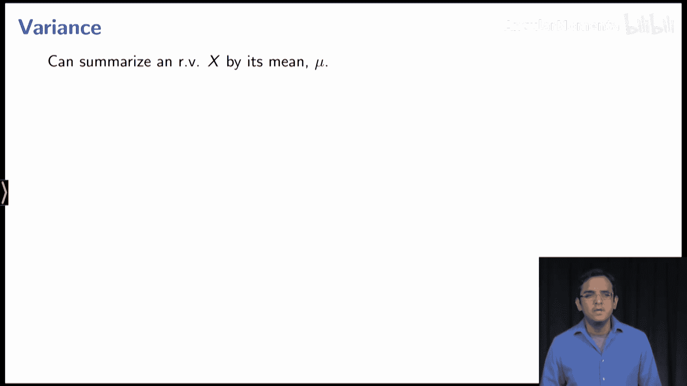

So this is a nice summary， this is a concise and useful summary。

 but one of the things that it does not capture is the spread of X。

So here's an example of two different distributions。嗯。They both have exactly the same mean mu。

But the one on the left。Is much more tightly concentrated around its mean。

 While the one on the right is much more diffuse。So they have the same mean。

 but their spread is very different。So the mean isn't capturing certain very important properties of the distribution。

What if we were allowed a second number with which to summarize the distribution？

Could we pick a number that somehow captures the spread。

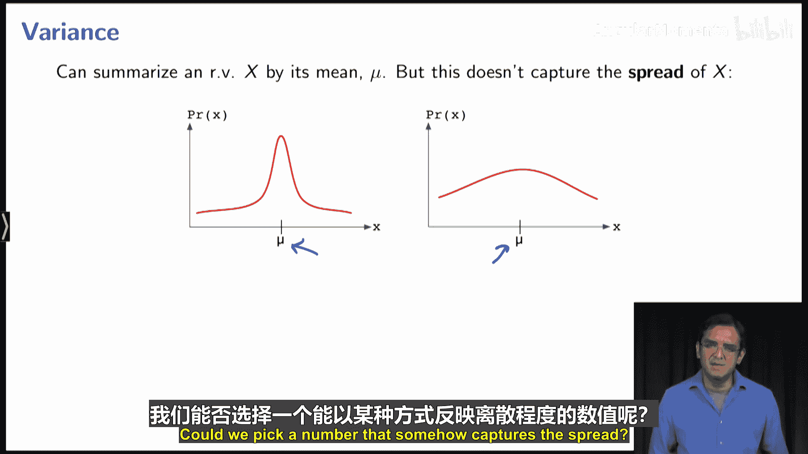

So here's an idea。Why not use the average distance from the main。手臂。Expected value。

Of the absolute difference between x and its mean。Okay， so in the distribution on the left。

The average distance of x from its mean would probably be something like this。

Whereas the distribution on the right， the average distance of x from its mean might be something like this。

So this would actually work very well。And we could certainly use it， and in fact。

 some people do use it， but it turns out that mathematically it's more convenient。

To look at the average square distance of x from the mean。And this is what we call the variance of X。

So the variance is the average square distance from the meanme。

And we'll see some properties of this in a second。Now， intuitively。

 what we do want is the typical distance from the mean rather than the typical square distance。

 and so what we end up doing is to take the square root of the variance。

 and this is the standard deviation of x。And the standard deviation behaves in the way we'd want it to in the left on the left。

 for example， the standard deviation would be something small， whereas on the right。

 it's something larger。

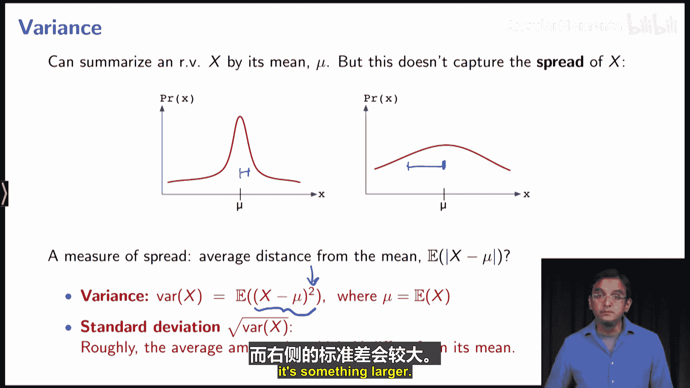

Okay。So let's see how we'd compute these quantities in a simple example。So we pick a random variable。

 x from 1，2，3，4，5。

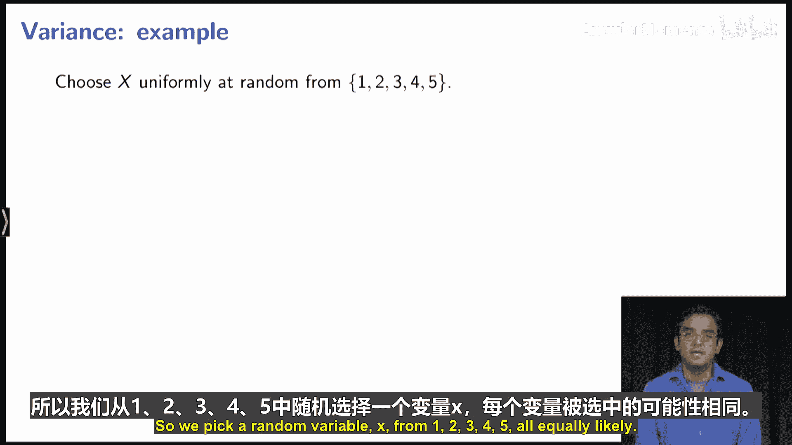

Or equally likely， what is the variance of x？So the first thing we need to do is to compute the expected value of x the mean。

And in this case， we'd expect it to just be the number in the middle， which is three。

But let's double check。 Okay， so we'll plug it into the formula。

The expected value of x is enumerate over all possible outcomes。 It's one with probability 1 fifth。

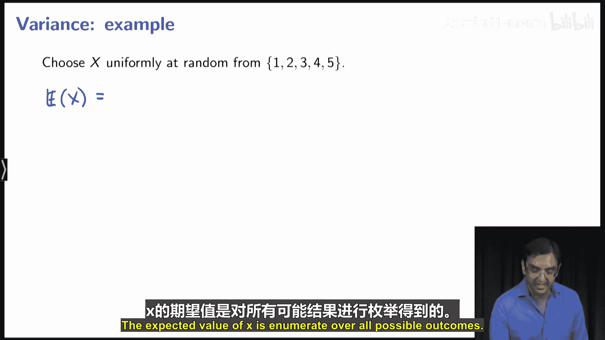

2 with probability of fifth。

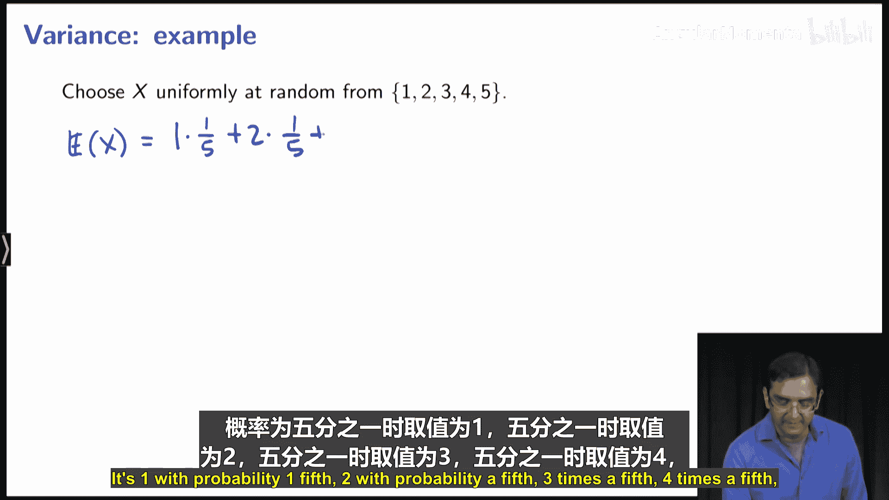

Three times a fifth， four times a fifth and five times a fifth。

And so you add up the numbers from one to five， so that is 9 and 315 over 5， which is 3 okay。

Which is exactly what we expected。Good， so now we have the expected value of x。

 this is what we've been calling mu。To compute the variance。We need the expected value。

Of x minus mu squared。So let's look at the different values that x can take on and x minus mu squared。

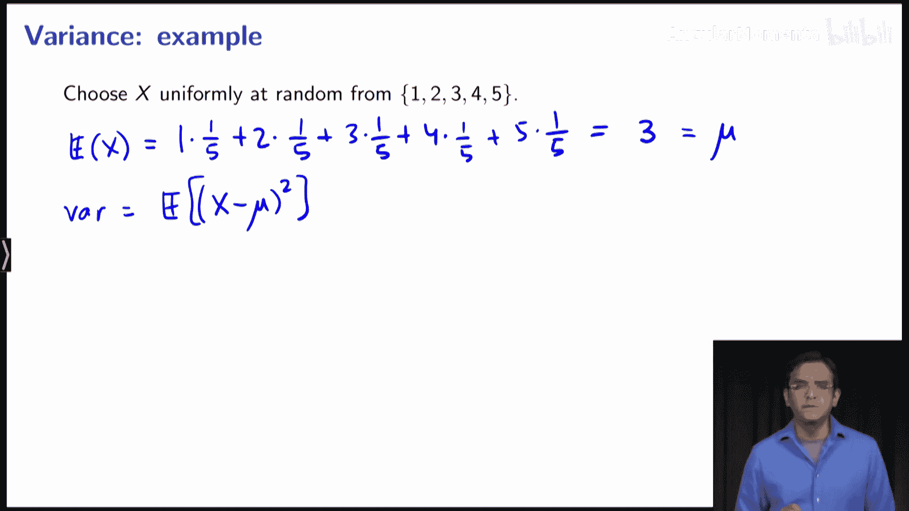

When x is1。X minus mu squared， so mu is equal to 3 is 2 squared。When x is 2。

 x minus me squared is1 squared。When x is 3， x minus mu squared is0 squared。4，1 squared， and5。

2 squared。And so the expected value。Of x minus mu squared。Well。

 x minus mu squared can take on just three possible values， 0104。

It takes on value 0 with probability 15。That's this line of the table。

It takes on value 1 with probability 25s， that's these two lines of the table。

And it takes on value 4 with probability 25s。

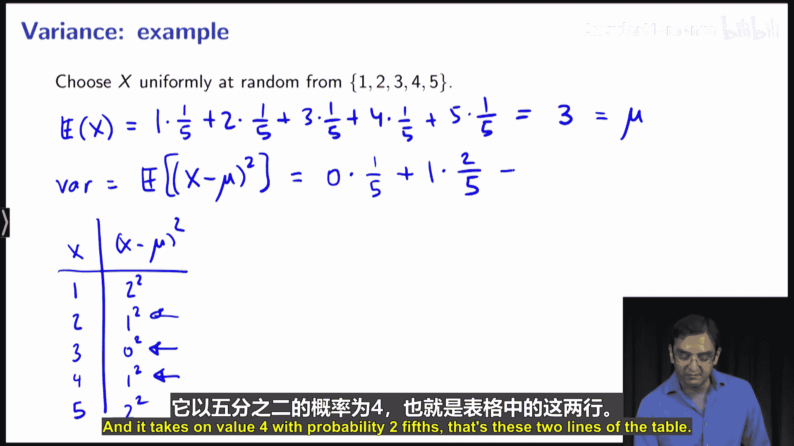

That's these two lines of the table。Okay。And so this works out to two。So the variance of x is2。

Which means。That the standard deviation of eggs。Is the square root of two。

The square root of the varianceance。Okay。

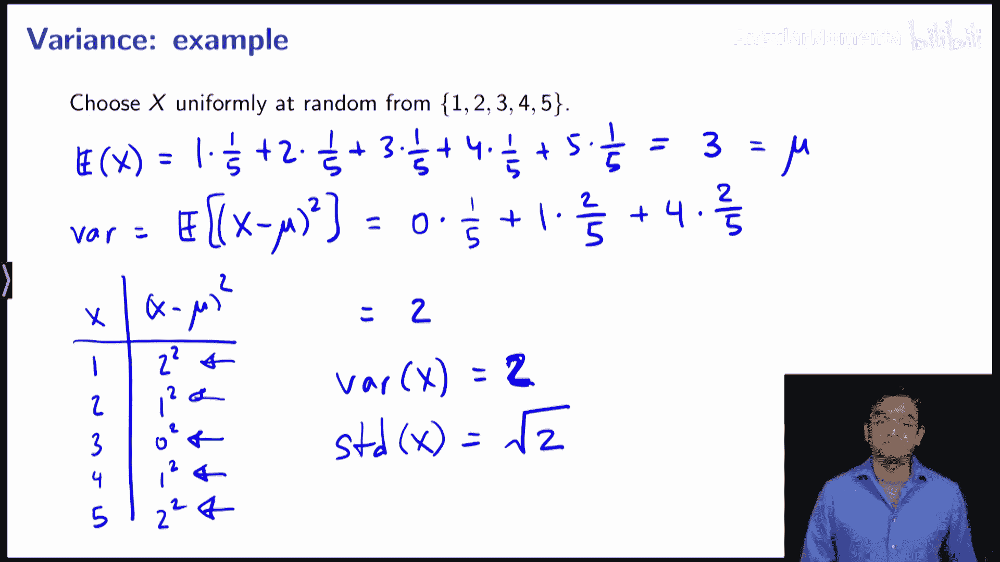

Okay， so let's look at some properties of the variance。 first of all。

 the variance is always a non negative number。Why， because it's the average square distance from the mean and the average of positive numbers has to be positive。

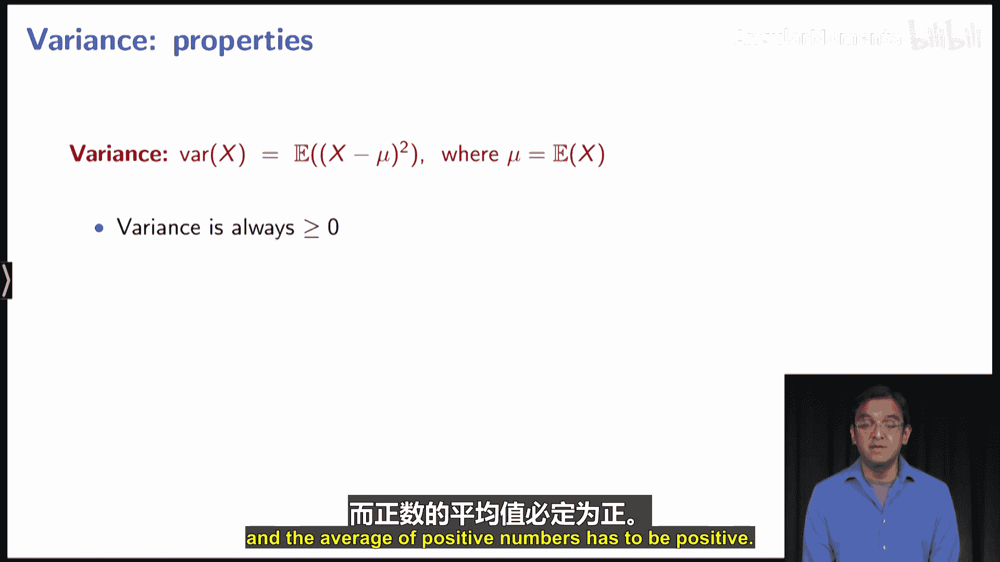

Then let's do the same thought experiment we did with averages。 Okay。

 suppose you have a bunch of numbers。And you increase each number by one。

 What happens to the variance， Well， if you increase each number by one。

Everything shifts over a little bit。But the spread remains the same。

 so the standard deviation remains the same， and the variance remains the same。

 so the variance is unaffected if you shift numbers by one。

What happens if you double each number Well if you double the numbers。

 then the spread also gets doubled。So the standard deviation is doubled。

 which means that the variance， which is the square of the standard deviation， gets multiplied by4。

So let's summarize this by a general formula。If you have a random variable x。

And then you define a new variable， which is something like 2 x plus1 or in general A x+ B。

Thenhan the variance of this new variable。Is a squared times the variance of x？

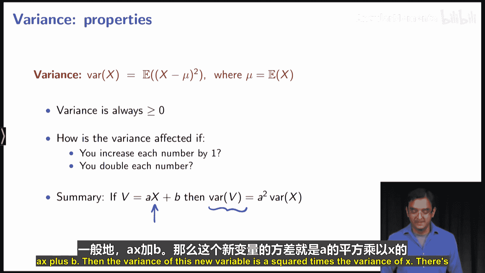

There's one last property of variance that will be very useful。

 and that is that there's another formula for it， there's a different way to calculate it。

It's this one over here。The variance of x， it turns out， is also the expected value of x squared。

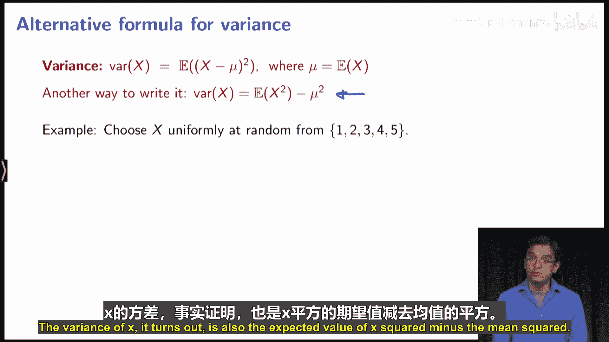

Minus the mean squared。嗯。always works out to the same number， and so let's see does it work Okay。

 so let's go back to our earlier example where we chose x uniformly from 1，2，3，4，5。

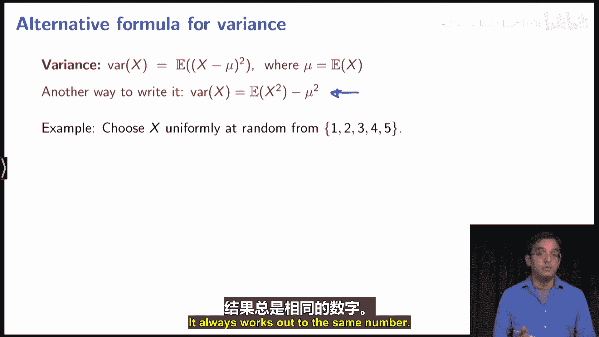

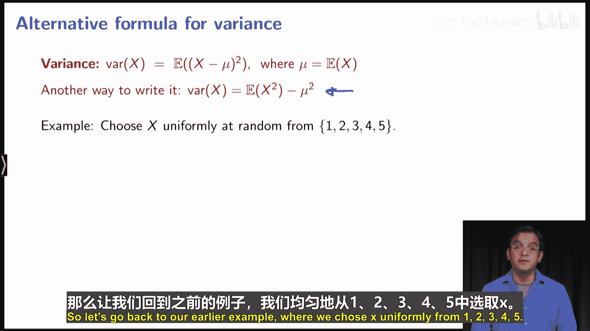

Now， in this case， we saw that the variance was 2 using the original formula。

 Let's try it again using the new formula Okay so what is the expected value of x squared。Well。

 x squared could be1 squared。With probability of fifth or two squared with probability of fifth。

Or three squared with probability of fifth。Or four squared with probability of fifth or five squared with probability of fifth。

 So what does this work out to， or 1 plus 4 plus 9 plus 16 plus 25 over 5。Which is。55 over 5。

 which is 11 and so the variance of x。Is the expected value of x squared？Minus mu squared。

 now mu is the mean we already know that's 3。So it's 11 minus9。Which is two exactly as we got before。

Okay， so we've seen some basic properties of random variables。

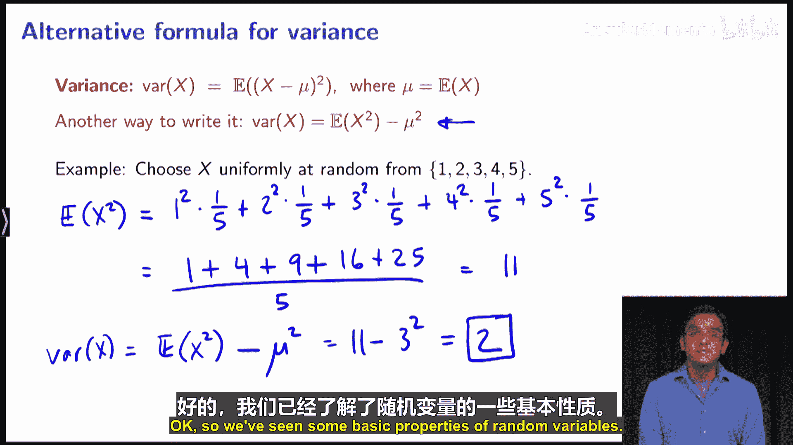

And next time， we'll get to the situation that we've gradually been building towards。

 a situation where we have multiple random variables， blood pressure， temperature。

 heart rate disease， and we're interested in how they interact with each other。

That's what we're going to be needing to build generative models in higher dimension。

