# 【加州大学圣地亚哥分校】机器学习基础  Machine Learning Fundamentals p12 03-06-02-二维生成式建模 -BV1TyFSziEZb_p12-

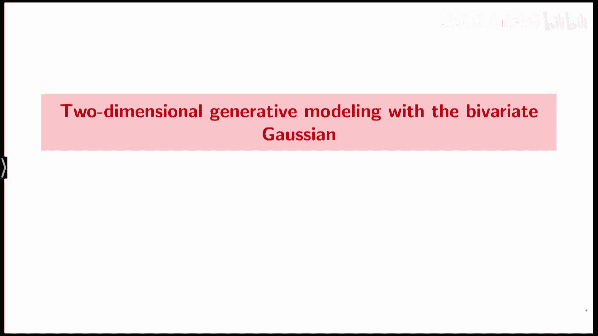

We now continue our development of the generative approach to classification。

So last time we looked at the one dimensional Gaussian distribution。

 and we saw how to build a classifier from it using the generative approach。

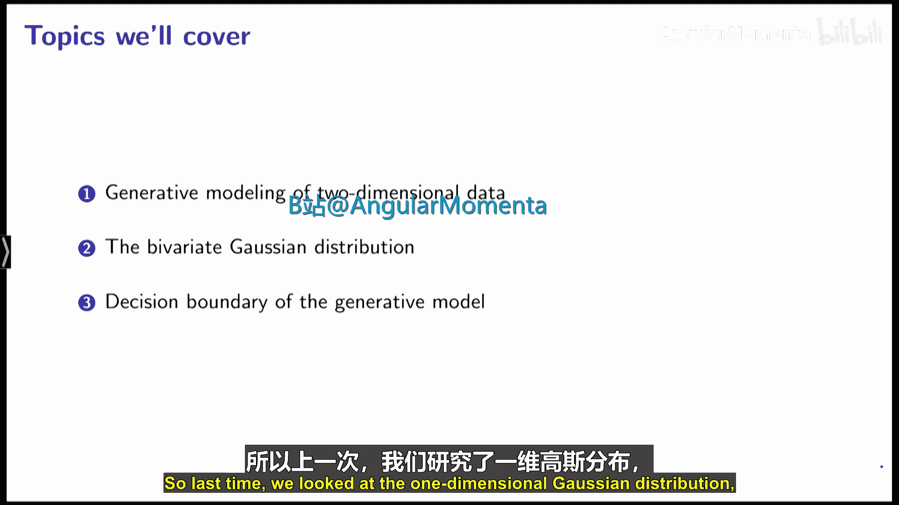

Today， we look at the Gaussian in two dimensions。One of the exciting things about this distribution is that it allows us to model the dependence between features。

So， for example， if we are trying to predict whether somebody is ill based on their cholesterol level and their blood pressure。

 we don't have to pretend that these two features， cholesterol level and blood pressure are independent。

We can actually model the dependence between them in order to get a more accurate prediction。

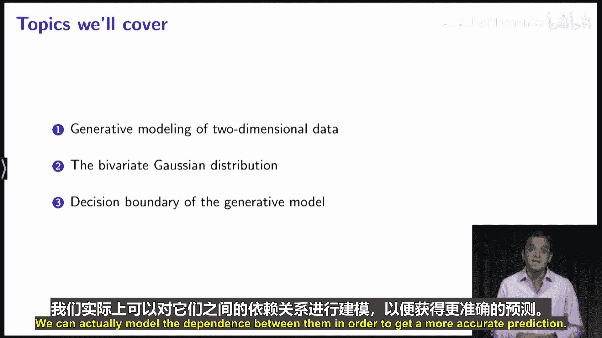

So a running example is the winery prediction problem。And if you recall。

 the situation here is that we have a bottle of wine， we have bottles of wine， and from each bottle。

 we measure 13 visual and chemical features。And we want to use these to predict which winery this bottle came from。

 winery， one， two or three。Last time we used just one out of the 13 features。

And we've found that using that one feature alone。We could get an error rate of about 29%。

Today we'll use two features。Do out of the 13， and we'll see that the error rate drops quite dramatically。

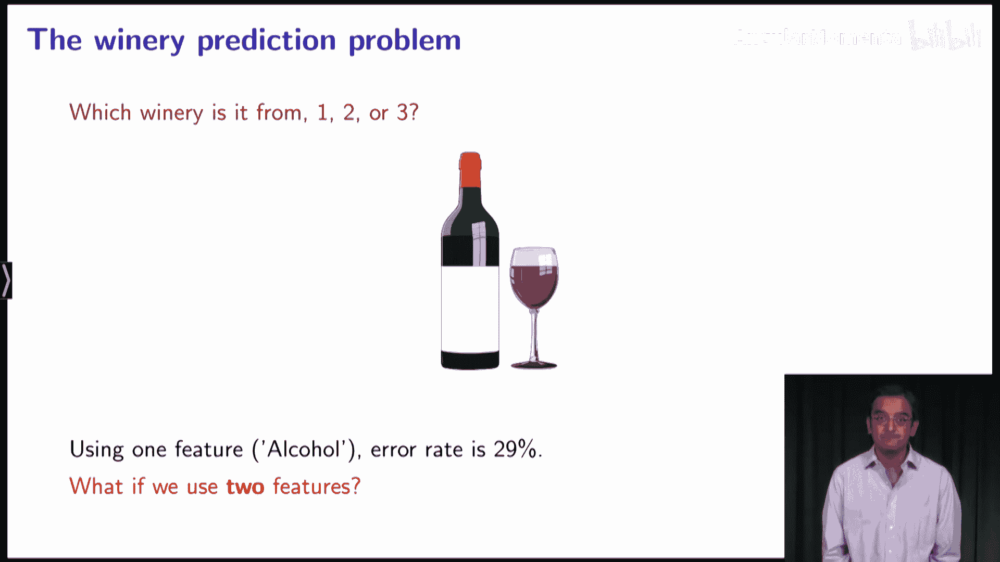

So just to a remind about this data set， we had a training set obtained from 130 bottles。

 so 130 data points。43 of them were from winery 1，51 from winery 2 and 36 from winery 3。

 And from each bottle， we extracted 13 features that make sense to wine experts。

 Those also a separate test set with 48 labeled points。Now， last time。

The feature that we used was alcohol。This time we'll use a second feature， flavonoids。

These are a family of chemical compounds that show up in wine。Okay。

 so these are the two features we're going to use。And let's just sort of think at a high level first about why it might be helpful to throw in a second feature。

So what happened last time is we just had this one feature， alcohol。

And we fit a Gaussian to the alcohol levels from winery 1。

 another Gaussian to the alcohol levels from winery 2。

 and a third one to the alcohol levels from winery 3。Looking at the three Gaussians。

 it turned out that they aren't really very well separated from each other， in fact。

 they're kind of on top of each other。And this is why this one feature alone turned out to not be a great basis for doing classification。

So let's see what happens when we throw in a second feature。

So what I've shown here is a scatter plot。嗯。嗯嗯。Each point here is one of the 130 training points。

 the red ones up on winery 1， the black ones are from winery2， the green ones up on winery3。

And for each of the training points， I've shown。Two of the features。

 alcohol level and flavoravingoids。 Okay， so each point has been plotted in two dimensions。

And you can see that。 there's。Actually， quite a bit of separation between them。

 So this makes us hopeful。 It gives us hope that these two features might be the basis for better classification。

 So what we're going to do is to follow the generative approach and to fit a distribution to the data from winery 1。

 a separate distribution to winery 2 and a separate distribution to winery 3。

And the distributions are going to turn out to be something like this。 Okay。

 this might seem mysterious。 What are these ellipses， So I will explain in a second。But roughly。

 this is the picture。 And it turns out that when you do this。

 the error rate drops quite substantially from 29% to just 8%。Okay。So all this is great。

 but what are these distributions and what are these phipses？So let's hone in on one of them。

 let's just look at the red one， which is from winery number one。

 let's just look at those specific points。

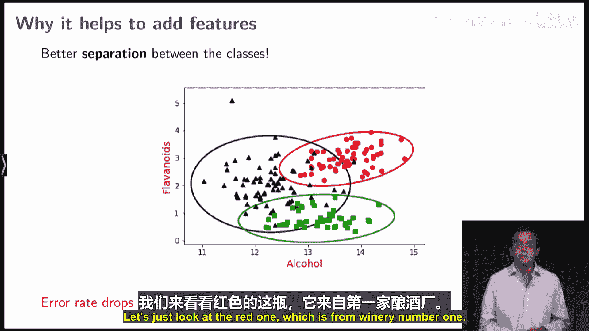

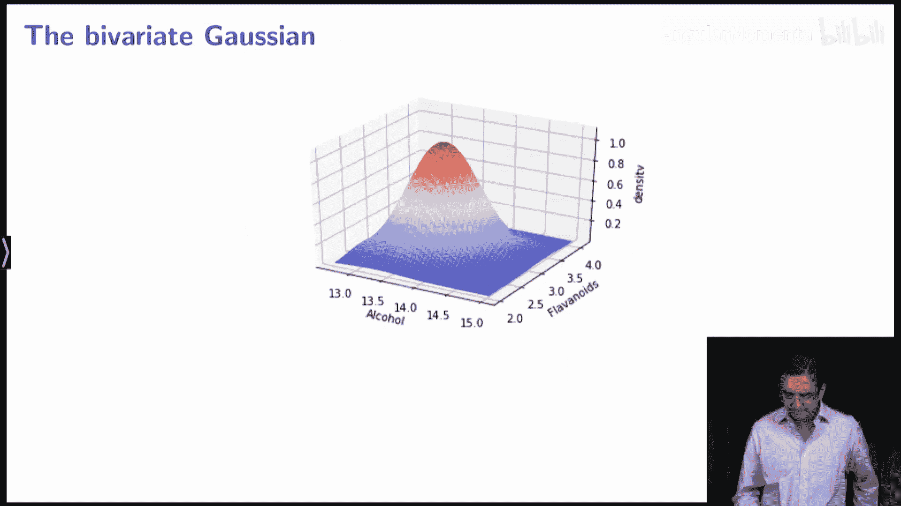

So when we fit a distribution to those， when we fit a Gaussian distribution to those 43 training points。

 this is the distribution we get Okay， so what is this thing well。

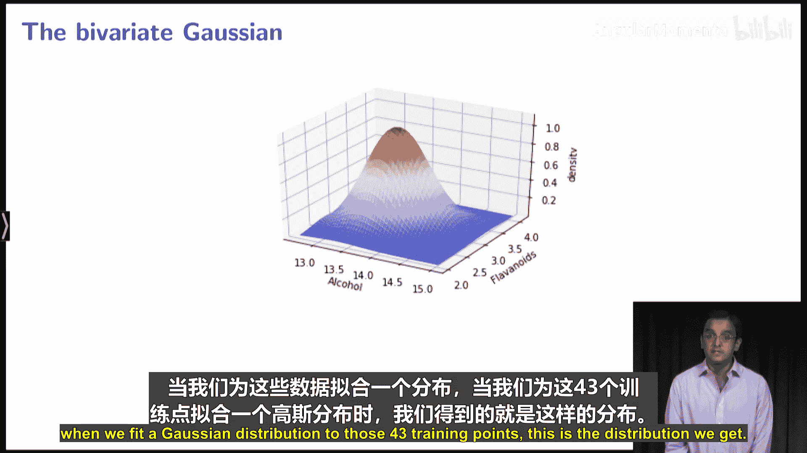

So it's a distribution over the 2D plane so it's a distribution that assigns a value to every possible alcohol level and every possible flonoid level so at the base over there you see the alcohol and flavoranoid values that's a 2D plane and the height is the density at that point。

Okay， so this is what a bivariate Gaussian distribution looks like。 Now， for me， personally。

 it's a little hard to interpret these 3D pictures， So I much prefer to draw it like this。 Okay。

 so what I've drawn drawn here in the red are the original training points， the 43 training points。

 the 432 dimensional points from wine we want。Using these points， we fit a Gaussian distribution。

And this distribution has two sets of parameters。 it has a mean。And it has a covariance matrix。

The mean is just a 2D point。 It is the center of the distribution。

It is the point of highest density so we're fitting a distribution and there's one point at which the density is highest。

 It's the center of the distribution， the mean。Now， as you move away from the mean。

 the density drops off。And it drops off with these eipoidal contours。

 So let's say the the density of the mean is 0。5。 you can ask。

Let's look at all points whose density is 0。4。 What are those points well。It might be this ellipse。

 for example。And then you can say， what are all points with density03？Well， it might be this ellipse。

 which is concentric with the first one and put are all points with density point 2。 Well。

 it might be this ellipse。So what I'm showing over here are just contour lines of this density。

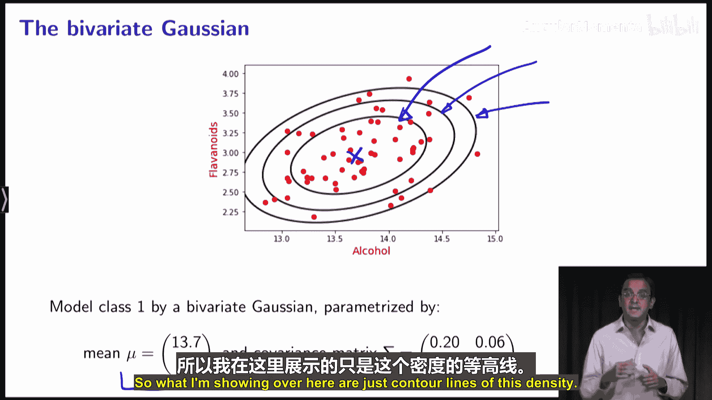

The point of the highest density is the mean， and then it falls off in these eoidal contours。

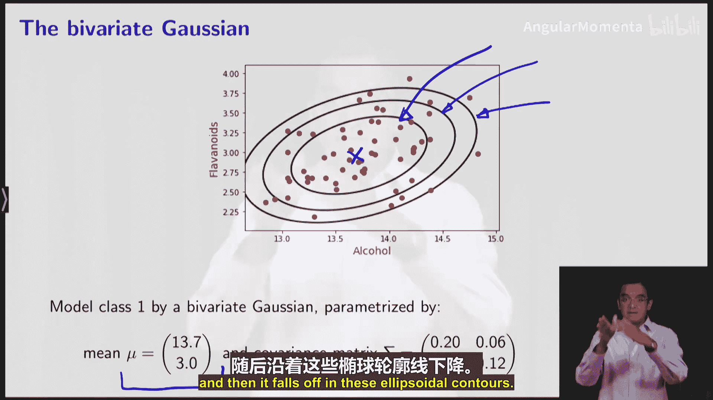

So let's look at these parameters again。😊，The mean makes a lot of sense。

 it's just the centerur of the density。What is this covariance matrix。

 so this is a two by two matrix。This number over here。Is the variance along the x1 direction？

It's just the variance of the alcohol values， so we have 43 numbers。

43 alcohol levels we compute their variance that's 0。2。

This number over here is the variance along the second direction。

It's just the variance of all the flavoroid numbers。The interesting thing is this number over here。

This is the covariance between the two features， between the alcohol level and the floid level。

So let's quickly recall what that is， what is the covariance between two random variables？

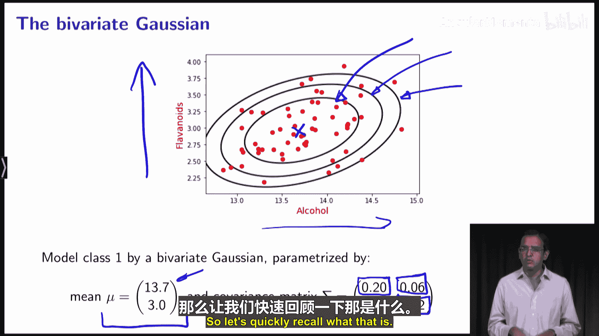

So let's say you have these two random variables， x1 and x2， alcohol and flavvooid， for example。

X1 has mean mu 1 average alcohol level。X2 his mean mutu average flavoravanoid level。

A standard measure of the dependence between x1 and x2 is the covariance。

It is the difference between the expected value of x1 times x2。And。

The expected value of x1 times the expected value of x2。When the covariance is positive。

 it means there's a positive correlation， when the covariance is negative。

 it means there's a negative correlation and if it's zero。

 it means the two variables are uncorrelated。So with this in mind。

 let's go and look at the Gaussian distribution a little bit more formally so the two dimensional Gaussian is a distribution over 2D space。

 it's a distribution over all of 2D space over all points x1 x2。

 so to every point it assigns some density。Now， the point of highest density is the mean。Mu 1 mu2。

 so that's a 2D point。Mu1 is the average value of the x ones， mu2 is the average value of the xtus。

That's the point of highest density。The other parameters to this distribution are variances and covariance parameters。

 It's a two by two matrix。That contains four numbers。

 but they're actually just three distinct numbers because it's a symmetric matrix in which the two of diagonal numbers are identical to each other。

Okay。So the number in the top left is the variance of x1。

The number in the bottom right is the variance of x2。And the number that captured its dependence。

 there's just one number there， that's sigma 12 or sigma 21， and that's the covariance of x1 and x2。

Okay， so these are the parameters of the 2D Gaussian distribution。

Now we already talked about the shape of this distribution。

The point of highest density is the mean mu。And then the density falls up with these illllipsoidal contours。

Something like this。Where the shape of these ellipsoids is given by the sigma matrix。

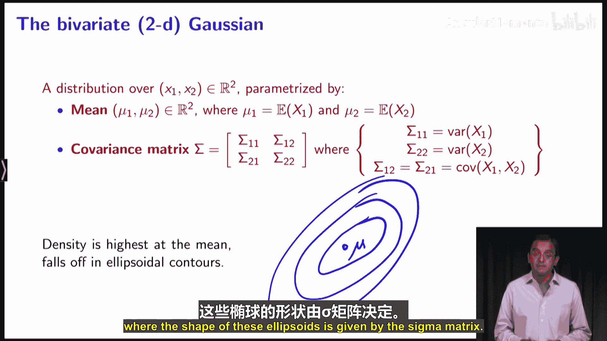

嗯。So now let's look at the precise form of the density。Okay。

 so we've already discussed the parameters。What is the formula of the density。

 What is the density at any given point x1 x2 Well， it has this formula over here。

 which admittedly looks a little bit messy and there might be some terms that are confusing so let's just go through them1 by1 okay so two I think we can all agree on what that is pi This is just the pi3。

14 It's that pi okay。What is this， so sigma is a2 by two matrix。What is。

What does it mean to put two bars around Sigma， Well， that actually is the determinant of the matrix。

It's a way to write the determinant of sigma。Some of you might be familiar with this， others not。

 in either case， don't worry about it， it's something that we'll be coming to again fairly soon。

The important thing to note about this leading term over here。Is that it does not depend on X at all。

It's just a normalizing constant。 It's just something that you have to stick in the front to make the density sum up to one。

The really important stuff is happening in here， inside the exponent。Okay， and by the way。

 in case you haven't seen this before， the notation X Z。Is just another way of writing E to the Z。

Okay。So the really important dependence arises from the exponent and let's look at those terms one by one。

 Okay， so in the middle we have sigma inverse。So sigma is a 2 by2 matrix。

 its inverse is also a 2 by 2 matrix。So this the two by two matrix。What's this thing over here？

X1 minus mu 1， x2 minus me 2。The center of the distribution is some point mu。

And we're trying to figure out the density at some other point x。Okay。Fm。

So it turns out that the density depends only on the displacement。Of x from mu。

It depends only on dis displacement。And that's what this vector is over here。

 It's a two by one vector。It's just x minus mu。It's the displacement of x from mu。

 mu is the center of the distribution， x at some point whose density we're trying to figure out。

Now this is also x minus mue， but we've taken its transpose， so it's not a row， so it's one by two。

Okay。And if this seems a little bit confusing， these matrix inverses and transpos and so on， again。

 you know， don't be concerned， we will be going over these very soon。But for the moment。

 we are multiplying together something that's one by two with something that's2 by2。

 with something that's 2 by1。 And so the answer is just one by one。 It's just a number， okay。Now。

The smallest that number can be is 0， and that's what happens when x is identically mut when you're just measuring the density at the center。

 and that's when the density is highest。As x moves away from mu。

 this number gets larger and larger and the density drops off。

So this is a little bit of insight into the density of the bivariate Gaussian。

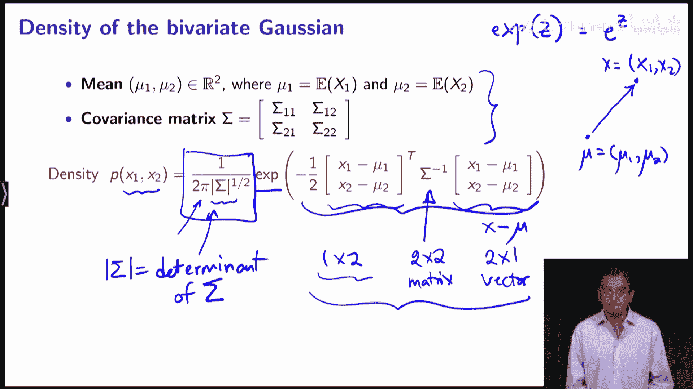

So let's look at a few examples just to solidify some of this。 Okay。

 so what I've done here is to draw pictures of two different Gaussians。With the same mean。

 So in both cases， the mean is the 0。11。But they have different covariance matrices and therefore different shapes。

So for each of them， I picked 50 points at random from the Gaussian and plotted them。

 and I've also drawn a representative contour line。

 Okay so let's look at the one on the left plus start Earth。So the mean is 11， so that's11。

And that is， of course， the point right in the middle over there。Okay。

 the center of the distribution， that's the mean， okay， so that all makes sense。

Now let's look at the numbers in the covariance matrix。Now。

 the number of the upperpolect is the variance of x1， which is4。

 So we know the standard deviation of x1 is the square root of the variance， so it's2。

And so the standard deviation of x2。Well the variance of x2 is 1， so the standard deviation is1。Okay。

And the covalance， the clean X1 and X2。Is 0。So what do these tell us so first of all。

 the standard deviation of x1 is twice that of x2， so the data is twice as spread in the x1 direction as it is in the x2 direction and we can see that directly from the plot。

The other thing is that the covariance is 0， so x1 and x2 are uncorrelated。 and again。

 we can see that because the Gaussian， the data is not tilting either upwards or downwards。

 it is axis aligned。Okay。So now let's move on to the second picture。

 So this is the Gaussian with exactly the same mean11。The standard deviation of x of x1 is again 2。

 the standard deviation of x2 is again 1。 so the stretch in the x1 direction is again twice the stretch in the x2 direction。

But now there's a covariance。 The covariance between x1 and x2 is 1。5。Which means。That there is。

A bit of a correlation between them。 Okay， so x1 and x2 are correlated with each other。

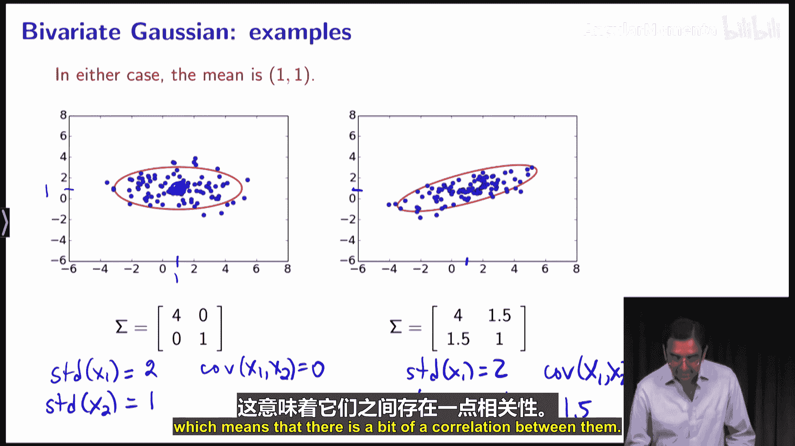

Okay， so now we can go back to our winery example。

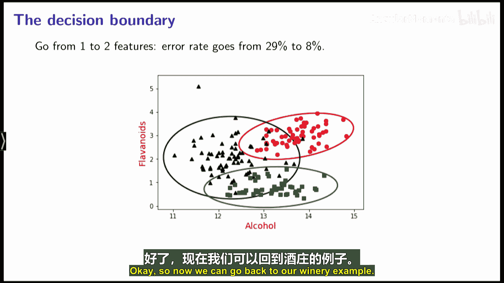

I think it's hopefully it's a little clearer now what these ellipses actually mean what we did is we fitted a Gaussian to winery number one。

 the red points， and we've just drawn a representative contour of the Gaussian obtained in this way。

And then we do the same for winery 2 and winery3。And now when a new point comes along。

 we simply predict using Bayes rule。 remember that we have class probabilities by one by two by3。

When we get a new point x， we simply pick the class J for which phij times Pj of x is maximized。

So what does that decision boundary look like？It turns out this is what it is。Any point in here？

Get predicted as being from winery number one。Any point in here gets predicted as being from winery number 3。

 the green 1。 and any point out here gets predicted as being from winery number 2。

It's rather a strange decision boundary， isn't it？What is the functional form of this boundary。And。

You know， now that we've reduced the error to 8% by using two features。

 can we do better by using more features， How do we do that。

 How do we take care of correlations between multiple variables。

So we'll see the answers to all these questions very soon。

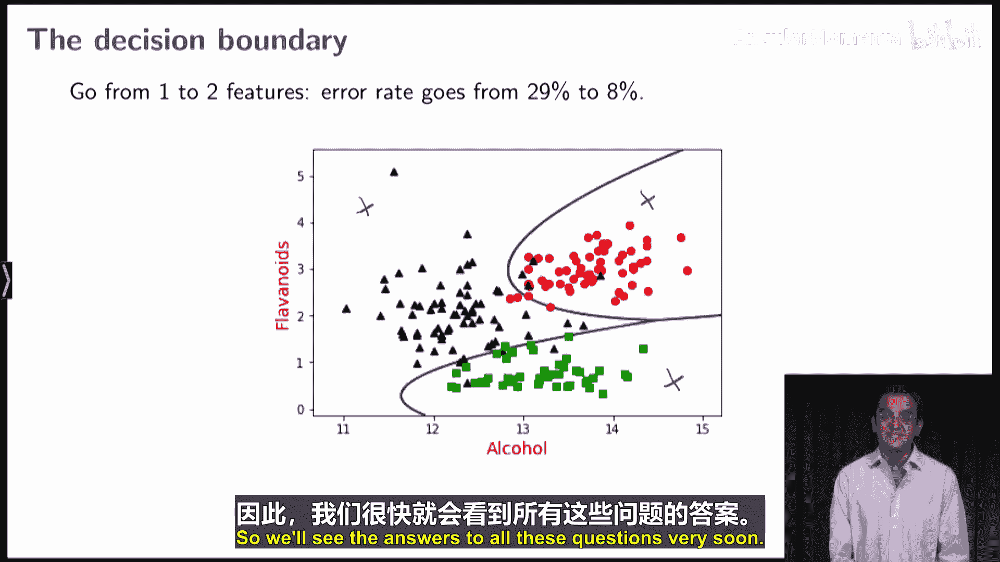

See you next time。