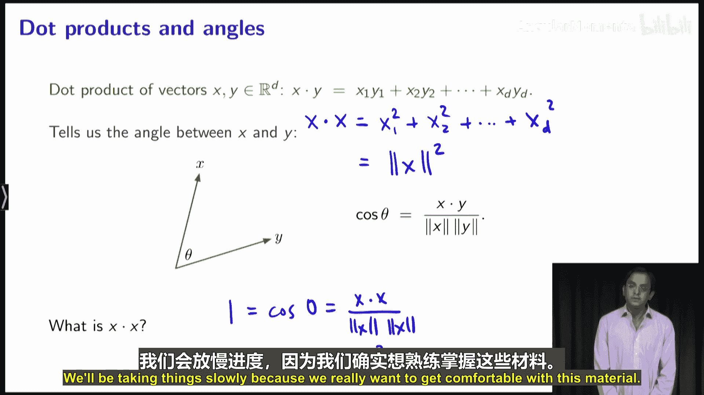

# 【加州大学圣地亚哥分校】机器学习基础  Machine Learning Fundamentals p13 04-01-02-线性代数I -BV1TyFSziEZb_p13-

Over the past few lectures， we've been seeing vectors and matrices more and more。

They've gradually been seeping in， and we're not going to be able to stave them off for very much longer。

Now I know that many of you have seen linear algebra before at some stage。But just to be sure。

 I want to do a pretty thorough review of the concepts and skills that we're going to be needing for this class。

Vinear algebra is really the most fundamental kind of math for machine learning。

 And so it's something to understand very well。What we'll talk about today is the basics of representing data using vectors and matrices and some basic notation and dot products。

So here's a data set consisting of four points。We can represent each of these points as vectors。

 so for example， this point over here。Is the factor 5，2。So we can write it like this。

And this one up here is 3，5。And the one near it。Is2，4？Two along the x1 axis，4 along the x2 axis。

 and this one is 11。We can also represent the entire data set in a single matrix， so for example。

 we could we could have a matrix in which each data point is a row。So something like thiss。Oh。1 one。

2，4。😔，3，5， and 5，2。Okay。This could be our data matrix。

 and it's a matrix with four rows in two columns， so it's a four by two matrix。Alternatively。

 we could put the data points as columns so we could have something like 1，1，2，4，3，5， and5，2。

This has two rows and four columns， so it's a 2 by four matrix。Either one is fine。

 in this course we'll mostly be adopting the convention of doing it the first way。Okay。

 so putting the data points as rows。So let's go over some of the indexing notation when we have a vector in D dimensional space。

 so vector x and RD。We'll write it as a column and we'll index its entries as x1 through xd。

When we have a matrix that's R by D， that means that it's a matrix with R rows。So R of these。

And D columns。So， D of these。So it's got a total of r times d entries。

And the entry that's at row number I and column number J will be denoted MIJ。Okay。

And we'll write this。As an will' say that this its dimension is R by D。 It's an R by D matrix。

So likewise， we can describe the factor as being D by one。D rows in one column。Okay。

Now one of the simplest things that one can do with a vector matrix is simply to take the transpose。

 which means to switch the rows and columns。Okay， so for example。

 if we look at this vector over here， which is a single column。

 we take its transposed by just writing it as a row。Okay， so the transpose is 1，6，3，0。

 so we started with something that was4 by one。And we ended up with something x transpose。

 that's one by four。Likewise， we have a matrix over here， it has three rows and four columns。

 so it's a  three by4 matrix。And to take its transpose。

 what we can do is we can just look at the first row of the matrix and write it down as a column。

 so 1204。And then the second row and write that down is the second column。

And the third row and write that down as the third column。And so it's a four by tweet matrix。

So formally， the transpose a transpose。Is given by the following equation。

 The I J entry of a transpose is simply the J I entry of the original matrix。

 rows and columns are switched。And one thing that's not hard to see is that if you take the transpose and then you take the transpose again。

 then you end up with the original matrix。Now， how do you add or subtract vectors and matrices？

This is very simple。 You just do it element wise。 Okay， so if you have two vectors like 1，2，3。And 4。

 five，6。The way you add them is just to add them up one in one element at a time。 So1 plus 4 is 5。

2 plus 5 is 7。3 plus 6 is 9。 Okay， and it's similar with matrices。 Let's say we have two matrices，2。

1，0，2。And another one， one，2，3，4。We just add them up entry Y， so 2 plus 1 is 3，1 plus2 is 3。

0 plus 3 is 3。And 2 plus 6，2 plus 4 is 6。Okay， so adding and subtracting is easy。

What's much more interesting is multiplying。And all we'll talk about today is the most basic kind of product。

The dot product between two vectors。Okay， the simplest sort of product。

So let's say we have two vectors， x and y in D dimensions， Okay， so the each of d coordinates。

 what is the dot product between them Okay， so we'll don't denote it as x dot y。

And to get the dot product， you just multiply the corresponding entries。 So the first two numbers。

 x1 and y1， the second two numbers x 2 and y 2 and so on all the way to x D times y D。

 and you add all of these up。Okay so that's the dot product， and let's see an example。

So here we have two vectors in the two dimensional plane。 Okay， so what are they。

 X is3 to the right and4 up。 So it's 3，4。And y is -4。To the right and three up。 So it's minus-4，3。

Okay。So this is x。And this is why。Okay。And what is their dot product， So what is 3。

4 dot product with minus-43？Okay， so first we multiply the first entries， so three times negative4。

And then we multiply the second entries。Four times 3。So we get negative 12 plus 12， which is zero。

So the dot product of these two vectors is zero。Now， interestingly， looking at these two vectors。

 we see that they also seem to be at right angles to each other。So this looks like it's 90 degrees。

Is there some relation between them being at right angles and the dot product being zero？Well。

 there definitely is。It turns out that the dot product between two vectors tells you the angle between them。

Okay， so here's the formula。So take any two vectors， x and y， so we have x and y。

And the angle between them is some number theta。It turns out that the cosine of theta。

Is exactly the dot product of x and y divided by the length of x and the length of y。So for instance。

 if the dot product is zero， if we have x dot y equal zero。Like we had before。

That means that the cosine of theta is 0。And what angle has a cosine of0， 90 degrees？Okay。

We will call two vectors orthogonal if they are at right angles to each other。

 and this is going to turn out to be a very important concept for us。

 we're going to be using orthogonal vectors a lot。The nice thing is that we now have a simple test for orthogonality。

To see if two things are at right angles， just take that dot product。And check if it's equal to0。

Another way in which we'll be using vectors is to simply indicate directions。

So we might be interested in this direction or that direction。If we are merely indicating directions。

 the length of the vector doesn't really matter， so it doesn't matter if we used this direction or this vector or this vector。

They all point in the same direction。And so a common convention。

 when one is only interested in the direction is to normalize vectors to length1。

 and that's what we call unit vectors。So sometimes we'll be working with you in vectors quite often。

 actually。And when x and y are unit vectors， this formula for the angle becomes especially simple because the denominator is just one。

 And so we get that the cosine of the angle is simply x dot y。Okay。

So one last thing that I want to look at in terms of dot products and angles。

Is the following question。What is X dot product it with itself？

What is the dot product of a D dimensionsal vector x with itself？So let's do this two different ways。

So we can we can do it by just plugging into the formula above。 Let's try that。 Okay， so x dot x。

Is x1， x1， so x1 is squared。Plus x2 x2， x2 is squared。All the way to Xd squared。Oh。

 so this is just the length of x squared。It's the squared Euclidean length of x， that's x dot x。

We can also do it using the angle formula。So what is the angle between x and itself， it's zero？

And what is the cosine of 0， the cosine of 0 is1。 So we have one equal to cosine of 0。

Which is equal to x dot x over the length of x。Times the length of x。

And so this tells us that x dot x。It's just the length of x squared。

 which is the same answer that we got before。Okay， well。

 that's it for this first portion of our linear algebra review。

We'll be taking things slowly because we really want to get comfortable with this material。

