# 【加州大学圣地亚哥分校】机器学习基础  Machine Learning Fundamentals p14 04-02-02-线性代数_II -BV1TyFSziEZb_p14-

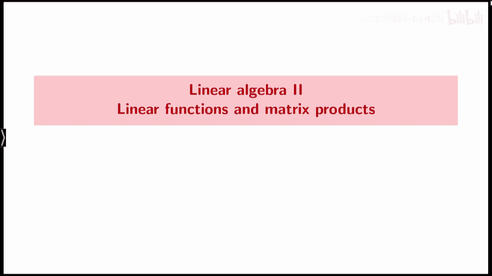

We now continue our review of linear algebra。Last time we looked at the dot product between two vectors。

 what we'll do today is to build upon this to get products between vectors and matrices and matrices and matrices。

This is crucial to modeling linear functions， which are among the most common functions that we'll be using in this class。

So what are linear functions and while we're at it， what are quadratic functions？Well。

 in one dimension， a linear function。Of one variable x。I's something like 3 x+2。

And a quadratic function is similar except that it's also allowed to have a squared term。

 so it can be something like 4x squared minus 2x plus 6。But what about in higher dimension？

Let's say we are in three dimensions， for instance。In this case。

 a linear function is a sum of a bunch of terms。And each term is either a constant， like four。

Or iss just a multiple of one of the variables， so we end up with something like 3x1 minus 2 x2 plus x3 plus 4。

A quadratic function is also just a sum of terms。And each term is either a constant or a linear term。

Or it could be the square of one of the variables like x1 squared or 6x2 squared。

Or it could use the pairwise product of two of the variables like this term over here， minus2 x1 x3。

So this is what linear and quadratic functions are for higher dimensional data。

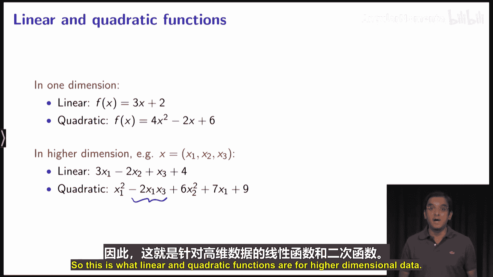

Now we'll be making very heavy use of linear functions。For instance。

 a lot of the methods we study support vector machines， logistic regressions， and so on。

Are based on linear decision boundaries okay what exactly are these Well suppose we have data in two dimensional space。

 then a linear decision boundaries just align something like the line shown over here。

And what we would do with this decision boundary is one side of the boundary would be classified as plus。

 and the other side would be classified as minus。Now what is the equation of a linear boundary like this Well this is in 2D。

 so it's just a line and this particular line has the following equation。😊，4 x1 plus 3 x2 equals 12。

Let's check this Okay， so this is the x1 direction here， this is the x2 direction。

Let's check this particular point， so this is the 0。30， does it lie on this line？

Well 4 times x1 plus 3 times x2 equals 12， yes， it lies on the line。 Now let's check this point。Zero。

4。Does it satisfy the equation Yes， it satisfies the equation as well， So this is indeed the line。

The red line shone in the figure。So this is in two dimensions， what happens in D dimensional space。

 what does a linear boundary look like there？😊，And it's a direct generalization of the previous form okay so when we're in D dimensional space。

 then x is a vector with d components x1 through xv。And a linear boundary。

 a linear separator is something of the form some constant W1 times x1 plus some constant W2 times x2。

 plus all the way to some constant WD times xt equals some other constancy。

This is the form of a linear separator indeed in en space。Now。

 if you look at the left hand side of that equation， it looks a lot like a dot product。Okay。

And in fact， it can just be written as w dotx equals c。

Where W is the D dimensional factor of coefficients， w1 through WD。

So dot products allow us to express linear boundaries。

Let's see another example of this and then generalize a little bit Okay。

 so on top over here we have a function that takes a four dimensional vector x1 through x4。

And returns a linear function。Of these four features。 Okay， so let's see what we have here。We have。

F of x1， x 2， x3， x4。Is let's go ahead and write it as a dot product。 Okay。

 so the coefficient for x1 is 3。The coefficient for x2， there is no x2， so let's make that as 0。

 the coefficient for x3 is negative 2。And the coefficient for x4 is 0， so it's this dot x1， x2， x3。

 x4。This is how we write down this linear function using a dot product。

Now let's look at this second example over here， which is a little bit of a generalization。

 so now again we take a four dimensional factor。But this time。

 instead of spitting out just one number， we are spitting out three separate numbers。

The output is a three dimensional vector。And each of the dimensions is just a linear function of x。

Okay， so let's see how we would write that。

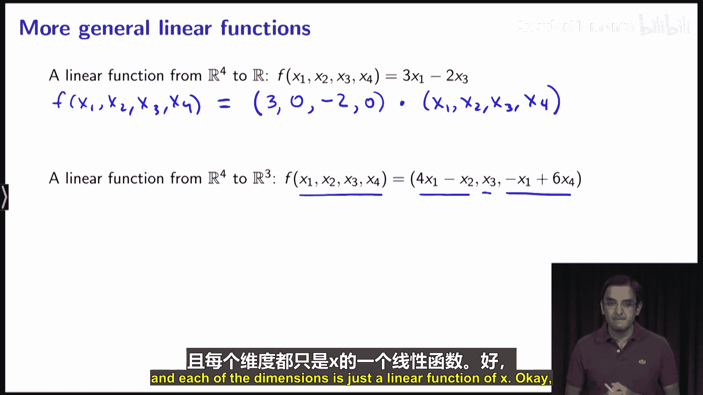

So we take， this is a function that maps。X1， x2， x3， x4。2。嗯。Four。

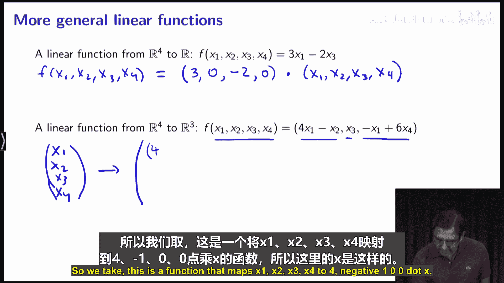

Negative 1，00 dot x。So this is x over here。The second coordinate is just x3， so that's 0010 dot x。

And the third coordinate is -1。0，0，6， dots。This is the function that we' are talking about Okay。

 so we can write this in a more convenient form using matrices。So our first row is 4 negative 1，0，0。

 the second row is 00，10， the third row is minus10，06。Times x， which is x1， x2。X 3， x 4。

We have expressed it as a matrix times a vector。嗯。

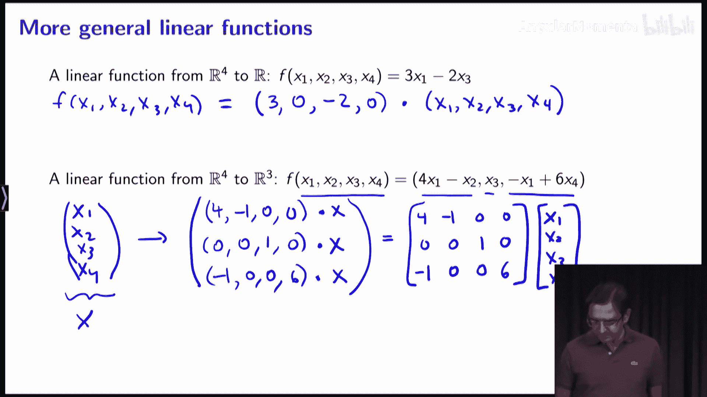

So let's just go ahead and talk in a little bit more in slightly more abstract way about this matrix vector product。

 how exactly does one multiply a matrix by a vector？OkaySo let's say we have a matrix that's R by D。

 that means that it has R rows and D columns。This we have this matrix N。 it has R rows。

 let's call an M1。M2。Alll the way to end thebar。So we have R rows。

And each row is a D dimensional vector， so each row has length D。We want to multiply by a vector。

The answer in this case。Is simply the first row dot product with the vector？

The second row dot product with the vector all the way to the R row dot product with the vector。

So we start with a matrix that's R by D。We multiplied by a vector， which is D by1。 It has D entries。

 and the result is R by one。That's the matrix vector product。It's just a series of dot products。Now。

 a matrix vector product captures a linear function as we've seen。

 and the simplest possible linear function is just sending x to itself， the identity function。

What matrix realizes that function？That's the identity matrix， it's a square matrix。

 but if vector x is d dimensional， it's a d by D matrix and it has ones along the diagonal and0 everywhere else Okay so if you take the identity matrix and you multiply it by any vector x you get back the same vector。

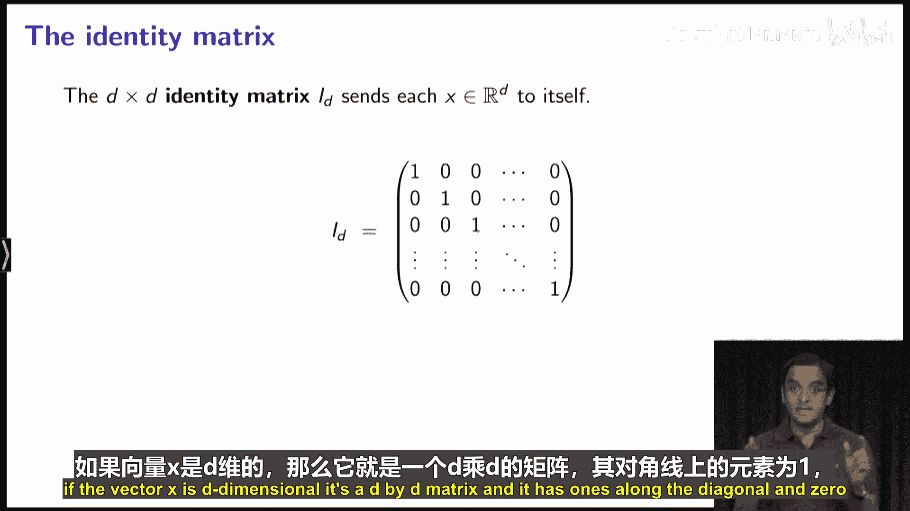

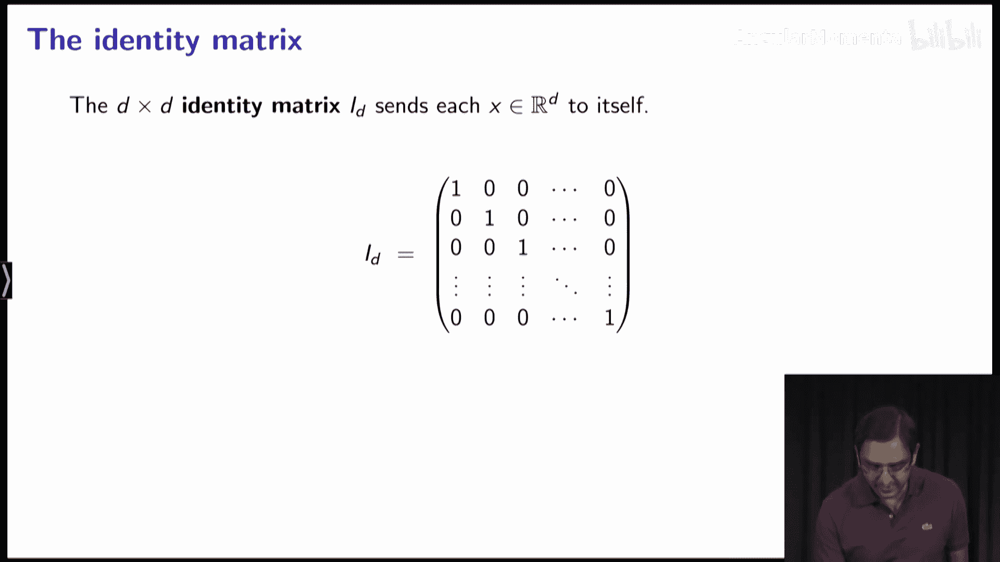

Very simple linear transformation。Now we will sometimes be using identity matrices in several different dimensions。

And so in those cases， we'll often use this subscript to denote what specific size identity matrix we're referring to。

Okay， so I subD means a D by D identity matrix。Now let's move on to matrix matrix products。

 so multiply one matrix by another matrix， how do you do that it's a very simple rule and again it's built out of dot products。

Okay， so we start with a matrix A。And in this case， we have one that is R by k。

 so that means it has R rows and K columns， so let's number the rows A1 through AR。R by K。

Then we have a matrix B。Which is K by P。 That means that it has P columns。

 Let's go ahead and number the columns。Let's called them B superscript 1 all the way to B superscript B。

So this is a K by P matrix。The result of these two is going to be an R by P matrix。So the result。

 which is a times B。Is going to be an R by P matrix。Okay， and the IJ entry of that matrix。

See if you look at the entry in row number I and column number J。That entry over there。

Is A sub I dot product。With B sub J。The IJ entry of A B is simply the dot product of the I row of A with the Jith column of B。

Okay so in order to compute the product， we simply take a bunch of dot products of every row of a with every column of B。

Now what this means is that if you want to multiply two matrices。

 the inner dimensions of the two matrices have to agree， we need a k in both these positions。

And the product， the product matrix， the size of that matrix is given by the outer dimensions。

So we take R by K and K by P and we get something that's R by P。

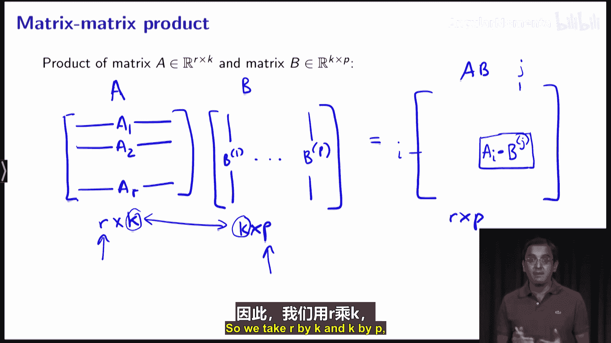

Let's do a little example of this。 Okay， so let's take。

Any matrix a may be 1， two， three，4， five，6。Let's multiply by some matrix B have about 1，0 minus1。0。

2，1。Okay。So what are the dimensions here， well this is two by three。This is3 by two。And indeed。

 the inner dimensions agree as they must。What is the product。

 what's going to be the size of the product， but it's just given by the outer dimensions it's going to be two by two。

 so let's make space for that。The answer is going to be some two by two matrix。

 so we have four numbers to fill in。What are those four numbers， where we take the first row of A？

Which is this rope。And we take the dot product with the first column of B。So let's see what that is。

 it's1 minus3， so it's negative2。What number goes in the second position。

 we take the first row of a dot product with the second column of B， so we get 0，4，3， we get7。

Two more numbers to fill in， we now move on to the second row of A。

 we take the dot product with the first column of B， so that's 4 minus6， which is negative2。

And the final number is。Four times 0 plus5 times 2 plus 6 times 1， which is 16。

So that's the product of these two matrices。

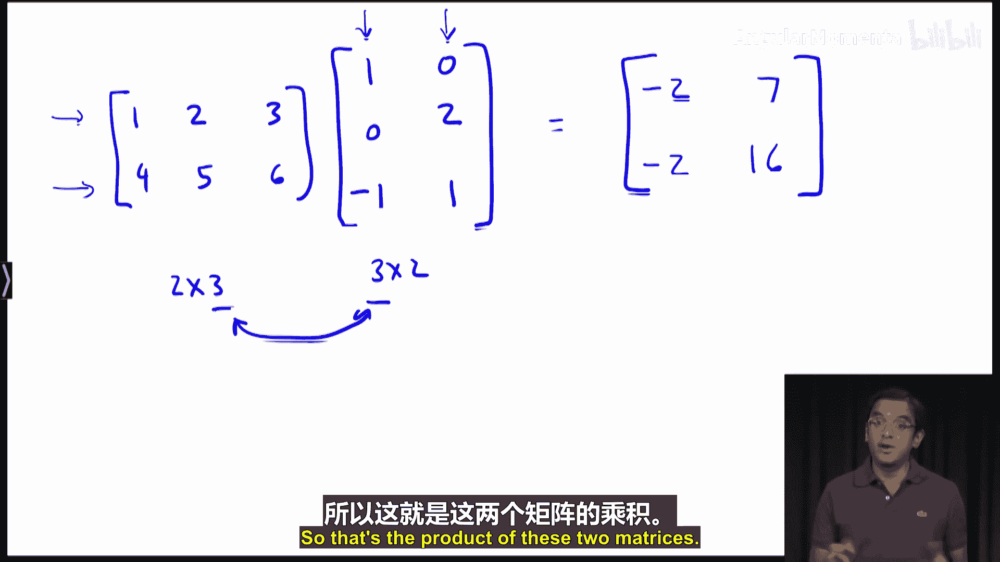

Very simple。So here's the formula again， the formal expression for the product of two matrices。

 the IJ entry of the product is just the dot product between the I row A and the J column of B。

Now there are some important properties of these products。

The first is that when you multiply something by the identity matrix， it does not change。

 that's to be expected。The second is a rather interesting one。 So it says that。

If you take the transpose of a product， it's like。Taking the product of the transposes。

 but with the flipped order now this is something that you can check by just plugging in the definition of the product by just plugging in the summation you see over here and just checking that the left and right hand sides really work out correctly。

But why don't we at least as a basic sanity check， just at least check that the dimensions of the two sides are the same？

Okay， so what is the dimension of A B transpose？Well we've already seen that in this case。

 if A is R by k and b is k by B， then AB is R by B。

 so A B transpose is switching the rows and column so the dimension of it is going to be P by R。Okay。

Now let's look at B transpose a transpose。B transpose has dimension。

B by K a transpose has dimension K by R。So good， you can actually multiply them since these inner dimensions agree。

 and the result will have dimension P by R。So at least it's the right size。

 and it turns out that these two matrices will also be identical。Now for this last one。

What we're being asked is that we have these two vectors U and V， so we have U。

A D dimensional vector。 And we have V， a D dimensional vector。

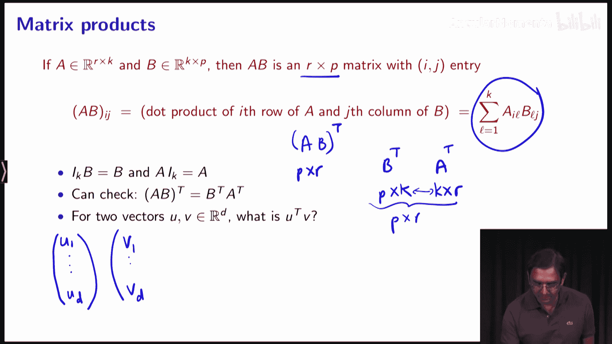

What is u transpose B Okay， so let's compute the transpose of U so we just take that column vector and make it into a row。

So you transpose feed。Is equal to。You want to Ud。Multiplily by V1 to Vdi。Okay。

 so we take each row of the first matrix and multiply it by each column of the second matrix， oh。

 it's just the dot product of UB。

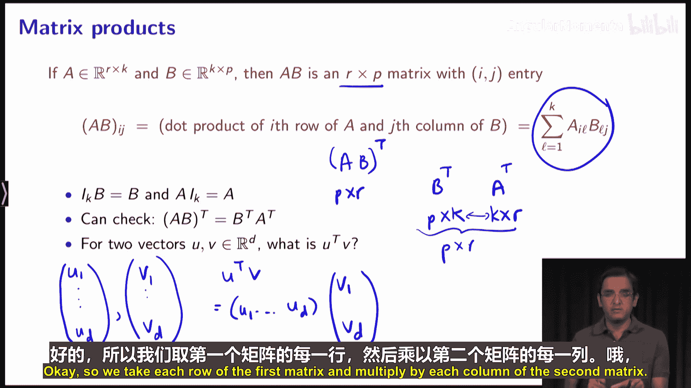

So this is interesting。 We have two ways of writing exactly the same thing。

 the dot product of two vectors。U dot V is exactly the same as U transpose V。

so this is a useful fact to remember。It's something that we'll be using to simplify a bunch of calculations later on Okay。

 so U transpose V is just the dot product between U and V。

Let's look at a couple of examples so now let's say we have a D dimensional vector x。

 so x has got D numbers。What is x transpose x？What we just saw this is the dot product of X with itself。

And what's that， that's just the squared length of x。So x transpose x is just a number。

 it's the squared length of x。What about Xx transpose？So X X transpo。 So let's see X is this。Factor。

So x is d by1。X transpose。Looks like this， it's 1 by D。So the product is D by D， it's a big matrix。

Okay， that's a little strange。What is the IJ entry of this matrix， it is X I X J。

So it's the D by D matrix of all pairwise products of features of x。

So these are also two very useful things to bear in mind。X transpose x versus X X transpose。

 Now they look almost the same， but as you can see， theyre completely different。

 One of them is just a simple number。The length of the vector squared and the other is a full D by D matrix。

So。One of the things this really goes to show is that you cannot change the order in which things are multiplied。

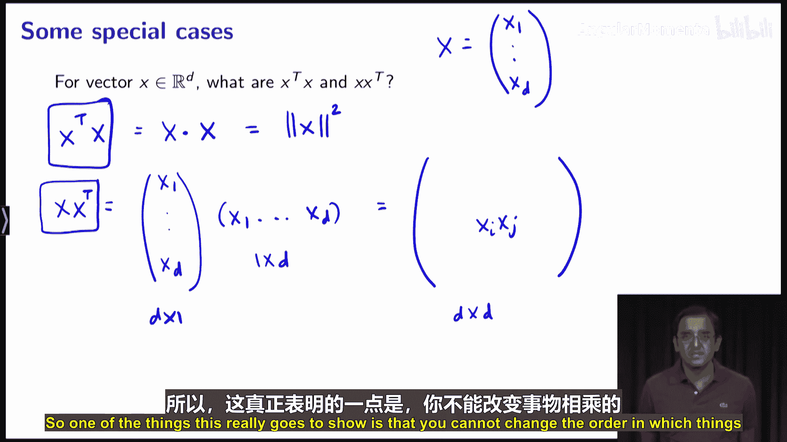

Okay， and so this is a very general and important property of matrices in general matrix multiplication is not commutative AB is not the same as B okay unless you get lucky okay。

So let's look at these examples， for instance， so here we have two matrices， A and B。

And let's multiply them one way and multiply them the other way and see if we get the same answer。

 Okay， they're both square matrices。 So we know the they're both two by 2。

 and so we know the result will be 2 by 2。 Let's see what we get in this case。 So we get1 plus 2。

 That's 3。Z and0 is0。0 and one is 1，0 and0 is0。 Okay， so that's the first product。

The second product is one。2。1。2。They are completely different， they aren't even close。

Okay so this is something to be a little bit careful about。

 you cannot switch the order in matrix multiplication。😊，One thing you can do， however。

 and something that's very convenient is that when youre multiplying together a bunch of matrices。

You can decide which pair of multiplications you're going to do first as long as you keep them in the original order。

 for example， you can decide okay， you have to multiply together ABCD。

 why not do AB first and then do CD and then multiply them together that's allowed。

Or you can do BC first。And then multiply the answer by a and multiply that answer by D。And so on。

 Okay， so you can parentheize。The expression in whatever way you like。

 as long as you maintain the order of the matrices。Let's look at a little example of this。So here。

 let's say we have a vector x whose length is2， what is this huge expression over here？Okay。

 so clearly there are a lot of things to be multiplied together。But parts that it look familiar。

 we've seen these sort of things before x transpose x， x x transpose， what are they， okay。

 x transpose x？That's a D by D matrix， okay？Xx transposees the D by D matrix。

 x transpose x is just a number。Which should we prefer the number that seems a lot simpler。

 so let's do those first。Okay， so we'll take x transpose x。

 we know that's just the length of x squared。Oh， here's another x transpose X。

 that's also the length of x squared， and here's another one and another one。

And so what we end up with is the length of x to the power 16。And we told the length of axis 2。

 So this is 2 to the 16th。Okay。So the Associative rule can be very helpful in simplifying matrix products here we simply choose the products that turn out to be very simple and do those first。

😊，So that's it for our second installment of linear algebra。

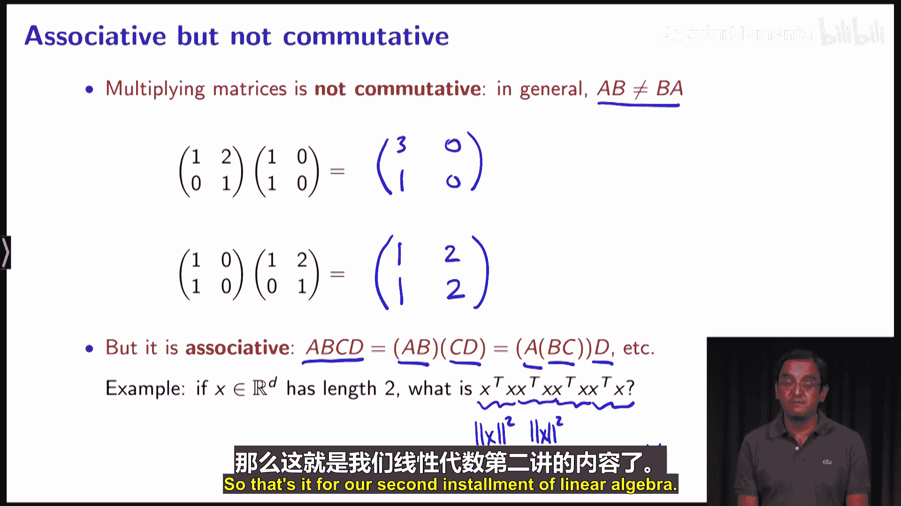

We now have all the notation and tools we need to be able to model linear functions。

 which is something we're going to be using very heavily in this course。😔。

